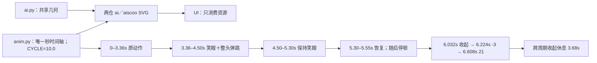

# Aiscoo Logo · 最终版

打开 `preview.html` 可以一次看完所有效果，包括动效。这个文件已经内嵌了全部图片，单独发给别人也能正常打开。

## 设计说明

- 开头的 "a" 是一个躲在 "i" 后面的 AI，"i" 的竖笔就当作墙。
- 半圆形的头、"i" 的竖笔、后面的 s、c、o 三者顶部在同一条线上。
- 字母间距为 12（以字母高度 100 为单位）。
- 动效 10 秒一轮：AI 从 i 后面探出、轻微左右观察并短眨眼、看 i 上跳动的圆点、笑眼并整头弹跳、恢复常态后缩回，跨周期收起休息 3.68 秒。0–3.36 秒的探出、转眼／转头、眨眼和 i 圆点时刻保持不变；收起整体后移 2 秒，沿用原轨迹和缓动，其余字母保持不变。
- 常态眼睛仍是细长竖胶囊：头部直径 61，眼宽 7.4、高 17.2、中心距 18；浅色黑头白眼，深色反相。视线先动、头部随后轻偏至约 3.5°；一次短眨眼约 216ms，闭合仍是圆润短线。笑眼改为闭合填充的厚圆拱，宽约 13.4（中性眼宽的 1.81 倍），两端圆润、内侧凹；先缩短中性眼再切换，禁止交叉淡化造成重影。
- 时间轴：0–0.96 秒沿用探出；0.96–2.30 秒观察／眨眼；2.30–3.36 秒看圆点后回正；3.36–4.50 秒切换笑眼，整头与眼睛一起蓄力纵向压缩 6%、上跳 8.2 头部单位（直径 61 的 13.4%）、落地压缩 5%、小回弹 2.1 头部单位，静止时恢复圆形；4.50–5.30 秒保持笑眼；5.30–5.55 秒恢复中性眼，随后停顿至 6.032 秒开始收起；6.224 秒到预备位 x=-3，6.608 秒到收起位 x=21，保持至下一轮。自动播放，不跟随鼠标。
- 常态静态视觉保持不变；静态 Logo、应用图标和启动页的第一帧都是缩起状态。
- 系统开启"减少动态效果"时，关闭全部动画（含 bounce），保持中性眼、圆形头部与缩起状态。

`docs/brand/aiscoo` 是品牌设计的唯一来源：`source/ai.py` 的 `head()`、`mark()`、`lockup()` 维护共享几何，`source/anim.py` 的 `CSS` 维护秒时间轴（`CYCLE = 10.0`）。aiscoo 与 aiscoo-admin 两仓的 ai／aiscoo 浅深资源均由此生成，UI 只消费资源。

旧实验入口 `build.py`、`q3d.py`、`anim.py`、`ai.py` 和 `oo_preview.py` 继续可运行，输出统一委托给当前品牌；旧文件名仅作兼容，不再生成星光 a、3D 椭圆眼、oo 候选方案或独立的旧周期。`build.wordmark()` 与 `oo_preview.rest_of_word()` 保留正式生成链使用的字母几何，后者仍负责 i／s／c／o／o，不能删除或另行改形。静态输出与减少动态效果时统一收起，动态输出复用同一条 10 秒笑眼弹跳时间轴。



## 文件

| 用途              | 文件                                                                                    |
| ----------------- | --------------------------------------------------------------------------------------- |
| macOS 应用图标    | `app-icon/macos/Aiscoo.icns`，附 `Aiscoo.iconset`（16 到 1024 px）                      |
| Windows 应用图标  | `app-icon/windows/Aiscoo.ico`（16 到 256 px）                                           |
| 图标原图          | `app-icon/png/icon-light-1024.png`、`icon-dark-1024.png`，以及同名 SVG                  |
| 应用 Logo（静态） | `logo/svg/aiscoo-light.svg`、`aiscoo-dark.svg`；PNG 版为 `logo/png/aiscoo-*@2x.png`     |
| 应用 Logo（动效） | `logo-animated/aiscoo-animated-light.svg`、`aiscoo-animated-dark.svg`                   |
| 启动页            | `splash/splash.html`；动效图形为 `splash/ai-animated-light.svg`、`ai-animated-dark.svg` |
| 单独的 "ai" 图形  | `mark/svg/ai-light.svg`、`ai-dark.svg`；PNG 版为 `mark/png/ai-*-512.png`                |

- `light` 版用在浅色背景上（黑色字），`dark` 版用在深色背景上（白色字）。
- 动效 SVG 直接用 `` 引用就会播放，不需要 JavaScript。

## 修改与重新生成

`source/` 里是生成上面所有文件的脚本，需要 Python 3。

1. 按所有者修改生成源：`source/ai.py` 维护共享几何（`LETTER_GAP` 为字母间距，`I_STEM_TOP, I_DOT_CY, I_DOT_R` 为 i 的高度和圆点）；`source/anim.py` 以秒定义全部动作时间轴及 `CYCLE = 10.0`，全部预览复用当前几何和时间轴。
2. 在 `source/` 目录下运行 `python3 make.py`。它会直接更新 `logo/`、`logo-animated/`、`splash/`、`mark/svg/` 和 `app-icon/png/` 里的 SVG，并把动效写进 `splash/splash.html`。
3. 从仓库根目录运行 `python3 -B docs/brand/aiscoo/source/export_rasters.py`，同步 PNG、ICNS、ICO 中的眼睛；需要 Pillow 12.1.0、锁定版本的 `@napi-rs/canvas` 和 macOS `iconutil`。导出保留现有 PNG 的阴影、透明边缘与眼区外像素，`--check` 只检查，`--template-root` 可指定备份设计包。
4. 运行 `python3 -B scripts/aiscoo/generate-icons.py` 发布客户端资源；在管理端运行 `python3 -I -B electron/sync-brand-assets.py --source-root ../aiscoo` 同步品牌资源，两个命令均支持 `--check`。
5. 运行 `python3 -B docs/brand/aiscoo/source/build_preview.py` 更新可独立分享的 `preview.html`，包含动态、静态、表情关键帧和小尺寸对照。

本轮已批准的笑眼与整头弹跳之外的设计如需修改，应另行确认并重新导出原稿；`export_rasters.py` 仍仅覆盖既有眼区，常态静态视觉保持不变。

## 设计工具镜像

`.skill-archive/logo-creator/Aiscoo-Logo-Final/` 是本包的完整镜像，包括 source、预览、SVG、PNG、ICNS 与 ICO；所有同名文件必须逐字节一致。修改在 `docs/brand/aiscoo` 完成，归档中的脚本只随包同步，不独立维护设计。历史方案通过 Git 历史查阅，不保留为当前素材。

从仓库根目录同步并验证，命令只触及这个设计包，不恢复 `.skill-archive` 的其他模块：

```bash
rsync -rc --exclude='__pycache__/' --exclude='*.pyc' --exclude='.DS_Store' docs/brand/aiscoo/ .skill-archive/logo-creator/Aiscoo-Logo-Final/
python3 -B scripts/aiscoo/robot-motion.test.py
```

回归测试同时检查旧函数出口、10 秒时间轴、归档文件集合与内容；同步前可加 `rsync` 的 `--dry-run --itemize-changes` 查看将更新的文件。
