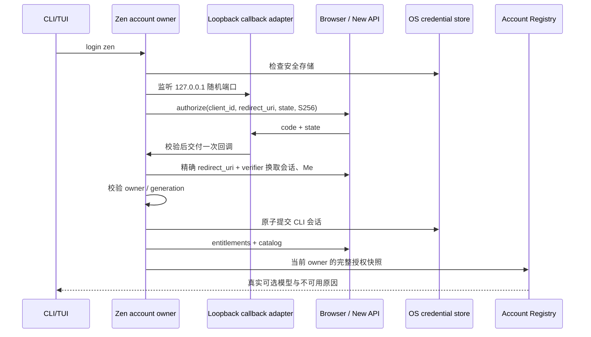

# CLI XWork Zen Plan

状态：2026-10-21 已实现并完成隔离浏览器授权与真实 CLI prompt 验收；本机 Node CLI 已更新，正式后端尚未部署 CLI 客户端支持。剩余平台与交互验证见下文。

## 目的与范围

独立 CLI 的 TUI 与单次 prompt 可以通过 XWork Zen Plan 登录、恢复、退出和选择套餐内模型。命令为 `zcode login zen`，TUI `/login` 首项展示 `XWork Zen Plan`。保留现有 Z.AI、BigModel 和自配 Provider。购买、续费与账户管理在浏览器完成，不增加 CLI 支付流程。

本轮仅覆盖 CLI 与浏览器运行在同一台机器的场景。桌面 Host 的 continuous、手机 replayable、远程 workspace 与桌面深链分发均不改变。`--no-browser` 打印授权 URL，仍需在同一台机器的浏览器完成授权；不能宣称支持 SSH 跨机登录。

## 实现前源码事实

- CLI `login-command.ts` 仅接受 zai/bigmodel，TUI `command-center/login-flow.ts` 仅有官方 OAuth/API Key 选项。
- `process-provider-registry-runtime.ts` 的 standalone account source 仍读取官方凭据；托管 Worker 已支持 New API Account overlay，不等于独立 CLI 已支持登录。
- 桌面 `NewApiAccountService` 使用窗口 Host owner 和 Main 提供的安全密钥；普通 Node 进程不能读取 Electron safeStorage 密钥。
- New API canonical spec `docs/specs/xcode-integration.md` §4.2/§6 目前只允许 `xcode-desktop` 与精确 `zcode://oauth/callback`，且明确不提供 CLI polling。必须先扩展后端契约，不能把动态回调直接塞入现有客户端。

## 产品规则

1. 显式 `NEW_API_BASE_URL` 配置 Zen origin，复用现有 origin 校验；缺配置时 Zen 入口显示配置提示，不猜域名，不回退官方服务。HTTP 只允许现有明确 loopback 白名单。
2. `zcode login zen` 发起独立授权。登录成功须完成 SessionBundle 校验、Me 身份确认、安全持久化，以及当前代次检查；只有成功提交后才显示账号信息与可选模型。
3. TUI 首次登录列表显示 Zen；正在登录时支持取消，取消使迟到回调失效。现有官方登录命令和参数保持兼容。
4. CLI 使用独立 SID，不认领桌面设备 SID，不读写桌面 active pointer，不导出桌面密钥。CLI 自己退出仅撤销自己的 SID。增加 `zcode logout zen` 和 `/logout zen`；原无参数退出保留官方行为，并在帮助中写清目标。
5. 登录后读取真实 entitlements/catalog；无套餐或无可用模型明确展示原因，不制造可执行模型。保留用户原默认选择，首次成功登录可提示选择 Zen 模型；不得自动将同名官方模型迁移为 Zen。
6. 仅把非秘密模型选择写入 Personal Config；Account overlay 由当前 Zen owner 派生。control、refresh、relay 不得写入普通配置、命令参数、stdout、日志或 shell 启动脚本。
7. 冷恢复必须核验有效会话。明确撤销清除可执行授权；网络/503 展示暂不可用，保留可恢复凭据，不伪装退出或无套餐。退出离线时区分本机清理与服务端撤销结果。

## 授权与后端依赖

新增公开客户端标识 `xwork-cli`。后端按 client_id 注册独立规则，不放宽桌面客户端：

- CLI 先监听 `127.0.0.1` 的系统分配端口，再创建 PKCE S256 请求，redirect URI 为 `http://127.0.0.1:<port>/oauth/callback`。
- 仅接受字面 IPv4 loopback、明确端口和精确路径；禁止 localhost 别名、任意 host、userinfo、fragment 与通配路径。token 交换中的 redirect URI 必须与 AuthFlow 中保存的完整 URI 一致。
- 浏览器沿用原生注册、密码、2FA/Passkey、当前账号展示和主动授权；不新增 CLI 密码表单。
- AuthFlow、code 与最终 SID 绑定 client_id；refresh/logout 校验该客户端。现有期限、一次性 code、PKCE 与撤销规则沿用 canonical spec。
- callback adapter 仅接受精确 path、一次 code/state、匹配的高熵 state；忽略或拒绝无关探测，不提前消费 pending。返回浏览器的成功页不含 token/code/state。
- 服务端成功兑换后本机 commit 失败或登录已取消，尽力撤销该次签发的精确 SID，并报告补偿结果。

跨仓库 HTTP 变更必须写入 New API canonical spec 并由后端实现验证。本文件不另造第二套 SessionBundle/金额/模型 schema。未实现后端支持前，此功能不能验收为完成。

## 所有者、存储与边界

| 状态 | 唯一所有者 | 约束 |
| --- | --- | --- |
| pending state/verifier/listener/取消 | CLI bootstrap Zen 登录协调器 | 一次登录一代次，finally 释放监听与计时器 |
| 活跃 owner/SID/refresh 单飞 | 独立 CLI Zen account runtime | origin/userId/SID/generation 共同隔离 |
| 安全凭据读写 | CLI adapters 平台凭据端口 | 不依赖 Electron，不使用公开机器信息派生密钥 |
| 套餐模型与授权 | 现有 AccountProviderService/Registry | 同一次快照携带 owner、catalog 和 authorization revision |
| TUI 菜单、提示、浏览器状态 | CLI/TUI 呈现层 | 只调用 bootstrap 契约，不持有 token 与业务 owner |

平台存储使用 macOS Keychain、Windows Credential Manager 和 Linux Secret Service，按规范化 origin 与 CLI client_id 隔离命名。系统安全库条目为服务 `XWork CLI Zen`、账户 `credential-encryption-key:<凭据目录 sha256 前 32 位>`：不同数据根（多个安装、隔离环境）各自持有加密 key，不能相互覆盖或删除。实现阶段选用有三平台支持的凭据 adapter，核对打包与原生依赖；不得降级到明文文件或旧机器 key。无法访问安全存储时在授权前报明确错误。单测可注入内存端口，测试 cipher 不能作为真实平台验证证据。

跨包公共功能放在适当共享 contract/adapter 公开入口；不得让 CLI bootstrap 依赖 Services 的实现文件。复用纯协议和模型解析能力时，先提取稳定契约，再让桌面与 CLI 调用。桌面安全存储和现有客户端默认值不因提取而变化。

请求期 relay credential 从当前 owner resolver 获取，复用现有 New API 请求头和模型能力映射。每次异步返回核对 generation、origin、userId、SID；旧账号结果不得写入新账号。重连、刷新不建立第二套模型配置缓存。显式撤销或换号先失效 owner 与执行授权，再发布变化；正常 refresh 不模拟退出/登录。

## 验收场景

1. 帮助、命令 parser、英文/中文 TUI 都提供 Zen；既有官方/API Key 登录回归通过。
2. 本机浏览器真实完成授权，回到发起 CLI；深链不被桌面接管。`--no-browser` 同机可完成；跨机限制提示清楚。
3. 缺 origin、安全存储不可用、端口监听失败时不发起授权；无密码或 token 泄露。
4. 错误/重复 state、错误 path、重复 callback、过期 code、取消、超时、并发两次登录和迟到兑换均不激活错误 owner；资源被释放。
5. token/Me 身份不符、存储提交失败有明确拒绝与补偿；取消后不显示成功。
6. 冷启动从平台安全存储恢复，正常 refresh 单飞并安全替换；撤销阻断请求，503 保留恢复能力。
7. 无套餐、空目录、禁用模型、目录/授权 revision 不一致均不产生可执行授权。
8. 选择真实 Zen 模型后 TUI 与 `--prompt` 使用现有模型 runtime，请求指向配置 origin；退出/换号后旧账号请求与缓存失效。
9. CLI 与桌面同时登录、各自退出互不删除对方会话；不同 origin 的同名账号隔离。
10. macOS 真实 Keychain/浏览器/TUI 验收；Windows/Linux adapter 与协议自动化验证，未实跑的平台明确标记。真实模型调用和正式服务部署需单独明确执行范围。

## 交付检查

### 当前验证记录（2026-10-21）

- 后端提交 `9cffe3717`：严格 CLI 回调、会话 ClientID 与刷新/退出校验；`16024d865`：浏览器授权页 CLI 回环校验。未部署正式服务。
- 已执行 SQLite、MySQL 8.0.46、PostgreSQL 16.14 的新库/旧库/重复迁移矩阵；认证 service/controller 定向测试通过。浏览器授权组件 65 项回归、Web 类型检查与目标 lint 通过。
- 已执行 macOS Keychain 合成记录写读删；CLI adapter 回环/加密 CAS/HTTP 6 项回归通过。Windows/Linux 安全存储未真机验证。
- 账号生命周期回归覆盖取消、迟到结果、换代、恢复竞态、刷新与持久化失败补偿；Registry 真实集成已覆盖 owner publication 和无套餐拒绝。命令/官方登录回归已执行，最终数量以交付记录为准。
- 隔离 Go embed 服务使用独立 SQLite、随机服务密钥与合成账号。真实 Chrome 原生密码登录、主动授权、CLI loopback、OS 保护持久化、另一进程冷恢复与真实 Me 均通过。测试 fixture 直接在私有数据库准备套餐、模型和本机上游；这不验证管理员配置 UI。
- 实际构建的 `--prompt --json` 从该账号恢复，读取真实套餐目录，经 Go relay 调用不计费的本机合成上游，退出码 0 且返回 `ZEN_ACCEPTANCE_OK`。首轮模型声明不支持工具被正确拒绝，修正 fixture 后通过。未验证实际工具执行/取消、PTY 全交互、2FA/Passkey 或跨平台真机。
- 实际构建的 `logout zen --json` 确认服务端撤销；只读数据库验证精确 CLI SID 已撤销，再次冷恢复为空。本机 `~/.local/bin/zcode` 已指向本功能 worktree 的验证产物，version/doctor 通过；移除 worktree 前必须重新安装。
- CLI 包 518 项测试、Zen 命令 3 项、bootstrap 定向 41 项、adapter 6 项与共享回调 1 项通过。根 typecheck/lint、CLI 根 typecheck/lint、架构检查通过；lint 保留 317 项警告。CLI 根 typecheck 首次因 PATH 缺少 turbo 失败，加入仓库现有 node_modules/.bin 后通过。

### 完整 E2E 套件（2026-10-21，`apps/zcode-cli/e2e/zen-plan`）

可重复执行的 17 个用例，覆盖矩阵见该目录 README。真实 Go New API（隔离）+ Chrome 原生页面 + CLI 构建产物 + node-pty/xterm 仿真 TUI + 合成上游。最终连续 3 次完整运行均 17/17 通过，无残留进程、隔离目录或仓库文件改动。完整测试新发现并修复：

- TUI 首项 Zen 缺少 pending 定义，浏览器授权期间无法 Esc 取消；补 pending 文案与等待态（CLI 单测 RED→GREEN）。
- 顶层 `login zen` 不处理 SIGINT；服务端已签发 SID 后 Ctrl+C 直接终止进程，补偿撤销不执行。现将信号转为 abort 并等待补偿后以 130 退出（CLI 单测 RED→GREEN）。
- 取消信号会中断进行中的 code 兑换，服务端已签发但客户端拿不到 bundle，无法精确撤销。兑换只受自身 HTTP 期限约束，结果返回后由 finally 撤销（bootstrap 单测 RED→GREEN；E2E `headless-login-interrupted-after-exchange` 在真实后端验证 SID 被撤销）。
- 钥匙串条目原为固定账户名，多个数据根共享同一加密 key，任何一个删除或重建都会使其他安装的凭据不可解密。改为按凭据目录派生账户名（adapter 单测）。已有安装的旧条目不会自动迁移：升级后首次运行需重新 `login zen`。
- 授权页对 CLI 显示“连接桌面应用”，中文“独立桌面设备会话”同样误导；按 client_id 区分说明并修正 zh/zh-TW 文案（Web 单测 RED→GREEN，后端提交 `e09cab064`）。
- 非自用模式下网关要求模型已定价，fixture 在隔离库补设倍率；这是部署前置条件，不是 CLI 缺陷。

实现取舍：当前 CLI 自有纯目录投影通过相同 canonical schema 和 Provider 类型运行，不导入 Services 的桌面实现。后续可将纯投影收敛到独立共享模块；当前两端分别回归，不能据此认为没有维护分叉成本。CLI 默认 Node bundle 保留外置 `@napi-rs/keyring` 原生依赖；本次未验证 SEA 分发的钥匙串资源。

扩展结构（按 `docs/xcode/UPSTREAM-EXTENSION.md` 重构）：Zen 逻辑不进入上游函数。上游仅保留接线：`startProcessProviderRegistryRuntime` 的通用 `standalone.extendAccountResolution` 钩子；bootstrap 公开入口改为导出 `zen/process-provider-registry-runtime.ts` 的同名组合层（合并目录、请求准入、owner 订阅、Zen 专属返回字段）；CLI 组合层是受管模块 `cli-xwork`（`packages/cli/src/xwork/`）：`main.ts` 改用 `runXwork`（`login zen`/`logout zen`、SIGINT 补偿与帮助追加，其余委托 `run`），`tui-prompt-handler.ts` 改用 `createXworkCommandCenter`（`/login` 前置 Zen 项、`/login zen`、`/logout zen`、`/help` 追加、`/model` 前刷新，其余委托 `createCommandCenter`）。上游命令、picker 原四项与顺序、locale 文案和上游测试保持不变。重构同时修复：refresh 轮换期间代次变化时撤销后继、换号后撤销被替换 SID、退出时服务端已失效视为已撤销而非报错。

重构后验证（同日）：完整 E2E 连续 3 次 17/17 通过，钥匙串条目数运行前后一致；`multi-process-and-account-switch` 新增断言换号后被替换的 alice SID 已在服务端撤销，`desktop-cli-coexistence` 改为自建 alice CLI 会话不依赖用例顺序。修正凭据文件明文检查的误报：原对整份文件做 `/sk-|eyJ|refresh/` 匹配，base64url 密文随机命中率约 10%（实测 2000 次抽样 10.3%），改为校验加密信封字段与密文不可解析。CLI 包 527 项、Zen 与契约 vitest 定向通过；根 typecheck、lint（0 错误）、架构检查（0 违规）通过。

实现前更新 canonical spec、受影响模块 contract 与上下文；代码从 release 派生分支完成，上游文件保持最小改动并加 XCODE 原因。交互覆盖 CLI/TUI E2E，协议和存储覆盖失败路径。执行根 typecheck/lint/架构检查及受影响 CLI 包 typecheck/lint/测试，完成后重建本机 zcode 并检查新入口。不得以菜单出现代替完整登录和模型链路验收。
