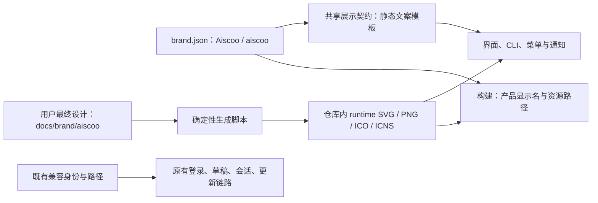

# Aiscoo 品牌迁移清单与验收

原品牌显示迁移已通过 PR 合入 `release`。下文“项目代码与目录命名迁移”为独立后续工作，当前尚待全部验证与集成；其分支和验证结果不继承原品牌 PR 的完成状态。原品牌迁移基线：`84e1e3dd`；分支：`feature/aiscoo-branding`。未发布安装包；提交与合并结果以对应 PR 为准。

## 产品规则与唯一所有者

产品显示名为 **Aiscoo**，用户提供的几何字标为小写 **aiscoo**，资源 slug 为 `aiscoo`。以 `docs/brand/aiscoo` 已提交的最终设计为原稿，不使用早期彩色草稿重新设计 Logo。浅色使用黑色字标，深色使用白色字标；桌面系统／Dock 图标基于已设计好的黑色版，内部 `ai` 围绕画布中心等比放大 20%，保留圆角底的几何、渐变、原有阴影与透明轮廓，原稿不改；Web／手机图标继续使用既有浅色版。

品牌事实唯一所有者为 `packages/shared/src/xwork-brand/brand.json`，通过 `@zcode/shared/xwork-brand` 的原生 JavaScript 入口和相邻类型声明公开纯展示契约；Node 构建通过静态导入内联同一 JSON，Python 生成器直接读取该文件。桌面运行时不按源码相对路径读取品牌文件。界面资源唯一所有者为 `packages/ui/src/xwork/brand/assets`。品牌与插件指南的实现移入 Aiscoo 命名目录，旧公开路径转发到同一实现；架构 owner 与原 ID 保持不变，并追加新 ID 别名。

界面使用独立 `AiscooIntlProvider` 包装，在应用入口显式装配品牌词典；原 `ZCodeIntlProvider` 保留上游默认，通过可选 `catalogTransform` 开放通用扩展。远控组件同样通过可选 `productName` 注入，原默认值和上游测试保留。只转换产品自己维护的静态文案模板，在插入用户值之前完成品牌投影。不得对用户会话、插件正文、项目名称、HTML 页面内容或最终模型输出做全局品牌替换。供应商 ZAI、BigModel、第三方产品、上游 ZCode 归属及法律信息保留真实名称。品牌集中配置，不在业务模块散落新的名称常量。

## ZCode v3.17.1 同步兼容（2026-10-30）

采纳上游新设置、数据同步、onboarding、composer 与会话恢复实现；沿用现有 Aiscoo 品牌契约和登录 header 插槽，欢迎展示挂接新版页面，不恢复已删除的 `OnboardingWelcomeView`。New API 主账号 owner、会话事件、请求代次及官方云凭据独立命名空间保持原规格；模型、插件指南、确定性头像继续从各自公开入口装配，不新增界面认证缓存。验收覆盖共享 Root 登录取消/重试、账号切换、模型选择、插件指南和新版欢迎页，以及桌面/手机、浅深主题的可重复场景；未执行的场景须在同步记录标明。

开发副本的签名时序：Electron 44.7.0 的 Dev.app 在品牌 plist、ICNS 和 `Resources/app` 入口全部刷新后才做 ad-hoc 签名。原样缓存不重复签名；图标、renderer URL 或入口变化必须重签，签名失败不能写入已完成指纹。旧 format=3 的未签名缓存不再复用，新指纹使用 format=4；工程回归与隔离桌面启动分别验证缓存时序和真实加载。跨平台 Node 回归使用既有 `signApp` 注入点，在签名调用时核对已准备的入口、图标与 plist，并验证恰好调用一次；合成 `.app` 不调用宿主 `codesign`。真实 macOS runtime 的签名与加载继续由隔离桌面场景验收。

同步后已晋升正式目录的 E2E 场景，其 manifest 与 provider fixture 的 `spec` 必须指向现存正式文件；沿用上游 canonical formal target 校验器，保留原回放内容、断言与历史验收状态。About、子代理 prompt 及运行中 guide 的品牌预期与共享品牌事实 `Aiscoo` 一致，不修改技术身份或回放响应。修正路径和文字后通过 fixture 检查不代表真实 Electron 场景已执行。

## 旧品牌残留的展示规则（2026-10-30）

托管 New API Chat Completions 的内置 Provider 名称、产品自己的 OpenRouter 归因以及新建官方插件市场的默认描述使用品牌配置中的 Aiscoo；保留原 Provider ID、服务地址、账号与模型配置、请求头名称及官方市场 ID。已有官方市场记录和用户自定义名称不批量改写；官方市场刷新时仍以远端清单的描述为准。用户内容、第三方资料与历史记录不替换，兼容身份、协议、旧数据目录及钥匙串不迁移。

共享包和 UI 包追加 `aiscoo-brand` 公开入口，与既有 `xwork-brand` 入口指向同一实现；旧路径和架构模块 ID 保持兼容。验收覆盖两种入口、运行时内置 Provider 配置、OpenRouter 与非 OpenRouter 请求头、新建和既有市场记录及第三方内容。

## 项目代码与目录命名迁移（待验收）

本次以 `origin/release` 的既有行为为基线，将可迁移的 Aiscoo 下游实现移入 Aiscoo 命名目录。先迁移品牌，再处理插件指南、CLI 与其他下游模块；每组须能单独验证。只移动实现，不改变产品文案、认证身份、存储、业务状态或进程协议。

- 共享品牌和 UI 品牌的现有 `./xwork-brand`、`./aiscoo-brand` 包导出键及精确 target 均保持不变；旧 target 转发至一个新目录实现。新旧导入的对象、组件和函数引用必须相同，原有所有命名导出和类型仍可用。
- 品牌数据 `packages/shared/src/xwork-brand/brand.json` 是构建器、安装器和历史启动脚本直接读取的唯一事实来源。UI `packages/ui/src/xwork/brand/assets` 仍供桌面、Web、分享页和图标生成器直接使用。两处旧资源路径保留，迁移不复制事实源或更改这些调用。
- 插件指南 RPC descriptor 保持 `xwork-plugin-guides`；CLI 的 `xwork/plugins/guideSource`、`xwork/workspace/streamText` 和 `xwork/workspace/textDelta` 保持不变。公开的 `xwork*` 协议属性保留，新的 `aiscoo*` 属性只追加并映射到相同字符串。
- 架构别名必须将 `cli-xwork`、`xwork-startup-context`、`xwork-plugin-guides-{protocol,cli,service,ui}`、`xwork-brand` 和 `xwork-brand-ui` 与对应 Aiscoo ID 映射到唯一模块；依赖校验、公开入口、owner、分层规则和未知 ID 检查均不放宽。共享架构清单的既有内容只追加；不复制模块或重新排序。
- 旧 CLI `test:xwork`、`posttest`、`scripts/xcode/start-local.py` 和 `scripts/xcode/启动 XCode.command` 保持可用；新增 Aiscoo 命名入口转发到同一实现。指向本仓历史脚本的桌面符号链接必须解析到正确脚本并保留退出码；当前机器上已失效、指向另一旧 checkout 的绝对链接不由本迁移修改。`docs/xcode/upstream-sync-log.md` 始终是唯一受保护历史记录，不移动、不修改。
- release 的 Host 和客户端使用 `xwork-plugin-guides`；一个未发布开发快照曾使用 `aiscoo-plugin-guides`。两者不自动互通，需以一致版本重启该快照；不重试有副作用的 `generate`。

验证先覆盖新旧包导出、共享对象及类型、CLI 和 Host 的 wire、全部架构别名和非法依赖、分支策略与 pre-push、历史启动路径；实施后执行相关定向测试及根类型检查、Lint 和架构检查。任何不能同时保持行为、完整兼容和共享清单只追加的部分暂停，保留可审阅证据。

## 深度盘点与实施清单

| 范围             | 已确认入口与问题                                                                                     | 实施与验收                                                                             |
| ---------------- | ---------------------------------------------------------------------------------------------------- | -------------------------------------------------------------------------------------- |
| 共享产品名       | 无统一配置；桌面打包、runtime、dev bundle 分别维护 Aiscoo 名称                                       | 增加纯数据配置及展示契约，三个身份入口消费同源值                                       |
| 全语言界面       | `packages/ui/src/i18n/locales/{en-US,zh-CN}.ts` 有大量 Aiscoo 文案；`IntlProvider` 直接装配词典      | 用下游词典投影装配，保留原词典键与上游默认资源；插值值不转换                           |
| 桌面常驻入口     | `App.tsx`、`WindowsTopLeftLogo.tsx` 使用 X 图；原生菜单、托盘、通知、About、授权有分散产品名         | 使用公共品牌组件和 displayName；操作行为、窗口控制不变                                 |
| 欢迎与登录       | `WelcomeScreen`、`OnboardingWelcomeView`、`RootStartupLoading`、静态 renderer HTML 启动标志          | 使用完整字标或 ai 标志；不依赖网络或文档目录读取资源                                   |
| 首页空态与套餐   | `ConversationDraftEmptyState` 还有内联 X 与 `xcode-hero-dark.svg`；套餐/供应商入口需区分产品与第三方 | 完整动态 aiscoo 字标独立位于问候语上方；供应商标志保留真实归属                         |
| 手机与 Web       | `ZCodeAppLogo` 借用供应商 ZAI 图；手机远控品牌/设备提示有硬编码 ZCode                                | 独立 Aiscoo 图标；手机标题、登录及远控产品提示统一                                     |
| 分享页面         | Web 与 web-share 有不同标题；分享 COPY 与下载入口含旧品牌                                            | 统一页面标题、字标、可访问性文本；不编造新域名或失效下载地址                           |
| Web 静态资源     | favicon.ico 与 index.html 内联 favicon 并存；启动 SVG 单独维护                                       | 同步内联与文件 favicon、启动图、手机添加主屏幕资源；离线静态加载                       |
| 系统图标         | desktop/build、public/logo/icons、Linux 多尺寸、dev .app 图标是旧 X                                  | 从最终设计确定性导出 16/24/32/48/64/128/256/512/1024 PNG、ICO、ICNS；保留开发徽标合同  |
| 安装器与 DMG     | 旧生成器复用已经改过的 X 图标底；安装器包装图和 DMG 字标未使用 Aiscoo                                | 从用户设计原稿生成产品资源；安装器和 DMG 只合成 Aiscoo 标志，不重画字标                |
| CLI/TUI 与运行时 | welcome/help/banner、TUI 空闲图、授权页面和本地服务提示散落                                          | 通过既有 Aiscoo 扩展/文案装配入口投影产品文本；保留 CLI 命令与协议                     |
| 打包发布         | product identity、preview/dev 名称、产物文件名、签名说明与 Linux desktop 展示                        | 用户看到 Aiscoo、Aiscoo Preview、Aiscoo Dev；appId、可执行文件和更新兼容标识保持既有值 |
| 文档             | 根 README、DESIGN、品牌规范和设计 README 仍指向旧品牌                                                | 更新当前产品入口与本规范；历史设计/上游技术文档保留历史事实                            |
| 验证与同步       | 现有 Logo、分享、手机品牌、runtime identity、builder 测试                                            | 添加下游品牌回归和打包资源检查，执行相关测试、typecheck、lint、架构与 merge-tree       |

## 兼容边界

保留 `@zcode/*`、CLI 命令、URL scheme、OAuth 回调、环境变量、appId、Linux 可执行文件/package identity、旧数据目录和持久化 key、Git 远端、下载/服务端地址、更新 feed/tag 协议及 `// XCODE:` 标记。它们代表兼容身份或真实服务位置，不是展示品牌。已有用户的工作区、草稿、登录状态和会话必须仍使用同一存储位置。

本次没有新增业务状态或异步事件所有者。品牌数据为构建时只读常量，图片随应用包加载，不产生远程请求或状态同步。

### Web HTML 启动字标

浏览器启动壳居中显示完整 `aiscoo` 字标，使用随应用已保存主题切换的动态原稿；启用减少动态效果时使用对应主题的完整静态原稿。桌面视口字标宽 320px，窄屏最大宽度为视口宽度减 48px，保持原稿比例且不裁切。沿用既有主题 bootstrap 及无主题时的深色默认值；只在应用 JavaScript bundle 执行前展示，不新增状态所有者。

开发和生产 HTML 均在生成时内联 `packages/ui/src/xwork/brand/assets` 中的四张 SVG，浏览器不依赖额外网络请求或脚本为图片设置地址。部署若设置 Content Security Policy，须允许现有首屏内联脚本和样式，且 `img-src`（或其回退的 `default-src`）须包含 `data:`；该改动不放宽任何部署策略。验收覆盖浅／深主题、系统主题、减少动态效果、320px 与 390px 窄屏、开发及生产四张原稿解码，以及允许 `data:` 的 CSP。

## 验收场景

1. 桌面及 390px 手机 Web，浅色和深色的登录、启动、欢迎、空态、关于和远控入口显示 Aiscoo 原稿图形，无 X/Z 产品图。字标不被拉伸、裁切或低对比遮蔽；减弱动画偏好受到尊重。
2. 产品自有的中英文文案、原生菜单、通知和 CLI 帮助显示 Aiscoo。用户输入 `Aiscoo` / `ZCode`、历史会话、路径、URL 和供应商名称原样显示。
3. 生产、Preview、Dev 分别显示 Aiscoo 对应名称；userData/sessionData、协议和更新身份断言仍为原有值。
4. 全部运行时资源是 Git 中的真实文件，打包配置实际引用；Web/dist 与桌面产物包含相同设计资产，运行时不访问 docs、用户下载目录或 CDN 加载 Logo。ICO/ICNS/PNG 可解码且覆盖现有图标尺寸。
5. 定向回归测试、`pnpm typecheck`、`pnpm lint`、`pnpm architecture:check --changed` 均报告真实结果；记录修改的上游文件、扩展理由及 `git merge-tree` 结果。未实际运行的跨平台安装器与交互场景明确记录。

## 用户视觉反馈补充

2026-10-28 用户补充确认：当前 Dock 内部图案偏小，保留深色圆角底，将 `ai` 等比放大 20%。桌面生成器读取 `desktopIcon.markScale: 1.2`，只变换原稿前景；保留底板几何和渐变，复用原始 PNG 的外部阴影与透明轮廓。桌面与公共 PNG／ICO／ICNS 同源生成；设计包 38 个文件、UI、Web／手机、安装器与 DMG 不随此调整变化。此决定取代以下早期记录中的“原图逐字节一致／不放大”要求。当前验收以 [图标规范](icon-spec.md) 为准，历史结果保留作追溯。

此前用户确认两项调整：桌面 Dock 直接采用之前已设计好的黑色版图标，保留原始尺寸比例与留白，不放大、不重绘；已有原图仅做 ICNS/ICO 等必要格式封装。初始对话取消背后水印，改在问候语上方清晰展示完整动态 `aiscoo` 字标。动画复用原稿 8 秒循环，减少动态效果时使用完整静态字标。设计原稿不改。验收检查桌面 1024 PNG 与黑色原图逐字节一致、Dock 封装解码保真、完整动态字标与问候语／输入框无重叠和浅深主题对比度。

### Dock 图案放大 20% 的实际验证（2026-10-28）

- 已生成 44 个资源并通过 `--check`。1024px 图标的白色 `ai` 边界由 **366×542px** 变为 **440×650px**，宽高均增加约 20%，高度约占 824px 底板的 79%；原图外部 alpha 与阴影保留。16/32px 及 48/64/96px 对照中未见裁切。
- 资源回归 **9/9 通过**，覆盖比例、位置、原稿不变、其他页面／安装资源字节不变、确定性重建和 ICNS／ICO 每档像素一致；品牌契约与 Dev bundle 定向回归 **2 文件、10/10 通过**，包括开发包缓存命中时更新 ICNS。
- `pnpm typecheck`、`pnpm lint`、`pnpm architecture:check --changed` 均退出 0；Lint 为 316 warnings、0 errors，架构为 0 violations。当前使用宿主 Node 24.18.0，固定版本仍为 24.14.0。改动契约文件的格式检查与 `git diff --check` 通过，未运行全量 UT。
- 新旧及多尺寸对照保存在被忽略的 `packages/desktop/out/branding-check/dock-icon-20-percent.png`。本次未重启正在运行的桌面进程；主进程下次启动读取新版 PNG，Dev `.app` 通过既有启动流程同步新版 ICNS。

### 登录页最终视觉与数据目录验证（2026-10-29）

登录页通过 Root 的可选 `header` 插槽装配下游 `AiscooLoginHeader`，保留上游 `LoginPanelHeader` 默认实现和 title／description／children 接口；品牌模块只负责视觉，不引用登录业务组件。产品头部使用完整动态 `aiscoo` 字标，保留 240px 宽及窄屏自适应，移除欢迎标题；中文说明为“连接账号，开始使用”。浅深主题复用原稿的 8 秒动效，系统减少动态效果时显示完整静态字标。真实组件预览验证 320／390px 与桌面布局，未见横向溢出；两次截图确认探头动作变化。登录状态与取消／重试测试及品牌契约合计 14/14 通过，文案调整后的三文件定向测试 36/36 通过。

2026-10-30 用户确认登录页产品简化：Aiscoo 的 New API 主按钮中英文分别显示“登录”和“Sign in”，隐藏登录页的“使用 API key”入口；登录、取消、重试仍使用原 provider ID。Desktop、普通 Web 及远控连接后的共享 Root 都采用这一展示规则；远控连接前的独立登录页仍显示 Z.ai 和 BigModel，供用户选择与桌面相同的账号。`WelcomeScreen` 未传可选配置时保留原按钮和 API key 表单。此改动不新增认证状态或本机 Web OAuth，也不改变已有用户配置、设置中的 provider、协议及远控身份。验收应覆盖中英文、原默认值、provider 选择和取消重试、真实远控登录入口，以及隔离的桌面／浏览器界面。

品牌隔离预览曾显式使用临时数据目录，因此不显示原有会话和自定义模型；这是测试启动参数，不是产品迁移。按用户要求关闭隔离预览后，真实 Aiscoo Dev 复用原 `~/.zcode` 与 `ZCode Dev` Electron 用户目录启动；进程文件句柄确认读取原 `tasks-index.sqlite` 与 CLI `db.sqlite`，任务列表、项目树和模型设置接口均成功返回。没有复制或删除原会话／模型配置。

本机 New API 服务健康，但此前真实客户端记录过 `Secure storage unavailable; private login requires recovery`。提交前复核 Electron 41.0.3 发现品牌更名会改变 ready 前的 `app.getName()`，从而改变 macOS `safeStorage` 选择的钥匙串服务／账号；这与 userData 路径无关。现已将历史钥匙串身份与展示身份分离：ready 前选择 XWork／XWork Preview／XWork Dev，ready 后恢复 Aiscoo；显式测试身份继续隔离。新增按服务名隔离的模拟钥匙串密文回归与启动顺序检查，不迁移或重置真实密钥。此修复消除已证实的品牌兼容风险，但未实际完成用户登录，不把原日志的底层异常或完整登录恢复写为已证实。验证 HTML 的固定失败提示仅为视觉夹具，不是认证结果；夹具均在忽略的 `out` 目录，不进入发布资源。

### 登录失败根因与真实恢复验证（2026-10-29）

确认根因是运行产物仍使用更名前后未分离的旧启动顺序：故障 Main 在 ready 前以 Aiscoo Dev 初始化 safeStorage，现存密文由 Aiscoo Dev 钥匙串保护，`decryptString` 因身份不匹配而失败；Main 的安全密钥加载失败后，Local Host 的 `oauth.startOAuth` 在联网前被 `XCODE_SECURE_STORAGE_UNAVAILABLE` 拦截。与 Renderer、用户数据目录或账号密码无关。

使用同一现存密文和真实 Electron 41.0.3 只读验证：直接 Aiscoo Dev 启动时 `isEncryptionAvailable=true` 但解密失败；XWork Dev→ready→Aiscoo Dev 顺序解密成功，不输出明文。源码已有的兼容处理得到确认，无需更改凭据加载或降级安全存储。完整重建后核对 Main 产物包含两个身份设置阶段，再正常退出无运行任务的旧桌面，沿用同一环境、用户目录和私有后端启动新版 Main／Host。新桌面自动恢复原账号、任务与模型配置，原安全密钥文件的大小、时间与字节保持不变，新启动日志未再出现安全存储不可用错误；没有重新登录、清空凭据或发起模型请求。

新增真实 macOS 跨进程回归入口 `node packages/desktop/test/runAiscooKeychainSmoke.mjs`：Dev／正式／Preview 三种历史身份分别写入合成密文、验证错误的新名称无法解密、验证从实际源码提取的兼容启动顺序可解密，**9/9 通过**；临时 profile 与合成密文均清理，不读取真实凭据。已有身份及运行时回归 **50/50 通过**；首轮受宿主继承的 CUA Helper 环境覆盖影响的 3 项断言失败，在删除这三项环境覆盖后的相同测试命令通过，未修改其断言。根类型检查、Lint（316 warnings、0 errors）、架构检查与桌面构建均退出 0，未运行全量 UT。运行宿主为 Node 24.18.0，仓库固定版本不变。该验证证明原账号冷恢复已正常，不宣称完成新的浏览器授权或跨平台安全库验收。

Electron 41.0.3 依据：[ready 前钥匙串配置](https://github.com/electron/electron/blob/v41.0.3/shell/browser/electron_browser_main_parts.cc#L509-L553)、[名称覆盖与 ready 事件](https://github.com/electron/electron/blob/v41.0.3/shell/browser/browser.cc#L179-L225)。原凭据加载器保持不变；修复仅使用既有 app 名称初始化入口与产品身份配置。

提交前使用仓库固定 Node 24.14.0 重新运行根类型检查、44 个资源一致性校验及 9/9 图片测试，并运行 12 文件 98/98 品牌定向回归；CLI workspace 32 项构建成功。完整提交前门禁、上游合并预演和 CI 结果记录在对应 PR，历史阶段结果保留如下。

### 初始输入框居中补充

完整字标进入文档流后，原 `29dvh` 顶部留白使初始输入框偏低；错误提示横幅还会额外占用高度。品牌模块现在观察会话可用区域、空态、输入 surface 和提示区域的实际尺寸，将输入框中心对齐可用区域中心，整组内容一起移动；顶部保留 52px 安全下限，受限窗口自然排布。实现位于独立品牌模块，没有修改共享时间线或会话业务状态。

实际桌面构建已刷新：1920×985 带／不带提示的输入框中心偏差均小于 1px，1280×800 无提示的浅深主题偏差也小于 1px；1024×720、820×600 带提示时验证顶部安全下限、品牌／问候语／输入框不重叠且输入框可见。减少动态效果可用，390×844 真实组件页的紧凑布局未受影响。4 文件 **61/61 回归通过**；`pnpm typecheck`、`pnpm lint`（316 warnings、0 errors）、`pnpm architecture:check --changed`、桌面 `build:no-runtime-assets` 均退出 0。没有运行全量 UT。最终桌面截图为被忽略的 `packages/desktop/out/branding-check/desktop-centered-final.png`。

### 视觉反馈调整的实际验证

- 桌面／公共 5 个全尺寸 PNG 与原始黑色设计逐字节一致，SHA256 为 `36726244017041e0b57cc6f3ffad93c4374eee81222f9cc22118b813f7cfd10a`。ICNS 最高分辨率解码像素相同，包含 16–1024px 和 Retina；没有新增派生图形、放大参数或修改原稿。38 个原稿、Web 图标、安装器与 DMG 字节不变。资源测试 **9/9 通过**，生成器 `--check` 核对 **44 个输出**一致。
- 初始对话及品牌、手机、启动、问候语定向回归 **6 文件、47/47 通过**。最终 `pnpm typecheck`、`pnpm lint`、`pnpm architecture:check --changed` 均退出 0；Lint 为 316 warnings、0 errors，架构为 0 violations。桌面 `build:no-runtime-assets` 退出 0，未运行全量 UT。
- 真实 macOS 隔离 Aiscoo Dev 预览已重启并置前，复用预览专属数据目录。通过界面的「暂时跳过」进入初始对话，没有登录账号或填入密钥。完整白色动态字标在问候语上方独立显示，布局间隔为 24px，两次原生窗口截图确认探头／眼睛动画变化；减少动态效果时动画隐藏、完整静态字标显示。另以真实组件检查 1280px 深色和 390px 浅色布局，无重叠。
- Dev.app 内 ICNS 与本次黑色资源哈希一致，运行中应用的 AppKit 图标确认为黑色原稿；源码启动时的 `app.dock.setIcon` 使用同一黑色 PNG。当前宿主不允许 Dock 辅助访问，系统整屏截图也不可用，因此未取得 Dock 栏截图。没有重启 Dock 或清理系统图标缓存；原 Aiscoo 进程与原用户数据保持不动。窗口截图保存在被忽略的 `packages/desktop/out/branding-check/`。

## 实施与验证记录

### 完成项与资源

所有清单范围均已接线至 Aiscoo。原稿 `docs/brand/aiscoo` 的 38 个文件保持原样；生成器从原稿输出 **44 个生产资源**，覆盖 10 个 UI SVG、桌面应用／安装器／DMG、多尺寸公共 PNG、ICO/ICNS 和手机 Web 图标。Web-share 沿用现有 `publicDir` 复用 `packages/web/public`，无重复资源所有者。

共享品牌入口采用 plain JavaScript package export 与相邻 `.d.ts`，兼容 CLI 既有 export alias 构建器。桌面 product identity 使用静态导入，品牌 JSON 被打包内联；新增 esbuild 产物离开 checkout 后在独立 Node 中加载的回归，避免运行时错误读取源码路径。原生 About 的原稿 SVG 在构建期内嵌。

### 实际验证结果

| 检查                                                 | 结果                                                                                                                                |
| ---------------------------------------------------- | ----------------------------------------------------------------------------------------------------------------------------------- |
| `pnpm typecheck`                                     | 最终退出 0；包括 Desktop main/host/remote、Web、UI、services/shared 与 CUA                                                          |
| `pnpm lint`                                          | 最终退出 0，316 warnings、0 errors；未把存量警告写为零告警                                                                          |
| `pnpm architecture:check --changed`                  | 最终退出 0，0 violations、0 baseline、0 new                                                                                         |
| CLI `typecheck` / `lint`                             | 均退出 0，使用根工具 PATH；保留 Node 版本差异提示                                                                                   |
| UI/Web 定向回归                                      | 18 文件 **188 通过**；包含原有三份上游品牌断言，未机械改写                                                                          |
| services/server/shared 定向回归                      | 27 个不重复文件 **627 通过、1 跳过**；新增三文件 29 项品牌／内容保真／恢复分类测试均通过                                            |
| native/CLI/Server 定向回归                           | **390 通过**：native/server 167、取消恢复 83、core/context 52、i18n 6、TUI 39、Zen 9、Dev bundle 1、CLI 消费者及构建 33             |
| shared 品牌契约                                      | 3/3 通过，覆盖用户插值、技术引用、原词典和重复投影                                                                                  |
| `python3 -B scripts/xcode/aiscoo-assets.test.py`     | 5/5 通过；隔离输出、重复 SHA、污染重建、尺寸/容器与原稿几何                                                                         |
| `python3 -B scripts/xcode/generate-icons.py --check` | 44 个资源逐字节一致                                                                                                                 |
| Web / Web-share 生产 build                           | 均退出 0，Logo 随 Vite 静态资源打包；保留原有 chunk 大小提示                                                                        |
| CLI `build` / `build:desktop-agent`                  | 均退出 0；生成的 CLI `--help` 实际显示 Aiscoo                                                                                       |
| Desktop `build:no-runtime-assets`                    | 最终退出 0；main 含 Aiscoo 常量和内嵌 About SVG                                                                                     |
| 格式与空白                                           | 对 235 个可格式化改动执行基线感知检查；只格式化新文件和原已规范的文件，11 个基线未格式化文件按仓库规则保留；`git diff --check` 通过 |
| 上游预演                                             | 刷新 upstream 后，HEAD 与包含未提交改动的临时 tree 两次 `git merge-tree` 均退出 0，无冲突；见下方逐文件记录                         |

测试矩阵按领域报告，可能存在跨组共同消费者，不将其相加为全仓独立用例总数。没有运行用户未要求的全量 UT。

### 可视验收与平台边界

使用 Browser Use 检查真实 Web 远控登录页：390×844 深色／浅色、1200×800 浅色均显示 Aiscoo 应用图标和名称；Z.ai/BigModel 供应商入口保留真实标志。另使用真实品牌组件构建隔离验收页，检查完整小写 `aiscoo` 字标、`ai` mark、浅深应用图标，以及 16/24/32px 图形，未见失真、错误底色或缺失眼睛。验收页位于被 Git 忽略的 `packages/web/out/aiscoo-brand-check.html`，不会进入产品路由或发布包。

真实 macOS/Windows/Linux 安装、签名／公证、Helper 原生授权及已安装版本的真实升级未执行；macOS 上 Windows installer smoke 明确跳过。未启动或修改真实用户 Electron 数据，未安装／信任证书，未更改账号凭据。验证宿主使用可用 Node **24.18.0**；仓库固定版本仍为 **24.14.0**，未改版本配置。

### 上游改动与评审

[逐文件理由和合并预演](aiscoo-upstream-review.md) 列出与 `upstream/main` 相交的全部 **216 个已修改文件**。品牌实现位于独立模块，既有翻译词典不改；共享 package exports、依赖和 module requires 只追加。协议、存储、Zen service/AAD、Windows EXE、Linux 命令、更新身份和第三方归属保留。

两项打包阻断及 CUA 动态标题漏项在独立复核中发现并修复：禁止主进程依赖源码相对 JSON 路径；package export 兼容既有 string-only alias；权限状态回调使用同一静态品牌词典。复核结束未留高置信未解决问题。

### 提交前回归补充

登录页评审后恢复上游默认头部，Root 通过可选 header 插槽装配独立 `AiscooLoginHeader`，默认标题、说明、图标及 OAuth 状态路径保持原有合同。真实 pre-push 钩子随后选中 84 个受影响根 UT 文件，其中静默启动测试发现下游 `AiscooStartupLogo` 的内嵌 style 文本进入页面 `textContent`；该轮结果为 1058 通过、1 失败，推送被阻止。

修复仅位于下游品牌模块：移除组件内 style，复用现有 `motion-reduce:hidden`／`hidden motion-reduce:block` 切换动画与静态图；保留原有静默启动测试并加强品牌契约。修复后品牌契约、全局数据库启动、根启动壳、登录品牌四文件共 16 项回归通过，包含迁移到失败时的定时器清理。后续完整 pre-push 与 CI 结果以 PR 验证记录为准。

### 本地分支合并与启动 Logo 历史证据（2026-10-30）

本地 `release@29a00f17` 合并 `origin/release@cd4af779` 时，保留 `6a21c37d`、`76ddf837`、`29a00f17` 三个原始提交。命名迁移、法律入口、头像与启动修复已分别由远端后续 PR 整合；代码采用远端已验证的兼容入口和 v3.17.1 实现，不重复恢复旧模块或删除旧别名。本节保留尚未收录的历史验证文字，不代表重新执行当时验收。

2026-10-29 的 `76ddf837` 记录：Vite dev 未改写启动页静态 ``，相对请求落入 SPA fallback，返回 200 与 `text/html`，图片 `naturalWidth=0`。修复使用 `data-startup-asset`、SVG `?url` 导入和 `src` 注入，使开发与构建使用同源资源；远端 PR #39 已覆盖该机制，并补充主题和启动时序适配。

`29a00f17` 修正了截图解读：当时 CDP 实测冷启动后四张启动 Logo 均解码成功，`naturalWidth=172`（修前为 0）；截图为浅色主题稿的深色 `#121317` 主体、白色眼睛和透明画布，不应称为白色 ai 标。当时品牌／窗口定向回归为 6 文件 84/84，生产构建退出 0；这些是原提交的历史证据，不作为本次合并重新运行的结果。
