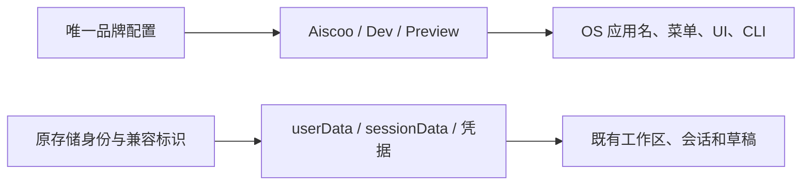
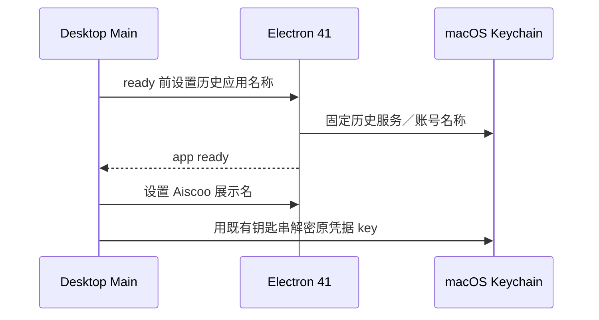

# Aiscoo 图标与显示名

使用用户设计并已提交的 [Aiscoo 设计包](../../brand/aiscoo/README.md)。产品显示名为 `Aiscoo`，几何完整字标为小写 `aiscoo`，图形标志为设计包的 `ai`。最终黑白方案取代旧 XWork 断笔 X；历史 XWork/ZCode 图形不再作为本产品标志。不修改供应商 ZAI/BigModel 及其他第三方标志。

品牌事实由 `packages/shared/src/aiscoo-brand/brand.json` 维护，展示契约通过 `@zcode/shared/aiscoo-brand` 提供。UI 静态资源与公开组件位于 `packages/ui/src/aiscoo/brand/`，原生桌面资源位于 `packages/desktop/build/`，Web 图标位于 `packages/web/public/`，公共图标位于 `public/logo/icons/`。全部资源随源码和构建产物分发；运行时不读取设计文档或网络 Logo。

## 图形与主题

浅色字标为 `#121317`，深色为白色。桌面系统／Dock 图标以用户已设计的黑色版 `app-icon/png/icon-dark.svg` 为源，保留深色圆角底的几何、渐变参数与原始 PNG 的外部阴影和透明轮廓；内部 `ai` 围绕画布中心等比放大 **20%**，不改变眼睛、圆点、笔画或相对比例。共享 `brand.json` 的 `desktopIcon` 唯一维护 `theme: dark` 与 `markScale: 1.2`，生成器只调整前景变换并输出桌面派生图，不修改设计包原稿。PNG、ICNS、ICO 与 Linux／公共多尺寸图标统一使用此派生图，容器中各尺寸像素与对应 PNG 一致。Web／手机图标、UI 图形、安装器与 DMG 继续使用既有设计。

页面字标移除整张画布的实底，保留图形比例和眼睛造型，按页面主题选择资源。禁止将完整横向字标强行拉伸为正方形。

统一登录页通过可选 `header` 插槽装配下游 `AiscooLoginHeader`；`WelcomeScreen` 未传插槽时保留原默认标题、说明与图标，登录状态仍由原 `LoginPanel` 拥有。Root 在现有登录入口传入品牌头部，品牌模块只渲染展示内容。卡片顶部展示完整动态小写 `aiscoo` 字标，复用 `AiscooAnimatedWordmark` 和既有透明矢量原稿的 8 秒循环；系统减少动态效果时显示同主题完整静态字标。移除原单独 `ai` 的深色方形底，不把完整字标塞进小图标容器。字标居中，宽度 240px、最大不超过卡片内容宽度，高度按原始比例自适应；浅色主题使用深色字标、深色主题使用白色字标。字标下只保留“连接账号，开始使用”说明；中文说明不再重复产品名，其他语言沿用既有翻译，不再显示“欢迎来到 Aiscoo”标题。OAuth 渠道、等待、失败／重试和 API Key 状态统一使用同一字标，保留可访问名称 Aiscoo。桌面与 320／390px 手机布局不得裁切或横向溢出。

桌面 PNG/ICNS/ICO、Linux 多尺寸 PNG、Web favicon、apple-touch-icon、公共图标、安装器与 DMG 使用同一设计来源。安装器保留包装盒语义，盒面使用 Aiscoo；DMG 组合字标使用用户设计的矢量路径。启动页、首页装饰标志、关于页、手机登录、分享及导出卡片统一使用 Aiscoo。启动 Logo 的动态／静态切换使用现有 motion-reduce 样式类，静默启动阶段不注入样式文本，不增加定时器或可见文字。

初始对话空态展示完整动态 `aiscoo` 字标，独立位于问候语上方，作为文档流内容参与垂直布局。字标为正常不透明度，不放在文字背后，不使用水印遮罩或渐隐；保留字标安全留白，窄屏按可用宽度缩放而不裁切或拉伸，问候语和输入框不重叠。桌面初始对话以输入框中心对齐会话可用区域中部，字标、问候语、输入框与推荐入口整体定位；顶部留白随窗口高度连续变化，并扣除字标和问候语占用的高度。空间不足时保留至少 52px 顶部安全距离，内容自然滚动；手机紧凑模式与浮窗沿用原布局。动效复用用户原稿的 8 秒循环：探头、眼睛转动与眨眼、i 圆点跳动。动画必须遵守 `prefers-reduced-motion`，减少动态效果时展示同主题完整静态字标。图形加载不依赖字体或网络。

## 产品显示名与兼容

显示名使用 `Aiscoo`、`Aiscoo Preview`、`Aiscoo Dev`、`Aiscoo Desktop App`，适用于界面、文案、原生菜单、窗口、通知、授权、安装器和 CLI/TUI。词典品牌投影只在装配产品自有模板时执行，先投影后插值；用户值、历史内容、第三方来源和法律归属不转换。

`@zcode/*` 包名、协议字段、URL scheme、环境变量、数据库与目录 key、应用 ID、CLI 命令、Linux 可执行文件/package identity、服务端与更新地址继续使用既有兼容标识。Windows 主程序显式保留原可执行文件名，macOS `.app` 的展示文件名随产品名更新。Finder 服务显示 Aiscoo，旧 workflow 只有在 bundle ID 确认为本应用时才清理。

桌面展示身份与存储身份仍由 `desktopRuntimeEnv.ts` 分离派生：`process.title` 消费品牌显示名，userData/sessionData 沿用原有数据身份，不生成新的空历史目录。macOS Electron 41 在应用 ready 前按当时的 `app.getName()` 固定 `safeStorage` 钥匙串服务／账号，因此启动早期 `app.setName` 必须使用历史名称：Dev 为 `XWork Dev`，正式版为 `XWork`，Preview 为 `XWork Preview`；显式测试身份覆盖继续隔离。`app.whenReady()` 后恢复 Aiscoo 展示名，`.app`、plist 与 Helper 保持同一新品牌命名，不迁移或重置凭据。历史钥匙串名称由桌面身份配置唯一提供。CLI Zen 钥匙串 service 与加密 AAD 也是持久化身份，不更名。验收断言 ready 前后的名称顺序，并使用真实 Electron／macOS safeStorage 的跨进程烟测：历史名称写入合成密文，新展示名称直接启动时应解密失败，按当前源码的历史名称→ready→展示名称顺序启动时应解密成功且密文不变。烟测使用临时 profile 与合成内容，不读取真实凭据。修复启用必须完整重建并重启 Main 和 Local Host；仅刷新 Renderer 不会重新选择钥匙串身份。

## 生成与验证

从仓库根目录运行 `python3 scripts/aiscoo/generate-icons.py`，从已提交设计原稿重新生成生产资源；生成结果不依赖旧 runtime 图片，重复执行应输出相同文件。生成环境使用 Python 3、Pillow **12.1.0** 和 workspace 锁定的 `@napi-rs/canvas` **0.1.100**，不使用系统字体。`python3 scripts/aiscoo/generate-icons.py --check` 比较生成字节而不写文件；`--output-root` 支持隔离输出。Web-share 通过现有 `publicDir` 复用 Web 图标，避免第二套资源。

PNG 覆盖 16/24/32/48/64/128/256/512/1024 尺寸，ICO 包含现有各尺寸，ICNS 覆盖 Retina。

验收要求：桌面 `ai` 宽高均为原版的 1.2 倍（栅格取整容差 2px），高度约占圆角底的 79%，图形不裁切；1024px 外部 alpha 与原图相同；16/32px 标志可辨识；各平台资源可解码；浅深主题无错误底色或变形；Web 构建包含本地图片；macOS Dev `.app` 缓存命中仍同步 ICNS；现有存储与登录保持正常。定向测试、资源入包检查和平台实测范围见 [迁移清单与验证记录](aiscoo-migration.md)。
