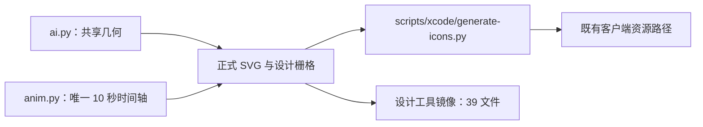

# 机器人眼型与自动表情更新验证

2026-10-30，用户确认采用自动循环，仅优化圆形机器人及眼睛，并要求 ai / aiscoo、客户端 / 管理端同步。本次提取以 `origin/release@cd4af779` 为基线，固定来源为本地 `release@b4aeece7`；现行图形遵循 [图标与显示名规范](icon-spec.md)。

## 验证记录的适用范围

下文 2026-10-30 的自动检查、浏览器观察和管理端结果均是来源分支保存的历史证据，不是本次提取后的重跑。历史管理端结果也不代表本 PR 修改或验证了管理端仓库。当前客户端生产生成与资源检查入口分别为 `scripts/xcode/generate-icons.py` 和 `scripts/xcode/aiscoo-assets.test.py`；UI 资源由 `packages/ui/src/xwork/brand/assets` 唯一维护，机器人专项检查为 `scripts/aiscoo/robot-motion.test.py`。

本次只提取品牌资源、生成源、镜像和对应说明；本机浏览器的现行规则以 [浏览器持有凭据规格](../specs/browser-new-api.md) 为准。旧本机 Web 方案及其端口、Host/Origin 验证记录不作为本次品牌验收依据。

## 当前设计：饱满笑眼、整头弹跳与 10 秒循环

中性眼为宽 7.4、高 17.2、中心距 18 的竖胶囊，头部直径 61。用户批准第二轮方案后，将细描边笑眼改为宽 13.4 的闭合填充圆拱，使用圆润两端和内凹下沿。中性胶囊眼先收短，在 3.62 秒同时切换可见层，再展开笑眼；5.40 秒切回中性眼并于 5.55 秒恢复。两层使用互补的离散可见性，不交叉淡化。

`.head > .bounce > .tilt` 分别负责收起、整头跳动与偏头。3.52 秒蓄力纵压 6%，3.82 秒跳至 -8.2，4.10 秒落地纵压 5%，4.27 秒小回弹至 -2.1，4.50 秒恢复单位缩放。笑眼继续保持至 5.30 秒。`anim.py` 以秒定义 10 秒周期；0–3.36 秒的探出、眨眼、转眼与圆点跳动保持原绝对时刻和缓动，收起片段整体后移 2 秒：6.032 秒开始、6.224 秒到 -3、6.608 秒到 21，跨周期休息 3.68 秒。

共享几何由 `docs/brand/aiscoo/source/ai.py` 维护，秒时间轴由 `source/anim.py` 唯一维护。旧 `build.py`、`q3d.py`、`anim.py`、`ai.py`、`oo_preview.py` 可执行入口委托同一几何与时间轴，原百分比缩放函数已移除。静态资源与减少动态效果时均使用中性眼、圆形头部的收起姿态；UI 只消费资源。

## 来源分支历史：文档与设计副本统一（2026-10-30）

来源记录称 12 份现行说明已更新品牌引用；本次提取覆盖图标规范及 11 份现行功能说明。`.skill-archive/logo-creator/Aiscoo-Logo-Final` 的 39 个设计文件（排除系统与缓存文件）与正式包逐字节一致；旧可执行入口均复用当前机器人与时间轴。来源分支曾重新生成正式 `make.py` 与预览，输出字节未变，44 项客户端发布资源一致。

历史管理端工作包括移除无引用的 `web/src/assets/logo.tsx`，并用当前静态字标刷新 README 引用的 8 张中英文合成示意图页头。来源记录使用 `jpegtran` 在原 JPEG 块中替换，保留 1920×1080 画布；品牌块外解码像素完全相同，模型广场浅蓝渐变保留。这些图片是合成示意图，未被描述为真实后台会话重拍；本次提取未访问或重新验证这些图片。

该阶段历史检查记录为：客户端机器人 5 项、资源 9 项，管理端品牌／截图 Python 5 项和品牌 Vitest 5 项，共 24 项定向测试通过；18 个设计栅格、44 个客户端资源与 20 个管理端资源一致。来源分支当时 `pnpm typecheck` 通过、`pnpm lint` 为 0 errors / 319 warnings、架构 0 violations、两仓 `git diff --check` 通过。以上均未在本次提取中作为根检查结果复用。

## 来源分支历史：10 秒修订自动验证（2026-10-30）

| 历史检查                                 | 来源记录结果                         |
| ---------------------------------------- | ------------------------------------ |
| freshness、architecture changed          | 通过；架构 0 violations              |
| `pnpm typecheck`                         | 通过，Node 24.14.0                   |
| `pnpm lint`                              | 退出码 0，0 errors / 319 warnings    |
| 客户端定向 Vitest                        | 5 文件、66 项通过                    |
| 客户端资源／机器人 Python                | 9 + 3 项通过                         |
| 管理端资源 Python／品牌 Vitest           | 4 + 5 项通过                         |
| 设计栅格／客户端发布／管理端同步只读检查 | 18 / 44 / 20 项一致                  |
| 该次动效修订前后静态栅格 SHA-256         | 86 / 86 字节一致，未重新导出设计栅格 |
| 两仓 `git diff --check`                  | 通过                                 |

来源分支记录 87 项定向测试通过，未运行全量测试。其 Web 启动页测试先因只读环境禁止写入 `.vite-temp` 跳过，随后在主会话独立重跑 10/10 通过；管理端 5 项使用 `--configLoader runner`。这些环境与结果仅属于历史阶段。

### 历史浏览器观察

来源分支检查生产 SVG 的两轮时间轴，每轮每 10ms 取样，共 1,001 个时刻；变换、眼高、可见性与圆点状态的最大差为 `7.4607e-14`，在 `1e-6` 容差内相同，20 秒接缝保持 x=21。3.45–5.60 秒每 5ms 检查时，两套眼睛未同时可见；关键帧包括 3.6px 眨眼高度、-8.2 主跳、-2.1 回弹与 4.50 秒单位缩放。

历史视觉观察覆盖 10 张分镜、浅深色 20/24/32/64px 笑眼和 240px 页头；390px 预览 `scrollWidth=390`。来源分支曾临时强制生产 reduced-motion CSS 分支，观察到 animation none、x=21、中性眼高 17.2、笑眼 opacity=0，随后移除临时样式；该结果属于 CSS 分支验证，不是真实系统偏好的验收。管理端当时两张浅深动态字标加载成功；本次未打开浏览器或管理端。

可播放预览为自包含的 `docs/brand/aiscoo/preview.html`，包含两种主题、分镜与实际尺寸对照。本次不提取录屏文件。

## 来源分支历史：首轮与环境限制

首轮采用 8 秒周期及短交叉淡变笑眼，已由当前 10 秒修订替代。首轮保留的几何、原探出／圆点跳动与栅格边界检查用于追溯，不作为现行动效要求。来源分支曾导出 18 个设计栅格、44 个客户端资源、20 个管理端资源；16 张设计 PNG、ICO 六档和 ICNS 八个可解码尺度保持原尺寸及 alpha，眼区外像素和阴影保留。首轮自动检查同样记录 87 项定向测试通过，未运行全量测试。

历史管理端原始 `bun run typecheck` 与 `bun run build:check` 因 `Script not found "check"` 失败，当时 Bun 为 1.4.2、清单指定 1.4.4；原始 `bun run lint` 为 151 errors / 66 warnings。补充直接使用 TypeScript 6.0.2 对管理端 `web/tsconfig.json` 执行 `tsc -b` 及 Rsbuild 2.1.6 build 均通过，但不替代原命令失败事实。本次未运行或更改管理端环境。

## 本次提取验证（2026-10-31）

固定使用 Node 24.14.0、Pillow 12.1.0 与隔离工作目录依赖。提取前 freshness 通过；依赖就绪后架构基线为 0 violations。以下为本次实际重跑结果：

| 检查                                                                                           | 本次实际结果                                             |
| ---------------------------------------------------------------------------------------------- | -------------------------------------------------------- |
| `python3 -B scripts/aiscoo/robot-motion.test.py`                                               | 5/5 通过，含几何边界、10 秒时间轴、旧入口与完整镜像      |
| `python3 -B scripts/xcode/aiscoo-assets.test.py`                                               | 9/9 通过，覆盖发布路径、确定性重建、容器、主题与原稿不变 |
| `python3 -I -B scripts/xcode/generate-icons.py --check`                                        | 44 个生产资源字节一致，只读检查                          |
| `python3 -I -B docs/brand/aiscoo/source/export_rasters.py --check`                             | 18 个正式设计栅格一致，只读检查                          |
| `python3 -I -B .skill-archive/logo-creator/Aiscoo-Logo-Final/source/export_rasters.py --check` | 18 个镜像设计栅格一致，只读检查                          |
| 正式包与设计工具镜像的相对路径集合及 SHA-256                                                   | 39/39 一致，排除系统与缓存文件                           |

根 `pnpm typecheck`、`pnpm lint` 及提取后架构门禁由主 PR 统一执行和记录。本次未执行浏览器、真实桌面或跨平台安装验收。

## 上游资源边界

本次品牌逻辑位于 Aiscoo 专属源和脚本。以下上游既有二进制路径接收生成后的产品资源，保留现有打包入口；二进制无法加入 XCODE 注释：

- `packages/desktop/build/`：DMG 背景、应用与安装器 PNG／ICNS／ICO。
- `packages/desktop/build/icons/`：16/24/32/48/64/128/256/512/1024 的 `NxN.png`。
- `packages/web/public/favicon.ico`。
- `public/icon_512@2x.png`、`public/logo/icons/icon.icns`、`icon.ico` 及对应九档 `NxN.png`。

这些路径通过生成资源更换品牌，避免为产品图形调整上游业务函数或打包接口。本次主 PR 的完整上游文件清单及 `git merge-tree` 结果由主 PR 统一记录，来源分支的旧合并预演不作为本次通过依据。
