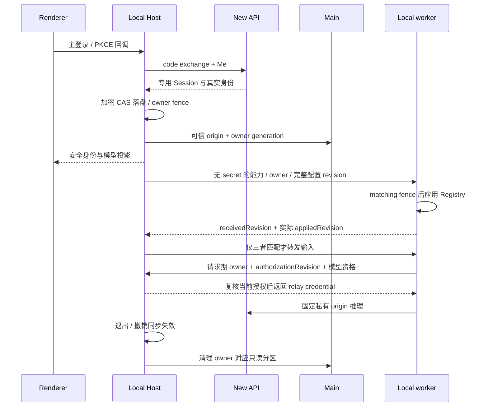

# XWork / New API 本机集成运行手册

客户端规则见 [spec](specs/new-api-integration.md)，认证、资金与管理员接口以 [New API canonical spec](../../../new-api/docs/specs/xcode-integration.md) 为唯一来源。实施与发布验收见 [执行计划](../superpowers/plans/2026-10-08-new-api-integration.md)。

## 本机一键启动（2026-10-19 当前部署）

双击桌面 **`启动 XCode.command`**。入口位于 `scripts/aiscoo/启动 XCode.command`，只负责补启动或激活现有 XWork Dev；不是 Apple Xcode。需要 Docker Desktop、现有数据库/原生API部署、仓库依赖和已安装 Node24，不自动安装、拉镜像或更新业务构件。

- 当前 API 是既有 launchd 作业 `com.new-api.local-backend`，binary及私密 `.env` 在 `~/Library/Application Support/new-api-local/`；使用现有 `new-api-local-postgres` 的 `127.0.0.1:15433/new_api`。这是已由用户确认复用的原生部署，下面旧容器/SQLite验收段落仅作为历史记录，不是当前启动规格。
- 2026-10-29 用户确认升级后，3001 已部署含 aiscoo 授权文案/完整字标的新版，随后按追加要求移除权限下方灰色说明卡片及“应用 / xcode-desktop”行；当前 binary SHA-256 `19e1d14169f8540e27e6d5a34019f21ed241511964f2d94795e2b253beb90628`，启动清单的 binary 哈希同步。原配置、密钥、plist 和数据库连接保留；初次升级三数据库迁移与业务副本重复启动通过，后续卡片移除只重建内嵌前端、后端源码相同。实际前端/字标已回读，status 200、匿名 Me 401、启动错误 0，原列业务行摘要保留；最新回退备份及部署报告在 `~/.local/share/new-api-native/backups/xwork-auth-label-20261029T141718/`，初次升级备份在 `~/.local/share/new-api-native/backups/xwork-auth-20261029T125827/`，详见[授权页规格](specs/new-api-authorization-account-switch.md#2-页面与文案)。
- `NEW_API_BASE_URL` 固定为 `http://127.0.0.1:3001`。binary、配置、plist或数据库身份变化会明确拒绝，不根据“端口能通”接管未知实例；安装清单在 `~/.config/xcode-local/start.json`（0600），不含密钥明文。
- 旧 `new-api` 容器保持停止且 restart policy 为 `no`，避免启动 Docker 数据库时旧 API 抢占端口；不删除旧容器或卷。原生 API 的既有登录自启/自动重启策略保留；本轮桌面作业 `com.xwork.local-desktop` 不登录自启、不自动重启。
- 保持系统 HOME 和原钥匙串/业务目录，沿用当前账号、项目及草稿。入口使用既有 `ZCODE_BUILTIN_PROVIDER_CONFIG_FILE` 指向仓库 `config/provider/zcode-builtin.json`，解决 Dev.app symlink下模型资源相对根错误，不复制资源或伪造目录。
- 日志：`~/.local/share/xcode-local/desktop.log`；原生 API 日志沿用其现有 plist。并发点击只有一份检查，已有桌面只激活；孤立或手工部分 dev 会拒绝，保护既有构建输出。
- 关闭启动终端不停止桌面/API；关桌面窗口后再双击可重新显示；Cmd+Q只退出桌面，不停止原生API或数据库。
- 此入口使用本机已安装 Node24.18.0/pnpm10.33.2；未安装mise，未修改仓库24.14.0 pin，patch版本warning保留。首次启动仍会走既有开发编译链，不是独立打包应用或离线安装器。

真实冷启动、只读模型/套餐恢复、Cmd+Q及窗口重开已验。**现有 API 仍监听全接口，不应暴露3001至不可信网络**；本轮未改其绑定配置。既有 `config/default.json` 相对根问题仍可能影响社群/反馈配置，本入口只使用现有provider覆盖修正模型资源。未执行真实模型调用、支付、授权变更或全量产品验收。详情见[一键启动实施计划](../superpowers/plans/2026-10-18-xcode-one-click-start.md)。

## 配置与边界

独立 CLI Zen（2026-10-21）：本机 `~/.local/bin/zcode` 使用 `feature/cli-zen-plan-implementation` worktree 的 Node bundle，支持 `login zen`、`logout zen` 及 TUI `/login zen`、`/logout zen`。显式设置 `NEW_API_BASE_URL`；浏览器必须与 CLI 同机。正式服务须先部署 New API 的 `9cffe3717`（客户端与 SID 归属）和 `16024d865`（授权页面）或其合并结果。当前 3001 未因本次实现而升级，不能据 CLI 帮助出现 Zen 推断正式服务可登录。隔离 Chrome→Go→CLI 冷恢复→真实 prompt→本机合成上游→退出验收通过，无外部计费调用；Windows/Linux、SEA 原生资源和完整 PTY 工具交互未实跑。详细证据及限制见 [CLI Zen spec](../../apps/zcode-cli/docs/design/v2/zen-plan.md)。删除功能 worktree 前须重新安装命令，启动器依赖该目录及相邻 node_modules。

- Node 版本使用 `mise.toml`，pnpm 使用根 `package.json`。本次验证使用 Node 24.14.0 / pnpm 10.33.2。
- 只有显式 `NEW_API_BASE_URL` 且本机桌面 Local Host 才启用私有组合，没有默认 3001。Main 安全库、Host 与 scheduler 使用相同 dotenv→已定义 process env 优先级；显式空 process 值遮蔽 dotenv。未配置的原非私有桌面、独立 Web/远程路径保留；已启用后任何认证、目录或资金错误都不回退到原官方身份或钱包。
- Origin 必须是精确 origin，不能含路径、query、fragment、用户名或密码；HTTP 仅允许 loopback。生产操作员明确设置后端 `XCODE_INTEGRATION_ENABLED`、与客户端完全一致的 `XCODE_PUBLIC_ORIGIN`，并验证实际二进制、挂载及数据库。
- 不复用 Z.ai/BigModel 的环境变量。它们继续属于独立官方连接；metadata、网页地址和 `server_address` 均不能改变私有 API origin。
- 现有 3001 服务不能仅凭 `/api/status` 成功判定就绪。2026-10-18 授权页专项已获明确授权并切换真实 Go embed；当前 binary/assets、人工确认门槛和未完成边界见下节生产记录，不能沿用旧隔离报告的“未部署”结论。

显式启用既有测试启动命令（后端与数据隔离需由操作员先准备）：

```sh
NEW_API_BASE_URL=http://127.0.0.1:3001 pnpm dev:desktop:test
```

桌面运行时隔离变量：`ZCODE_DESKTOP_USER_DATA_DIR`、`ZCODE_DESKTOP_SESSION_DATA_DIR`；业务数据根通过已有 `ZCODE_DATA_BASE_DIR` 处理，必须核实启动链实际采用的值，不能只设置变量就假设隔离成功。不要连接真实用户目录做注册、撤销或额度耗尽场景。

完整隔离检查清单（2026-10-21 实测缺口后补充）：

- 必须同时设置 `ZCODE_STORAGE_DIR=<私有根>/.zcode`、`ZCODE_SESSION_DB_PATH=<私有根>/.zcode/cli/db/db.sqlite`、`ZCODE_LOG_DIR=<私有根>/.zcode/cli/log`。三者各自独立解析，都不跟随 `ZCODE_DATA_BASE_DIR`：存储根见 `apps/zcode-cli/packages/adapters/src/config/env-config.adapter.ts`（默认 `~/.zcode`）；会话库默认 `~/.zcode/cli/db/db.sqlite`（`adapters/src/storage/session-store/paths.ts`），不随存储根移动；日志目录默认 `~/.zcode/cli/log`（`adapters/src/logging/index.ts`）。2026-10-21 两次实测：只设存储根时，会话、消息与日志仍写入真实 `~/.zcode/cli`。
- 启动后核对私有根 `cli/log/*.jsonl` 中 `bootstrap.app.startup.storage.completed` 的 `cliStorageRoot` 与 `zcode_protocol.startup.sqlite_migration.completed` 的 `dbPath` 均在私有根，并确认真实 `~/.zcode/cli/log` 当天日志与真实会话库均不含私有工作区路径。
- 使用 `--open-workspace <私有目录>` 显式指定工作区，绕过 `os.homedir()` 下 `setting.json` 的启动恢复（见下文启动恢复边界）。`pnpm dev:desktop*` 启动链不转发命令行参数，开发版改用 JSON 数组环境变量传递，例如 `ZCODE_DESKTOP_DEV_APP_ARGS='["--open-workspace=<私有目录>"]'`；`packages/desktop/scripts/devElectronAppArgs.mjs` 只放行 `--open-workspace`，其他以 `-` 开头的开关直接报错。
- CLI 用户配置 `~/.zcode/cli/config.json` 无环境变量可改：`getDefaultConfigPath()`（`adapters/src/config/file-config.adapter.ts`）固定解析 `homedir()/.zcode/cli/config.json`，Desktop Agent 启动链也不传 `userConfigPath`。因此隔离运行仍会加载真实用户插件、MCP 与 hooks；插件或语言等用户级操作会通过 `atomicWriteJson` 写回该文件。验收期间不执行用户级插件/MCP/hook/语言变更；启动前备份 `config.json` 及 `plugins/{installed_plugins,known_marketplaces}.json`，结束后逐字节比对，不一致时先用备份恢复再报告。需要完全隔离用户配置时须先给 Desktop Agent 增加显式配置路径，不能靠快照代替。
- 未打包 Electron 启动时 `registerDeepLinkProtocol` 会无条件调用 `setAsDefaultProtocolClient("zcode")`，改写系统 `zcode://` 处理程序。启动前记录 `NSWorkspace.urlForApplication(toOpen: zcode://…)` 的 app 路径；结束后先 `lsregister -u` 注销本仓库 `node_modules/electron/dist/Electron.app`，再用 `NSWorkspace.setDefaultApplication(at:toOpenURLsWithScheme:)` 设回原 app 路径，并重新查询确认路径与启动前一致（同 bundle ID 的多份 Electron 不能只靠 bundle ID 区分）。
- 结束时对比真实 `~/.zcode` 下数据库与设置文件的 mtime/size 快照；有变化必须先定位写入者，不能直接视为无关。

macOS 保持系统 `HOME` 不变，应用/Host/工作区使用上述隔离变量。改成合成 HOME 会让真实 OS keychain 查找失败，不能选择“还原为默认”来掩盖测试配置错误。无安全库时 fail-closed，不注入测试 AES key 就宣称真实恢复通过。（`ZCODE_DESKTOP_HOME_DIR` 只影响 Electron `app.getPath("home")`，不改变进程 `HOME`。）

## 授权页生产专项：2026-10-18 当前状态

状态 **PASS WITH DISCLOSED CONCERNS（生产授权专项、清理及独立最终复核完成）**。实际3001保持原容器/配置/挂载与密钥语义，使用经最终评审的binary SHA-256 `da5ad356af59bb4fdab01421049ca90401df91ca6334d4d67cfc329bea1725e8`，真实HTML引用 `index.35d0844c67.js` / `index.0d47dc1946.css`。一致备份/部署与全部证据见 [生产验收报告](../../.superpowers/sdd/2026-10-17-new-api-authorization-account-switch/production-validation-report.md)；保留完整生产备份和staged reviewed binary，不恢复/覆盖仍有合法并发使用的业务库。最终复核无阻断性 Important 缺口，不扩大为全质量、模型或资金验收。

两名专用非管理员原生注册账号完成A权限/取消换号、A→原生B/原flow/无自动complete、生产根路由真双标签和取消终态。独立真实Desktop使用系统HOME/真实safeStorage、私有Main/Host/renderer/Worker及有效显式私有workspace，不复用5174/9229。首轮人工等待造成code过期的失败保留；最终用户亲自连续点击网页授权/原生打开，真正OS投递精确callback到原Main、原Host真实Me B。完整退出后同数据/keystore重启仍真实Me B；原Host.logout真实撤销专用xcode SID，浏览器B冷refresh200；旧完成页不重登，再全退出cold restart的Host/session provider均null（截图pending-auth UI不冒充idle登录页）。

生产429按Retry-After自然等待，不改限制；随后B复用真实Cookie、A原生登录，均由原生UI执行account.delete/password step-up及self-delete，旧会话401、专用session全revoked、原生audit保留。最终单一只读事务确认原身份/会话安全/配置/套餐等原行不变，合法并发usage/access字段另列。所有自有进程/私有密码数据keys/bundle/profile已清理；finally精确恢复原com.github.Electron及openwork实际Electron.app路径并新查询相等，仅unregister私有app，不改成XWorkDev。原5174/9229 PIDs不变，3001继续部署；本专项模型调用0，不宣称全局usage0或全质量绿。独立隔离缺陷和工具预览脱敏历史见报告，未提交/推送。

## 浏览器授权页换号：2026-10-18 隔离阶段记录

已实现 [授权页规格](specs/new-api-authorization-account-switch.md) 的当前账户展示、常显“使用其他账户”和一次主动授权。换号会退出**当前浏览器会话**，影响同源其他后台标签；重新登录后必须再次确认。普通授权创建独立桌面设备会话，浏览器仍保持登录，换号不续期原 10 分钟请求。取消只结束本页操作，不声称撤销服务端 flow。

隔离验收使用新构建 Web + Go embed、原生 setup/register 合成 A/B、独立 SQLite/密钥、`NEW_API_BASE_URL=http://127.0.0.1:43017`；Docker 仅发布 `127.0.0.1:43017:3000`。生产根路由真双标签、迟到退出 / 409 / 网络故障、原生登录返回、一次性提交与中英/主题/窄屏/真实 200% Chromium 缩放均有分项证据。详细状态及脱敏截图见 [S04 报告](../../.superpowers/sdd/2026-10-17-new-api-authorization-account-switch/task-4-report.md)，不可把受控故障注入当作真实后端故障。

S04 fix round1 曾在真实 CSS640×409 /200% 下确认品牌 masthead 与授权标题同在 y32 的实际重叠。仅授权 wrapper 增加 `sm:pt-16`，不改共享登录布局、字号或品牌；重新 Web/Go embed 后实际 header bottom64/title top96，不相交，1280×900及393×852亦通过。最终截图为等待字体/动画/登录toast自然消失后的独立顶端和操作区 viewport（native capturePage 与 Playwright，非 full-page 拼接）；换号框也已用动画完成后有效opacity1的中英截图替代过渡帧。失败与闭合详见报告§10；新的隔离 backend SHA 为 `1d84f8cf2d432afb38d100c775ecece3fc19037a3d285aa9300a4fc5cc7dbe87`，不表示3001部署。

真实 macOS safeStorage 生成的私有密钥为 0600；原 Host PKCE 经新浏览器登录 B / 主动确认，原始 callback 定向送入隔离 Main 的真实 `open-url` 路由，随后 Host 真实 Me 为 B。仅浏览器打开和目标进程投递使用测试运输，**未验证 OS 全局 `zcode://` 注册/分发**，不是完整安装包深链 E2E。Main/Host/Worker 同源新构建，但无套餐的合成账户未启动 Worker，未为验收补造套餐或调用模型。2FA / Passkey 未在合成账户启用，不声称完成其验证。

隔离桌面还有启动恢复边界：当前 Main 的 `settingsFile = join(os.homedir(), ".zcode", "v2", "setting.json")` 不跟随 `ZCODE_DESKTOP_HOME_DIR`，可能把真实工作区加入预热名单；本次首次发现后立即停止。第二次使用已有 `--open-workspace=<私有目录>` 显式启动，避开该启动恢复读取点，设置服务与业务根另行核实为私有路径。保持系统 HOME / 真实 OS keystore，不改用户配置来规避；未修复这一独立隔离缺陷，后续不能只设置 userData 就假定所有数据路径隔离。

历史控制器聚焦 88 / 全 Web 2348、两仓类型与任务 lint/format 通过；全包 New API lint / copyright / protected-format 仍有范围外基线失败。初始 S01–S03 TDD RED 未运行的记录保留，不能由后验通过倒填。本轮没有提交/推送或部署/重启业务 3001；已有 3001 不因隔离 Web 构建而更新。

最终评审补正 Cookie 竞争：固定 SID `logout(expectedSID)` 复用现有 Axios fetch adapter，以 credentials omit 同时隔离请求 Cookie 与响应 Set-Cookie；必须收到匹配目标的既有 `data.revoked_sid` 才认定成功。普通无参数退出/OAuth 保留原行为，不增 Go/HTTP 契约。旧 A Cookie 暂留但 SID 已撤销，不代表仍登录，也不能在迟到响应后删除共享 hint。真实 raw-header proxy 复现旧实现 B Cookie 丢失/refresh401，修正后 B Cookie 保留、冷 reload/refresh200 且 A protected401；真实匿名 success 的清 Cookie 响应被忽略并失败关闭。最终聚焦79、全 Web180文件/2355测试、build:check/typecheck、五文件lint与三文件受保护正文格式通过；Web/Go embed 已重建，最终隔离 backend SHA `da5ad356af59bb4fdab01421049ca90401df91ca6334d4d67cfc329bea1725e8`。见 [最终修正报告](../../.superpowers/sdd/2026-10-17-new-api-authorization-account-switch/final-fix-report.md)，初轮 body-only A05 不再作为 Cookie 证明；未重验桌面/Host 冷恢复，最终定向复审已通过，未部署3001。

## 主账号与独立官方连接

1. 主登录打开 New API 原生认证页面，复用原生注册、密码、2FA/Passkey 流程。桌面只持有 PKCE flow，不保存密码；浏览器会话与专用客户端 Session 分开。
2. Local Host 是 Native 身份与三类凭据的唯一业务 owner。Main 的 OS keystore 仅保护安全库密钥；Renderer、配置、Web Storage、日志及普通凭据 RPC 不得到 control、refresh 或 relay secret。
3. 恢复前校验 origin、用户、SID、期限及真实 Me。明确撤销会失效模型/权限并清理只读 WebView；503、离线或安全库不可用不是成功退出、无套餐或零用量。
4. 官方 MCP、闲时任务、分享需要单独连接 BigModel/Z.ai。它们保留真实官方 origin、身份、Plan 和模型；官方登录不替换主账号/头像。连接关闭、迟到回调和 A→B→A 都受主 owner 与凭据 generation 约束。
5. 官方安全记录只恢复到相同 Native origin/user；旧全局官方 secret 不自动认领。普通官方 Plan 推理仍不从这条云连接恢复到主模型选择。



macOS/Windows 使用 Electron `safeStorage`；Linux 的 `basic_text`、无可用 OS keystore 或无法保护密钥时私有登录 fail-closed，不降级到旧机器 key。跨平台真实 keystore 验收单独记录，不能以注入测试 key 的 AES-GCM 测试代替。

## 手工套餐与模型维护

- 管理员在 New API 为用户授予 canonical 的 `xcode` 专用实例。托管 relay key 只消费指定实例；钱包/general/其他订阅不兜底。renew、replace、revoke、reset 通过当前管理员接口及 revision 执行，不在客户端造订单或修改原生账户关系。
- 客户端模板价格、指定实例、额度单位和 `quota_per_unit` 来自真实 metadata；保持原始十进制字符串。Unlimited 与未知指标明确区分，不把 unknown/null 变成零。
- 前端仅展示 `account:new-api-openai-chat-completions`，名称为 `XWork`；模型设置、聊天选择和默认候选使用同一可见性规则。Responses/Messages anchor 保留底层协议与历史身份，但不向前端开放；旧选择须手动重选，不自动转换协议。管理员需将供 XWork 使用的模型配置为真实可用的 Chat Completions transport。
- 管理员维护真实 transport、完整 model properties 与 option/CEL maps。Native 本地配置只允许已有模型排序，不能覆盖托管能力、名称或可见性。缺失配置、非法 CEL、禁用模型或授权/catalog revision 不一致均不能获得可执行 ref；问题在目录 issue 投影中显示，不猜供应商默认能力。
- 旧个人、企业、Start Plan ref 必须手动重选，即使 `model_id` 同名也不自动映射。Native 的 `off/nothink` 等历史值不转换为 `disabled`；未选、已删除或不支持的值保留原选择并要求重选。保留历史消息/ref 与用户自配 Provider/key/模型，不批量改写用户配置。
- 模型设置现有刷新入口重新读取服务端目录；Renderer 重读 View 不代替 HTTP 刷新。首次后续提交等待 Host→Worker 串行交付的实际 `appliedRevision`；仅收到新目录或 `receivedRevision` 不代表可执行。纯能力更新保留旧 turn 的冻结配置，新 turn 重新绑定；owner/授权或模型资格失效仍取消/拒绝。Host 与 Worker 必须来自同版本产物，不支持旧 Native 鉴权字段兼容。当前私有链路仅本机 worker；远程私有 provisioning 明确 unsupported，原非私有远程功能不删除。

### 2026-10-12 思考能力优化与定向配置候选

供应商依据为 [DeepSeek Chat Completions](https://api-docs.deepseek.com/api/create-chat-completion) 与 [Thinking Mode](https://api-docs.deepseek.com/guides/thinking_mode)：思考默认开启，明确关闭用 `thinking.type=disabled`；开启用 `enabled` 和合法 effort。工具后续请求需要历史 `reasoning_content`，思考模式不支持 required/named tool choice。`map:"{}"` 只是无覆盖，不是关闭证据。

| exact model ID      | 已应用完整配置                                                      | 实际渠道／供应商验收                                                                    |
| ------------------- | ------------------------------------------------------------------- | --------------------------------------------------------------------------------------- |
| `deepseek-v4-flash` | 保留上下文 128000、输出 4096 及其他属性；档位 disabled/low/high/max | 官方文档未列此 alias，但当前官方 origin 的 Type43 渠道已接受 exact ID 与四档；未改写 ID |
| `deepseek-v4-pro`   | 保留上下文 128000、输出 4096 及其他属性；档位 disabled/low/high/max | 同一 Type43 渠道四档实际 HTTP 200，关闭无思考、其余档位均观察到思考                     |

用户明确授权「继续真实联调」后，已一致备份 3001 业务数据库，以 fresh 完整管理员 PUT 应用且回读两项配置；没有裸 SQL 写入。渠道无 alias/参数覆盖，raw passthrough 未开启，RetryTimes=0。目录 revision 从 `74f848158f261ba71c2a2fb85c5a885ac437fdff847bc1b866ae8d2140f554c2` 变为 `a55b5f1ebdfe0679cb855977c686b0fa2cc1da39840d082b1e6c7121d3d97058`，测试账号 authorization revision 仍为 1。备份位于忽略且限权的 `.superpowers/sdd/2026-10-12-new-api-model-capability-optimization/live-backup/`，含私有数据，禁止提交或分享。

真实供应商验证共 18 次、每次 `max_tokens=512`：两模型各四档、真实文件工具调用及带历史思考的续轮、各一次流式取消，以及实际 CLI Model runtime/installed SDK 各自的关闭和高档请求。两条流的真实 relay/消费记录均为 `client_gone / context canceled`；非 idle timeout。18 条消费记录全部来自隔离测试账号的指定实例 4，billing_source=subscription、wallet_quota_deducted=0；不把此有限样例写成完整资金门禁。测试授权已撤销，真实密码 step-up 后删除测试账号；旧 control 401、relay 403，消费与审计保留。测试期间另有已有账号 5 条非测试消费，原计数未回退；非目标模型、模板和已有账号/实例/key 的配置未改。

`pnpm prepare:desktop-runtime` 已成功；确认 Main 的 runningAgentSessionCount=0 后正常退出并重启同版桌面。当前 Main/Host 都已重建，暂存 Worker 与实际 CLI dist 的 SHA-256 同为 `a8f559bdc2965a47df3ac09d775d8f667b22d3656f4c79db34a022244e0ce320`。实际暂存 Worker 的 app-server NDJSON 启动/回执 smoke 退出 0：Builtin matching fence 未通过时 receivedRevision 与实际 appliedRevision 不同，status=received，不发模型 HTTP。真实设置刷新后仍只有一个 XWork·Plan 入口，原 Composer 实际接收 disabled/low/high/max，原选择和控件保留。没有在业务会话删除已选档或制造撤销；这些场景由隔离真实 Host/Worker/Core/Electron 回归验证。

后端没有重启或更换产物：仍为 `xwork-upgrade-20261012`，规范 origin `http://127.0.0.1:3001`，原数据挂载与只读 binary 挂载保留；当前 binary SHA-256 `448a595f7218f4394b56419269854f6e0f6ec5020af85a6d64864f8a7936d037`。Go build metadata 未嵌入 VCS revision，不能宣称该产物精确对应当前源码或为 clean release；完整 G1–G5、多数据库及 Windows/Linux 仍未验收。

映射：关闭显式写 disabled，并用 Merge Patch null 删除 `reasoning_effort`；其他允许值写 enabled + 精确 effort。保持原主动选模选择 `values` 最后一项的行为，新增 `max` 后可能提高默认推理消耗；恢复旧值不会据此补档。必要回滚只恢复备份中的两个 exact models 完整配置，再点击原刷新入口；保留客户端安全修复、审计与其他数据，不切回官方账号 origin，不重启后端。

## 用量、额度与只读升级

- 图表是 Native **账号级**消费/退款日志，不是当前 workspace、当前套餐或单一 relay key 的汇总。历史已下架模型仍保留真实统计；跨用户数据不能混入。
- 指定套餐卡只有单周期额度/剩余和真实 reset 時刻，unlimited 为明确空限额；不模拟官方三窗口、额外 reset 机会、工具调用总数或成功动画。
- 聊天用量浮层与原生 ZCode 一致：Native 只显示一根「当前订阅周期」额度条和原生「查看」入口，不显示授权状态行、「周期详情 · 只读」按钮或周期弹窗；不能调用官方 opportunity/reset 或出现五小时/周双窗口。授权状态、周期与管理员说明在设置页用量统计查看。
- 自定义日期使用合法 calendar date 与 IANA timezone，按服务端范围投影；DST 不能按固定 24 小时补造桶。Signed quota/net 值、精确计数及无数据字段保留实际语义。
- 默认 `server-local` 不是 IANA 名称：用量日桶以服务端 `YYYY-MM-DD` 标签归日，today 小时桶以服务端 `range_start_date` 归日；保留带 offset 的小时标签与 DST 重复桶，包括横轴和 tooltip。不能用电脑时区、UTC 日期或当前额度 offset 重建历史用量日历。工具详情的总计与卡片一样按 availability 显示“暂不提供”，不能将空 series 转为业务零。
- 客户端购买/升级入口打开同源只读 `/xcode/plans`。短期 handoff 一次性使用，放在 owner 专属临时 WebView partition；禁止跨源导航、购买、下载、弹窗及权限获取，退出/owner 变化清 Cookie、Storage 和 Cache。
- 2026-10-12 已实施 [U01–U04](../superpowers/plans/2026-10-08-new-api-integration.md#5-升级页评审修正u01u04) 和 [升级 UI 规格](specs/new-api-upgrade-ui.md)：原生管理员在模板表单配置可空 `xcode_display`；分类/周期/等高卡片按真实模板派生，摘要独立显示实际授权，当前标记只匹配 exact plan ID。`/plans` 仍为旧严格契约，展示 metadata 仅在 `web/view` sidecar；展示 Cookie 不含身份/权限，主题/语言/字号由 Native 首帧传递。参考价及折扣只在可比数据成立时显示，`manual_admin` CTA 仅说明实际 SKU 的 grant/renew/replace，不提交付款/申请；团队明确不支持。
- 升级页中文基准 content1568×947、UI14/zoom1 下四卡与 CTA 首屏；英文、最大字号和较矮窗口允许纵滚，不能缩小字号或截断权益。验收截图使用隔离环境的真实合成模板，不代表部署目录必有体验/Lite/Pro/Max 或正式供应商权益。
- 隔离开发后端重启仍须保留 `SESSION_SECRET`/`CRYPTO_SECRET` 与原数据库，并设置正确 `XCODE_PUBLIC_ORIGIN`（仅 loopback 允许 HTTP）；缺公开源的 handoff503 是配置故障，不是身份撤销。live smoke 的短期控制 token 快照过期须沿真实 refresh/PKCE 获取，不禁用限流/签名校验。Full Desktop 的冷恢复后一次 logout/relaunch 尚未解释，G2 不因此通过。
- Native payment 写方法在发付款 HTTP 前拒绝；六项旧付款读取明确返回不支持/手工分配，不能返回假钱包、假订单或付款成功。购买功能是否保留在原生 New API dashboard 单独验收。

## 故障区分

| 现象                            | 处理与不变量                                                                 |
| ------------------------------- | ---------------------------------------------------------------------------- |
| 旧服务 404 / 不符合 wire schema | 核对实际二进制与开关/origin；不改成官方 endpoint 或默认成功                  |
| 503 / 网络中断                  | 展示暂不可用；不声称 signed-out、no_plan、0 用量；下一次有效读取仍校验 owner |
| 明确 SID / relay 撤销           | 同步阻断旧目录/请求，关闭私有 WebView；新登录不能复用旧 owner/revision       |
| OS key / 加密记录损坏           | 提示安全凭据恢复；不反射 secret，不使用旧 key 解密私有命名空间               |
| 没有指定实例 / 额度耗尽         | 明确未授权/不可用；钱包/general 余额不能救济托管请求                         |
| 模型 metadata 错误              | 修真实 backend metadata 并刷新；不补能力、不混用 transport、不切供应商兜底   |
| 官方连接缺失或失效              | 仅官方功能要求重新连接；Native 主账号与本机推理不替换为官方身份              |

## 回归与验收

根目录现有命令：

```sh
pnpm test:unit:node
NEW_API_BASE_URL=http://127.0.0.1:3001 node packages/desktop/test/runNewApiElectronSmokes.mjs
pnpm typecheck
pnpm lint
pnpm fmt:check
pnpm architecture:check --changed
```

`pnpm test:unit` 顺序执行 Vitest 与上述 Node 原生测试；`verify:pre-push` 先以 `--scope push` 执行上游 affected 入口，再独立运行 `test:unit:node`。不能把 `--scope` 追加到含 `&&` 的 wrapper 末端而误传给 Node runner。`node:test` 文件不交给 Vitest 收集，避免将其报告成“0 test”或遗漏原生 mock.module 的隔离语义。

`newApiComposerContextElectron.mjs` 已纳入上述 Electron smoke 入口：真实 Composer/额度 hooks 验证自定义 API Key 空草稿不显示订阅、三个 Native transport 保留额度、Native 缓存切换到自定义模型后只展示上下文且 hover 不读取订阅、切回 Native/清空选择，以及触摸按下的上下文展示。全局侧栏与设置额度保持主账号来源；对话浮层跟随当前结构化模型选择。

`newApiModelSettingsElectron.mjs` 同样纳入该入口：使用真实 Native 状态卡与 owner hook，在隔离业务 fixture 下验证授权/查询失败/空模板、换号与退出首帧、旧响应及重复刷新隔离、手动刷新、英文深色与 393px 窄屏。模型设置按 [原版呈现规格](specs/new-api-model-settings-ui.md) 复用套餐卡及个人/团队入口，不再显示独立官方云横幅；连接/断开仍在使用统计 MCP 区。本机完整桌面在 Renderer 重新加载后实际读取部署数据，状态卡与个人入口均打开只读套餐 WebView，手动刷新正常，自定义供应商编辑入口保持；未改真实模板/授权，未以 fixture 声称官方权益或推理通过。

`newApiModelCapabilitiesElectron.mjs` 复用原 Composer 控件和真实 Host/Registry；隔离 Host 装配位于 `newApiModelCapabilitiesHost.mjs`。该场景验证逐模型不同公开档位、单档 fixed、多档菜单/Ctrl+T、主动选模原策略、已提交选择冻结、真正目录刷新与只重读 View、删除档位及历史空值重选、自配选项、中英/浅深色与 360px 窄屏。截图为受控原组件窗口，不是运行中业务账号的部署验收。

本次 SDK→隔离 Native relay→受控上游完成思考工具调用、临时文件真实读取及带历史 `reasoning_content` 的续轮；记录存在性与 17 字符计数，不保存思考正文。新模型使用更新的 context/map，已创建模型保持旧映射，已删除 low 不出站；关闭显式 disabled 且无 effort。取消约 6 毫秒抵达上游，relay 为 `client_gone`，不是 10 秒 idle timeout。永久 Go relay 回归保留 Type43 转换/alias、参数覆盖、raw passthrough、真实 SSE 思考和主动取消；它们不等于真实供应商验收。

CLI/bootstrap 不包含在根 `typecheck` 入口内，需使用其当前包脚本另行校验并重建本机 Agent bundle，不能启动旧 bundle 就声称新 worker 行为通过。桌面必须实际操作登录、手动重选、真实套餐/用量页与只读升级页，并观察重启、退出、owner 变化和旧 worker 拒绝结果。

CLI 依赖统一从仓库根执行 `pnpm install --frozen-lockfile`，不要进入内层工作区独立安装（它依赖根目录的 workspace 包）。根目录使用 `pnpm --filter './apps/zcode-cli/packages/*' -r typecheck` 与同范围 `-r lint`；CLI 的独立 `.oxlintrc.json` 避免根配置有意忽略 CLI 的规则使子包 lint 报“0 files”。

Marketplace 导入回归通过临时 Git URL 映射克隆本地已提交 fixture，覆盖 GitHub 完整 URL、简写解析及真实落盘，不依赖公网仓库当前内容，也不修改用户 Git 配置；公网 GitHub 的连通性与供应商状态需另行验证。Electron 上下文浮层使用 CDP 鼠标输入，避免隔离窗口失去原生焦点干扰 hover/leave 场景。

2026-10-09 可达证据见 `.superpowers/sdd/2026-10-08-new-api-integration/progress.md`：隔离后端实际完成 Native PKCE、七 DTO、refresh/恢复、admin grant/renew/revoke、handoff 与用途隔离；之后重建 backend `web/dist` 和 Go embed 二进制，SHA-256 为 `9d1cb26a27babc08f93f6a774fae978800c586c423e37888c2c714706c745a0a`，源码 `46a74273cd3b3a88d01d0a5d5512375c1c719530`、`vcs.modified=true`，不是 clean release artifact。三 installed SDK 已经穿过真实 New API relay/adapter 到受控上游，指定实例扣费与日志 wallet deduction0 有真实证据；另有真实 full Desktop 主登录、macOS keystore 冷恢复、Host→CLI→Native 推理和只读套餐页证明。受控上游的 11/7 token 是 fixture，不是真供应商计量；没有以此声称正式供应商或完整资金矩阵通过。

发布仍必须完成执行计划 T10 覆盖表：真实上游与三 transport 的资金结算、所有资金域/跨周期/并发及数据库矩阵、真实官方 Plan/MCP/闲时任务/分享、各目标 OS 安全库、对应源码的完整部署。缺凭据、测试数据或部署授权的项明确未验收；代码检查或页面打开不替代它们。

## 安全部署与回滚

- 发布前核对客户端/后端源码、构建标记、挂载、canonical origin、功能开关和实际 consumer；备份并确认审计保留，使用明确允许的测试数据验证撤销和资金域。
- 关闭开关不是旧二进制安全回滚：先撤销全部专用客户端 Session/relay key，取消所有有效 xcode 实例，保留 purpose/scope 与资金审计。确认旧代码不能把专用实例/托管 key 当 general/wallet 再部署旧二进制。
- 切客户端 URL 或去掉 `NEW_API_BASE_URL` 不迁移用户、订阅或秘密，也不允许未归属云凭据被认领。原生 browser Session 与 XCode Session 的撤销语义必须分别检查。
- 默认不自动发布、不提交/推送、不重启用户已有服务、不改业务数据库；部署必须有明确授权。PR 目标 `release`，`main` 仍只镜像上游。
- 2026-10-12 用户明确选择「桌面前端＋3001嵌入页」后，已重建桌面/本机 Agent、New API Web 与 Go embed，并启动 `NEW_API_BASE_URL=http://127.0.0.1:3001 pnpm dev:desktop:prod`。现有 `new-api` 容器保留原配置、会话密钥、数据挂载和端口，实际版本为 `xwork-upgrade-20261012`，加载 `index.3b9adbf597.js`；数据库新增可空 `xcode_display`，完整性检查通过，原 3 个账号、2 个模板、账号额度及订阅记录与升级前一致。真实 Native 页面已验证账号恢复、模板读取、个人/团队切换及主题/语言/字号继承，不替代完整 G1–G5 验收。
- 本次部署备份位于 `~/ai/new-api-backup-xcode-restart-zv7Pnl/`，包含一致数据库快照、旧二进制和私有容器配置；目录及私有文件已限制权限，禁止提交或对外分享。旧容器保留为停止状态的 `new-api-before-upgrade-zv7Pnl`，不要与新容器同时写入相同数据库。当前模板未配置 `xcode_display`，页面按规格保留原始名称与条款；未改写套餐价格、授权、权益或补造体验/Lite/Pro/Max。
