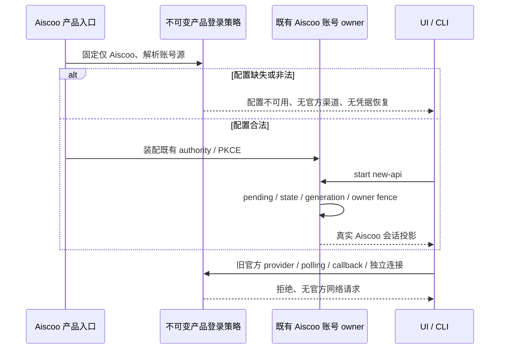

# Aiscoo 唯一账号登录

状态：用户于 2026-10-31 明确要求“删除，清理 Z.ai／BigModel 登录相关的”。本规格覆盖旧规范中保留官方主登录、独立官方连接及条件式回退的规则；以本规格为准。

## 1. 产品规则与边界

- Aiscoo Desktop、Web 和 Aiscoo CLI 产品入口只允许 Aiscoo 账号（内部稳定 provider ID 为 `new-api`，CLI 沿用现有 Zen/Aiscoo 授权实现）。不再展示、发起或恢复 Z.ai／BigModel 产品账号登录。
- 删除 Aiscoo 的官方主账号回退、Z.ai polling 登录、独立 `official-cloud` 连接入口及其产品装配。缺配置、空配置、非法配置、服务失败、退出和旧会话恢复均不得启用旧官方账号；服务端/RPC 与原生 deep-link 边界也必须拒绝，不能只隐藏按钮。
- 自配模型/API Key、供应商模型协议、BigModel/Z.ai 的自配 Provider、主题名、上游归属、第三方插件/MCP 的 OAuth 不属于产品账号登录，不随本次清理删除。历史 token、数据库和安全库条目不自动删除、迁移或认领；产品入口不再读取它们作为当前身份。
- 通用上游认证实现可留作未注入产品策略时的能力；Aiscoo 的所有产品入口必须显式装配唯一账号策略。复用扩展点、只追加配置及最小装配接线，不重写上游 OAuth 状态机。
- 没有 Aiscoo 权益替代的官方 MCP/闲时云功能进入真实不可用状态，不重新开放官方登录，不使用 Aiscoo token 请求官方服务，不伪造额度或可执行模型。

## 2. 配置与平台

公开账号源仍为 `AISCOO_ADMIN_BASE_URL`，必须是严格 HTTPS origin 或现有允许的 loopback HTTP；没有生产默认地址，不读退役的 `NEW_API_BASE_URL`，不复用 Z.ai/BigModel 端点推断账号源。

Desktop Aiscoo 渠道始终启用产品账号限制。Main、Host、scheduler 对同一配置作一致决策；未配置或非法配置显示稳定且不含实际地址的配置错误，不能创建旧官方 OAuth owner、恢复旧官方会话或出站请求。设置和会话数据仍由既有 owner 持有。正式包没有运行账号配置时也必须失败关闭，不能依赖开发 `.env` 存在。

本机 Web 复用已实现的浏览器 New API authority、同源控制 API 代理和严格 loopback PKCE callback；未启用/未配置显示不可用。远控/分享原有 Z.ai/BigModel 浏览器登录入口停止使用；不在本次绕过或改写现有 relay、配对、权限、Host attachment、回调或 CORS 边界。已有可用 attachment 的恢复链路与公开只读分享尽量保持，不支持 Aiscoo 身份的路由明确不可用，不静默读取旧官方浏览器登录态。

Aiscoo CLI 复用已有 Zen/Aiscoo 命令与安全存储。默认登录只引导 Aiscoo；指定 Z.ai/BigModel 或旧官方自动登录/恢复路径在产品入口拒绝并提示 Aiscoo。通用 CLI 实现仍可按上游扩展原则保留，产品命令不可绕回官方登录。

## 3. 唯一状态所有者与事件顺序

有效配置下仍由 Desktop `NewApiAccountService`、Web 浏览器 New API authority、CLI Zen credential owner 分别持有自身既有会话；不新建第二份 accepted login 状态。配置不可用适配器只提供不可用投影，不伪造账号、SID、token 或授权流程。Renderer 通过服务 hook 投影。

退出、取消、换号、过期、迟到回调继续沿原 owner 的同步失效、异步撤销和一次消费规则；不恢复旧官方 identity。冷启动尚未发布 active provider、授权仍 pending 或恢复请求未返回时，退出也必须立即委托同一 owner 失效，不能因 UI 前置查询为空而跳过或延迟失效。Desktop `desktop-continuous` 与手机 `web-remote-replayable` 维持原含义，手机不新建 Agent 或 Host。

凭据端口在判断退役命名空间和读取 manual 来源前，使用与底层一致的规范化 key。首尾空白不能绕过旧官方读取/写入/删除限制，也不能绕过 CLI 手工 API Key 来源判定；批量接口同样在任何 IO 前检查每个 key。

## 4. 验收

1. 登录界面、设置、使用统计、Web 预连接及 CLI 入口不再出现可点击的 Z.ai/BigModel 产品登录；旧官方用户缓存不构成已登录 Aiscoo。覆盖空 providers、仅旧官方、混合 provider 和合法 Aiscoo。
2. 服务/RPC/原生边界拒绝官方 provider、polling 和独立连接；缺失/空/非法配置及旧凭据存在时均无官方 restore、刷新或登录请求；自配模型和第三方 MCP OAuth 保持原行为。
3. 合法 Aiscoo 配置继续使用真实原有 PKCE、渠道精确 callback、取消/退出/过期与 stale owner 防护；不改后端协议、API 路径或登录凭据格式。
4. 交互先维护既有 E2E/浏览器验收场景，再修改实现；App 不新增已退役业务单测。复用获批下游回归与 CLI/工程入口，使用隔离数据和假后端，不访问真实账号/钥匙串或调用计费模型。
5. 执行 root typecheck、lint、架构、对应回归和 Desktop/Web 构建，列明上游最小装配文件及 `git merge-tree` 预演结果。平台、真实后端或工具受限的验收如实记录，不以定向通过宣称完整 E2E。
