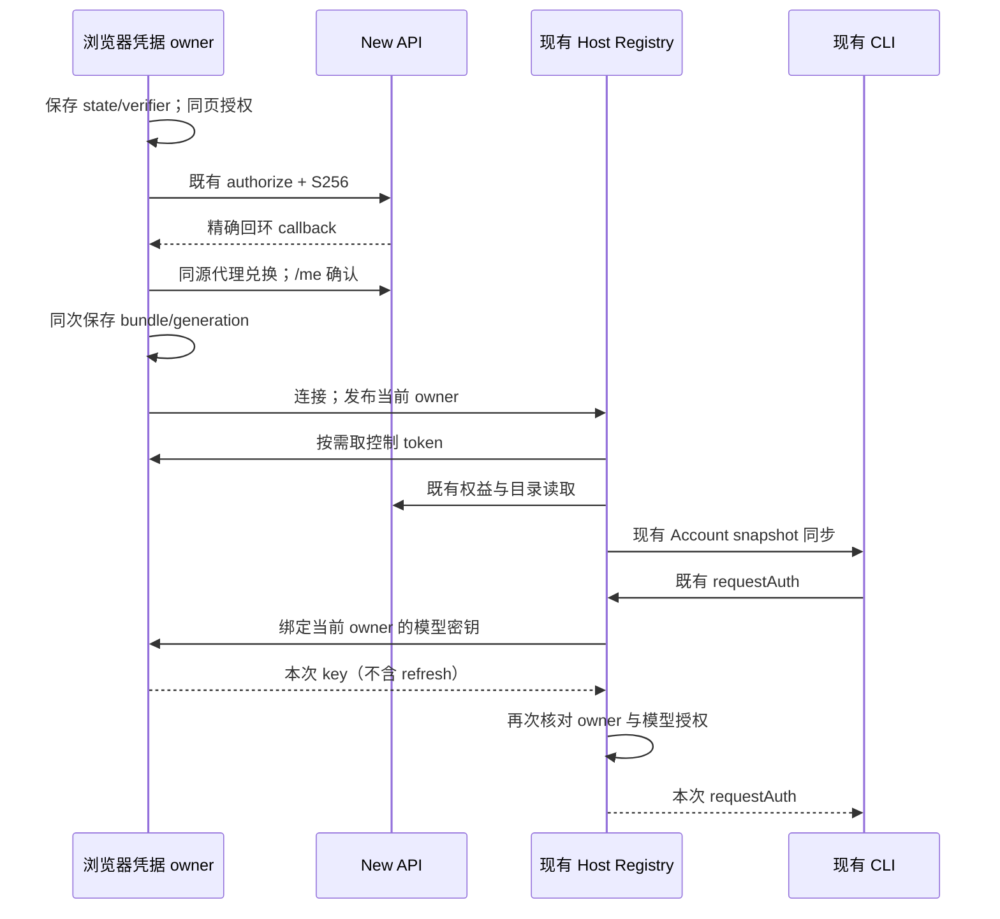

# 本机 Web：浏览器持有 New API 凭据

状态：浏览器登录与凭据适配已实现，2026-10-30；普通 standalone Web 创建项目和聊天首发尚未验收。用户明确选择尽量少改、浏览器持凭据；替代已关闭且未合并的 PR #47。范围仍为同机浏览器 + 现有 Server + 本机 CLI，不扩展部署 Web、多用户或手机远控。

## 1. 复用与范围

- 沿用 `pnpm dev:web`、现有 WebSocket RPC、`IOAuthService`、`WebCallbackPage`、AccountProviderService、Native 目录解析及 Worker 的请求期鉴权协议。上游 Z.ai/BigModel 远控和分享登录保持原路径。
- 浏览器通过 WebCrypto 生成 state 和 S256 PKCE，使用现有公共客户端 `xwork-cli` 和精确 `http://127.0.0.1:<Web端口>/oauth/callback`，同页跳转到 New API 原生授权页，回调成功返回 `/`。源码允许这种回调，不要求独立 listener。仅本机模式启用专用同源控制 API 代理，不修改 New API 后端和 CORS。
- 公开配置为 `AISCOO_BROWSER_NEW_API=1` 与 `NEW_API_BASE_URL`；浏览器访问地址必须是有显式非默认端口的 `http://127.0.0.1`。启用配置不得回退到官方账号。远控、分享、Desktop 及未启用配置时保持既有默认行为。本机代理必须保留原 `/api/v1/oauth/token`、`/api/v1/remote` 专用目标，所有专用条目排在 `/api` 通配之前；只将本机 `/ws` 与 `/api` 目标切到精确回环 Server。
- 不带入 #47 的 Host 登录状态机、OS keyring、私有磁盘凭据库、CLI adapters 依赖、新网络 session/token 系统和专用进程启动器。
- 普通 standalone Web 的项目创建仍存在既有边界：UI 默认传 `hostId=local`，Server 持库 owner 为 `remote:server:<id>`，因而目录/保存会被 `project.host-offline` 拒绝；未选择项目的草稿被 `project.remote-project-required` 拒绝。本次不改写 owner、workspace identity 或远端项目权限。真实 CLI 的 helper 查询通过，不能据此声称普通新用户从创建项目到聊天首发已可用；该交互需要独立的当前 Server 项目适配。

## 2. 所有权与接口

| 状态                     | 唯一 owner                                  | 派生边界                                                                      |
| ------------------------ | ------------------------------------------- | ----------------------------------------------------------------------------- |
| 登录尝试、state/verifier | 浏览器，sessionStorage                      | 精确回调、一次消费、5 分钟有效；导航后仍可取回                                |
| SessionBundle 与刷新轮换 | 浏览器，独立 localStorage key               | 不读取/覆盖上游 OAuth key；按 New API origin 隔离；Web Locks 串行写入/refresh |
| 当前身份                 | 浏览器保存的 user/SID/generation            | `/me` 远端确认；Server 仅保留连接期 owner 投影                                |
| 目录/权益/可执行模型     | 现有 Host AccountProviderService / Registry | 继续复用现有 Native 解析、owner/authorization revision 校验及 Worker 同步     |
| 模型请求密钥             | 浏览器持久保存，按请求临时交付              | 通过同连接反向 RPC 到现有 Host/CLI requestAuth；不进入配置或日志              |

现有服务工厂增加可选的 Native account authority 注入，默认为原桌面实现。浏览器 authority 是窄接口：`oauth/getOwner/isCurrent/withControlSession/getRelayCredential`；它不创建第二个可持久会话库。Host 只按需读取短期 control token或本次模型密钥，不读取 refresh token，不替浏览器刷新。

现有 socket 上增加可选反向 channel 装配；普通 `/ws` 仍是 `web-remote-replayable` / terminal-client，不获得 trusted-host 或 provisioning 权限。本机模式每个 Server 同时只接受一个浏览器账号 attachment；第二个连接被拒绝，断连同步清除该 owner 并使目录失效。它不是多租户服务。

## 3. 时间和失败规则

- callback 处理单飞；state/回调/provider/期限必须匹配。code 兑换不自动重试；合法 proof 重放会撤销已签发 SID。旧尝试不能覆盖后来接受的登录。非法回调不访问 token endpoint。
- refresh 在浏览器 Web Lock 内重新读取当前 bundle，轮换后同次写回；保持原 user/SID/relay key，只有同一 owner 可接受结果。退出/换号/断连之后的迟到结果不能发布给新 attachment。
- 恢复必须经 `/me` 确认，过期 control 先刷新。网络失败显示不可用并保留可恢复存储；控制接口确认 SID/凭据用途无效时，Host 在异步通知前同步使捕获 owner 和目录失效，再通知浏览器按 generation/user/SID 清除匹配凭据。迟到错误不得清除后来新账号；网络或服务故障不得伪装撤销。不能把 opaque token 或缓存头像当身份验证。
- 退出先使本地 owner 无效、清存储并通知 Server 使执行失效，再尝试原 SID 的远端 logout。撤销失败明确报错，不声称远端已撤销；不撤销后来新登录的 SID。登录/退出均通过原 `IOAuthService` 消费路径。
- 浏览器关闭后 Server 无可用 credential source；不保存 control/refresh/relay key 到 Host 磁盘。已有已接受任务的恢复仍由现有 CLI 管理；新请求不能借用上个 attachment 的凭据。
- 本机 Server 与 Vite 明确监听 loopback，代理目标固定为已验证 New API origin；不能把任意 URL、凭据或 token 编入公开配置。不为浏览器方案开放公网/局域网访问。开发服务器使用明确 Host/Origin 边界；该边界不引入新登录 session 系统。

## 4. 验收

1. 从干净 release 安装后直接 typecheck，源码无 CLI dist/keyring 依赖；未启用时现有 Web/远控/分享/桌面相关回归保持通过。
2. 真实回环假后端 + 浏览器完成授权、callback、恢复、refresh、退出；未知 state/重复 callback/过期尝试拒绝；不触碰真实账号和生产 New API。
3. 现有目录/权益解析与请求期 resolver 接入，合成模型请求仅到回环假模型接口；凭据不落 Host 文件，不伪造可执行目录。真实 CLI 集成回归通过既有 `generateWorkspaceText`、`app-server --stdio` 发出 Chat Completions HTTP 并核对返回文本、模型与用量；该回归需要先构建 CLI，不替代普通聊天 UI 的交互验收。
4. 账号变更、断连、刷新/读取迟到、第二 attachment 都不会释放旧或错误账号密钥；无身份时目录不可执行。
5. 必需的 typecheck、lint、架构检查、受影响测试、Web 构建和上游合并预演如实记录。真实部署支持、真实账号及跨平台未验内容单独列出，不以源码检查代替。
