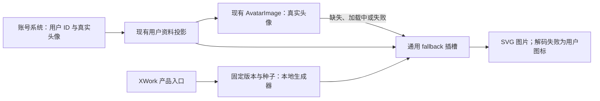

# 默认用户头像

状态：已实施并通过定向测试与隔离界面验收；未合并、打包发行或部署。

## 产品规则

登录用户的真实头像可用时优先展示；头像地址缺失、空白或图片加载失败时展示 Multiavatar。生成或图片解码失败、没有有效用户身份时显示中性用户图标。未登录和恢复中的展示语义保持原样。覆盖桌面侧栏、账户菜单与设置页，以及 new-api 网页已经展示用户头像的位置。管理员日志隐藏敏感信息时使用匿名占位，不展示可关联用户的稳定图案。

用户头像是身份的展示派生值，不是上传资料，不回写用户记录、不新增数据库字段，不改变 `/api/xcode/v1` 用户字段或 `UserInfo`。账号系统仍是身份与真实头像的唯一所有者。

## 确定性与跨仓库合同

- 固定生成器 `@multiavatar/multiavatar@1.0.7`，默认参数（保留背景，不覆盖角色或主题）。
- new-api 用户 ID 使用正十进制字符串，不转换成浮点数。种子为 `aiscoo:new-api:multiavatar:v1:` 加规范用户 ID。
- 名字、邮箱、主题、登录 SID、凭据和时间均不参与生成。同一账号在桌面与 new-api 网页的 SVG 一致；改名、刷新、重新登录和重启后不变。
- 本期命名空间代表当前 new-api 账号库；未来独立账号库必须配置独立命名空间。Multiavatar 图案空间有限，不承诺不同账号的图案绝不重复。
- 两仓使用相同固定用户 ID 的 SVG SHA-256 校验值防止生成规则漂移。生成器升级需要显式迁移评估。

## 模块与接入

`profile-avatar` 提供可选、通用的 fallback 渲染上下文。未注入时返回调用者原有 fallback，保留上游默认行为。`aiscoo-account-avatar` 拥有稳定 ID 到 SVG data URI 的纯派生和本地图片展示，通过根包装组件注入默认头像。共享 Footer 只调用通用扩展，不引用 Multiavatar 或 XWork 实现；Avatar primitive、OAuth、Host 与 Store 不新增头像状态。

生成器仅使用本地资源，SVG 作为编码后的 `data:image/svg+xml;charset=utf-8,` 图片加载，不使用 HTML 注入，不访问 Multiavatar/CDN。缓存按用户 ID 有界保存，可随页面生命周期丢弃。头像加载错误仅属于当前身份及当前图片地址，切换用户不继承另一身份的错误。

new-api 独立实现相同种子合同与生成版本，组合自己的 Avatar primitive。现有网页登录返回的 ID 足够生成，不改 Go、HTTP 或数据库。更新 new-api 现有 `docs/specs/xcode-integration.md` 说明双方合同。

## 许可

Multiavatar 使用 MULTIAVATAR LICENSE v1.0，不标为 MIT。用于产品账号头像附加功能，保留随包许可及 CryptoJS 声明，禁止将原图库重新包装或作为竞争头像产品。许可复核仅绑定已核实的精确包名、版本与原始许可值，不放行未知 `SEE LICENSE IN LICENSE` 包。

## 验收

1. 相同 ID 的跨端 SVG 校验值一致；修改名字、重新登录、刷新和重启后头像不变；换号后显示对应头像。
2. 真实头像正常显示；无头像、空白地址或加载失败显示 Multiavatar；生成图解码失败显示中性图标；未装配扩展时保留首字回退。
3. 侧栏、菜单、设置及 new-api 现有头像入口尺寸与裁切正确，深浅主题和窄屏可读，匿名日志不泄露稳定头像。
4. Electron 与浏览器实际解码 SVG，断网可用，没有外部头像请求或 CSP 拒绝。
5. 执行受影响单测与 Electron 场景、typecheck、lint、架构和许可检查；记录真实结果与上游合并预演，不将环境限制写成通过。

## 实施验证（2026-10-29）

XCode 分支 `feature/multiavatar-default-avatars`；new-api 使用从 `release` 创建的隔离工作区 `/Users/timo/ai/new-api-multiavatar`、分支 `feat/multiavatar-default-avatars`，保留原 new-api 品牌分支中的未提交改动。无提交、推送、合并或发布。

| 范围                                  | 实际结果                                                                                                                                                                                                                              |
| ------------------------------------- | ------------------------------------------------------------------------------------------------------------------------------------------------------------------------------------------------------------------------------------- |
| XCode 头像契约、图片状态与现有 Footer | 固定 Node 24.14.0 下，4 文件 19 项通过；ID42 SVG SHA-256 为 `f0d93b3eb893342c11ba3dfd82ac35b8e525bd4658437d8be1bd4ef1f3d91892`，与 new-api 相同。                                                                                     |
| XCode 原 New API 协议回归             | `newApiWire.test.ts` 的 9 项通过。                                                                                                                                                                                                    |
| XCode 许可与架构回归                  | 许可相关定向 16 项、架构检查器 37 项通过；`pnpm architecture:check --changed` 零违规。                                                                                                                                                |
| XCode 类型、Lint、格式                | `pnpm typecheck` 通过；`pnpm lint` 通过，316 条既有 warning、零 error；本次新增模块与测试的定向 Lint/格式检查通过。                                                                                                                   |
| Electron 真实组件                     | `node packages/desktop/test/newApiAccountAvatarElectron.mjs` 通过：真实 Footer/Menu、SVG 解码、真实图片优先、损坏/空白回退、改名、换号、恢复/未登录、未注入扩展与 renderer reload。深浅主题、宽/窄窗口均为原 32px 头像且无横向溢出。  |
| Electron CSP 与网络                   | `img-src 'self' data:` 下无图片拒绝，无外部请求；只记录现有 Zod `allowsEval` 空函数能力探测的 `script-src` 告警，未放宽产品 CSP。                                                                                                     |
| new-api                               | 头像及相关页面 5 文件 114 项通过；其实际网页测试命令执行 213 文件、2617 项全部通过；typecheck、生产 build 和本次 16 个 TypeScript 文件 Lint/17 文件格式检查通过。                                                                     |
| new-api 已有检查问题                  | 全仓 Lint 160 error/66 warning，全仓格式检查涉及 9 个既有文件；本次改动文件无对应诊断，未扩大修复。                                                                                                                                   |
| 浏览器实际组件                        | 本地隔离入口使用真实 UserAvatar、ProfileHeader、ProfileDropdown、MobileDrawer、授权页及真实 CSS。浅色宽屏、深色 390px、本地 SVG 解码、privacy 隐藏头像、移动抽屉和授权页均已观察。仅本次创建的验收服务随后关闭。                      |
| 第三方声明                            | 完整 notices/inventory 生成与基础新鲜度检查通过；Multiavatar 专用许可及内嵌 CryptoJS BSD-3-Clause 原文已纳入。整体许可标识检查仍有 3 个其他依赖失败，严格完整性仍有原 19 项缺口，见 `third-party/README.md`，未宣称发行许可门禁通过。 |

截图与机器证据保存在 `/tmp/aiscoo-multiavatar-validation/`（临时验收材料）。未执行真实账户登录、完整桌面进程/OS 重启、Windows/Linux UI 或正式部署；确定性由固定种子、跨端 golden、换号及 renderer reload 证据覆盖。

## 上游修改理由与合并预演

上游业务逻辑只增加通用插槽调用和产品入口包装，保持关闭扩展时原行为。共享清单只追加；生成文件仅接受真实依赖图生成结果。

| 上游文件                                                                         | 最小修改理由                                                                                                               |
| -------------------------------------------------------------------------------- | -------------------------------------------------------------------------------------------------------------------------- |
| `packages/ui/src/WorkspaceSidebarFooter.tsx`                                     | 原组件无 fallback 插槽，增加通用可选 hook 调用，使产品默认头像独立装配。                                                   |
| `packages/desktop/src/renderer/src/main.tsx`、`packages/web/src/main.tsx`        | 产品装配点组合头像 Provider，与已有启动包装并存，不改变 Root props 或认证所有者。                                          |
| `packages/ui/package.json`、`pnpm-lock.yaml`                                     | 追加独立公开入口和固定依赖；严格 JSON/生成文件不加代码注释。                                                               |
| `scripts/license-identifiers.mjs`、`scripts/licenses.mjs`                        | 仅导出、调用 XWork 独立精确许可复核谓词，原分类器与其他规则不变。                                                          |
| `third-party/README.md`、`third-party/SPEC.md`、`third-party/npm-overrides.json` | 追加使用限制、固定版本的许可原文与来源，不删除或改写原登记。                                                               |
| `THIRD-PARTY-NOTICES.md`、`third-party/inventory.json`                           | 完整生成器统一生成；另恢复精确版本 LobeHub 原文以解除生成阻断。旧锁已有的 keyring 平台原文因此一并纳入，原 19 项缺口保持。 |

已执行 `git fetch upstream`；以包含全部未提交头像补丁的临时索引生成树，使用 `git merge-tree --write-tree --name-only --merge-base=<共同基线> <补丁树> upstream/main` 预演，退出 0，无冲突。上游为 `3c5b2276`。临时索引未改变用户暂存区，未创建提交。
