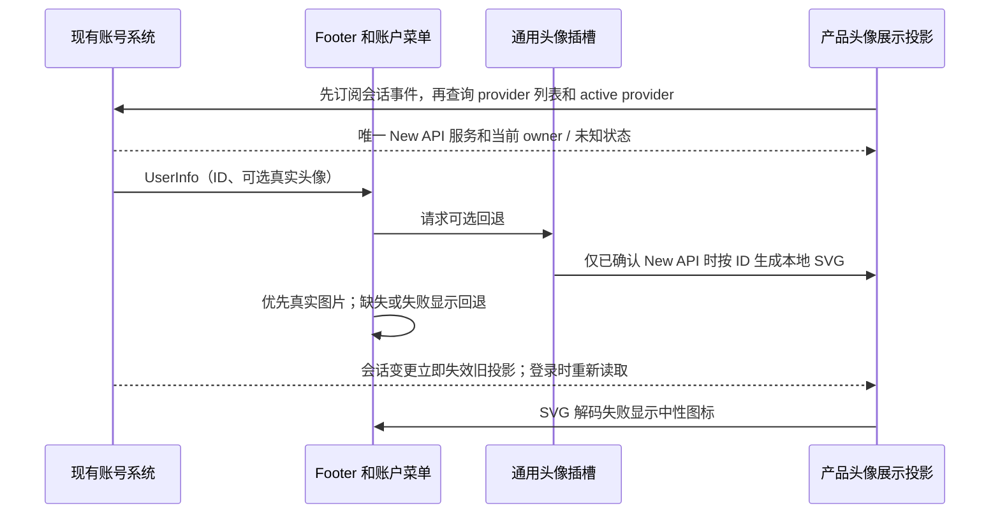

# 默认用户头像

状态：正在从独立头像功能集成到 release；验收结果以本 worktree 的实际运行记录为准。

## 产品规则

- 登录用户的真实头像可用时优先展示。地址缺失、空白或图片加载失败时，桌面侧栏、账户菜单和复用侧栏的设置页按身份规则选择本地 Multiavatar、原 fallback 或中性图标。未登录与账号恢复中的既有图标保持原样。
- 头像是账户身份的展示派生值，不是用户资料；不写回用户记录、不新增持久化字段，也不改变现有的 UserInfo、provider 身份、凭据或 `/api/xcode/v1` 传输合同。账户系统继续拥有 ID 与真实头像。
- 此次只修改本仓库的桌面及现有 Web 产品装配点；new-api 网站及其匿名日志行为由对应仓库负责，本 worktree 不声称已验证或修改其实现。

## 确定性与范围

- 固定 `@multiavatar/multiavatar@1.0.7`，使用默认参数和背景。只在产品入口验证 OAuth 服务是仅提供 New API 主身份、且 active provider 为 New API 时，为正十进制 ID 生成头像，种子为 `aiscoo:new-api:multiavatar:v1:` 加 ID；不转换为浮点数。非正十进制 ID（包括 `unknown`、零和前导零）保留上游原 fallback；已确认 New API 身份的空白 ID 显示中性图标。
- 生成只依赖 ID 和固定命名空间，不依赖名称、邮箱、主题、会话、凭据或时间。`UserInfo` 不包含 provider 来源；因此产品入口只读取当前主 OAuth 服务的现有 provider 列表、active provider 与会话变更事件做可丢弃的展示投影，未知、错误、过期或混合 provider 一律保留原 fallback。不新增身份 owner，不改凭据或持久化。不同账号的有限图案不保证绝不重复。
- ID `42` 的原始 SVG SHA-256 为 `f0d93b3eb893342c11ba3dfd82ac35b8e525bd4658437d8be1bd4ef1f3d91892`；升级生成器或种子须先评估迁移及跨端合同。

## 模块与时序

`profile-avatar` 暴露通用可选 fallback 上下文，未注入或渲染器拒绝时保留现有首字回退。`xwork/account-avatar` 负责 ID 到 SVG data URI 的纯派生、生成图解码失败回退和产品入口的只读 OAuth 展示投影。Footer 只调用通用插槽，不引用产品生成器。缓存有界且仅为可丢弃的派生值；图片失败状态随身份和生成图来源重置，不能污染其他身份。产品入口先订阅主 OAuth 服务会话事件，再读取 provider；退出立即关闭投影，登录事件触发重新读取，旧请求、替换服务和卸载均不可提交迟到结果。始终保留同一个根组件父节点，避免身份展示变化重挂应用。通过 `getProviders()` 确认仅有 New API 后，再读取 `getActiveProvider()`；读取失败或无 active owner 时不接管，原有 user 状态与认证事件顺序不变。

SVG 仅作为编码的 `data:image/svg+xml;charset=utf-8,` 图片加载，不使用 HTML 注入或访问 Multiavatar/CDN。Desktop 和 Web 使用各自现有根组件组合，不改变认证状态与恢复链路。

## 许可与验收

Multiavatar 的原始许可为 MULTIAVATAR LICENSE v1.0，并非 MIT；仅针对核验过的精确包名、版本与原始许可字段登记。保留其许可及内嵌 CryptoJS 原始版权和条款，禁止将头像设计集重打包或用于相似、竞争的头像产品；具体材料和约束以 `third-party/` 为准。已有许可标识或完整性缺口必须如实记录，不以生成声明代替发行审核。

1. 固定 ID golden、一致性、换号、改名、无效 ID 与生成失败回退通过定向测试；合成 BigModel、Zai、`unknown` 等非正十进制身份保持原 fallback；空 ID 显示中性图标，未装配时上游 fallback 不变。
2. 实际隔离 Electron 验证真实 Footer、菜单、图片解码与真实图优先，覆盖缺失、空白、损坏、换号、恢复和退出；检查深浅主题、窄屏、CSP 与外部请求。
3. 运行受影响测试、typecheck、lint、架构及许可检查；以实际结果记录失败与已知限制，未连接真实账户或部署。

## 本 worktree 验证（2026-10-30）

- 分支 `feature/aiscoo-account-avatar` 从 `origin/release` 的 `152a337e` 创建，已 fast-forward 到 `e0447b44`（#39 桌面启动壳、#40 Web 字标、#41 同步日志保护，与本功能文件不重叠）；使用本机 Node 24.18.0（`mise.toml` 固定 24.14.0）和 pnpm 10.33.2。未提交、推送、合并或部署。
- 身份边界结论：`UserInfo` 无 provider 字段，因此头像仅在产品入口通过 Native 主账号 `NewApiAccountService.oauth` 的公开投影确认后生成：`getProviders()` 仅返回 new-api，`getActiveProvider()` 仅在存在 owner 时返回 new-api，owner 清空时在身份落盘锁内同步触发 `signed-out`。官方 BigModel/Zai 登录由另一个服务持有，不经过该投影。已知限制：投影与 `UserInfo` 来自两次独立读取，不是同一个原子快照；换号窗口内由“先订阅再读取、事件立即失效、请求代数防迟到”收敛，任何读取失败、事件不可订阅、服务替换、混合 provider 都回到上游 fallback。要求原子对应时需上游在 `UserInfo` 增加 provider 来源，本功能不新增身份 owner。
- 头像与插槽定向测试 28 项通过（含 `aiscooAccountAvatar` 22 项：合成 BigModel/Zai 数字 ID 42、混合 provider、迟到请求、active 读取失败或无 owner、旧慢读不覆盖新读、换号经退出再登录、卸载后迟到结果、`unknown`/前导零/空 ID）。侧栏相关测试 24 项通过；许可谓词及实际 gate 隔离测试 2 项通过。
- 隔离 Electron 真实 Footer 和菜单验证通过：本地 SVG 解码、真实头像优先、损坏/空白回退、换号与改名、恢复/退出、合成其他 provider 的原 fallback、空 ID 图标、无注入和 renderer reload；深浅主题及 360px 宽屏无横向溢出。测试仅使用合成身份并阻断外部请求；观察到 Zod `allowsEval` 空函数探测的已识别 CSP 告警。证据在 `/var/folders/44/l6x_89z10090mcfn64grkxnw0000gn/T/aiscoo-avatar-evidence-U9eku7/`。
- 快进到 `e0447b44` 后重跑：`pnpm typecheck` 通过；`pnpm lint` 通过（0 error、319 warning，均不在本功能文件）；`pnpm architecture:check --changed` 零违规；功能文件格式检查通过。快进范围未触及 Electron 测试编译的 `packages/ui`、`shared`、`services`、`desktop/src/renderer/src`，故未重跑隔离 Electron，上述 Electron 记录沿用 `152a337e` 的结果。
- 许可复核谓词、门禁挂钩函数、补充材料清单和文档均放在下游独立文件：`scripts/aiscoo/multiavatar-license.mjs`、`third-party/aiscoo-npm-overrides.json`、`third-party/aiscoo-multiavatar.md`；上游 `license-identifiers.mjs`、`third-party/npm-overrides.json`、`README.md`、`SPEC.md` 保持原样，`licenses.mjs` 与 `generate-third-party-notices.mjs` 仅各加少量 `// XCODE:` 行。完整声明生成和基础许可检查通过。严格许可检查因 release 既有的 19 项待核验材料失败，与 release 基线逐项一致，不声称严格门禁通过；详见 `third-party/aiscoo-multiavatar.md` 和 `inventory.json`。
- 与 `upstream/main` a60ba6a7 的 merge-tree 预演：release 基线 179 个冲突，含全部改动后 181 个，新增仅 `THIRD-PARTY-NOTICES.md` 与 `third-party/inventory.json`（完整生成器输出，上游同样重新生成，无法避免）。未验证真实账户、完整桌面进程或操作系统重启、手机 Web、Windows/Linux 与正式发行包。
