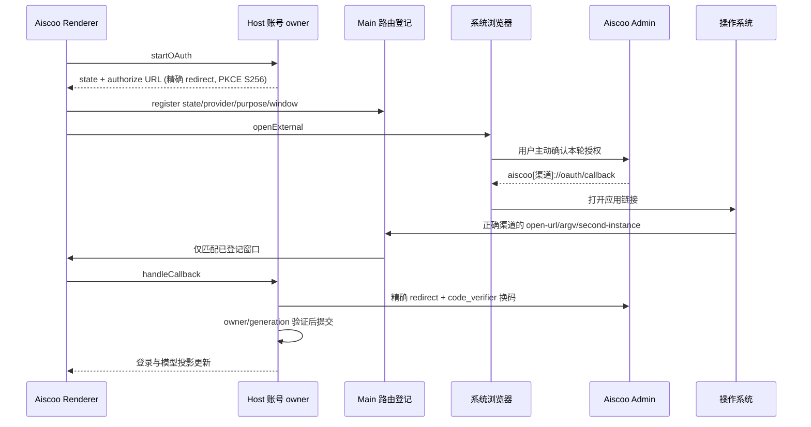

# Aiscoo 桌面身份与原生登录回调

状态：已确认，2026-10-30。

## 产品身份

| 渠道        | 应用 ID                | 显示名 / Electron 数据目录名 | URL scheme     | Native redirect URI             |
| ----------- | ---------------------- | ---------------------------- | -------------- | ------------------------------- |
| production  | dev.aiscoo.app         | Aiscoo                       | aiscoo         | aiscoo://oauth/callback         |
| development | dev.aiscoo.app.dev     | Aiscoo Dev                   | aiscoo-dev     | aiscoo-dev://oauth/callback     |
| preview     | dev.aiscoo.app.preview | Aiscoo Preview               | aiscoo-preview | aiscoo-preview://oauth/callback |

Aiscoo 正式版、开发版、Preview 和上游 ZCode 必须能够共存。Aiscoo 不默认声明或注册 zcode scheme，不删除或注销 ZCode 的注册。上游默认配置、NEW_API_CALLBACK_URI 及稳定 client_id=xcode-desktop 保留，通过可选配置扩展，不批量替换协议标识。

唯一身份配置位于 @zcode/shared/aiscoo-desktop-identity，构建工具和运行时复用。Desktop 构建显式固化渠道；未注入 Aiscoo 渠道的通用运行时保持上游默认值。系统应用 ID、Windows executable/AUMID、Linux executable/package/desktop MIME、macOS开发副本与正式协议声明均须与该配置一致。

Aiscoo 桌面打包入口使用独立配置包装上游 afterPack：先等待原 hook 完成全部 asar 重打包，再为 macOS 的 node-pty spawn-helper 恢复执行权限，随后由 Electron Builder 执行签名。原配置单独使用时行为不变；原 hook 失败时不得继续修复或签名。工程回归覆盖 hook 次序、真实重打包和执行权限恢复；最终安装包须以实际 PTY spawn 验收，不能仅检查文件存在。

## 授权接口与所有者

Native New API authorize、callback parser 与 token exchange 必须使用同一精确 redirect。后端先增加允许的精确 URI，保留旧版 zcode URI；不得接受任意自定义 scheme、URI前缀、额外路径、fragment、用户信息、端口或重复 query。开发/Preview 回调只有后端明确登记才可用。既有 refresh/logout client ID 与凭据 namespace 保持不变。

Host NewApiAccountService 是 pending/PKCE、换码、会话持久化和账号 generation 的唯一 owner。Main 只拥有 state/provider/purpose/window 的投递登记；Renderer 只发起和呈现状态。取消、超时、旧 state、错误 provider/purpose、重复回调仍由现有 owner 校验；不向当前活动窗口兜底。不记录 code/state/token。

desktop-continuous 与手机 web-remote-replayable 语义不变；手机继续复用已有 Host attachment。本变更不增加登录、会话或队列 owner。

官方云 BigModel/Z.ai 依赖提供方与官网中转的独立 redirect 配置，不能因本地 Native 回调支持就声称官方云回跳已兼容。Aiscoo 不通过抢注 zcode 或放宽校验补偿其服务端未登记；该能力在其服务端配合后单独验收。

## 深链覆盖

Main scheme 注册、URL提取/解析、冷/热启动、支付返回、工作区打开、分享导入、Finder 生成链接均读取同一配置，保留每条现有路由参数及用户确认规则。Web 分享默认指向 Aiscoo 正式版，开发渠道须显式配置。远控的 HTTPS 链路不改为桌面 OAuth 深链，Android 原生注册单列平台验收。

## 数据与凭据

Electron userData/sessionData 使用各渠道独立目录。业务数据根、Host、CLI DB/日志与单例锁也须按实际路径验证；保留系统 HOME。早期 Chromium 硬件加速设置也读取本渠道固定的设置文件，不能反读旧 HOME 设置而覆盖本渠道偏好。使用已有显式路径覆盖，不假设改 appId 就完成所有数据隔离。

新安装使用 Aiscoo 独立业务数据根。既有用户数据不得按 ZCode 目录名称自动认领，也不得从正在写入的数据库复制。历史迁移必须由用户选定旧 Aiscoo 来源、停止旧写入者、创建一致备份、暂存导入、验证密钥后原子启用。此次不对真实数据自动执行迁移。

macOS 历史钥匙串名 XWork / XWork Dev / XWork Preview 与密文版本保留。新 bundle/签名访问旧钥匙串须实机验证，失败保留旧密文并明确恢复或重新登录，不用新 key 覆盖。CLI 目录派生账户、AAD与refresh锁单独验收；禁止两数据根同时刷新同一凭据。回滚保留原数据与安装，token 已轮换时允许要求重登，不承诺旧 token 可用。

## 验收

1. 身份工程回归：三个渠道 appId/scheme/dataName 成对唯一，打包和运行时一致，通用未注入配置仍使用上游值。
2. Native 授权回归：authorize 与 token exchange 参数一致；正确渠道成功，跨渠道、重复参数、未知 state、过期/取消和重复回调拒绝。
3. 系统共存：ZCode、Aiscoo正式/Dev/Preview 冷/热启动回跳各自实例，不随安装启动顺序互相接管；Windows/Linux在对应系统执行后才记通过。
4. 真实 macOS：新app身份启动，原钥匙串名称不变；新建测试凭据跨重启恢复，旧版合成密文迁移验证；真实用户迁移另行授权执行。
5. 后端精确白名单与客户端完整 Native E2E；登录成功、模型目录和实际推理分别记录。执行 typecheck、lint、架构及相关回归，未执行的平台或官方服务端部分如实记录。
