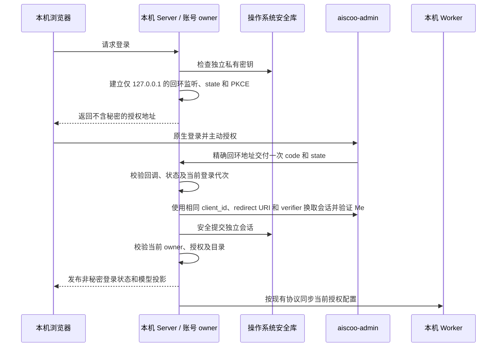
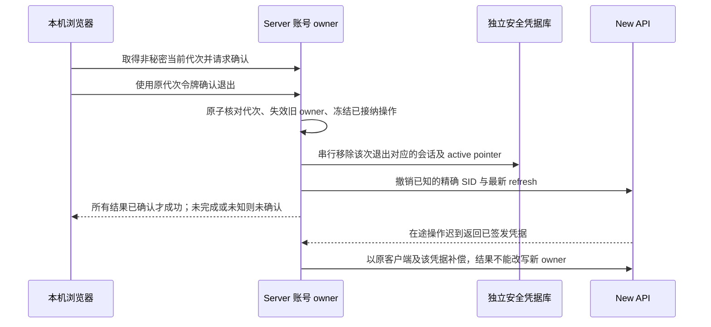
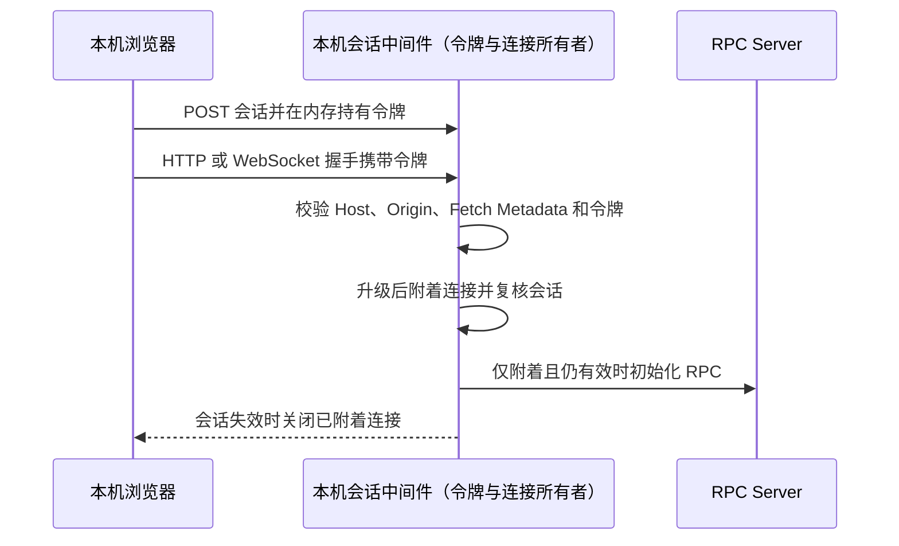

# 本机 Web 使用 Aiscoo 账号

状态：实施中。本规格扩展 [私有网关一期规格](new-api-integration.md)，不表示代码或生产后端已经支持独立 Web 登录。

## 范围与产品规则

1. 用户在同一台电脑上启动 Web 前端和本机 Server，以浏览器使用 Aiscoo 应用；不启动 Electron，也不经手机远控 relay。
2. Aiscoo 本机 Web 模式使用显式配置的 `NEW_API_BASE_URL` 作为主账号和托管模型来源。未配置、安全存储不可用、后端不支持该登录方式或连接失败时，明确显示错误，不恢复或回退到智谱/Z.ai 主账号或套餐。
3. 不改动用户的桌面会话、CLI 会话、原有官方凭据或自定义 Provider。Web 使用独立会话；切换账号、注销和撤销只影响该会话及其派生授权。
4. 仅支持单机单用户；不实现远程访问、SSH、多用户隔离或 Web 远控。桌面专属的平台能力不因本模式冒充 `desktop-local` 而启用。
5. 浏览器启动壳居中显示完整的 `aiscoo` 字标，优先使用随主题切换的现有动态原稿；减少动态效果时显示对应的完整静态字标。字标在桌面视口宽 320px，窄屏最大为视口宽度减 48px，按原稿比例缩放，不裁切；开发模式与生产构建均须在 JavaScript 执行前显示，且不依赖网络。
6. 新增 `pnpm dev:aiscoo:web` 作为本机开发入口，默认页面 `http://127.0.0.1:5174`、Server `127.0.0.1:3030` 和账号服务 `http://127.0.0.1:3001`；显式配置可覆盖端口及账号服务。开发页面只监听 `127.0.0.1`，同时信任同一端口的精确 `http://127.0.0.1:<端口>` 和 `http://localhost:<端口>` 来源；`localhost` 首先解析为 IPv6 时需要客户端回退到 IPv4。端口冲突时直接退出并报告，不自动接管其他进程或更换页面来源。沿用用户现有工作区数据根，Web 身份密钥和会话与桌面、CLI 分开；隔离验收必须显式设置全部数据根。

启动器拥有且只清理本次启动的 Server 和 Web 进程树。收到 Ctrl-C 或终止信号，或任一服务退出、无法启动时，停止两棵树并等待清理；不按端口或进程名终止其他进程。POSIX 使用独立进程组并在宽限后回收仍在运行的后代；Windows 当前只能请求直接子进程退出，无法保证其后代退出。Server 由启动器内的包装进程监督，异常退出经本次启动专属的回环通道通知启动器；重建或关闭时的 SIGTERM 不视为故障。

本机前端由构建标识 `VITE_AISCOO_LOCAL_WEB=1` 明确区分：只允许路径 `/` 且不含 `remote` 查询参数的页面进入本机应用。其他路径或含 `remote` 参数时，在任何 Web 远控、旧官方 OAuth 回调、分享页、本机会话请求和 WebSocket 初始化前显示本地化的不支持提示，唯一导航入口为不带查询参数的 `/`。提示不展示 URL、授权参数或分享码，也不提供远控操作；即使浏览器已有官方凭据亦不进入官方流程。New API 授权由 Host 的独立回环 listener 处理，不经过这些页面路由。未启用本机标识时沿用现有 Web 路由行为。

## 身份和凭据所有者

| 状态                                     | 唯一所有者                                      | 约束                                                                                                                                                       |
| ---------------------------------------- | ----------------------------------------------- | ---------------------------------------------------------------------------------------------------------------------------------------------------------- |
| 当前 New API owner、登录代次及登录中操作 | 本机 Server 的 `NewApiAccountService`           | 沿用既有状态机、所有者 fence 和 OAuth RPC；UI 不缓存第二份业务身份                                                                                         |
| 私有会话、refresh 和 relay 凭据          | 独立于桌面及 CLI 的本机安全凭据库               | 加密密钥保存在操作系统安全库；不可用时失败关闭，不使用明文或公开机器信息派生的 key                                                                         |
| Web 公共凭据及自定义凭据存储能力         | 同一独立安全凭据库中的公共命名空间              | `ICredentialService` 和 Host 内消费者使用 Web 专属文件及密钥；无论登录状态均不得读取、迁移、修改或删除桌面与 CLI 凭据。公开 RPC 仍禁止访问私有身份命名空间 |
| 模型目录和请求权限                       | 现有 AccountProviderService 和 Host/Worker 链路 | 仅从当前有效 owner 的授权快照派生；换号、注销、撤销立即失效                                                                                                |
| 浏览器                                   | 前端视图                                        | 只读取公开身份、状态和模型投影，不持有会话、refresh 或模型 relay secret                                                                                    |

## 本机授权与事件顺序

本模式复用后端已定义的 `xwork-cli` 公共客户端及精确回环回调约束；桌面 `xcode-desktop` 客户端、深链和其已有会话保持原样。实际部署必须支持该客户端，源码或健康检查本身不能作为生产部署已支持的证据。

回调必须校验精确地址、唯一 `state` 和一次性 `code`。取消、超时、重复回调及旧代次结果不得激活会话；若兑换成功但未能提交，尽力撤销本次签发的独立会话。恢复、刷新与退出必须使用同一 client_id，并保留桌面与 CLI 的会话隔离。失败和离线不冒充成功退出或空套餐。

本机 Web 的显式退出仍由 `NewApiAccountService` 独占协调：先失效当前 owner、登录代次和派生执行权限，阻止退出期间恢复旧凭据；再按同一 mutation 顺序移除该会话的本地加密记录和 active pointer，并向后端撤销实际最新的该 SID 凭据。退出与 refresh、恢复、换号交错时，不得重新激活已退出的身份，不得删除或撤销新账号；冷重启不能恢复已成功移除的会话。后端未确认撤销时，公开 RPC 返回不含秘密的稳定错误 `XCODE_LOCAL_WEB_LOGOUT_UNCONFIRMED`，界面明确告知“本机已退出，服务端撤销未确认”，不声称能够重试或已撤销；本地持久化或派生权限清理失败显示退出未完成，当前 Host 阻止旧会话恢复与重新登录。若凭据库无法写入，Host 无法将失效状态持久化，重启后旧 active 仍可能被服务端确认并恢复，须先修复存储再处理该会话，不能冒充本机已安全退出。未签发可撤销会话时不伪造远端结果。桌面路径保持原语义。

退出准入必须绑定用户打开确认框时由 Host owner 签发的非秘密代次令牌；确认后 Host 原子比较当前代次，仅匹配时失效 owner，账号切换（包括 A→B→A）、失效或其他退出使旧确认失效。令牌只用于退出准入，不携带 SID、凭据或用户信息；旧令牌拒绝不能清理当前身份。Host 在同一退出屏障下收拢此前已接纳的 refresh、失效和授权操作：已签发但无法持久化的后继必须使用签发该会话的客户端和准确 SID/refresh 撤销，退出、取消或换号不得恢复旧 active。已经启动但尚未完成且无法证明其结果的远端请求，不得无限等待或用超时判定成功，退出返回远端撤销未确认；迟到返回的已签发凭据仍由原 owner 负责准确补偿。补偿失败或结果未知不得被另一旧凭据的成功响应掩盖。该屏障只跟踪本次 Host 内未完成的真实操作，不建立持久 outbox；进程意外退出或请求响应未携带已签发凭据时，无法证明远端会话已撤销。

Host 装配由 `@zcode/services/node` 导出异步 `createLocalWebNewApiAccountFactory({ origin, dataDirectory? })`。它检查精确 origin 和独立系统安全库存储，并返回 `newApiAccountFactory` 注入 `createServerHostServices`；未注入时原有 standalone Server 行为不变。授权 listener 和 pending flow 由同一个账号 owner 管理，Server 在停止 HTTP 接收后调用 factory 的异步 `dispose()` 关闭 listener、失效尚未完成的授权，然后调用现有 `disposeServiceResourcesAndWait(services)`。不在 RPC 提供本机回环 code 或 verifier；`handleCallback` 不接受浏览器转发的本机授权回调。

Web 私有数据库默认固定在 `getAppConfigDir()/local-web/new-api`；隔离测试的 `dataDirectory` 是替代 app 配置根，仍使用该根下的 `local-web/new-api`。随机 key 使用独立于桌面和 CLI 的安全库账户。账号、独立官方连接及使用凭据服务保存的公开或自定义凭据使用同一 Web 数据库和密钥，但 RPC 不能访问 `new-api:`、`official-cloud:` 私有命名空间；任何路径都不迁移、读取或覆盖桌面 active pointer、桌面 OAuth 凭据或 CLI Zen store。Host 在创建公共凭据服务及依赖它的其他服务之前，从已初始化的 Web 工厂取得独立文件和 cipher；账号 owner 仍按原顺序装配。内部 provisioning 若启用也使用相同文件及 cipher。缺少 key、密钥库不可用或已有数据丢失 key 时失败关闭；测试只能使用临时目录和隔离的假安全库。桌面、CLI、普通 Web 和未注入本机 Web 工厂的 Host 保持现有存储行为。

本机 Web 的个人 Provider 配置和默认模型选择由现有 Host Provider Repository 管理，固定使用 Web 私有目录 `getAppConfigDir()/local-web/new-api/provider/provider_config.json`；隔离测试的替代配置根也遵循相同子路径。Host 的设置、模型选择和 provisioning，及 Worker 通过环境变量读取的路径必须指向同一文件；不读取或自动迁移桌面、CLI 的 `provider_config.json` 或旧 `config.json`。用户仍可在本机 Web 独立新增和使用自定义 Provider，桌面原有配置保持原样。现有 Provider 文件格式可能以明文保存自定义 API Key；使用现有私有文件原子写入和平台权限，不声称该文件已加密。

本机 Web 的内置 Provider 基线使用随包配置及 Web 私有 active 文件，Host 和 Worker 读取同一 active 路径；不启用官方控制面远端配置刷新，也不复用桌面的远端缓存。仍合并当前 New API origin 的 anchors，并按现有 owner 授权同步模型目录；其他 Host 的刷新、旧配置迁移和 Provider 存储行为不变。Host 必须在创建公共凭据服务前验证注入的 Web 凭据文件路径及 cipher 完整，缺失时报 `XCODE_LOCAL_WEB_CREDENTIAL_STORE_INVALID`，不得回退桌面存储。

本机 Web 工厂通过独立扩展模块提供已校验的 Host 配置：同一凭据存储、Provider 文件及不刷新远端或导入旧配置的覆盖项。Host 按既有顺序装配网络传输，并将唯一的 `onOwnerChanged` 回调交给工厂创建账号；扩展模块不新增身份 owner 或另行订阅状态。未注入扩展时，保留原 Provider 配置默认值和路径求值时机；Worker 的默认个人配置路径在每次 spawn 时读取当前数据根。

授权开始时先使旧 owner 与代次失效，再异步创建一次性回环 listener；cancel、logout、替换、过期或 dispose 撤销其 admission 并关闭监听。回环收到有效结果后由 Host 将 code 私下交给现有 owner 完成兑换、Me、commit 和最终 fence；即使已过期或取消，也按现有补偿语义撤销已签发会话。兑换使用该次精确 redirect URI，refresh、logout 与补偿固定使用 `xwork-cli`。

本机 Web 的 New API 网络请求使用 15 秒 AbortSignal 期限，保留已有调用方的取消信号；请求或响应体因期限终止时映射既有 `XCODE_BACKEND_UNAVAILABLE`，不泄露原始错误及秘密。请求实现如未响应取消并迟到返回成功，仍交给既有 owner 的代次栅栏和补偿处理，不以额外 Promise 竞速丢弃结果；桌面请求路径保持原样。若后端已签发会话而响应中断使 Host 未收到 SID 和 refresh，现有按 SID/refresh 撤销的接口无法证明该会话已被撤销；能否按授权请求追踪或撤销须由后端另行确认。后台授权页面的取消当前只改变该浏览器页面状态，不发送回环回调；Host 无法立即观察该动作，仍由用户在应用内取消或现有授权期限结束流程。

普通本机 Web 通过显式平台标识订阅 OAuth 非秘密状态事件；桌面、远控和上游普通 Web 不启用该同步。先订阅后读取已验证投影，启动恢复和事件处理共用代次 fence；`signed-out` 先查询 active provider，避免退出中的旧凭据被重新恢复。错误不伪造退出，卸载或切换使旧异步操作失效；登录成功通知仅对当前代次发布一次。当前 `signed-in` 事件后的身份恢复返回 unavailable 或抛错时，停止恢复并在登录界面显示可重试的通用失败提示，不伪造退出、成功或修改 Host owner；旧 revision 的失败不得覆盖后续退出或登录。

`IOAuthService` 追加可选 `onDidFailAuthorization` 事件，数据仅为 `{ provider, state, reason }`，`reason` 限定 `expired`、`backend-unavailable`、`authorization-failed`。Host 仅为当前未取消的回环登录代次发布，取消、替换和销毁不伪造失败。`LoginPanel` 的 `useOAuth` 只在本机 Web 平台标识与 `new-api` 均匹配时持有本轮临时 state，并仅在 provider 与 state 相等时结束等待、展示既有通用失败 UI；取消、重试、切换和卸载废弃当前 state。RPC 回复前到达的事件只在本轮暂存，拿到返回的 state 后比对。禁止展示或记录 state，不以事件泄露 code、token、URL 或原始错误；桌面和远控的原有登录语义不变。本机 Host 另提供可选 `getLocalWebAuthorizationCapabilities(): Promise<{failureEvents:true}>`；UI 先读取能力，再订阅事件，然后以同一有序 RPC 通道上的第二次能力查询作为顺序栅栏，最后开始登录。能力仅表示 Host 支持事件，不是 RPC 订阅 ACK。

本机 Web 用户点击登录或重试时，UI 在用户手势的同步调用栈中通过平台预打开空白窗口；平台立即断开新窗口的 opener，握手和授权地址返回后仅由当前登录代次导航该窗口。预打开被阻止、缺少用户激活、窗口提前关闭或自动发起的登录没有手势时，等待区显示可点击的授权链接，链接使用 `noopener noreferrer`，不会自动再次弹窗。授权地址只在当前尝试的内存和链接中保留，不展示、记录或持久化；失败、取消、重试、成功收尾及卸载关闭当前预打开窗口并清除链接。桌面、远控和普通 Web 继续使用原有打开方式。

登录发起与 Root 恢复通过平台可选注入的通用 OAuth 生命周期工厂组合：前者提供尝试开始、启动前握手、响应关联、打开授权页及清理挂点；后者提供订阅、启动准入、代次快照和失效判断。未注入工厂时保留既有发起、恢复、设置观察和异常处理路径。Aiscoo 实现放在独立 UI 模块，仅保存当前登录尝试的临时 state、窗口和链接，以及单个 Renderer 观察代次；不得保存第二份账号身份。Root 的启动快照、账号事件和 Provider 设置观察必须引用同一代次：订阅先于读取；事件推进代次；每个异步结果写 UI 前校验其捕获代次；卸载使全部结果失效。启动快照被同一挂载周期内的新事件淘汰时，结束该周期的启动恢复提示，即使新事件查询到的 active provider 不匹配；旧快照不得改变身份、登录结果或错误。已卸载周期的迟到快照不得结束新挂载周期的恢复提示。Host 仍是登录、退出、会话凭据和身份事实的唯一 owner。失败事件先于启动 RPC 回复时按当前尝试暂存并在返回后匹配；无扩展、扩展启用、取消与新尝试交错、订阅替换、旧启动快照和旧设置读取均需回归验证。

## 网络边界

- Server、开发前端及授权回调只监听 loopback；不能仅凭日志中的 localhost 假定绑定范围。
- 向浏览器暴露的 HTTP 和 WebSocket 必须验证受信任的 Host 与 Origin，并使用仅供本机会话使用的短期内存令牌保护需要认证的入口；阻止跨站 WebSocket 和 DNS rebinding。令牌不得通过 cookie 或其他浏览器自动附带的凭据发送至同一主机的其他端口。访问令牌、refresh 和 relay secret 不写进日志、浏览器持久化或 URL。授权 code 仅允许出现在协议要求的一次性 loopback 回调 URL；服务端须设置 no-store、no-referrer，回调正文与应用页面不包含 code，任何日志不得记录完整回调 URL。
- `NEW_API_BASE_URL` 是精确服务 origin，不从页面 metadata 推断。HTTP 仅允许现有规范允许的 loopback 地址。
- 本地开发前端代理与生产静态页面使用同一身份 owner 与相同访问保护，不提供无需认证的旁路。
- 启用本机 Web profile 时，Server 必须显式绑定 `127.0.0.1` 或 `::1`，并配置带端口的精确 loopback 页面 origin。普通上游 Server 的默认行为不因本模式改变。
- 本地页面首次连接前同源 POST `/api/local-web/session`；Server 仅在 Host 和 Origin 精确匹配所配置页面 origin、`Sec-Fetch-*` 不表明跨站时建立短期本机会话，并以 no-store JSON 返回随机令牌。令牌仅在当前页面内存持有，不设置 cookie、写入 URL 或浏览器存储，也不发送至其他端口。本机会话最长有效期一小时，Server 重启即失效；页面重载后重新建立会话。
- 其他 `/api/*` 通过专用请求头提供有效令牌；本机首页启动实际请求 `/api/server-info`，须携带该头。`/api/rpc-host-capability` 供 Desktop Host 使用，`/api/bots/*` 供外部 webhook 使用，二者不由本机首页调用且仍受本机边界保护；未经本机会话授权的外部 webhook 不能使用本机 profile。静态资源和用户指定的任意资源 URL 不携带该令牌。浏览器 WebSocket 仅在握手的子协议列表中传递令牌，服务端选中的协议不得包含令牌。WebSocket 和有副作用的请求同时要求精确匹配的 Origin，常规 GET 在 Origin 缺失时仍验证 Host 与令牌。拒绝 `null`、跨站来源、伪造 Host、cookie 和 query-token 绕过；本机 profile 不同时启用旧 token 入口。令牌到期时关闭该会话的已建立 WebSocket；页面提示连接中断并可重载，以建立新会话，不静默复用过期令牌。
- 本机会话中间件是令牌和连接准入的唯一所有者。WebSocket 握手前校验令牌，HTTP 升级后附着连接时再次校验，`onOpen` 初始化 RPC 前还须确认该连接已附着且会话仍有效；任一步发现过期或被淘汰即关闭连接，禁止注册 RPC 或建立连接 scope。该限制也适用于 `/ws/host`；未启用本机 profile 时保持普通 Server 原有行为。
- 此边界防止普通跨源网页及浏览器自动附带凭据造成的跨端口访问，不能隔离同机恶意进程：该进程可连接 loopback 并伪造 Host、Origin 和 Fetch Metadata 来获取新会话。
- 开发时 Web Vite 代理保留浏览器原始 Host 与 Origin，不使用 `changeOrigin` 改写为 Server 地址；Server 仅信任实际配置的前端 origin。生产静态页面使用自身 origin。

## 验收

1. 暗色、亮色、减少动态效果的 Web 冷启动均显示正确 Aiscoo 图片；四张图片在开发服务和生产构建中均可解码，离线启动不依赖外网。
2. 不启动 Electron，Web 可连接本机 Server；用户登录入口仅呈现 Aiscoo 主账号，后端不可用时不出现智谱登录或自动使用旧官方账号。
3. 在隔离后端和隔离数据根完成授权、冷恢复、刷新、切换账号与退出；验证错误 state、重复回调、取消、过期、迟到结果和凭据存储失败均不能登录。
4. 用户身份、模型目录和请求期授权由同一 owner 驱动；非授权模型不可执行，切换或撤销后旧 Worker 权限失效。网络错误不伪装为退出或空套餐。
5. 非本机监听、跨站 Origin、伪造 Host 和未授权 HTTP/WebSocket 均被拒绝。测试不得使用真实账号、支付、真实模型计费或真实用户数据库。
6. 架构检查、相关测试、类型检查和 lint 的结果分别记录；真实操作系统安全库、真实后台授权以及未运行的平台测试不能用模拟结果替代。
7. 授权等待文案将 `new-api` 的展示名映射为小写 `aiscoo`，中文为“等待 aiscoo 完成认证...”；桌面、本机 Web 及其他 Web 共用品牌展示映射，provider ID、其他 provider 和登录流程保持原样。
8. 隔离临时 HOME 下预置可解密的合成桌面 OAuth 凭据，通过真实 `/ws` 调用 `ICredentialService`：本机 Web 未登录和已登录时均读不到桌面值，保存或删除相同 key 不改变桌面文件；Web 自定义 Provider 凭据可加密保存并在 Host 冷重启后读取，退出、删除和密钥丢失不改变桌面或 CLI 哨兵。私有身份命名空间仍拒绝全部公共操作；非本机 profile 继续使用既有路径及 cipher。
9. 隔离数据根中预置合成旧官方 Provider、默认模型和旧 `config.json`；本机 Web 启动及刷新均不恢复这些配置、不访问官方 Provider 配置服务。独立新增的自定义 Provider 可执行、跨冷重启保存，Host 和 Worker 使用同一 Web 文件，POSIX 下新 Provider 目录为 0700、文件为 0600；桌面原文件不变。
