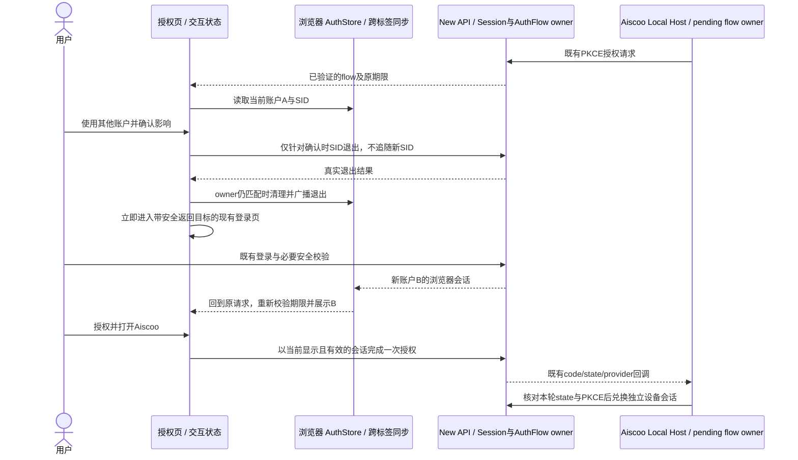

# New API 授权页：账户切换与明确授权

状态：2026-10-18 S01–S03 已实现并完成独立静态评审；S04 已完成隔离真实浏览器与 macOS OS keystore / 原始 Host PKCE 身份验收，具体范围及限制见 §7。最终评审发现的迟到退出 Set-Cookie 竞争已按 §4 完成固定 SID transport / 撤销证明修正；新增测试先 RED 后 GREEN，最终全 Web 180 文件 / 2355 测试通过，真实完整 headers 的失败前/成功后及浏览器 B 冷刷新证据见 final-fix-report.md。最终定向复审已通过，无未关闭的 Critical / Important / Minor。不代表业务 3001 已部署、完整 OS scheme 分发或模型/资金验收。

本规格规定 New API 浏览器授权页的交互增量；HTTP、认证、会话和 PKCE 仍以 [New API canonical spec](../../../../new-api/docs/specs/xcode-integration.md) 为唯一来源。客户端主身份边界见 [客户端集成规格](new-api-integration.md#4-主账号登录适配)。

## 1. 已确认方向与范围

- 授权页显示当前真实账户，并始终提供“使用其他账户”。保留已登录用户直接确认授权的路径，不强迫每次重新输入凭据。
- 采用**当前浏览器单会话切换**：明确说明影响，退出当前浏览器会话，再复用已有 New API 登录页。其他已打开的同源后台页面会受到影响。
- 不提供后台继续保持管理员、授权页独立登录其他用户的隔离会话；不建立历史账户列表、多账户中心或新的密码表单。
- 重新登录成功后回到本次授权页，显示新账户，必须再次主动确认授权。登录本身不是授权。
- 权限说明前置到页面；“授权并打开 Aiscoo”是唯一授权确认，不再重复弹出同内容的授权确认框。换号影响仍需要单独确认。
- 展示名为 Aiscoo；New API 及 QuantumNous 归属保留。内部 `xcode-desktop`、`provider=new-api`、`zcode://oauth/callback`、state 和 PKCE 不变。
- 不改变套餐、模型、额度、支付、用户权限、数据库结构或其他客户端登录模式。不访问模型推理端点验证登录。

## 2. 页面与文案

页面沿用 New API 的 AuthLayout、Button、ConfirmDialog、LoadingState、ErrorState、主题和语言体系。只调整授权页内容容器，不改变普通登录/注册页的共享布局。

| 区域     | 内容与要求                                                                                                                                   |
| -------- | -------------------------------------------------------------------------------------------------------------------------------------------- |
| 标题     | “授权 Aiscoo”；说明“使用你的 New API 账户连接桌面应用”                                                                                       |
| 账户     | 标题“当前账户”；头像或名称首字符；真实 `display_name` 与 `username`；展示名为空时使用用户名，不虚构邮件或管理员标识                          |
| 换号入口 | “使用其他账户”，位于账户区域，首屏可见、可键盘聚焦，不隐藏在头像菜单                                                                         |
| 权限     | 读取个人资料；查看套餐与用量；使用分配给该账户的 Aiscoo 套餐调用模型                                                                         |
| 限制     | 明确不授予支付、API Key 管理或账户安全权限；授权不代表自动获得套餐                                                                           |
| 有效期   | 使用服务端请求期限，显示完整本地日期和时间，并注明为本次请求；不新增倒计时轮询                                                               |
| 设备说明 | 授权创建独立桌面设备会话；正常授权后浏览器保持登录。保留现有设备期限说明及在 Login Sessions 撤销的指引，不能把默认 30 天写成所有部署固定期限 |
| 操作     | 次按钮“取消”；主按钮“授权并打开 Aiscoo”；应用标识 `xcode-desktop` 降为次要信息                                                               |

换号确认框：

- 标题：“切换登录账户？”
- 正文：“将退出当前浏览器中的 {{username}} 登录会话，然后前往 New API 登录页。”
- 影响：“其他已打开的 New API 后台页面也会受到此次账户切换影响。”
- 后续：“登录完成后，需要重新确认授权。”
- 操作：“返回”与“退出并切换”；执行中禁止重复提交或同时发起授权。

桌面内容宽 480–560px，卡片内部保持清晰左对齐；手机单列、左右留白 16px，长用户名可换行，触达区域至少 44px。使用 New API 已有字体和语义色，不引入 Aiscoo 客户端专属的 `text-ui-*` 到另一个仓库。支持七个既有语言资源、深浅主题、键盘焦点、弹窗焦点恢复及屏幕阅读器错误/加载提示；英文和大字号可滚动，不裁切操作按钮。

授权页内容容器须单独预留顶部品牌栏空间，防止短视口或 `sm` 断点下原生 200% 缩放时标题与 New API 品牌栏重叠；保留正常字号和品牌栏，不改变共享 AuthLayout 或普通登录页。

## 3. 所有者、接口和顺序

- New API 服务端浏览器 Session 是浏览器身份事实；现有 `useAuthStore` 保存其投影，既有根路由与 `auth-session-sync` 负责跨标签同步。
- 授权请求及期限属于服务端 AuthFlow；页面仅持有查询结果及本次交互状态，不新增身份 store、持久账户列表或自动授权标志。
- Local Host 持有桌面登录 state/verifier 和登录 generation；网页不能得到 verifier，也不能自行切换已发布的桌面主账号。
- 继续使用 `GET /api/xcode/v1/auth/authorize/request`、`POST /api/user/auth/logout`、现有原生登录、`POST /api/xcode/v1/auth/authorize/complete`。不增加后端路由、回调参数或任意 user_id 选择。

## 4. 状态、安全与失败语义

1. **请求先校验**：缺少、非法、过期的 flow 不进入换号或登录流程。保持 10 分钟请求期限、60 秒 code 及精确 callback 校验；返回地址只经 `sanitizeAuthRedirect` 接受同源授权路径。
2. **换号目标固定**：确认框显示、退出请求及退出完成必须归属同一 `(flowToken, user.id, session.sid)` 和同一次页面交互。确认期间身份变化须关闭旧确认并重新展示；A→B→A 也不能复活旧动作。
3. **退出不能追随新账户**：现有普通 `logout()` 有 `AUTH_SESSION_MISMATCH` 刷新重试行为；授权页必须使用固定期望 SID 的退出方式，遇 409 不刷新后改退 B。固定 SID 分支在同一 Axios 实例上选择已安装 fetch adapter 与 `withCredentials:false`，由浏览器 `credentials:omit` 同时隔离请求 Cookie 和响应 Set-Cookie；仍由原生 Bearer + 固定 `X-Auth-Session` 实际撤销 A。仅改 XHR 的 withCredentials 不能隔离同源 Cookie，不得采用。普通退出及原 OAuth 登录调用者保留原 Cookie/刷新重试行为，不增后端路由或协议。
4. **真实撤销成功才清理**：固定 SID 必须同时收到 `success:true` 和精确匹配期望 SID 的既有 `data.revoked_sid`；缺失/不匹配证明（包括无 Cookie 且 Bearer 过期时的匿名 success）按失败处理，不重试、不清空身份、不跳登录。`success:false`、网络/服务错误同样保留当前身份。退出响应迟到、页面卸载、flow 变化或账户变化时，不清理新身份、不发布旧错误、不继续旧导航；浏览器接收 headers 时已经必须保持新 B 的刷新 Cookie / hint，不能依靠 await 后 owner 检查或删除共享 hint 修补。已撤销 A 的旧 Cookie 暂留不代表 A 有效，后续原生认证按无效会话处理。
5. **退出后的顺序**：先保留经验证的 flow 返回目标；仅在退出成功且 owner 仍有效时调用既有统一清理/广播，再立即导航。清理会使 QueryClient 缓存失效，不能依赖被清掉的授权 query 再重建返回目标，也不能用延时规避竞争。
6. **跨标签与中断**：保留现有广播机制。另一标签登录 B 时，授权页重新验证并展示 B；匹配的 signed_out 事件跳登录时保留安全的授权返回目标，普通页面退出去向不变。取消换号确认无副作用；退出后中断登录保持未登录，不恢复 A。
7. **提交绑定当前展示身份**：单次点击捕获当前展示的 owner，与即时 store 对照；变化时先更新账户再由用户确认。发出及接收完成请求时均受本次交互归属约束。任何返回地址都经现有 `validatedCallback`，禁止把代码或秘密存入 Web Storage/日志。
8. **一次性完成不重试**：授权发出后锁住换号/取消/重复授权；不重试不确定结果，不因 focus/online 自动重新发送。完成期间身份变化不打开迟到 deep link。
9. **取消是页面终态**：不调用 complete/logout，不返回伪造成功或新增错误回调；显示“已取消授权，可关闭此页返回 Aiscoo”，并禁用本页后续授权。它不声称已经撤销服务端 flow；Host pending flow 由现有期限/取消逻辑处理。刷新页面须重新验证服务端请求并再次明确授权。
10. **有效期独立**：换号不续期。登录返回时重新读取服务端请求；请求过期只提示从桌面重新发起，不签发桌面会话。退出成功但请求随后过期，不自动恢复旧浏览器登录。

## 5. 验收场景

| 编号 | 场景与可观察结果                                                                                                                                                                                                         |
| ---- | ------------------------------------------------------------------------------------------------------------------------------------------------------------------------------------------------------------------------ |
| A01  | 已登录 A：显示 A 的真实身份与换号入口；仅一次明确点击即可授权，创建的桌面会话属于 A                                                                                                                                      |
| A02  | 打开换号框后返回：A 保留，无退出/授权请求；重复点击不能重复提交                                                                                                                                                          |
| A03  | A→换号→原生登录 B→原请求：显示 B 且没有自动 complete；主动授权后的桌面 Me 为 B                                                                                                                                           |
| A04  | 退出 `success:false`、离线、5xx：仍保留 A 和可理解错误，不导航、不伪装已退出                                                                                                                                             |
| A05  | A 的退出遇 409、新账户 B、迟到成功/失败或 A→B→A：不退出/清理 B，不复用旧确认，不发迟到导航或授权回调；真实 A 响应全部 headers/body 延迟到原生 B 登录后交付，B Cookie 保留且冷 reload 经真实 refresh 仍为 B，A 实际已撤销 |
| A06  | 清理全部 query 后仍携带完整安全 flow 返回目标进入登录；登录/注册往返和启用的 2FA/Passkey 流程不丢目标                                                                                                                    |
| A07  | 在登录期间过期或切换 flow：不续期、不向旧 flow 发 complete；外部/协议相对返回地址被拒绝                                                                                                                                  |
| A08  | 真正两个浏览器标签的 signed_out/authenticated：不显示旧账户权限，不丢合法授权返回目标，不循环 reload；其他后台页面保持原退出行为                                                                                         |
| A09  | 授权双击、网络不确定、focus/online、非法 callback、完成时换号：保持一次性及身份隔离，不重复签发/回跳                                                                                                                     |
| A10  | 取消授权：没有 complete/logout/deep link；终态不再可提交，浏览器登录保留                                                                                                                                                 |
| A11  | 中文/英文、浅深色、360/393px、200%缩放、长用户名和键盘操作：账户、换号、权限、错误和操作均可读可达，无横向溢出                                                                                                           |
| A12  | 新的独立浏览器上下文走真实 New API 登录/授权，真实 Host 收到回调并以 B 为主身份；不得用 mock 身份替代此门槛，不需要模型请求                                                                                              |

## 6. 现有实现依据与交付边界

实现已覆盖后端 `web/src/features/xcode/authorize.tsx`、`features/auth/api.ts` 和 `routes/__root.tsx`；继续复用 `lib/auth-session.ts`、`lib/auth-session-sync.ts`、`service/xcode_auth.go`、`model/user_session.go`。换号入口、固定确认 SID、统一清理前捕获安全返回目标及生产根路由跨标签返回目标均已落地；没有新增身份 store、后端路由或桌面协议。

参考 [Google OpenID Connect](https://developers.google.com/identity/openid-connect/openid-connect#authenticationuriparameters)、[Microsoft 账户选择](https://learn.microsoft.com/en-us/entra/identity-platform/v2-oauth2-auth-code-flow#request-an-authorization-code)、[GitHub 授权说明](https://docs.github.com/en/apps/oauth-apps/using-oauth-apps/authorizing-oauth-apps) 的交互原则，不把第三方协议参数直接加到本项目。

执行见 [完整实施计划](../../superpowers/plans/2026-10-17-new-api-authorization-account-switch.md)。源码、浏览器验收、真实 Host 联调和业务部署分别记录。没有明确部署授权，不重建/替换 3001 容器、不读写业务库、不代用户退出管理员账号。桌面启动必须显式携带 `NEW_API_BASE_URL=http://127.0.0.1:3001`；本次不修复开发态应用内 relaunch 的独立生命周期问题。

## 7. 2026-10-18 隔离验收记录

详细逐项证据、故障注入、命令输出及清理记录见 [S04 报告](../../../.superpowers/sdd/2026-10-17-new-api-authorization-account-switch/task-4-report.md) 和同目录 `task-4-evidence/`。仅使用原生 setup / register 创建的合成 A/B，以及新建浏览器上下文；后端为新构建 Web + Go embed、独立 SQLite / 密钥、仅 `127.0.0.1:43017` 发布。未访问业务数据库或重启/部署 3001，未改真实账号、套餐、额度或发送模型请求。

- A01–A10：真实 A 单次确认 / PKCE 设备 Me、取消换号、A→B 原生登录且不自动授权、退出业务失败/离线/503/409、迟到成功/失败与 A→B→A、注册往返/中断、过期/换 flow、不安全返回目标、一次性双击/focus/online/非法 callback/完成期间换号及取消终态均有分项证据。409、网络失败与时钟/期限响应的受控注入单独标识；初轮 A05 的 body-only 迟到响应只证明页面 owner 门禁，不能证明 Cookie 安全，已由下述最终修正的真实 headers / 冷刷新证据替代。合成账户未启用 2FA/Passkey，未执行其凭据验证。
- A08：同一真实浏览器 context 的双标签加载生产根路由；标签二普通后台退出时没有授权 redirect，标签一保留原安全 flow；标签二原生登录 B 后标签一展示 B，无循环 reload。没有假 root route。
- A11：中英、浅深色、1280×900、360×800、393×852、真实 20 字符用户名 / 展示名、键盘 Enter/Tab/Escape 与弹窗焦点恢复通过。复核曾确认真实200%下 masthead/title 重叠；授权页限定 `sm:pt-16` 修复并重新 Web/Go embed 后，实际 content1280×818 / CSS640×409 / DPR4 / zoomFactor2 的 masthead bottom64 / title top96 不相交，标准1280×900和393×852亦无相交或水平文本裁切，按钮滚动可达。最终证据使用顶端/操作区独立 native 与 Playwright viewport 截图，不使用 full-page 拼接判稳态可读、不声称首屏全部可见；失败到修复的记录保留于报告§10。
- 换号框最终截图已补为真正稳态：英文/中文分别等待相关真实动画 finished Promise，再核对 opacity/effectiveOpacity1、scale/transform none、标题/按钮有效opacity1以及焦点恢复；原两张过渡态截图被 `A02-settled-dialog-{en,zhCN}.png` 替代，未通过关闭动画或注入样式伪造截图。
- A12：真实 Main 产生 OS safeStorage 保护的密钥文件（0600）；原 Host 产生 PKCE/state，新的真实浏览器登录 B 并主动确认，原样 callback 进入该隔离 Main 的真实 `open-url` handler 和既有路由，随后 Host `oauth.restoreSession()` 真实 Me 为 `new-api / id 2 / s04accountb`。只替换浏览器打开及目标进程投递的测试运输，不替换身份、凭据、verifier 或 Host；**未验 OS 全局 `zcode://` 分发**。Main/Host/Worker 已同源新构建；没有为无套餐的合成 B 配置模型，Worker 未运行，不以构建成功冒充模型执行。
- 首次桌面尝试发现 `index.ts` 的启动工作区恢复直接读取系统 HOME 下 settings，与正确隔离的设置服务不同，导致真实工作区路径进入预热名单；当即停止。第二次通过既有 `--open-workspace=<私有目录>` 避开该唯一读取点，并显式提供私有配置 / 业务根和真实 bundled release，成功完成身份验收；没有暗改生产实现。后续隔离运行不能只设置 Electron userData 就假定启动恢复已隔离。
- S01–S03 初始 TDD RED 未执行（当时上级规则要求实现结束后统一检查），不能倒填。最终 Cookie 修正单独执行了真实旧实现：API 回归 5 FAIL / 11 PASS；修正后聚焦 79/79、最终全包 2355/2355、build:check/typecheck、五文件 lint、三文件受保护正文格式通过。此前全包 lint / copyright / format 的范围外失败仍保留，不声称全绿。
- 最终 Cookie 修正：仅现有 `logout(expectedSID)` 选择 fetch credentials omit 并核对既有 `data.revoked_sid`，无 Go/后端协议更改。独立 43017 后端与 43018 loopback 原样 HTTP proxy 在服务端完成后、浏览器接收 headers 前挂起 A 响应。旧实现真实两条 Set-Cookie 在 B 原生登录后交付，B Cookie 消失、真实 refresh401；新实现无请求 Cookie，Bearer+SID 真撤销 A（protected401）、B 保留（protected200），迟到响应后 B Cookie 不变、冷文档与真实 refresh200 为 B。另用仅篡改 outgoing Bearer 的故障注入触发真实匿名 success + 两条清 Cookie，浏览器确实忽略 Set-Cookie 且页面失败关闭，A 未被伪称退出。完整原生密码表单 A→B、原 flow、无自动 complete、冷 reload 为 B，以及普通菜单 logout 真清 Cookie/撤销 B 均复验。报告与脱敏证据见 [最终修正报告](../../../.superpowers/sdd/2026-10-17-new-api-authorization-account-switch/final-fix-report.md)；本轮没有再启动桌面，不把浏览器冷刷新冒充 Host 冷恢复，原 A12 和其他未验边界保持原有限定。

## 8. 2026-10-18 生产专项当前状态

明确授权后，真实3001已切换到最终评审binary `da5ad356af59bb4fdab01421049ca90401df91ca6334d4d67cfc329bea1725e8`，原容器配置/密钥语义/挂载保留，实际新JS/CSS与运行binary已回读。仅为本专项原生注册两名专用非管理员，真实A权限/取消换号、A→原生B登录保留原flow且无自动complete、生产根路由真双标签及取消终态已有脱敏证据；未对生产注入故障、修改限流/时间、配置套餐或调用模型。

当前 **PASS WITH DISCLOSED CONCERNS（生产专项、清理及独立最终复核完成）**：首轮人工超过60秒的code-invalid失败历史保留；最终用户在稳定独立Chrome连续亲点网页授权/原生打开，原Host PKCE/state经真正全局OS→精确私有Main，callback哈希匹配且1485ms内投递，fresh complete仅1次，原Host真实Me B。全Main/Host退出0后同私有数据/真实keystore冷恢复仍真实Me B；原Host.logout真实撤销专用设备SID而浏览器B冷refresh200，旧完成页不重登录；再全退出cold restart的Host identity/provider均null。签出截图的pending-new-auth UI不称稳定idle页，不做原因或源码修复推断。最终复核无阻断性 Important 缺口，原有范围限制保留。

生产原生429按实际Retry-After自然等待，随后B复用真实Cookie、A原生登录，都经原生UI执行account.delete/password step-up/self-delete：DELETE200/success、旧会话401、全部专用session revoked、原生audit保留。删除后单一只读事务确认原行/身份/会话安全/配置保留，并发usage/access字段单列。本任务自有进程/私有密码/keys/bundle/profile全部清理；finally精确恢复原com.github.Electron/openwork Electron.app并新查询相等，仅unregister私有app；原5174/9229 PIDs和已部署3001、完整生产备份保留。实际证据及独立隔离缺陷/工具预览脱敏历史见 [生产验收报告](../../../.superpowers/sdd/2026-10-17-new-api-authorization-account-switch/production-validation-report.md)。不把专项通过扩大成模型/资金或全质量绿；未提交/推送，最终由控制器审阅。
