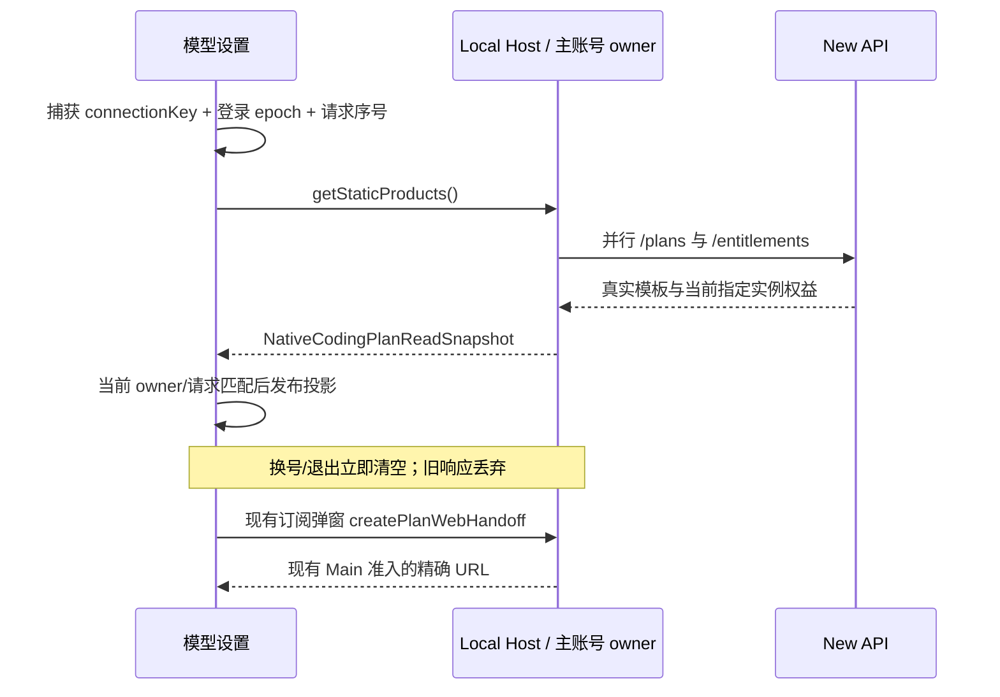

# New API 模型设置：恢复 ZCode 原版呈现

状态：2026-10-12 已实施，本机 UI 与回归验收完成；不替代集成计划的正式发布门禁。

## 产品规则

- 复用现有模型设置外壳、左右分栏、导航、标题、状态卡和套餐入口样式；不另造一套 New API 配置页。
- 官方模型入口只有 `account:new-api-openai-chat-completions`，名称固定为 `XWork`。隐藏协议不恢复，不自动迁移历史模型选择，不借用 BigModel/Z.ai 的 Provider 身份。
- New API 入口是托管套餐，不进入自定义 Provider 表单。未登录、查询中、未开通、有效、额度用尽、过期、撤销和查询失败分别呈现；查询失败不解释为未开通。
- 套餐状态、名称、有效期与额度来自 `/entitlements`；模板、价格、币种、周期和说明来自 `/plans`。不取官方静态价格或官方权益，不硬编码截图中的商品。
- 个人套餐卡片保持原版样式。参考价格仅比较相同币种与完整周期的已启用模板；不可比的周期/币种分别展示，缺目录显示真实空态，不补假价格。
- 团队套餐保留原版卡片位置和样式，明确“当前不支持团队套餐”，禁用购买，不展示虚构价格、席位或组织能力。
- 订阅/升级与个人套餐入口复用现有升级弹窗及 Native handoff；实际授予仍是 `manual_admin`。不调用官方支付、自助支付或额度重置。
- 托管套餐不提供自配 API Key、修改端点、改名、删除或“解绑套餐”。不把退出主账号冒充解绑；真实主账号退出仍走既有账号菜单。
- 模型详情只在真实授权允许时显示 New API 的只读模型；未开通页面保持状态卡及套餐入口，不堆叠自定义配置表单。
- 自定义供应商的添加、编辑、测试、删除与排序不变。
- 移除套餐详情顶部独立官方云横幅。官方连接/解绑/额度入口继续保留在已有“使用统计”的官方 MCP 卡片，不修改其认证或注销流程。
- 浅色/深色、中文/英文和手机窄屏使用现有组件与 `text-ui-*` 字号。
- 模型上下文默认值逐项依据模型发布方的官方 API 规格或公开模型配置核验，不把服务商目录的 `200K`、`1M` 等概数直接当成精确 token 数；允许按用户明确要求设置更低的应用上下文上限，部署策略不冒充官方规格。模型规格不等于代理链路已验证的接入上限。
- 模型容量 badge 使用固定 K/M 技术单位并保留 token 整数对应的精度；`1,050,000` 显示为 `1.05M`，不能四舍五入成 `1.1M`。普通用量统计的 compact 精度不变。
- 对话模型菜单只显示可选模型，不显示“不可选择”诊断条目或仅含诊断的空分组；全部不可选时保留管理模型入口。模型设置页继续展示目录问题及原因，底层授权与执行校验不变。
- 模型设置的模型列表行在模型名前显示图标，规则与 composer 模型菜单一致（见 `docs/ui/chat-model-select-menu.md`）：New API 下发的 `icon` 优先，自定义模型按模型名映射同一套 @lobehub/icons 名称；都无法识别时不显示图标。
- 模型设置的模型列表行在容量 badge 后保留“视觉 / Vision”徽标（模型声明支持图片输入时显示）；对话模型菜单等其他位置不显示。

## 所有者与读取路径

New API 业务事实唯一所有者是窗口 Local Host 的主账号及订阅服务。Renderer 通过现有 `ICodingPlanSubscriptionService.getStaticProducts()` 读取 `NativeCodingPlanReadSnapshot`，不增加 HTTP/RPC 协议、凭据或持久缓存。

UI hook 仅保存当前读取的投影、loading/error 和请求序号。owner key 复用 Host `connectionKey` + 主登录 `authSessionSeq` 的现有 `useUsageAccountScope`。换号/退出的首帧清空旧数据，旧请求不得覆盖新 owner；服务实例变化同样隔离。手动刷新与关闭订阅弹窗重新读取当前 owner 的快照。

Desktop handoff 复用既有 Main/Host admission 与临时分区；Web/远程不新建 Host，不绕过现有平台能力门禁。原非 New API 模式保持现行官方界面和业务路径。

## 验收

1. New API 模式只见一个 `XWork` 官方导航，右侧为原版标题、编程套餐状态、个人和团队入口，没有官方云横幅或自配连接表单。
2. 未开通/额度用尽/过期/撤销与查询失败区别明确；有效状态展示真实套餐名、有效期和指定实例额度，不显示官方五小时/周/MCP 额度。
3. 禁用模板不参与参考价；不同币种和周期不混算；空目录不补旧官方价格。
4. 手动刷新可以更新套餐；owner A 的延迟响应不能在换到 B 或退出后出现，重复刷新只发布最新请求。
5. 订阅及个人入口实际打开现有 Native 套餐比较页；团队不能触发购买。自定义供应商仍可操作。
6. 在真实 Electron 的模型设置中验收未开通、有效、错误、换号、刷新、订阅入口和两种主题；确定性 fixture 不冒充真实账号或真实推理。
7. 模型容量 badge 能准确表达 `1,050,000`、`1,048,576`、`202,752` 与 `204,800` token，中文和英文不改变技术规格数值；保留模型目录的禁用/授权语义。
8. 目录同时含有效模型、元数据缺失模型和能力表达式错误模型时，对话菜单只显示有效模型；全部不可选时没有问题模型条目，仍可进入管理模型。设置页的目录诊断不受影响。

## 本机验证记录

- `newApiModelSettings.test.ts` 覆盖禁用模板、不可比币种/周期与精确十进制价格；已纳入现有 New API Node 回归入口，完整入口 158 项通过。
- `newApiModelSettingsElectron.mjs` 已纳入既有 Electron smoke 入口。真实 React 状态卡和 owner hook 验证未开通、有效、耗尽、过期、撤销、查询失败、空模板、换号/退出首帧、迟到响应、同 owner 重复刷新、手动刷新、英文深色及 393px 窄屏；业务输入是确定性 fixture，不冒充部署授权或真实推理。
- 当前运行的完整 XWork 桌面在 Renderer 重新加载后实际读取部署后端套餐、价格、有效期与额度；状态卡与个人套餐入口均打开同源只读套餐 WebView，手动刷新后授权状态正常。自定义供应商仍显示原有连接和模型编辑操作。未修改真实授权、模板或凭据。
- 根 `typecheck` 通过，Lint 0 错误/71 警告，changed 架构检查 0 违规；任务涉及文件格式检查通过。真实官方账号连接/解绑、Windows/Linux 与正式发布矩阵未在本任务重做。
- 2026-10-13 上下文精度核验：通过正常管理员接口修正 8 个模型、回读全部 20 个启用模型；真实 Electron 刷新后逐项容量 badge 与精确数值一致，且没有截断。GPT 依据 [OpenAI 原生规格](https://developers.openai.com/api/docs/models/gpt-5.6-sol) 使用 1,050,000；MiniMax 依据[官方 API 表](https://platform.minimax.io/docs/api-reference/text-anthropic-api.md)使用 204,800；GLM-5 与 DeepSeek V4 依据发布方公开模型配置使用 [202,752](https://huggingface.co/zai-org/GLM-5/raw/main/config.json) 与 [1,048,576](https://huggingface.co/deepseek-ai/DeepSeek-V4-Flash/raw/main/config.json)。Claude 的 200,000/1,000,000 与[原生上下文文档](https://platform.claude.com/docs/en/build-with-claude/context-windows)一致，未改动。公开模型配置数值不冒充代理 API 的实测接入上限；本次没有边界长度推理、价格、输出上限或其他能力变更。
- 同次验证：容量精度回归先复现 `1.1M` 错误、修复后通过；Node 24.18.0 下完整既有 New API Node 入口 169 项通过，根 `typecheck` 通过，Lint 0 错误/71 警告，任务涉及文件格式检查通过。
- 随后的用户指定覆盖：GPT-5.6 Sol / Terra / Luna 的应用上下文上限均设为 272,000 tokens。通过正常管理员接口更新并回读三条配置，真实 Electron 刷新后均显示 `272K`；其他模型配置、价格、输出上限和能力标志未改动。该值是用户指定的部署策略，不是对 OpenAI 官方 1,050,000-token 规格的更正。
- 2026-10-17 模型菜单过滤：Node 边界回归覆盖有效项与目录问题并存、全部无候选时不生成空分组；真实 Electron 回归先确认问题项可见而失败，修复后通过，并确认 Host 设置诊断仍保留。运行中的完整桌面菜单已实际确认 `auto-kiro`、`deepseek-3.2`、`qwen3-coder-next` 及“不可选择”说明均不再显示，20 个可选套餐模型及管理模型入口仍在，当前选择未改变。未修改后台模型配置或授权。
- 同次验证：既有 New API Node 回归入口 169 项通过，Composer 能力 Electron 回归（含自定义模型、中英文、浅深色、360px 窄屏）通过；根 `typecheck` 通过，Lint 0 错误/71 警告，changed 架构检查 0 违规，任务文件格式检查通过。未重做 Windows/Linux 或手机真机验收。
