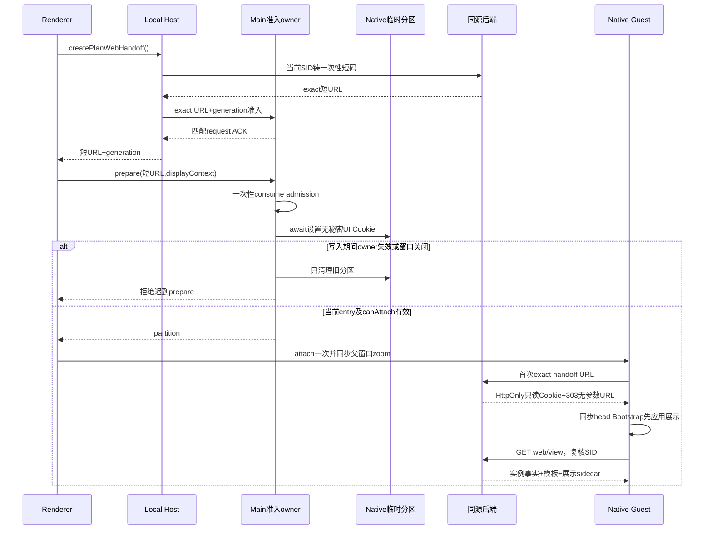

# New API 升级套餐页：原版视觉恢复规格

状态：2026-10-10 设计评审后定稿，供实施计划 U01–U04 使用；尚未实施或签署新 UI 验收。主集成的 T01–T10 历史证据和 G1–G5 发布门槛不因本规格更新而改变。

## 1. 目标与范围

New API 模式设置中的升级页恢复用户提供的 ZCode 原版信息结构、导航、分类、周期选择、套餐卡片、价格层级和底部按钮；不是沿用后台授权详情页后仅改颜色。继续使用现有 Native WebView，不在客户端另建商品页，也不恢复已删除的客户端购买组件。

视觉原图：[原版升级页](assets/new-api-upgrade-zcode-baseline.png)，原始文件 2326×1405，SHA-256 `2a4aea54e1fd3d8ec12998a653aa56bdd33e9f0518ed61353ec296365f5722f8`。图片不提供原始 CSS viewport、DPR、App zoom；执行者记录这些参数并等比归一化比较，不把图片像素直接当 CSS px。1568×947 为比较用归一化尺寸，不是已知的原 App viewport。

保留 `manual_admin`、无自助付款、无企业组织功能、无新增试用历史/订单/申请系统。真实价格、周期、状态和不支持功能文案可以与截图不同；不伪造体验结束、自动续费、折扣或官方权益。品牌仍为 XWork，New API/QuantumNous 归属保留在低干扰页脚。非私有官方升级流程不改。

## 2. 页面结构与真实状态

- 客户端只有一条“升级套餐”导航，复用 `EmbeddedWebsiteHeader` 的按钮与视觉；Native 分支透传 `target.initialAudience`，缺省 `personal`，不传 teamPlanKey、org 或 project。
- 网页不重复 New API 顶部导航、主题/语言控制、巨大标题和指定授权详情面板。顺序为个人/团队分类、紧凑授权摘要、月/季/年选择、卡片和页脚。管理员限制在参考价提示与实际 CTA 说明中表达，不再以两层长说明占首屏。
- `team` 首个内容帧选中团队，显示“此部署不提供团队套餐/组织功能”，无个人商品冒充团队、无授予 CTA。切回个人只改页面状态，无企业 API 请求。
- 授权摘要独立于分类、周期和启用模板列表：真实 plan_title（缺失用 #plan_id）、status、end_time；额度详情留现有使用统计。unassigned、active、exhausted、expired、revoked 分开；exhausted 不等于到期。模板下架或在另一周期也不能隐藏当前指定授权。
- 卡片只在精确 `plan_id` 等于 entitlements.subscription.plan_id 时标记“当前授权模板”，不能用同档 group_key、标题或 start/end 差值猜当前 SKU/周期。实例额度、reset 快照不由后来修改的模板重建。
- trial 仅为明确展示类型，不是新的授权状态。只有服务端明确标记的真实模板才显示体验卡；零价不自动认作体验。没有 trial 历史读契约，不推断“已过期/已结束”；没有配置四档时显示真实模板及配置提示，不生成占位商品。
- 保持原图的价格主视觉和轮廓星形亮点标识：主价明显大于档位标题，按 Native UI 字号加12px，亮点图标不参与可访问名称。所有文字随 Native UI 字号变化，root rem 仍为16px；不通过整体缩放伪称原图DPI一致。

## 3. 单一商品事实与展示 sidecar

跨仓 wire 以 [canonical §9.1](../../../../new-api/docs/specs/xcode-integration.md#91-升级页展示恢复增量) 为准。仅 `/api/xcode/v1/web/view` 增加 `plan_presentations`；公共控制 `/plans` item 不加字段，XCode strict NewApiPlanSchema 不改。web/view 的 schema 必须保留新增字段，不让 Zod 静默丢弃。

原生 SubscriptionPlan 增加可空的 typed JSON `xcode_display`，无配置为 null；只保存 `group_key,group_title,offer_kind,highlights,features`。不保存价格、额度、权限、团队、周期表或折扣。必须覆盖模型/迁移、原生创建与显式更新映射、管理员编辑/表单转换、缓存失效及重新读取；不能只增加模型字段。字符串按文本呈现，不解析 HTML/Markdown；系统固定官方权益独立说明不由管理员文案覆盖。

每个 web sidecar item 使用原生十进制字符串 `plan_id`，包含 `metadata`（配置或 null）、`assignable:boolean`、`assignment_reason:null|"template_config"`、`display_issue:null|"invalid_display"`。后台复用实际 grant 模板校验及合规条件，不把 enabled 当作可授予。已有控制计划列表和资金算法不改；web 的计划 DTO 与 sidecar 从同批原生模板读取构建，一次批量查询，不逐卡 N+1，也不混用两轮编辑前后的数据。

明确规则：

1. metadata 的 group*key 是 1–64 字符 `[A-Za-z0-9*-]`，group_title 非空最多128字符；offer_kind 为 standard/trial；highlights 最多4行、features 最多16行，每行非空最多256字符。合法 null 为未配置；损坏旧记录保留原生商品并标 display_issue，不把数据错误当无套餐。
2. 分组边界为 `(group_key,currency)`，顺序遵循原生 sort_order/id；跨币种不合并。同组 group_title、offer_kind、权益数组冲突时，整组退回精确 plan_id 独立卡并提示配置冲突，不丢模板、不偷偷取首项。
3. 只有 month/1、month/3、month/12、year/1 对应 monthly/quarterly/yearly；month/12 与 year/1 同属 annual slot。同 slot 有多个模板时该 slot 展开为带原名称/ID的独立卡，不覆盖或选便宜/当前模板；其他无冲突 slot 可照常使用。缺选中周期显示“该周期暂无模板”，无该周期 CTA，不能借用邻近周期。
4. 未配置、损坏元数据及 day/hour/custom/其他月数显示独立真实卡；不把30/90天或秒数换成日历月/季度。明确 trial 卡按自身实际时长显示，只有唯一真实模板时可固定在周期卡片旁；多个 trial 同样保留独立卡，不猜一个体验商品。
5. 默认周期优先 quarterly（有可展示日历季度模板时），其次 monthly、yearly；没有这些模板时不选假周期，只显示独立卡。切换只选择对应原生 plan_id，不修改授权。

## 4. 价格与管理员 CTA

周期总参考价始终为原生 price_amount+currency，不使用 quota display 币种/汇率。月均价只对1/3/12个日历月计算，并同时显示周期总价。金额以十进制字符串/整数有理数计算，仅最终显示时舍入；不引入依赖或使用浮点金额决定折扣。

折扣只在同组存在唯一正价同币种月模板，且 highlights/features、total_quota、reset_period/reset_custom_seconds 相同可比时显示；有限额度还必须有相同周期的真实重置，finite+never 不把相同总额度冒充等月预算，无限额度可比较。finite+custom 无法仅凭静态模板证明有效期内等月重置预算，因此不显示折扣，真实总价与月均价保持不变。比例为 `period_price / (monthly_price * months)`，只显示严格0到1之间的比值，0价/涨价/无基准/冲突均不显示。季度24、月10显示月均8、总参考价24、8折；年度96显示月均8、总参考价96、8折。day90不参加计算。权益预算不同不比较折扣；不写死原图数值。

原版底部白色主按钮形态保留，当前文案“联系管理员”。仅 assignable 的实际 SKU 打开本页说明，包含真实名称、ID、周期、总参考价；没有申请提交、订单、付款写请求、成功动画或外部购买跳转。说明依据授权状态与精确 ID：active/exhausted 的相同 plan_id 续期只延长期限、不补当期额度，不同 ID 才是管理员 replace，且无时间折算/额度结转；unassigned/revoked 由管理员重新 grant；expired 的相同 ID renew 新建实例并采用当前模板预算，不声称延长旧实例，不同 ID 则重新 grant。团队或不可授予模板没有开通 CTA，不承诺 exhausted 续期恢复额度。

## 5. 无秘密展示上下文与首帧

新增公开具名 `NativePlanDisplayContext` 与 `NativePlanWebviewPrepareRequest`，归 shared/platform 公开入口：

```ts
interface NativePlanDisplayContext {
  version: 1;
  theme: "light" | "dark";
  locale: "zh-CN" | "en-US";
  initialAudience: "personal" | "team";
  uiFontSizePx: number; // 整数12–20，现有默认14
}
interface NativePlanWebviewPrepareRequest {
  url: string;
  ownerGeneration: number;
  displayContext: NativePlanDisplayContext;
}
```

`prepareNativePlanWebview(request)` 仍返回 `{partition:string}`；不改 Host createPlanWebHandoff、NewApiClient、服务端 handoff/认证 Cookie或短码响应。Renderer 读取当前 resolved theme、Intl locale、uiFontSizePx 和入口分类，通过现有 IPlatformService/preload/IPC 透传；无 UI 直接 window.zcode。

Main 严格验证有限字段及字号范围，先消费现有精确 admission，获得非 persist 分区；在该分区 await cookies.set 写 host-only session Cookie `xcode_plan_display_v1`，Path=/xcode/plans、SameSite=Strict、HTTPS 时 Secure、httpOnly=false，无用户、SID、短码、凭据、URL或权限字段。值为编码后的展示上下文。异步写入后核对 sender/window、windows 当前 entry 和 policy.canAttach(partition,url)；失效、失败或窗口消失只清理该旧分区并拒绝，不返回迟到可挂载分区，不污染新 owner。

New API 增同源静态 head Bootstrap（同步、无 async/defer、在 stylesheet/app module前），仅 exact /xcode/plans 执行。严格解析 Cookie；合法时应用 html light/dark、lang、color-scheme 和 `--ui-font-size`，预置既有 `newapi:theme:v1:mode` 和 `i18nextLng`（zh-CN→zhCN，en-US→en），并以 html data 属性承载初始分类供 React 消费。不得修改 html fontSize/rem、内联 JS、放宽 script-src、增加 preload/Node/函数桥、使用 dom-ready 认证/样式注入。非法/缺失上下文整体忽略，只走普通展示默认值；存储不可写时 ThemeProvider/i18n 仍优先消费已验证的 html 展示属性，不能被系统设置覆盖。非viewer页面启动不读取或写入这些属性/存储。

主题、语言、字号和外部 initialAudience 变化使用现有重新铸码/重建分区流程；不在原 handoff URL 拼参数。页内分类/周期只是 React 状态。reload/retry 重新 handoff，返回/前进只按实际安全历史启用，关闭返回设置。纯 UI Cookie 被篡改最多改变展示，不产生身份或操作权限；认证 Cookie 仍 HttpOnly、Path=/api/xcode/v1/web，无法由页面读取。



## 6. 宽度、缩放与视觉验收

网页升级内容统一持有内容最大宽度/横向留白；Native 外壳提供完整可用 guest 宽度，不继续用 max-w-5xl/px-6 把它限制为约976px。Header 通过最小 Native 宽度覆写与网页同一边界对齐，不改变官方默认。升级页独立遵循 XWork DESIGN tokens，不让 New API 全局 ThemeCustomization 的字体/色板/圆角覆盖嵌入页，非viewer页面不改。

四列阈值为 `4 × 200px + 3 × 16px = 848px` 的实际卡片可用宽度（不含页左右留白）；两列阈值416px，以下一列。不固定会裁切长权益的卡片高度；使用同排等高与底部对齐，内容超长可纵向滚动，不能缩小字号硬挤。原图中文基准为 content1568×947、默认14px和实际四档标准数据，首屏显示分类、周期、四卡和CTA；紧凑摘要不抢主视觉，法律页脚允许下滚。系统限制窗口高度或英文长文案属于非基准，不把可滚动 CTA 误判为裁切。

Main 为 Native guest 在 will-attach 创建偏好、实际 attach及桌面 zoom 改变时同步所属窗口 zoomFactor；沿当前 desktop zoom owner调用，不只监听未保证触发的事件，也不等 dom-ready。使用现有 `1.1^level`、level=-3..5，zoom不放进展示 Cookie。

验收记录 viewport、DPR、zoom、UI字号、theme/locale、guest innerWidth、卡片/按钮DOMRect与脱敏截图。四卡top差≤1 CSS px、height差≤2、CTA bottom差≤2；scrollWidth≤clientWidth+1。实际 Main/Host/原生后端在相同数据与尺寸检查，不以独立浏览器样本或主壳截图代替 guest。-3/0/5 zoom、中英、12/14/20px及长名称权益不裁切；非默认可合法降列/滚动，不强求所有组合四列首屏。

## 7. 实施与验收映射

| 交付                        | 所有者与验证                                                                                                           |
| --------------------------- | ---------------------------------------------------------------------------------------------------------------------- |
| U01 展示元数据与web sidecar | 原生模型/CRUD/表单/批量projection；持久化roundtrip、兼容旧控制/plans、损坏记录、真实授予资格                           |
| U02 安全展示上下文          | shared/platform→Renderer/preload/Main分区→同步head Bootstrap；入口、首帧、cookie写入竞态、owner失效、CSP和普通页面隔离 |
| U03 原版套餐页面            | Web分组/价格/CTA/紧凑授权摘要及Native外壳；重复/缺周期/异币种、disabled当前模板、精确ID、no-payment，实际DOM布局       |
| U04 真实Desktop整合         | 两仓来源与构建、原生管理员保存真实四档10个模板（trial1+三档各月季年）、实际登录/授权/换号与截图；不能拿样本当真实验收  |

2026-10-12 U01–U04 已实现并完成独立升级页验收：真实原生管理员保存/重开、Full Desktop/Local Host 登录与四档展示、真实续期/年度替换回读、同步展示首帧和隔离边界。证据见实施账本及其 `upgrade-ui-evidence/`；原 T10 和 G1–G5 不因此放行，既有 cold-session logout 不作为稳定性通过。原图仅覆盖个人页，不声称取得原版团队/付款流程或原 CSS/DPI。
