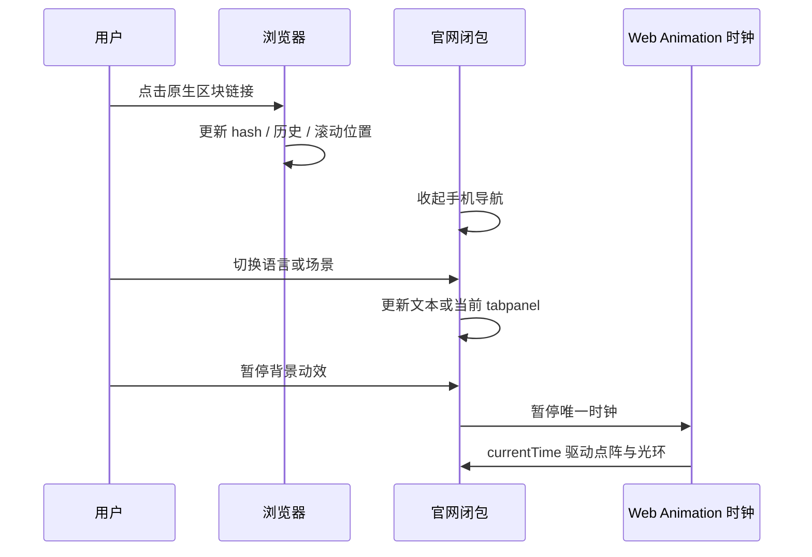

# Aiscoo 单文件官网

## 范围与产品规则

独立静态页面 `website/index.html` 使用原生 HTML、CSS、JavaScript，无运行依赖、框架或构建步骤。官网为正常纵向页面：品牌首屏之后依次呈现产品实图、使用场景、开发者、获取方式、关于与页脚。所有主要信息处于文档流中，用户可以直接下拉阅读，不通过 dialog 展示主要内容。官网不接入应用会话、账号、Host 或业务服务。

内容依据仓库 README、UI_PLUGIN.md、docs/document-skills-plugin.md 和现有产品截图：Aiscoo 是 AI 编程工作台，具备桌面、Web、终端入口，代码与文件操作、插件/MCP、文档处理与可交互画布。不得声称未证实的商业指标、客户、订阅价、云端常驻执行或电脑控制能力。获取区提供源码与自行构建指引，不链接上游产品安装包，也不把未核验的远端发布状态写成事实。

品牌素材复用 `packages/ui/src/xwork/brand/assets/wordmark-dark.svg` 与 `mark-dark.svg`；产品实图复用 `docs/images/ui-plugins/excalidraw-canvas.png`。运营主体只采用 `packages/shared/src/xwork-brand/brand.json` 已确认的“杭州艾思酷国际贸易有限公司”，中英页面保留相同中文主体，不自行翻译法律名称。源码许可链接指向根 LICENSE；第三方素材的许可不能由 Apache-2.0 自动推定。用户提供的背景保留尺寸及 SHA-256 来源记录，不提交外部用户标识、个人路径或会话产物地址。未确认正式域名、备案号或公开法律页地址时不编造或使用占位号码；公开发布前另行核实素材授权及部署所需信息。

## 视觉与信息结构

保留深蓝至青色地平线、浅奶油按钮、轻盈标题、点阵节奏和约 1.6 秒开场。首屏使用实际对话与 Excalidraw 画布截图；品牌使用仓库 Aiscoo 机器人标记。所有资源以 data URL 内嵌，离线打开单个 HTML 即可使用。

设计 token：night `#09131f`、ink `#0a0f15`、cyan `#46dcec`、mist `#d5f7f6`、cream `#f5f0e5`、muted `#a0b4c2`。中文标题使用系统宋体衬线，英文 Georgia；正文使用系统无衬线。首屏地平线过渡到浅色产品展示，深色场景区与开发者终端互相呼应。正文左对齐，实图为产品区的主要视觉。

- 顶部导航固定于滚动容器顶部。产品、场景、开发者、获取、关于均为真实 `href="#..."` 链接。
- 主操作进入 `#download`，探索工作台进入 `#product`，工具入口进入 `#developers`。首屏底部有明确的向下浏览入口。
- 产品区展示完整实图与能力说明；场景区内联切换开发、文档、画布示例；开发者区提供可复制的源码初始化命令。
- 获取区说明当前源码获取方式，提供仓库与 README 链接；关于与页脚位于页面末尾，提供返回顶部入口。
- 手机保持自然纵向阅读。菜单按钮展开顶部导航，不锁定 body、不覆盖整屏、不圈定焦点。无 JavaScript 时导航和主要文字仍可阅读。

## 唯一状态所有者与时序

浏览器拥有 URL hash、滚动位置和历史记录。导航使用原生锚点即时定位，不拦截点击重写滚动，不依赖平滑滚动动画。目标区设置顶部间距，避免标题被固定导航遮挡，支持直接打开带 hash 的链接以及浏览器后退。

页面闭包唯一拥有语言、场景选择、动效开关和页面时钟状态，不持久化、不发送请求。语言切换只更新文本，保留当前场景与元素身份。菜单的 `aria-expanded` 是展开状态来源；选择区块、Escape、移到桌面布局时关闭菜单，Escape 将焦点送回按钮。场景标签具有 tablist/tab/tabpanel 语义，支持方向键、Home、End。

点阵约 2,000 个 SVG 方点，按列整点变化。确定性的 1.6–2.8 秒节奏段、0.2–0.5 秒停顿、每秒约 6 次脉冲、中心向外延迟。它是工作节奏的视觉表现，不暗示未实现的语音产品。prefers-reduced-motion 下关闭开场、持续动画和平滑滚动。

## 验收场景（浏览器 E2E）

1. 1440×900、1280×800、390×844 的文档高度超过视口；滚动可依次看到所有区块直至页脚，没有整页横向溢出，截图保持比例。关键内容无需点击弹窗。
2. 桌面导航、首屏主次操作及向下浏览入口改变 hash 并到达对应区块，目标标题没有被固定导航遮挡。直接打开 `#developers` 后内容可见；浏览器后退可回到之前的锚点。页面不存在 dialog。
3. 手机菜单打开后可点选区块，选中后菜单收起且页面可以继续滚动；Escape 关闭并恢复按钮焦点；桌面宽度恢复正常导航。菜单内获取入口可用。
4. 场景标签可用鼠标及方向键切换；切换语言后保留当前场景，所有区块及无障碍标签同步更新。复制初始化命令有成功反馈；剪贴板不可用时选择代码并提示手动复制。
5. 图片及品牌与上述仓库来源一致，外链指向对应源码。暂停按钮冻结页面时钟；减少动态效果规则存在；内联脚本通过语法与 lint 检查。只把当前文件及实际执行的结果写入验证记录，浏览器覆盖范围与系统级模拟未执行项分别说明。
