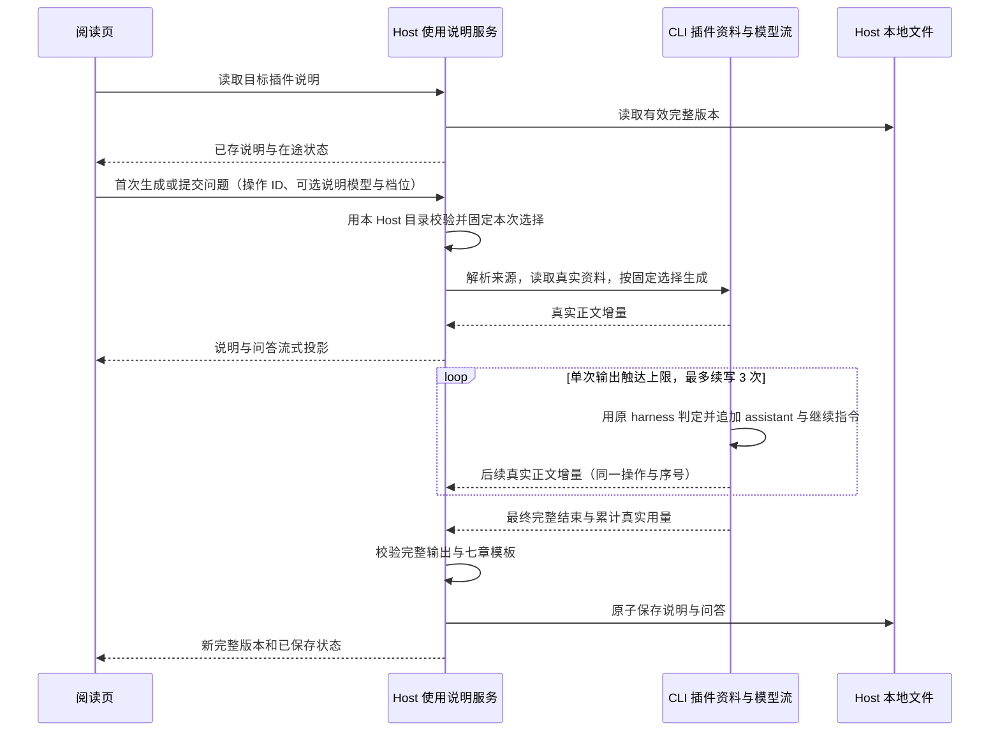

# 插件使用说明与交互调整

状态：用户于 2026-10-27 确认“详情页固定入口＋独立阅读页＋统一模板＋首次生成、本地复用”，并追加“用户可提问，让 AI 调整说明；复用 XWork 现有前端交互”。本规格记录该授权，不增加第二次产品确认流程。

## 产品规则

- 所有插件详情顶部提供次级“使用说明”按钮，未安装也能查看；主市场、Side Pane、插件管理复用同一阅读页。查看不安装、不启用、不运行插件，不切换或污染普通任务。
- 阅读页保留返回入口、插件名和保存状态。宽屏目录与正文并排，窄屏单列；沿用 DESIGN.md 字体、主题、按钮、消息 Markdown、输入框及发送/停止行为。
- 首次无说明时自动读取真实插件资料并调用当前工作区可用模型生成。命中缓存直接展示；没有模型时保留已存说明，仅生成入口提示配置模型。
- 固定七个章节：认识这个插件、什么时候适合用、使用前的准备、快速上手、实际场景示例、能力边界与注意事项、常见问题与参考资料。英文使用对应固定标题。
- 快速上手给出真实触发方式、输入和查看结果的步骤；不能把 Hook/UI/MCP 一律写成聊天指令。场景通常 2～3 个，每个含背景、材料、可复制提示词、预期产出及检查标准。资料不足必须说明缺口，不编造能力、命令、配置、费用或成功效果。
- 页面内提供“提问或调整说明”输入区及问答记录。用户可以要求解释、补充场景或改写；模型回答本次问题并返回完整七章说明。只解释时可保持原说明不变；有调整时替换新版。已有说明也可继续完善。
- 输入区直接复用主 Composer 的 ChatPromptEditor、Lexical 文本编辑器及 ModelConfigSelect 合并菜单，使用相同主题、边框、留白、发送/停止与 Enter/Shift+Enter、IME 行为。关闭任务 slash/mention、附件与普通草稿写入；问答不创建普通任务。
- 提供来自同一目标 Host 的可用模型和公开思考档位选择：模型目录取自说明服务所在 Host 的模型服务，与说明服务同一次解析，不按路径另行解析，远程 Source 或无附加标签页的远程工作区也不会显示其他 Host 的模型；保留供应商分组、隐藏空目录；选择仅作为本说明下一次提交参数，不修改普通会话模型、档位、草稿、Recent、账号连接或全局默认。切换选择不触发生成。
- 首次自动生成沿用目标 Host 的可用偏好模型并选择最低公开思考档位；说明菜单的默认值与该实际策略一致。用户显式选择后，Host 校验模型和档位仍可用，CLI 尊重选择，不能静默替换供应商、模型或档位。保存结果可选记录完整实际 selection，旧缓存仍有效；切换目标后丢弃旧目标选择及迟到结果。
- 生成时真实流式展示；手动上滚后不强制吸底。一次请求固定模型选择，重复挂载与重复点击复用在途操作。离开页面继续生成并保存；取消只中止对应操作。
- 已保存说明在新结果完整、模板校验及落盘成功前保持可读。单次生成达到输出上限时，复用原 harness 的结束原因判断、继续指令和最多 3 次续写预算（首轮加续写最多 4 次请求）。每轮把该轮实际 assistant 正文及思考签名加入本次临时上下文，再追加继续指令；正文增量按顺序直接拼接，最终成功结束后才校验完整七章并保存。第四次仍截断、拒绝、错误、取消或缺失章节不覆盖上一版。保存失败保留待保存结果，允许仅重试保存。
- “重新生成”与用户问题为显式调用；首次打开以外不自动重复花费模型额度。升级保留旧说明并标注版本差异，用户选择更新说明。离线可读已有缓存。

## 状态与所有者

1. CLI 解析插件来源、读取资料并创建真实模型流；沿用现有 ModelFactory、账号请求头、admission、取消及用量记账，禁止 Renderer 直接调用供应商或传递 Key。
2. Host 的独立使用说明服务拥有在途任务、说明问答、最新完整版本、待保存结果与异步文件持久化；UI 仅持有阅读导航、未提交文本、说明专属模型选择及服务投影。
3. 以来源身份、插件稳定 ID、实际版本/内容指纹、语言和模板版本定位缓存，来源相同的通用说明允许跨项目复用；不同 Host 的用户数据天然隔离。请求路由保留 workspaceIdentity（trim 后优先于 path）与 remoteSessionId；页面切换丢弃旧目标事件。
4. 数据放 Host 用户应用数据下独立 plugin-guides 目录，不写安装包或业务项目。原子替换、严格解析和写锁保护完整版本；问答随说明保存，未成功完成的流不作为完整版本。
5. 文档、清单、Skill、Command、Agent 仅作为不可信输入资料。资料读取不执行插件、不暴露配置值或工作区/聊天内容，限制到经既有来源解析器确认的插件根，拒绝符号链接越界及路径穿越。超出资料预算应明确诊断，不能静默伪装完整。
6. Host 在读取与相位变化时发布完整快照，生成中仅发送追加的正文/回答增量；快照与增量共用严格递增序号。UI 仅接收相同目标和操作的连续事件，漏序号时从同一 Host 重读，不再次调用模型。
7. 资料读取和模型流各有 30 分钟独立取消期限，协议 watchdog 多留 5 秒；该辅助调用超时不回收工作区 Agent。仅两个说明辅助方法走并发 admission，普通 session 请求保留原有串行顺序。
8. 自动续写由 CLI 辅助流持有；Host 仍只有一个 operationId、取消信号和 30 分钟生成期限。续写固定本次模型与思考档位，每轮保持原输出预算；临时 assistant/继续消息不写入普通会话或说明问答。每次物理调用分别按真实 usage 记账，返回总 usage 仅汇总各轮均有真实值的指标。

说明流是独立服务事件，不借用任务序号或任务消息队列。桌面订阅 Host 连续事件；手机重连先订阅再读取同一 owner 的当前快照，按序号丢弃过期事件；不把此流写入会话 replay 或另起 Agent 会话。手机 attachment 仅追加说明服务的 RPC channel，保留原有 Terminal、Provider provisioning 和来源管理权限边界。无订阅时任务仍由 Host 持有。

## 接入边界

- 现有 PluginStoreDetailView 是市场和管理的共享组合点；通过通用可选插槽/包装挂入 XWork 新组件，不改写上游详情函数。
- 新逻辑集中到 XWork 模块。公共清单、协议方法/通知、服务 descriptor、RPC 客户端、装配与架构登记只追加；跨包使用公开入口。
- 现有 workspace/generateText 为一次性返回，不改变其默认行为。追加独立文本流扩展，并在 Core 内复用现有模型创建、认证和记账工具；不把插件业务写进通用模型函数。
- 新插件资料接口复用已安装/未安装来源解析，不建立第二套安装器或解压器。
- 模型使用当前账号、认证与计费链，返回真实 usage，并调用既有用量记账 helper。当前本地 `model_usage.session_id` 依赖真实持久化 session；独立临时调用可能无法写入本地 App Usage 明细。本功能不创建隐藏普通任务、不修改 Usage schema，也不把 best-effort 记账当作落库成功。
- 说明输出预算是本次请求的期望上限。CLI 必须使用实际绑定模型的公开 `optionSpecs.maxOutputTokens.max` 钳制预算；未传预算时使用该公开上限。未指定思考档位时复用 `auxiliaryModelOptions` 的最低公开档位；显式档位原样执行。响应 selection 反映实际执行档位，仅本次请求生效。

## 验收场景

- PG-01：未安装插件可进入说明页；生成/阅读不改变安装、启用或当前任务。
- PG-02：首次生成七章和具体示例；模型真实增量出现，完整后本地保存。
- PG-03：退出阅读页、重新进入及重启 Host 后读取原说明，不新增模型请求；离线仍可读。
- PG-04：用户连续提出解释、增加行业场景、简化上手步骤；问答保留，完整新版满足模板并在重开后保留。
- PG-05：两入口同时查看只触发一次首次生成；快速重复点击不重复写；插件/语言/Host/工作区切换不串响应。
- PG-06：取消、供应商失败、截断、模板无效保留旧说明；文件写失败可仅保存重试，不再次调用模型。
- PG-07：插件升级标旧版本并显式更新；同名不同来源、不同内容/语言不读错说明。
- PG-08：恶意文档/符号链接不读取根外数据、不执行命令；用户凭据及项目文件不进入提示词。
- PG-09：主市场、Side Pane、管理入口、窄屏、明暗主题、中英文和键盘输入/停止均可用。
- PG-10：输入区与主 Composer 共用组件；选择另一可用模型和非最低思考档位后提交，真实请求采用所选模型/档位，普通会话选择、草稿和 Recent 不变；失效模型/档位阻止执行并保留旧说明和输入。选择本身不调用模型，重开旧缓存不失效。
- PG-11：真实流首轮按输出上限结束后自动续写，正文不重复、完整七章与问答最终保存；连续截断最多四次物理请求，耗尽或续写中取消保留旧说明；只累计真实用量，不把继续指令加入用户问答。

## 验证要求

使用 XWork 独立测试覆盖消费者可见状态、资料信任边界、持久化与并发取消；保留上游测试原样。实际运行真实 Host 服务和真实前端交互冒烟，记录受控模型 wire 与持久化证据；执行定向测试、pnpm typecheck、pnpm lint、pnpm architecture:check --changed。不得称未执行的真实供应商、手机、Windows/Linux 验证已通过。

## 实现与验收记录（2026-10-27）

已实现详情固定入口、独立七章阅读页、真实模型流、Host 本地复用及页内问答改写。共享协议、Host 服务、CLI 三个扩展模块和 UI 阅读器分别留有契约说明；实现计划包含 21 个上游修改文件的必要性清单及合并预演证据。

- 最终根定向回归：12 文件、74 测试通过，覆盖协议、Host 文件持久化、UI 投影、真实 RPC 暴露及原插件页面行为。
- CLI 集成轮定向回归：3 文件、24 测试通过，覆盖资料边界、模型结束/取消及并发 NDJSON 请求。
- 最终 `pnpm typecheck` 通过；`pnpm lint` 为 0 errors、316 条既有 warnings，本次新增 warnings 已清除；`pnpm architecture:check --changed` 为 0 违规；变更路径格式检查通过（匹配 52 文件）。
- 最终真实 Electron：`xwork-plugin-guides-20261027-r4`，exit 0，1 passing、0 failed、0 skipped。实际 SDK 经 HTTP SSE 访问本机受控 Provider；没有请求外部付费模型。
- 共 4 次模型请求：首次成功、追问成功、第三次取消且关闭实际 HTTP 流、显式重试成功。返回重开和完整退出重启后仍是 4 次；新旧 Electron PID 为 95377 / 96050。
- 已保存说明与问答在新进程恢复；插件保持未安装；普通 conversation/model/draft 观测值前后相同。393px 阅读区域在明暗两主题均位于真实 viewport 内，正文无横向溢出。截图已实际复核。
- 额外回归验证了超过默认 180 秒仍能持续的请求、独立 deadline 不触发 Agent 回收、reading 阶段停止、增量广播大小随输出近似线性增长，以及超限预览在发布无效快照前失败。
- `upstream/main` 为 `3c5b2276`；release 基线和含本功能的临时树分别执行 `git merge-tree`，均 exit 0、无冲突。本功能新增冲突 0；细节见实施计划。

| 场景          | 证据与范围                                                                                                                                                                               |
| ------------- | ---------------------------------------------------------------------------------------------------------------------------------------------------------------------------------------- |
| PG-01 / PG-02 | 真实 Electron 主市场未安装插件入口、七章实时预览、实际 SSE 与本地完整保存。                                                                                                              |
| PG-03         | 实际返回重开及全退出/新 PID 重启复用；Host 回归另测离线读取。                                                                                                                            |
| PG-04         | 实际页内提问、完整新版与问答持久化；Host/UI 回归覆盖持续追问投影。                                                                                                                       |
| PG-05         | 双 Host owner 实例共享实际文件锁、重复点击和旧 target/service/route/版本事件隔离的定向回归。                                                                                             |
| PG-06         | 实际取消/重试保留已存版本；回归覆盖 provider 错误、截断、无效模板、保存失败、仅保存重试及跨窗口新版本冲突。                                                                              |
| PG-07         | 来源/语言文件隔离、内容指纹、版本变化 stale 与显式更新的回归。                                                                                                                           |
| PG-08         | CLI 的符号链接、路径穿越、读取预算、配置值隔离与无安装写入回归。                                                                                                                         |
| PG-09         | 实际主市场、英文输入/停止及 393px 明暗主题；主市场/Side Pane/管理使用同一包装，入口接入经过定向回归与评审。中文模板和 locale 契约有回归，未声称全部入口/语言组合均逐一做过真实设备 E2E。 |

完整报告、请求观测和截图位于 `packages/desktop/.e2e-artifacts/xwork-plugin-guides-20261027-r4/`。保留早期记录：首轮因本机 900px 窗口高度约束失败，未发送模型请求；r2 通过后发现窄屏断言只验证局部宽度，随后补入实际左右屏幕边界检查，r3、r4 均通过。

测试环境已恢复：`zcode://` 精确指回原 `XWork Dev.app` 并读回；确认专用临时目录无开放文件后移除；正常 production 后端的 Main/Host/Preload 与 renderer 构建均成功，长期开发 renderer 保留。用户原桌面页面检查为 root 已渲染、无 Vite error overlay；保留原进程，本轮不将隔离 Host 的成功当作用户当前进程已加载新服务。

首轮隔离验收边界：当轮未调用真实外部供应商，未测真实手机、Windows/Linux，未运行全量单测。本地 App Usage 的临时 session 外键限制见“接入边界”；供应商账号侧仍按实际调用计费。现有文件锁无 AbortSignal，锁竞争可能使取消等待至获得锁或 180 秒锁超时，开始模型前仍检查取消。

## 实际开发进程故障回归（2026-10-27）

用户截图中的 `Channel name 'aiscoo-plugin-guides' timed out after 1000ms` 来自已运行数日的旧 Host；Renderer 已热更新，新服务尚未注册。服务端日志确认 `Unknown channel`，与模型响应速度无关。确认普通会话运行数为 0 后，通过既有正常重启命令加载新 Host；新进程日志确认频道注册及 `read` 成功，没有放大 RPC 超时或伪造降级路径。

继续通过真实配置验收时发现两项模型执行问题：

- 说明期望输出 8192，而实际绑定模型声明的输出上限为 4096。Core 现在按公开模型上限钳制本次预算，未传预算时也给出有效的模型上限。
- 继承最高思考档位的真实请求以 `length` 结束且正文为空，没有落盘。说明调用现在复用现有 `auxiliaryModelOptions` 的最低公开思考档位；仅覆盖这次辅助请求。实际读取的普通 preferred selection 仍为原模型及 `max`，没有改写会话设置。

另有独立运行态依赖：New API 已配置的真实 KiroaaS 上游没有运行，导致 HTTP 500。已恢复其既有 `com.xwork.kiroaas-native` 自启动服务并确认健康，没有更换渠道地址或凭据。此前失败重试已在页面停止；没有以测试服务替代真实上游。

最终实际验证：

- 当前用户配置的 New API / KiroaaS / `claude-opus-5.5` 链路完成 PDF 说明；页面显示“已保存到本地”。
- 已保存中文正文 4070 字符、完整七章、三个可复制示例代码块；磁盘 JSON 的插件 ID 为 `pdf@zcode-plugins-official`，章节数为 7。再次通过同一 Host 的 `read` 返回 ready 和相同 revision。
- 实际用户正在导航窗口，缓存复核改用只读 Host API；不声称自动化完成了第二次 UI 返回/重开，也不把同时发生的用户生成请求算作缓存调用。
- 新增真实 Model 参数校验回归：预算越界/缺省先复现相同错误，辅助档位断言也先失败；最终 4 文件、28 项 CLI 定向回归通过，覆盖模型上限、较小预算、缺省预算及普通会话档位保持。
- 最终实际 Agent 构建、`pnpm typecheck`、`pnpm lint`（316 warnings / 0 errors）、架构检查（0 违规）及修复文件格式检查通过。初版测试放入生产编译目录产生的 rootDir 失败已纠正：集成回归位于既有 `packages/adapters/tests/`，该次生成的源码旁编译输出已清理，之后构建成功。

真实链路观测保留在 `packages/desktop/.e2e-artifacts/xwork-plugin-guides-live-20261027/observations.json`。首轮受控 SSE 报告仍单独保留；真实设备与其他平台的未验证范围未改变。

## 主 Composer 与独立模型选择验收（2026-10-27）

“提问或调整说明”现在直接复用主界面的 `ChatPromptEditor` / Lexical 输入壳和 `ModelConfigSelect` 合并菜单。模型、供应商分组与思考档位来自目标 Host；本地 reader 仅持有下一次提交意图，手动提问、重新生成和失败重试均提交该选择。Host 用同一模型 facade 校验精确身份与档位，CLI 尊重显式思考级别，未指定时才使用辅助最低档；保存记录可选携带实际完整 selection，旧缓存继续有效。

- 最终根定向回归 15 文件、100 测试通过；CLI 4 文件、30 测试通过。新增 UI 回归放在现有 `packages/ui/test/` 发现路径，避免未被测试入口收集；两个模块的契约测试保持 300 行以内。jsdom 使用浏览器媒体查询替身及真实 range change 事件，实际键盘操作由 Electron 验收。
- `pnpm typecheck` 通过；`pnpm lint` 为 316 warnings / 0 errors；`pnpm architecture:check --changed` 为 0 违规；87 个任务文件格式检查通过。最初两处同期套餐卡片类型错误随后在工作区消失，最终命令通过；本任务没有修改该卡片。
- 实际 Agent CLI 构建及正常 production 桌面构建通过。Electron 最终 `xwork-plugin-guide-composer-20261027-r3` exit 0，1 passing、0 failed、0 skipped；使用真实 SDK/Host/CLI 与隔离 loopback HTTP SSE 服务，没有增加真实外部付费模型调用。
- 实际 wire 共四次：首次为默认模型 / low，后续提问、取消和重试均为另一供应商模型 / high。选择菜单本身不产生请求，取消真实关闭 HTTP 流；停止与失败保留旧说明，完整重启 PID 41882 → 42486 后仍为四次请求，并恢复已保存的模型与档位。
- 普通会话前后均为原模型 / high，非空未发送草稿、模型设置、持久化全局默认选择及模型/Recent 的 localStorage 投影保持相同。393px 明暗主题实际输入左右边界为 34 / 359，截图已滚动到输入区并实际复核；菜单关闭后等待标签动画结束再截图。

报告、请求及截图位于 `packages/desktop/.e2e-artifacts/xwork-plugin-guide-composer-20261027-r3/`；r1、r2 记录保留，r2 补强了输入区可视截图，r3 补强了真实嵌套默认选择字段及 Recent 存储观测。手机真机、Windows/Linux、全量单测和新的外部模型付费调用未执行；原本地 App Usage 与文件锁限制保持不变。

正常桌面已在重新确认运行任务数为 0、无未提交输入及无可见说明操作后，通过既有 relaunch 命令加载新构建（Main 43934 / Host 44310）。实际重新打开既有 PDF 说明显示原“已保存到本地”时间、新 Lexical 输入和 `claude-opus-5.5 / 低` 控件；Host 日志只有说明 read 与模型 View 读取，未新增生成。原 PDF JSON 的 SHA-256 仍为 `fac58701825a1ae64658a292285edc8d2a6bf20e7e6d2fe8f41c1b04a232e5ea`，旧缓存不失效。真实表面截图为最终报告目录的 `real-runtime.png`。`zcode://` 已恢复到测试前精确 XWork Dev.app 路径并重新查询一致；没有提交、推送或创建 PR。

## 输出上限自动续写验收（2026-10-27）

说明辅助流直接复用原 harness 的 `classifyOutputTokenContinuation`、`OUTPUT_TOKEN_CONTINUE_PROMPT` 和输出上限错误；首轮加最多三次续写共四次物理请求。每轮实际正文、思考签名及继续指令只进入本操作临时上下文；同一模型、档位、输出预算和取消期限贯穿全过程。最终完整结束后才返回拼接正文供 Host 七章校验和保存；每轮独立记账，累计 usage 不补未知指标。

- CLI 定向回归 3 文件、26 测试通过；新增场景先复现旧 `length` 直接失败及空 assistant 消息问题，再转绿。覆盖首轮截断后继续、第三次续写成功、第四次仍截断报错、原始输出上限标记、思考签名、续写中取消、普通历史与模型选择不变，以及真实用量累加/缺失。
- Host 定向回归 3 文件、20 测试通过，覆盖旧说明保留、完整保存、取消、保存失败及序号边界。
- 实际 Electron `xwork-guide-continuation-20261027` exit 0，2 passing、0 failed、0 skipped。真实 SDK/Host/CLI 通过隔离 loopback HTTP SSE 执行 PG-11：首轮返回 `length`，第二轮携带部分 assistant 与原继续指令；两个请求均沿用所选模型/high，最终保存七章、只新增本次用户问题与回答，未保存继续指令，正文未重复。整个 spec 共六次模型请求，含既有取消及重启缓存场景。
- 实际 CLI Agent 构建、Core typecheck、根 `pnpm typecheck`、根 lint（316 warnings / 0 errors）、Core lint、架构检查（0 违规）及四个变更代码文件格式检查通过。已恢复正常 production 桌面产物；测试 `zcode://` 注册恢复为原精确 `XWork Dev.app` 路径，读回一致。隔离临时目录在确认无开放文件后移除。

报告、真实 wire 与截图位于 `packages/desktop/.e2e-artifacts/xwork-guide-continuation-20261027/`。本轮未调用外部付费模型、未跑全量单测或手机/Windows/Linux 真机；真实上游仍可能在四次输出都达到上限后失败，旧说明继续保留。

正常桌面通过既有 relaunch 命令加载新构建后，实际页面为 `XWork`、`document.readyState=complete`、根节点包含已渲染内容、无 Vite 错误遮罩；主世界 preload 的 `getDesktopSessionActivity()` 正常返回 `runningAgentSessionCount: 0`。此次启动复核没有触发模型生成；自动化连接已释放，保留用户桌面窗口。
