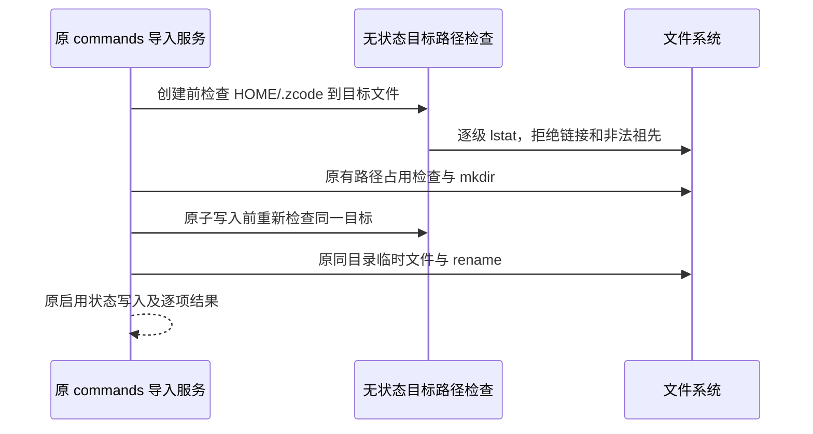

# 上游同步后的数据写入安全收尾

状态：命令同步安全修复已实现并完成定向验证。会话 purge 使用独立规格，不属于本文范围。

## 命令同步：拒绝目标路径中的既有符号链接

### 问题与产品规则

v3.17.1 的命令 collector 不进入符号链接目录，但导入新命令时递归 mkdir 与同目录原子写入会解析祖先链接。若 `~/.zcode/commands/group` 指向外部目录，新命令可能写出命令根目录并返回 created；随后的列表仍跳过该目录，用户再次比较时仍会看到可新建。

命令同步继续统一写入目标端 `~/.zcode/commands`。从目标端可信 HOME 下的 `.zcode` 开始，到 commands 根目录、各级目标目录及最终文件，任何已存在的符号链接均拒绝，不跟随、不替换，返回该项 `failed` 和明确的链接路径原因。指向根目录内部的链接、悬空链接及 Windows 目录 junction 同样拒绝。

只有 `ENOENT` 表示尚未创建，可以继续原创建流程；非目录祖先或其他 IO 错误不得当成不存在。可信 HOME 本身可经系统路径别名定位，不对 HOME 以上的系统目录增加新限制。

### 所有者、接口与执行顺序

`IUserConfigSyncService` 的 commands 分类继续拥有导入操作；文件系统是路径与字节事实来源。独立的异步路径检查 helper 不持有缓存、队列、锁或新 owner，不新增 RPC、重试或超时。

首次检查在模式分派前拒绝已有目标链接，包含未被 collector 收录的悬空叶子。合法路径继续保留已有的来源、哈希与冲突判断，覆盖在实际写入前再次检查。collector、来源目录合并、key 归一化、字节复制、权限位保留、启用状态写入及失败回滚保持原合同。正常嵌套目录缺失时继续创建，成功命令可以被后续列表读取；同批次其他合法命令不因单项路径失败而中止。

检查拒绝预先存在以及在复核时已出现的链接；路径检查与后续 OS 写入不是单一原子操作。本修复不声称消除恶意并发替换祖先目录造成的 TOCTOU，也不引入平台特有的 dirfd/openat 写入算法。

### 验收与回归入口

新增独立 Node 原生回归，通过真实 `createUserConfigSyncService()` 的 commands `importSyncItems` / `listSyncItems` / `exportSyncItems` 入口执行，不恢复已退役 App 单测。将该文件作为精确条目追加到现有 `scripts/run-native-unit-tests.mjs`。

1. `.zcode`、commands 根目录、第一层和深层祖先为既有目录链接时，导入返回 failed，链接和外部目录字节不变；同一请求再次执行仍失败。
2. 最终文件为正常或悬空符号链接时，拒绝覆盖或创建，链接、外部内容和启用配置不变。
3. 正常 `group/new.md` 在目录不存在时 created，字节完整，后续 list/export 可读；新建来源禁用状态仍换算为目标绝对路径。
4. 正常覆盖保留目标权限与启用状态，缺失或过期 expectedTargetHash 仍 conflict、文件不变；createOnly 遇到普通已有命令仍 conflict。
5. 非目录祖先及其他 IO 错误明确失败；同批次的正常项仍成功，不新增分类整体拒绝。

2026-10-30 定向证据：旧实现首轮 RED 为 12 场景 5 通过 / 7 失败，四类根或祖先链接均实际写入外部目录；随后将悬空叶子的 overwrite 断言也统一为明确失败。最终实现 GREEN 为 12/12 通过，正常嵌套同步、同批其他项、权限与启用状态、哈希冲突均保留。`pnpm exec tsc -b packages/services` 通过；四个改动代码/runner 文件的定向 `pnpm lint -- …` 为 0 错误 / 0 警告；`pnpm architecture:check --changed` 为 0 违规。未运行全量测试；Windows junction 分支仅具备回归定义，本轮 macOS 未执行 Windows 验收。
