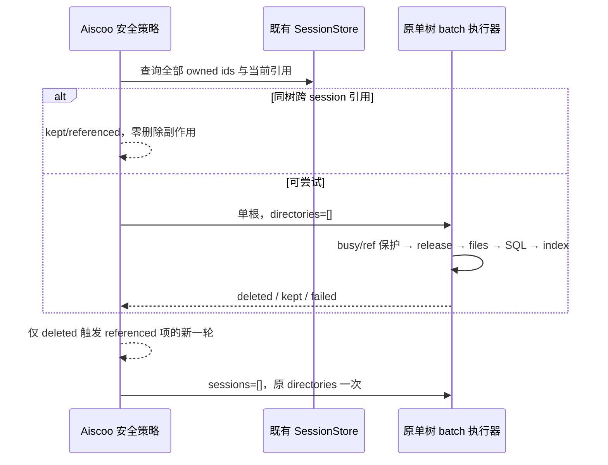

# 上游同步：会话批量清理的幸存引用安全

状态：2026-10-30 同步正确性修复，采用保守保护；关联 PR #50。

## 已确认问题与范围

ZCode v3.17.1 的 `purgeSessionDataWith` 在删除前把本批全部非 busy 候选当作将被删除，预先排除它们之间的附件引用。后续某树释放、文件删除或 SQL 删除失败，仅记录 failed；已经或随后删除的源树可能仍被失败幸存者引用。A 引用 B 时，`[A,B]` 与 `[B,A]` 都能产生该结果。

同一根的附属子会话也有风险：原入口先逐个删除全部 owned ids 的文件，最后对根调用递归 `purgeSessions`；根或子会话中途失败会留下行。只把请求拆成单根不保护同树跨 session 引用。

本次不新增文件暂存/回滚、独立 SQL 写者、artifact-only 删除或迁移，不将文件预检等同于实际删除成功。现有 `removeSession` 是不可逆、多路径操作，失败可能已删除部分文件；本规格保证不再因批次中其他会话的失败而新增跨 session 悬挂引用，不承诺回滚失败会话自身的既有部分删除。

## 唯一 owner 与接线

- store 是持久引用和会话行的唯一事实来源；lifecycle/residency 是忙碌与运行态释放的唯一 owner；原 batch 执行器仍独占 release、removeSession、purgeSessions 和 forgetIndexed 的顺序。
- Aiscoo 独立安全策略只持有当前调用内的候选与结果，不维护第二份持久引用图、不保存任务队列、不写 SQL、不直接访问文件。
- 原 batch 函数主体保持不变，仅变成私有执行器；公共 `purgeSessionDataWith` 统一委托安全策略并注入私有执行器，生产 RPC 和直接调用都经过同一保护。接线处用 XCODE 中文注释说明原因。
- `measureSessionDataWith`、权限、V4 schema、结果字段、身份与归属规则不变。

## 算法与失败边界

1. 每次尝试某根前，调用现有 `listOwnedSessionTrees([root])` 获取根及全部附属后代。任一 id busy 时由原执行器返回 running，busy 优先于 referenced。
2. 对非 busy 树，以现有 `listArtifactReferrers(ids)` 查询真实未删除引用；发现目标与引用者属于同树且二者 session id 不同，整树直接返回 `kept/referenced`，不释放、不删文件、不删行。同 session 的自身引用不阻止清理。
3. 其他树调用原执行器，参数只含该根且 directories 为空。因此只有已经实际删除行的引用方才从查询中消失，失败、尚未执行及未选择的会话仍保护附件源。
4. 仅当本轮至少一根实际 deleted 时，再次尝试本轮因 referenced 暂缓的根。failed 和 running 在本批不自动重试；一轮无删除进展即停止。无环跨树链在无失败时可全部删除，与输入顺序无关；结果按原请求顺序归并，每根只出现一个终态，释放字节不重复累计。
5. memory 由同一个原执行器在全部 session 处理后用空 sessionIds 调用一次，沿原目录顺序返回结果；不因 session 重试重复删除 memory。

行为收紧明确如下：同树跨 session 引用整树保留；跨树循环引用及其仍有幸存引用的源树保留为 referenced。上游原先假定这些树整批必删并一并删除，本次不保留该不安全假设。正常无引用 owned 树、无环跨树成功批次、外部引用、软删除引用不计、busy、失败不移出索引、文件先于行与重复删除幂等保持原合同。

## 回归验收

独立 CLI 回归 `apps/zcode-cli/packages/bootstrap/tests/aiscoo-session-purge-safety.test.ts` 必须通过公共入口；fake port 会在 purge 成功后删除引用方，不能用永不更新的引用 fixture 模拟实际 store。

- A 引用 B：两种输入顺序，A 的 release、文件或 SQL 分别失败，B 文件/行/索引均不触碰；A 同批只尝试一次。
- 根/owned child 交叉引用：两个方向、根或 child 注入失败均整树 referenced，零文件副作用；自身引用不误判，普通无引用树完整清理。
- 无环链两种顺序全部成功，独立树失败不阻止无关树；循环保留；外部、未选 root、busy 引用按真实幸存事实保护。
- memory 只删除一次；每根最终结果与 bytes 不重复；原 batch/store 错误不被吞为成功。
- 真实临时 SQLite 与真实会话文件端口覆盖文件失败的两种顺序；查询来自 part 中 `zcode-artifact://` URI，删除后检查行、源附件与索引回调。同树、无环和循环等组合使用遵守相同引用/删行语义的可变内存端口覆盖。

定向入口：`pnpm --dir apps/zcode-cli exec vitest run packages/bootstrap/tests/aiscoo-session-purge-safety.test.ts packages/bootstrap/tests/session-data.test.ts packages/adapters/tests/session-data-files.test.ts`。SQLite 仓储按既有 `session-store.test.ts` 的 purge/referrer 用例定向选择；再运行架构检查、CLI typecheck/lint 与根要求的 typecheck/lint，如实记录环境与既有失败。所有运行时验证使用固定 Node 24.14.0、隔离 HOME/XDG/CLI 数据根，不触碰用户真实会话。
