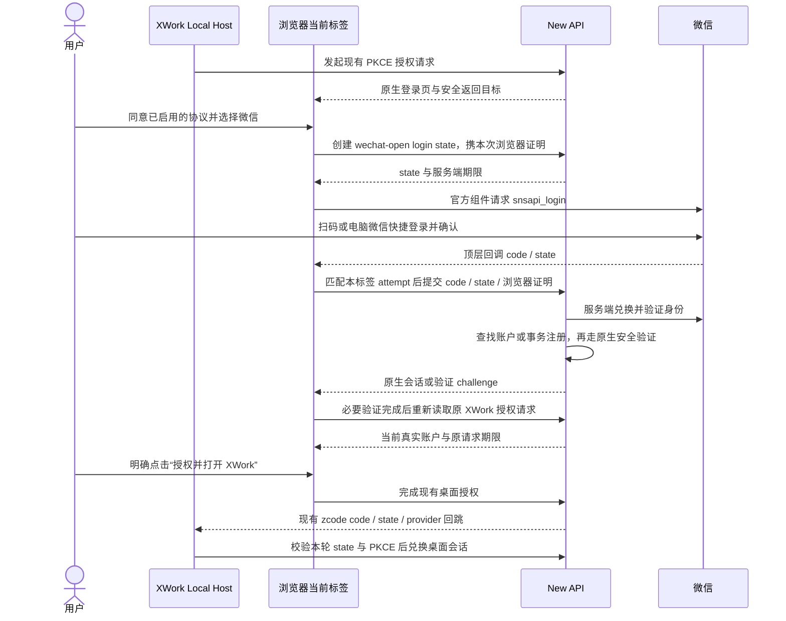

# 微信网站应用登录与自动注册（方案 A）

状态：方案 A 的 S01/S02 已在隔离分支 `feat/wechat-open-login` 实现并完成下述受控验证；尚未提交、合入或部署。S03 真实微信扫码、电脑快捷登录与完整 Host 验收（W10）未完成，仍受应用资质、密钥及登记 HTTPS 回调域名约束。

## 1. 目标与范围

在 New API 统一登录页提供微信官方网站应用登录：用户扫码或通过符合条件的电脑微信快捷登录，已有绑定直接登录，新微信身份在注册开启时自动创建普通账户。XWork 桌面沿用现有浏览器授权与 PKCE 回跳。

- 保留现有账号密码登录、注册、Passkey、二次验证及其他已启用登录方式。
- 参考截图的双栏信息结构：账号登录与微信区并列，标题“登录 / 注册 XWork”，协议区域统一管理。
- 微信头像、昵称、快捷登录和切换微信账号由官方组件提供；页面不自行探测本机微信身份。
- 本次不增加手机号验证码登录、CCF 登录、赠送额度、支付或套餐变更，不把截图中的“2000 万 tokens”写入产品。
- 本次覆盖 New API 浏览器登录页及桌面 Local Host 授权；不新增 XWork 独立 Web 主账号体系、手机微信内网页授权或移动端原生微信 SDK。

## 2. 实施前基线与方案差异

下表记录实施前 New API release `d2abf9c` 的源码与公开配置快照；实现和验证结果见第 9 节。

| 项目       | 已核对的事实                                                                                                                                                   | 方案 A 的变化                                                                                  |
| ---------- | -------------------------------------------------------------------------------------------------------------------------------------------------------------- | ---------------------------------------------------------------------------------------------- |
| 现有微信   | [controller/wechat.go](../../../../new-api/controller/wechat.go) 通过 wechat-server 验证公众号验证码，使用 `users.wechat_id`，注册开关控制新用户创建           | 追加独立的网站微信 Provider；不把网站授权 code 发到原验证码接口                                |
| OAuth 框架 | [controller/oauth.go](../../../../new-api/controller/oauth.go) 已有 10 分钟 AuthFlow、Provider 注册、登录/绑定/验证 intent 和统一回调                          | 复用生命周期、会话签发及安全验证，追加微信传输与绑定支持                                       |
| 持久化限制 | 现有 OAuth 创建、绑定、验证因子发现包含内置字段枚举，以及对 `GenericOAuthProvider` 的具体类型判断；`users.wechat_id` 只有普通索引                              | 网站微信使用新增可空唯一字段，并同步接入内置字段枚举；不能只注册 Provider 就认为整条链路已完成 |
| 桌面授权   | [NewApiProviderAdapter](../../../packages/services/src/oauth/providers/newApiProviderAdapter.ts) 已生成 state、S256 challenge，并使用 `zcode://oauth/callback` | 继续复用 `new-api` 主 Provider；不增加桌面微信 token 或第二套会话                              |
| 本机状态   | 本轮公开 `GET /api/status` 返回 `wechat_login=false`、未配置 `wechat_qrcode`，账号登录和注册开启                                                               | 仅证明当次公开配置；未核实网站应用资质、密钥或授权域名，不能据此宣称可真实扫码                 |

现有通用 OAuth token 请求使用标准 POST 参数；微信网站应用的 token 接口使用官方规定的 GET 与 `appid` / `secret`。因此不能仅配置现有 Generic OAuth 地址来完成接入，微信协议放入独立 Provider 实现。

## 3. 产品规则

### 3.1 登录与注册

1. 已绑定网站微信身份：定位原 New API 用户，执行原生封禁、删除、会话签发及二次验证规则。
2. 未绑定身份：只有服务端 `RegisterEnabled=true` 时，才在同一事务创建普通用户与微信绑定；`PasswordRegisterEnabled` 仅控制密码注册，不阻止已允许的微信注册。
3. 注册关闭时：既有绑定仍可登录；新身份提示“暂未开放新用户注册”，不创建用户、会话或赠送权益。
4. 同一微信身份并发首次登录：最多创建一个用户、一个绑定；唯一约束冲突须回滚本次创建，重读已提交的绑定并重新检查账户状态，不遗留孤立用户或重复发放注册权益。
5. 新账户沿用现有真实注册默认配置。登录不代表获得 XWork 套餐；没有授权套餐时展示真实状态。

### 3.2 绑定与账户归属

- 已有账户通过现有安全设置发起微信绑定，绑定前完成原生安全证明，回调绑定发起时的用户与浏览器 SID。
- 网站微信身份由 `(appid, openid)` 唯一确定。OpenID 仅在相应应用内有效，不与现有公众号 ID 互换，不按昵称、头像、未验证手机号或邮箱匹配账户。
- 已被其他账户绑定的微信身份拒绝再次绑定；同一账户同一应用已有其他微信绑定时拒绝静默覆盖，沿用明确解绑后重新绑定的流程。
- 本期不按 UnionID 自动合并历史账户，也不引入跨应用账号迁移。用户显式绑定原账号后继续使用原 `user_id`，套餐、余额和任务历史的归属不变。
- 绑定、解绑和删除账户接入已有安全审计、认证版本与会话撤销规则；不能因新增微信入口绕过最后一个可用认证方式的保护。

### 3.3 页面与平台

| 区域       | 行为                                                                                                                                                                                   |
| ---------- | -------------------------------------------------------------------------------------------------------------------------------------------------------------------------------------- |
| 桌面布局   | 宽度至少 768px 时采用账号区 / 微信区双栏；不足时单列并允许切换登录方式，操作不横向溢出                                                                                                 |
| 微信入口   | 显示“微信登录 / 注册”与“首次使用将自动创建账户”；加载官方 `WxLogin`，二维码区域至少 220 × 220px                                                                                        |
| 协议       | 复用 `LegalConsent` 与真实配置的协议链接；要求同意协议时，在勾选前不创建微信 state、不加载授权组件，不默认勾选或伪造链接                                                               |
| 官方状态   | 组件负责二维码、快捷登录、微信账号切换及其内部状态；`onReady` / `onQRcodeReady` 仅代表加载完成，不能当作登录成功或自行推断已扫码                                                       |
| 失败与重开 | 页面提供加载失败、服务端流程过期和重新发起操作；取消、替换组件或切换主题时调用官方 SDK 回写的 `onCleanup` 移除消息监听；只在用户主动重开时创建新 attempt，不在不确定兑换结果上自动重试 |

普通浏览器支持中英文、项目已有语言资源、深浅主题、键盘操作和错误播报。沿用 New API 的 AuthLayout、Button、Tabs 等组件与字体规范，不引入另一个仓库的 `text-ui-*`。

手机页面保持单列和现有账号登录；微信入口明确提示使用电脑页面扫码，不要求手机用户扫描自己的屏幕。手机微信内的一键授权需要公众号网页 OAuth，本次不把网站应用 `snsapi_login` 冒充该能力。

## 4. 状态所有者与事件顺序

| 状态                                        | 唯一所有者                     | 边界                                                                                  |
| ------------------------------------------- | ------------------------------ | ------------------------------------------------------------------------------------- |
| 微信身份、官方授权 code、请求内 token       | 微信与 New API 服务端 Provider | 网页仅转交 code/state；AppSecret、微信 access/refresh token 不返回网页或桌面          |
| 微信登录 AuthFlow、身份绑定、浏览器 Session | New API                        | state 绑定 provider、intent、期限与发起浏览器；用户创建与绑定事务提交后才发布登录结果 |
| 当前 attempt、协议同意、返回目标            | 浏览器当前标签                 | 只保留本次交互投影；身份或 attempt 变化后拒绝旧结果，不新建账户状态 store             |
| XWork 授权 AuthFlow 与来源 SID              | New API                        | 登录或换号不延长原请求；完成授权时验证当前真实浏览器身份                              |
| 桌面 state、PKCE verifier、登录 generation  | Local Host                     | 网页不获取 verifier；只接受本轮匹配回调，并存入既有安全凭据库                         |

普通网页直接登录的目标仍是现有安全站内目标或 dashboard。桌面来源必须保留 `/xcode/authorize?flow_token=...`；刷新、微信回调、注册及二次验证往返均不能替换为自动授权。

## 5. 接口、配置与持久化

本节登记本次实现的增量。HTTP 与桌面凭据基础契约仍以 [New API canonical spec](../../../../new-api/docs/specs/xcode-integration.md) 为准；网站微信增量已同步到隔离实现中的 `docs/authentication.md`，不另建桌面微信协议。

### 5.1 配置与公开能力

增加网站微信配置 `WeChatOpenEnabled`、`WeChatOpenAppID`、`WeChatOpenAppSecret`、`WeChatOpenCallbackURL`。沿用现有管理员权限、配置持久化与敏感值保护；Secret 输入只支持更新，不明文回显，不进入公开 status、日志或构建产物。

- 默认关闭；启用时检查 AppID、Secret 和 CallbackURL 完整有效。缺配置不能呈现可执行的扫码入口。
- CallbackURL 是服务端配置的 HTTPS 绝对 URL，固定为该部署公开 origin 下的 `/oauth/wechat-open`；拒绝 userinfo、query、fragment、外源及用户提交的回调替换。
- 微信登录的授权/token/userinfo 上游固定为官方 HTTPS 端点，不开放通用可配置转发地址。
- 配置必须与发起 AuthFlow 时的应用及回调一致；配置变化后旧 flow 拒绝完成，不把旧应用身份写到新命名空间。
- 原公众号 `WeChatAuthEnabled` / wechat-server 配置和接口语义保留；新登录页主微信区只展示已选的网站微信方式，不重复展示两个含义不同的“微信登录”。

公开 `GET /api/status` 仅追加 `wechat_open` 对象：`enabled`、`app_id`、`redirect_uri`。关闭或配置无效时 `enabled=false`；前端不得据旧 `wechat_login` / `wechat_qrcode` 猜测网站扫码能力。

### 5.2 流程接口

| 接口                                                               | 网站微信约定                                                                                                                 |
| ------------------------------------------------------------------ | ---------------------------------------------------------------------------------------------------------------------------- |
| `POST /api/oauth/state`                                            | `provider="wechat-open"`；复用 `intent="login" / "bind" / "verify"` 和原生安全证明；微信 flow 沿用 10 分钟服务端期限         |
| `GET /api/oauth/wechat-open`                                       | 统一 OAuth 回调兑换；校验 provider、intent、state、发起浏览器证明、应用配置和期限，再按官方协议兑换 code                     |
| 浏览器 `/oauth/wechat-open`                                        | 复用现有回调页面，追加网站微信 attempt 校验与请求 header；调用现有 `handleLoginResult`，接受原生 AuthBundle 或验证 challenge |
| 原 `/api/oauth/wechat` 与 `/api/oauth/wechat/bind`                 | 继续是公众号验证码流程，不接收网站应用授权 code                                                                              |
| XWork `/api/xcode/v1/auth/authorize/*` 与 `zcode://oauth/callback` | 沿用当前接口、`provider=new-api` 与 PKCE，不增加微信 token、任意 user_id 或自动授权参数                                      |

微信官方控件使用 `scope=snsapi_login`、`self_redirect=false`，回调发生在当前顶层标签。使用 HTTPS 官方脚本，新增必要的精确 script/frame/connect 来源；不为了加载微信放宽全站 CSP 为通配符。

### 5.3 发起浏览器与 attempt 绑定

服务端仅检查随机 state 存在，不能证明回调来自发起登录的浏览器。网站微信增加专属的浏览器证明，同时保持其他 Provider 的默认行为。

1. 当前标签每次发起生成 32 字节随机证明，以 base64url 编码，通过 `X-OAuth-Browser-Proof` header 提交 state 创建请求；服务端在 flow 载荷中仅保存其 SHA-256 与配置指纹。
2. 登录发起标签在 sessionStorage 保存当前 attempt 的 state、短期证明、intent、期限、发起时的用户/SID 及经校验的返回目标；这是临时流程数据，不包含微信 token、New API AuthBundle 或 PKCE verifier。存取不可用时不开始该微信流程，保留账号登录。
3. 登录回调页面先确认 state 是本标签当前 attempt、浏览器身份仍与发起时一致，再以同一 header 调用兑换接口；服务端同时验证证明、provider/intent 与配置指纹。直接打开他人 callback 或 API URL、复制链接到新标签、缺失/错误证明均不得签发登录会话或更新刷新 Cookie。
4. 主动重开、切换登录方式、取消或浏览器账户/SID 变化使当前 attempt 失效；旧回调不兑换、不覆盖新身份。取消与重开不声称已撤销服务端旧 flow，服务端仍按原期限和消费规则失效。
5. 成功、终态失败与新 attempt 替换后清理旧证明。兑换失败不自动重试一次性 code；接口沿用现有限流、禁用缓存和可信同源策略，不允许跨源脚本读取或提交证明。

绑定与验证 intent 的 attempt 和证明归发起设置页所有；popup 沿用现有标记与精确 opener/source/origin 校验，仅转交本次 code/state。设置页核对当前 attempt、用户与 SID 后，携同一证明调用兑换接口；不能误用登录标签的存储规则拒绝合法 popup，也不能把绑定失败改为创建新账户或隐式登录。

现有原生登录响应会写 HttpOnly Refresh Cookie，因此仅在页面忽略迟到 body 不足以证明身份隔离。W08 必须延迟完整响应 headers/body，再验证当前身份与冷刷新恢复；实施计划须明确兑换提交与 Cookie 写入的归属控制，未满足此项不得把页面 owner 检查称为完整防护。

实施采用现有 `new-api:auth-refresh` Web Lock 协调所有会写认证 Cookie 的浏览器请求：原生登录、二次登录验证、Passkey 登录、OAuth 兑换、退出与刷新。在 HTTP adapter 内等完整响应 headers/body 返回后才释放；新登录不能越过旧响应。刷新保留既有锁，避免重复获取死锁。网站微信入口在缺少 Web Locks 时明确不可用，现有账号登录仍可使用；不新增会话 Cookie 或认证状态库。

### 5.4 网站微信身份字段

采用现有内置 Provider 的用户字段模式，追加 `users.wechat_open_id`：可空、唯一、最长 191 字符，内容为经过服务端验证的 `appid:openid`；无绑定必须是 SQL NULL，不能用空字符串制造唯一索引冲突。AppID、OpenID 均须非空且不含分隔符，组合超长时明确拒绝。查询与唯一约束必须逐字节区分大小写，MySQL 不得沿用大小写不敏感的默认 collation，也不将身份转小写。

- 旧 `users.wechat_id` 保持原义与数据，不自动迁移、不批量改写已有账户。新字段不通过普通用户资料写接口直接设置。
- Provider 身份查询、事务注册、绑定更新白名单、可用验证因子发现、解绑、管理员查看与清除绑定、用户删除/缓存及必要的用户投影都须覆盖新字段，避免只能登录却无法管理绑定。
- 管理员从用户行菜单进入绑定管理时先关闭菜单，再由绑定弹窗接管焦点，避免菜单与弹窗同时保持模态状态。
- 按现有 GORM 增量迁移兼容 SQLite、MySQL、PostgreSQL；已有用户新增值为 NULL。唯一约束属于数据库事实，不能以先查后写替代。
- 本期无需持久化 UnionID，也不保存长期微信 access/refresh token。微信返回的 token OpenID 与 userinfo OpenID 必须一致；原始上游 URL 查询含 secret 时必须脱敏。
- 昵称仅作为创建新用户时的展示名，用户名由服务端生成且与昵称无关；后续微信登录不覆盖用户自行维护的资料。新注册、并发冲突重读均执行既有安全与额度规则。

## 6. 失败与授权边界

| 情况                                            | 可观察行为                                                                                |
| ----------------------------------------------- | ----------------------------------------------------------------------------------------- |
| 用户未在微信确认或拒绝授权                      | 不创建会话；允许返回账号登录或主动重新发起。微信未提供的拒绝回调不能伪造为已取消事件      |
| 微信 code 无效、超时、网络错误、身份字段不完整  | 返回明确失败，不生成空身份、假头像、成功会话或另一登录方式的凭据                          |
| state/证明错误、flow 已消费、旧配置或旧 attempt | 拒绝，不能覆盖浏览器身份；不自动重放兑换                                                  |
| 微信成功但需要 2FA/Passkey 等验证               | 转入原生 challenge 流程，保留安全返回目标；验证完成前不兑换桌面会话                       |
| 桌面请求已过期或登录期间换号                    | 重新校验并提示从桌面发起；不延长原 flow，不自动 complete，不让旧 SID 的迟到结果覆盖新身份 |

桌面原请求仍为 10 分钟，一次性桌面 code 为 60 秒；二者与微信登录 flow 的有效期分别计算。账户切换、固定 SID 退出、跨标签同步及迟到响应防护遵循 [现有账户切换规格](new-api-authorization-account-switch.md)。

## 7. 实施边界与阶段

| 阶段               | 范围                                                                                                                          | 完成证据                                                                                      |
| ------------------ | ----------------------------------------------------------------------------------------------------------------------------- | --------------------------------------------------------------------------------------------- |
| S01 服务端身份闭环 | New API 独立微信 Provider/配置模块、新用户字段迁移、统一 OAuth 最小接入、浏览器证明及绑定/解绑/验证因子接入                   | 隔离真实数据库上的注册唯一性、绑定冲突、非法回调与原生 challenge 回归；受控微信 HTTP 上游冒烟 |
| S02 登录界面闭环   | New API 登录和注册页面复用 `WechatOpenLogin` 组件，配置表单、status 类型、官方脚本加载与 attempt helper；更新七个已有语言资源 | 浏览器双栏/单列、深浅主题、协议门禁、失败/重开、同标签回调与原授权返回目标验证                |
| S03 真实微信到桌面 | 使用已审核应用与登记的 HTTPS 域名，真实扫码及可用设备的快捷登录，接回当前 Host 授权                                           | 真实浏览器 Session 与最终桌面 Me 为同一用户；无自动授权；注册/老用户/绑定与必要安全验证有证据 |

New API 预期触及 `oauth/`、`controller/oauth.go`、`controller/misc.go`、配置读写、`model/user.go` 及其迁移/认证相关枚举，和 `web/src/features/auth/`、认证设置、回调页面、既有安全绑定 UI。实现不拆改无关登录流程，不将微信协议塞入桌面 OAuth Service。

XCode 默认只需规格与扩展验收文件，`WelcomeScreen`、桌面主 Provider、PKCE 和凭据仓库均已有适用链路；若实施发现确需修改上游文件，按 [UPSTREAM-EXTENSION.md](../UPSTREAM-EXTENSION.md) 增加最小通用接入点，逐项记录理由并预演上游合并。不得把测试便利作为改上游协议的理由。

## 8. 验收矩阵

### 8.1 账户与安全

| 编号 | 场景与验收结果                                                                                                                                         |
| ---- | ------------------------------------------------------------------------------------------------------------------------------------------------------ |
| W01  | 已绑定微信登录得到原 `user_id`；禁用/删除用户不登录、不新建替代账号                                                                                    |
| W02  | 新微信在注册开启时只创建一个普通用户；关闭注册时不创建用户、绑定或会话，旧用户仍可登录                                                                 |
| W03  | 两个有效 flow 同时使用同一微信身份首次登录，数据库只有一个用户与绑定，注册奖励只发生一次；事务失败无孤立用户；不同大小写的 OpenID 不被误识别为同一身份 |
| W04  | 已有账号完成安全证明后绑定微信，仍使用原套餐/余额/历史；绑定到他人账号、覆盖本账号已有绑定、跨 SID 回调均拒绝                                          |
| W05  | 错误/过期/已消费 state，缺失/错误浏览器证明，跨 provider/intent，复制回调到新标签，以及 AppID/回调配置变化均不签发会话或污染 Cookie                    |

### 8.2 流程与页面

| 编号 | 场景与验收结果                                                                                                                                        |
| ---- | ----------------------------------------------------------------------------------------------------------------------------------------------------- |
| W06  | 启用协议且未同意时无微信 state 请求；官方脚本失败、state 过期和 sessionStorage 不可用时有明确提示，账号登录可用；加载完成不等于登录成功               |
| W07  | 微信登录/首次注册/二次验证往返保留原安全授权目标；外源目标被拒绝，过期 XWork flow 不续期，不自动 complete                                             |
| W08  | 取消/重开/换方式、A→B→A、跨标签换号及迟到回调不覆盖新身份；延迟真实响应 headers/body 后冷刷新仍为当前账户；重复操作不重复创建绑定、用户或桌面设备会话 |
| W09  | 可从安全设置查看、解绑和用于验证网站微信绑定；最后认证方式保护、用户删除与认证缓存行为一致；旧公众号登录回归通过                                      |
| W10  | 真实扫码到桌面 Me 一致；具备条件时真实验证电脑微信快捷登录；深浅主题、中英文及其余既有语言、大字号、窄屏、键盘均可操作                                |

自动测试使用隔离用户、数据库和受控微信 HTTP 上游；只有真实微信应用与真实浏览器/Host 的证据才能满足 W10。不能用自制二维码、mock 用户或假的成功回调替代。

## 9. 上线前提与本轮证据

上线需要：已审核的网站应用及微信登录权限；AppID/AppSecret；登记过的授权域名与本部署精确 HTTPS 回调；正确的 TLS/代理与静态资源策略。开发联调使用隔离环境和可访问的登记域名，不把 loopback 3001 直接当成可登记的微信正式回调，也不自动开放公网端口或替换业务部署。

密钥通过受控服务端配置输入，不放入文档、源码、聊天或截图。本次只使用合成凭据和隔离账户；已审核网站应用、可用 AppID/AppSecret、登记域名与 HTTPS 回调尚未核验，阻塞 W10。未访问生产数据库、重启 3001 服务或部署实现。

实现位于 New API 隔离工作树 `new-api-wechat-open`，从 release `d2abf9c95a44c6a3f3655f72d12bec6281a58471` 切出。当前证据如下：

- 后端 `go test ./controller ./model ./oauth ./service -count=1` 通过；网站微信专属回归覆盖原子注册、MFA、软删除、过期/证明/配置漂移、同 SID 安全绑定、冲突、验证因子、解绑轮换与最后因子保护。MySQL 8.0.46、PostgreSQL 16.14 上的同组 controller 回归通过。
- SQLite 3.50.4、MySQL 8.0.46、PostgreSQL 16.14 真实实例上的新库与 release 用户表升级矩阵通过，每个场景调用实际 `migrateDB()` 三次；验证旧资料/密码哈希/额度/索引保留、多个 SQL NULL、大小写身份独立与唯一约束。旧库 fixture 覆盖受影响的完整用户表，不冒充全量生产数据迁移。
- 前端 11 个相关测试文件共 128 项通过，`bun run typecheck` 与生产构建通过；36 个涉及的 TS/TSX 文件 scoped lint 为零。全仓 `bun run lint` 有 226 条既有诊断（116 个文件），`bun run copyright:check` 有 24 个非本次文件待修，均未记为通过，也未扩改这些文件。
- 真实 Chromium 验证了登录/注册双栏、650px 与 150% 字号下七种语言、390px 手机账号入口、深浅主题、协议门禁及 SDK 失败清理。当前官方 SDK 实际加载 200，iframe 为 300×400，取消前后窗口消息监听从 1→2→1，证明清理生效；这不代表真实扫码成功。密码证明后的 popup 绑定、自助解绑后的即时 Token 轮换（下个 profile 请求直接 200、无 refresh 补救）、管理员查看/清除均有运行证据。
- 延迟原生登录完整两条 Set-Cookie headers/body 时，旧微信兑换请求为 0，同名 Web Lock 一持有一等待；释放后两标签冷刷新均保留新账号。受控微信登录返回同一原始桌面请求、期限不变且未自动 complete；真实 `NewApiProviderAdapter` 在 Node 24 下完成 PKCE、Me、refresh、logout、重放拒绝，浏览器与 Me 均为隔离用户 2。最终系统协议唤起被测试拦截，未操作真实桌面 profile/安全凭据库，不能据此宣称 W10 通过。

独立后端与前端审查已完成；审查补出的管理员绑定投影、翻译与只读公钥请求锁范围已修正。浏览器又发现并回归修复了管理员菜单/绑定弹窗的模态焦点竞争，以及官方 SDK 回写清理函数未调用造成的消息监听遗留。

参考依据：

- [微信网站应用登录开发指南](https://developers.weixin.qq.com/doc/oplatform/Website_App/WeChat_Login/Wechat_Login.html)：网站应用审核要求、`snsapi_login`、WxLogin、电脑快捷登录和 220 × 220px 最小区域。
- [微信授权后接口与 UnionID](https://developers.weixin.qq.com/doc/oplatform/Website_App/WeChat_Login/Authorized_Interface_Calling_UnionID.html)：code 兑换、OpenID/UnionID 及用户资料契约。
- [New API 原生认证说明](../../../../new-api/docs/authentication.md)：原生 Session、验证 challenge、绑定及安全操作边界。
- [XWork 主账号集成规格](new-api-integration.md)：原生登录页归属、Host PKCE 与桌面凭据边界。
