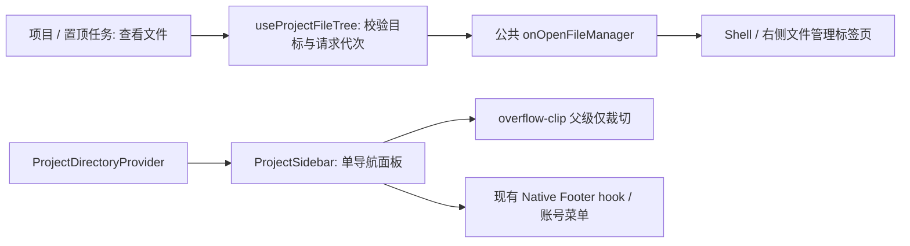

# 工作区侧栏布局与面板切换

## 规则与所有权

- `WorkspaceShellLayout` 继续拥有侧栏像素宽度、折叠状态和宽度持久化；默认/最小宽度保持 264px，不迁移设置。
- `WorkspaceSidebar` 只重导出上游 `project-sidebar` 的 `ProjectSidebar`，不恢复旧版千行组件或已淘汰的 `WorkspaceSidebarCollapsedRail`。`ProjectDirectoryProvider` 是侧栏与 composer 共享的项目目录及排序偏好 owner；workspace tab 只负责导航和执行目录。
- 侧栏内仅有 `[data-project-sidebar-panel="navigation"]` 一个面板，其直接父级使用上游已有的 `overflow-clip`；该父级只裁切，不能成为可被焦点、`scrollIntoView()` 或程序滚动平移的容器。
- “查看文件”经 `useProjectFileTree` → 公共 `onOpenFileManager` → Shell 的 `handleOpenFileManager` 打开右侧文件管理标签页；目标保留 `workspacePath`、`workspaceIdentity`、`workspaceRemoteSessionId`，迟到结果由原请求序号拒绝。侧栏不再持有 `isFileTreeOpen` 或隐藏的第二个文件树面板，也不再需要旧双面板的 `inert` 补丁。
- 项目/任务列表与外部文件树的纵向滚动各由其内部视口负责。文件管理器打开时，导航、项目与账号栏保持可见且可交互，不把侧栏设为 `inert`。
- `ProjectSidebar` 经现有 `user`、登录/退出、工作区 scope 和升级回调连接 `WorkspaceSidebarFooter`；Native New API 套餐、当前所选模型额度及升级入口复用既有 Footer hook 和升级 Provider，不另建账号、套餐缓存或请求路径。
- Desktop 与普通 Web 复用同一组件；不改变服务、Host、会话、远程 identity、数据存储及账号协议。



## 缺陷依据

2026-10-11 真实桌面窗口中，侧栏宽度为 264px，但动画父级使用 `overflow-hidden`，右移隐藏面板使 `scrollWidth` 达到 528px；实际 `scrollLeft=54.5`，新建任务行 x=-46.5px，导航和账号一起被裁切。对隐藏面板调用 `scrollIntoView()` 可使整列移出窗口。`overflow-hidden` 不等于禁止滚动；不能用重置宽度、定时归零或额外状态掩盖该问题。

## 验收

1. 对导航面板、项目行及外部文件树分别调用 `scrollIntoView()`，并尝试给侧栏裁切父级写入 `scrollLeft=54.5`；裁切父级仍为 0，导航和账号行均在侧栏边界内。
2. 连续两轮通过项目“查看文件”打开并关闭右侧文件管理标签页；文件树必须位于侧栏之外，侧栏中始终只有一个导航面板。hover 指定项目后，其真实 `virtual-project-files` 按钮及账号 `login-trigger` 按钮仍可程序聚焦，聚焦后导航/账号不越界。不得继续断言已删除的“隐藏列表/隐藏文件树不能聚焦”。
3. 列表与外部文件树内部仍可纵向滚动；账号菜单、Native 套餐/额度/升级入口及侧栏宽度键盘操作正常。账号与额度行为验证使用隔离账号投影，不切换真实账号、不发送模型请求。
4. 在真实窗口检查浅色/深色、缩放与窄窗口布局；不改变原有宽度、持久化键和折叠规则。

回归脚本 `packages/desktop/test/workspaceSidebarLayout.cdp.mjs` 已按新版 owner 改造；只匹配 URL 中 `initialWorkspacePath` 等于显式参数的唯一桌面窗口，不回退至其它用户窗口。运行前由验收 owner 启动隔离桌面进程并开启 CDP，使用唯一名称、本地单 root 且 root 等于隔离工作区的项目，选中项目视图并展开侧栏。列表和文件树都必须有足够内容形成纵向溢出，缺少溢出会报错而非跳过；本次项目目标不能已有打开的文件管理标签，运行期间不并发操作该隔离窗口：

```sh
node packages/desktop/test/workspaceSidebarLayout.cdp.mjs http://127.0.0.1:9229 /绝对路径/隔离工作区 隔离项目名称
```

脚本使用的 selector 与实际行为断言：

- 侧栏仍为 `[data-testid="sidebar"]`；用 `[data-project-sidebar-panel="navigation"]` 的直接父级取裁切视口，不再依赖 `children[1]` 或第二个子面板。
- 导航几何目标为 `[data-testid="sidebar-primary-navigation"]`，账号为侧栏内的 `footer`。程序聚焦只检查指定项目的真实 `virtual-project-files` 按钮及 `login-trigger` 按钮；`task-new-button` 在新版是 `role="group"` 容器，不作为可聚焦按钮，也不为回归修改产品的 tabindex。
- 项目行改为 `[data-testid="virtual-project-row"]`；hover 后点击同一行的 `[data-testid="virtual-project-files"]`。多 root 项目还需选择 `[data-testid^="virtual-project-files-"]` 菜单项，因此最小 smoke 固定单 root 项目。
- 文件树改为侧栏外可见的 `[data-file-manager-pane] [data-testid="workspace-file-tree-panel"]`；断言 `sidebar.contains(tree) === false`，侧栏无第二面板，且真实文件/账号按钮仍能获得焦点。
- 记录打开前 `[data-side-pane-tab-id]` 的集合和活动标签；关闭本轮新增文件标签的 `[data-side-pane-tab-id="实际ID"] button`（标签组件内唯一按钮），两轮结束后断言原标签集合不变并恢复原活动标签。不会点击文件树首个按钮当“返回”，也不关闭既有标签。
- 反复检查裁切视口横向偏移、导航/账号边界、程序聚焦和菜单可打开；通过真实鼠标滚轮检查列表及外部文件树的纵向滚动并恢复各自滚动位置。清理只关闭本次新开标签，不创建任务、写文件、登录/退出或点击真实付费操作。

## v3.16.1 晋升适配（2026-10-19）

- 原 `4c6783a2` 只有 `overflow-hidden` → `overflow-clip` 与两个非活动面板的 `inert`。上游新侧栏已经使用 `overflow-clip`，文件树已迁至右侧 owner，不再有两个横向滑动面板；因此保留新结构即可覆盖旧根因，不重复添加滚动归零逻辑、状态或 `inert`。
- `WorkspaceShellLayout` 使用上游项目目录 Provider、公共文件管理回调与新版远控布局，保留 XWork 窗口标题。与纯上游的产品接口差异保留在现有 Footer 链路：`user`、登录/退出回调、精确工作区 scope、Native 套餐/当前所选模型额度 hook，以及既有升级 Provider；不恢复旧侧栏来承载这些差异，不新建账号或套餐 owner。
- 晋升结论：接受上游单导航面板的 `overflow-clip` 与右侧外部文件管理器；旧双面板已移除，其两个非活动面板 `inert` 补丁随结构退场，不恢复 `WorkspaceSidebarCollapsedRail`，不额外增加滚动归零或兼容状态。

## v3.16.1 真实桌面验收（2026-10-19）

- 验收 owner 在独立隔离的完整 Desktop Main/Host 实例中，经公开 RPC 准备 31 个本地项目与 80 个文件，直接通过 CDP 运行上述永久脚本；未连接用户工作区或真实账号。
- CSS 视口为 1200×800、DPR 2，侧栏实测为 264×800；真实窗口截图已由验收 owner 查看，导航、项目和账号栏未出现左侧裁切。
- 完整脚本运行耗时 2.50 秒，结果为：

```json
{
  "sidebarLayout": "passed",
  "singleNavigationPanel": "passed",
  "externalFileTreeRoundTrips": 2,
  "sidebarAndTreeWheelScroll": "passed",
  "accountMenu": "passed",
  "preservedOriginalTabs": 0
}
```

- 两轮文件管理器打开/关闭、外部文件树归属、真实文件/账号按钮聚焦、裁切父级横向偏移为 0、导航/账号边界及列表/文件树真实鼠标纵滚均通过；本次初始标签集合为空，新增标签已按脚本清理，不据此声称已实测非空既有标签场景。
- 本轮证明上述新版侧栏布局回归，不代表已验证浅色/深色全部组合、原生缩放、窄窗口、Windows/Linux 或手机 Web，也不代表 Native 套餐账务、升级交易及模型请求通过。以下记录仅为旧版历史证据。

## 旧版验收记录（2026-10-11，非 v3.16.1 验收）

- macOS 真实 XWork Dev 窗口：修复前回归断言得到 `scrollLeft=264`，导航和账号均越界；修复后通过两轮文件树往返、隐藏面板焦点与账号菜单检查。
- 原窗口 1512×884、原生放大一档（CSS 视口 1374×803）、原生窄窗口 900×640；浅色与深色截图均无侧栏左侧裁切。原生放大状态也执行并通过上述回归。
- 窄窗口中真实滚轮使任务列表滚动到 99px、XCode 文件树滚动到 300px；宽度键盘操作 264→280→264，折叠/展开后宽度 264px、横向偏移 0。
- 已恢复原浅色主题、实际大小和侧栏宽度设置；恢复窗口后的 CSS 视口实测为 1512×883（macOS 原生尺寸回写相差 1px）。
- `pnpm typecheck` 通过；`pnpm lint` 为 0 错误、71 条现有警告；`pnpm architecture:check --changed` 为 0 违规；本次三个文件格式检查通过。
- 未验 Windows/Linux 原生窗口或独立手机 Web；共享组件没有平台分支改动。
