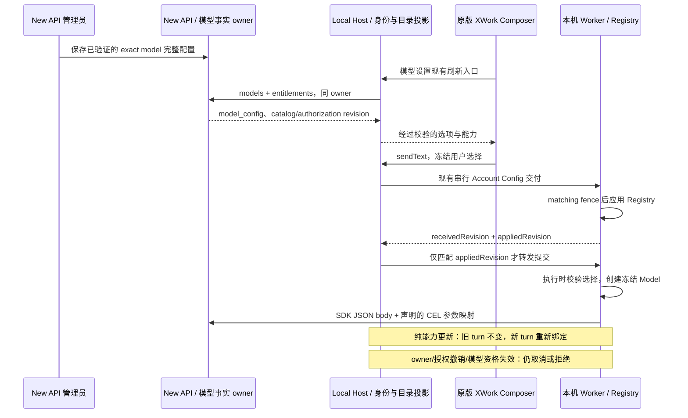

# New API 模型能力驱动优化 Implementation Plan

> **For agentic workers:** REQUIRED SUB-SKILL: Use superpowers:subagent-driven-development (recommended) or superpowers:executing-plans to implement this plan task-by-task. Steps use checkbox (`- [ ]`) syntax for tracking.

**Goal:** 保持原 ZCode 设置与聊天交互、单一 `XWork·Plan` 入口，让各托管模型的能力、思考档位和实际请求参数以 New API 的真实声明为准，消除“显示关闭但实际仍思考”及刷新后的配置不同步。

**Architecture:** New API 维护 exact model ID 的完整 `model_config`；既有 Host Account source、Registry 和原版 UI 校验并投影，不新增目录或能力推测器。复用本机 Worker 的串行配置交付与每 turn 创建 Model 的链路，分开配置应用 revision 与 Native 授权身份：新 turn 用新配置，已经开始的 turn 保持冻结事实，撤销仍及时生效。

**Tech Stack:** 仓库固定 Node 24.14.0、pnpm 10.33.2；TypeScript、Zod、现有受限 CEL/JSON Merge Patch、React/Electron、现有 Host/RPC/V4 协议；New API Go 1.25.1、GORM、现有管理员 JsonEditor 与 Bun/Vitest。

**Spec:** [客户端规格 §5.2.1](../../xcode/specs/new-api-integration.md#521-服务端能力声明与思考控制一致性)、[原版模型设置呈现](../../xcode/specs/new-api-model-settings-ui.md)、[唯一 HTTP/metadata canonical spec §7](../../../../new-api/docs/specs/xcode-integration.md#7-管理员模型元数据)。本计划是既有集成的增量，不重跑或重写 T01–T10、U01–U04 的实施清单，也不替代 G1–G5 正式发布验收。

状态：2026-10-12 **仅完成规格补充与计划制定，M01–M05 均待实施/验收**。本文未授权提交、推送、业务数据库写入、现有服务重启或收费推理。

## Global Constraints

- 本期仅本机 New API 与窗口 Local Host/本机 Worker；不扩展私有远程 provisioning、独立 Web 登录或企业/支付业务。
- 普通托管入口固定 `account:new-api-openai-chat-completions` / `XWork·Plan`；另外两个 transport anchor 保留底层身份但隐藏，不自动迁移历史 ref。
- 唯一能力来源是服务端完整 `model_config`；只覆盖 `new-api-account`，自配 Provider、独立官方云和历史持久化数据不改。
- 保留原 UI、组件、国际化与主动选模初始化：`completeNewModelSelection` 取服务端 `values` 最后一项，辅助调用取首项；恢复失效值不得借此自动补档。新增 `max` 可能提高主动选模后的默认推理成本，部署前必须说明。
- 不新增 HTTP/schema_version、不增加默认档位字段、模型名能力表、通用热更新服务、目录缓存、轮询/推送、第二个 CEL 编译器或产品依赖。
- 配置不承载秘密、任意 JS 或可改变私有 origin 的上游地址；结构/CEL 校验不能代替真实供应商能力验证。
- 完整配置 revision 继续用于一致交付；Native 授权使用精确 owner 与既有 canonical `authorizationRevision`。不得删除 owner/lease、Builtin matching fence、stale run 或撤销防护。
- 上游源码只作最小修改，添加 `// XCODE: <原因>`，bug 注释用中文说明依据；不整理无关文件。
- 分支沿用当前 `feature/private-server-technical-design`，PR 目标 `XCode-main`；用户根目录未跟踪 `.video_agent/` 不纳入本任务，不自行加入忽略或删除。
- 真实账号/渠道配置、现有 3001 服务及收费推理须另有明确授权；开发回归使用隔离账号、数据库与应用目录。凭据、提示词和思考正文不得写入工件。

## Review Focus

1. 关闭选项名正确但 CEL/渠道覆盖仍开启思考 → M01 配置来源核实，M04 SDK→relay→受控上游请求断言，M05 真供应商验收。
2. 同 model ID/档位仅改变 map/contextWindow，旧 turn 被取消或新 turn 使用旧映射 → M03 冻结与应用屏障回归。
3. 看见新目录就提交，但 Worker 只接收未应用；Builtin revision 不匹配 → M03 `appliedRevision` 与延迟交付/拒绝场景。
4. Native 被本地历史别名或 visibility 污染；删除档位后静默补值 → M02 真选择/提交门禁回归，M04 原 Composer 交互。
5. 放宽 revision 后旧身份/停用模型仍能出站，或凭据 await 期间撤销 → M03 owner/授权/模型资格失效与凭据返回前复核，保留自配/官方隔离。

## 0. 已确认事实与前置门槛

以下是本次讨论的只读取证与当前源码事实，不是本计划任务通过记录：

- 当前部署的 `deepseek-v4-flash`、`deepseek-v4-pro` 都声明 `values:["disabled"], map:"{}"`；真实 UI 是单档 fixed 控件。读取到 flash 客户端请求没有 `thinking`/`reasoning_effort`，响应却有 reasoning。实际 option mapper 也证明 `{}` 不添加关闭参数。
- `newApiAccountProviderResolution.ts` 已校验完整配置；`ProviderConfigResolver` 的 Native 模型绕过 Personal/Builtin 能力规则；Host、Worker、SDK patch 主链已存在，不能再建第二套。
- `resolveLegacyReasoningLevel` 未排除 Native；Native Personal overlay 仍允许 `visibility`。二者是源码可达缺口，尚未运行本计划 RED 用例。
- Host 普通 V4 `sendText` 未前置等待 Account 同步。`receivedRevision` 仅为接收回执，Worker refresh 遇 Builtin matching fence 可继续保留旧 Registry。
- Native Runtime 和 Host 鉴权目前都比较完整 `accountRevision`；纯目录/能力更新也可能中止旧流。每 turn 本来就创建新 Model，问题不是不存在的 Session Model 缓存。
- 后端已有原生 `xcode_config` 编辑器、严格 Go 解析、实时目录和内容 revision；不需要迁移表或手动 bump 版本。原生模型 PUT 会写其他表单字段，不能只传 ID 和一段配置。

### 上游来源核实

已读取 [DeepSeek Chat Completions](https://api-docs.deepseek.com/api/create-chat-completion) 与 [Thinking Mode](https://api-docs.deepseek.com/guides/thinking_mode)（2026-10-12）：默认开启思考、默认 effort 为 high；OpenAI 格式支持 `thinking.type=enabled/disabled`，effort 支持 low/high/max，medium 是 high 的兼容别名而非独立中档。API 页面当前 model 枚举是 `deepseek-flash` 与 `deepseek-v4-pro`，**没有 `deepseek-v4-flash`**。

因此先核对部署的渠道类型、实际供应商与 alias/model mapping；不能仅凭 New API constants 或官方页面给第三方/旧 alias 直接套配置，也不能擅自改已有 model ID。官方文档要求携 tools 的后续请求回传历史 `reasoning_content`，且 thinking 模式不支持 required/named tool choice；M04/M05 必须覆盖实际 Agent 多轮工具路径。

### 目标数据规则

- 已确认与上述契约一致的模型，候选公开值为 `disabled, low, high, max`，只取实际上游支持的子集，保持低到高语义顺序；不提供假的 medium/xhigh 独立能力。
- 下列只是 reasoning 子对象候选，必须合并进已读取的完整配置并通过双方校验，**不是可直接提交的模型 PUT payload**：

```json
{
  "values": ["disabled", "low", "high", "max"],
  "map": "reasoningLevel == \"disabled\" ? {\"thinking\": {\"type\": \"disabled\"}, \"reasoning_effort\": null} : {\"thinking\": {\"type\": \"enabled\"}, \"reasoning_effort\": reasoningLevel}"
}
```

`null` 按既有 Merge Patch 删除 SDK 可能带入的 effort，避免关闭与 effort 冲突。非思考模型的 neutral `off + {}` 仍合法，但必须有实际无思考能力的依据。不新增“默认开启”语义字段，也不把无参数标成已关闭。

其余完整 properties、contextWindow、maxOutputTokens 以每模型/渠道可信限制核对；不把官方最大输出当上下文，不因 JSON mode 就宣称严格 JSON Schema，不因支持思考就假定支持图片/音频。未核实的现有字段不在此次修复中顺手提高。

## 1. 文件职责与执行依赖

除 Create 标记的 Electron 场景外，以下都复用现有文件；必要改动必须由对应 RED 证明，不重写已正确实现。

| 任务 | 主要文件（所属仓库）                                                                                                                                                                                                                                                                                                                                                                                                                                                                                                | 职责                                                                              |
| ---- | ------------------------------------------------------------------------------------------------------------------------------------------------------------------------------------------------------------------------------------------------------------------------------------------------------------------------------------------------------------------------------------------------------------------------------------------------------------------------------------------------------------------- | --------------------------------------------------------------------------------- |
| M01  | New API：`docs/specs/xcode-integration.md`；`model/xcode_model_config.go`、`model/model_meta.go`、`controller/model_meta.go`、`service/xcode_facade.go`；`controller/xcode_models_test.go`                                                                                                                                                                                                                                                                                                                          | 真实配置候选、管理员维护语义、目录/revision；主体为配置交付，既有实现无缺口不修改 |
| M02  | XCode：`packages/provider/src/resolver.ts`；`packages/provider-node/src/legacy-reasoning-level.ts`；`packages/services/test/newApiSelectionCutover.test.ts`、`newApiRegistry.test.ts`                                                                                                                                                                                                                                                                                                                               | 托管配置优先级、固定入口、严格档位选择                                            |
| M03  | XCode：`packages/provider/src/resolver.ts`、`registry.ts`、`registry-service.ts`；`packages/shared/src/zcode-protocol/index.ts`；`packages/services/src/model-provider/accountProviderRequestAuthService.ts`、`zcode-agent/zcodeAgentService.ts`；CLI `bootstrap/src/app/process-provider-registry-runtime.ts`、`provider-registry-model-runtime.ts`、`zcode-protocol/account-provider-config.ts`、`server-types.ts`、`zcode-protocol-entrypoint.ts`；`newApiRegistryOwner.test.ts`、`newApiWorkerBoundary.test.ts` | Native 授权身份与能力 revision 分离、应用确认、sendText 放行与撤销安全            |
| M04  | Create：XCode `packages/desktop/test/newApiModelCapabilitiesElectron.mjs`；Modify：`runNewApiElectronSmokes.mjs`、`newApiWorkerBoundary.test.ts`；仅发现真实缺陷时修改原 Composer/SDK adapter 或现有 SDK patch                                                                                                                                                                                                                                                                                                      | 原版界面交互与真实 SDK/relay 工具往返                                             |
| M05  | XCode：`docs/xcode/new-api-integration-runbook.md`；New API：指定模型的既有管理员配置；实际涉及的两仓源码/构建                                                                                                                                                                                                                                                                                                                                                                                                      | 授权后的定向配置应用、真实部署与逐档验收                                          |

依赖顺序：M01 → M02 → M03 → M04 → M05。M02/M03 共享 resolver、M03/M04 共享 Worker 测试，不并发编辑；共享 schema 和接线由一个集成执行者负责。提交/推送不在默认步骤内，获得当轮明确授权后才按任务范围提交。



## 2. 执行通则与可用验证命令

开始代码任务前读取当前 spec、架构治理技能、`pnpm architecture:check --changed` 和目标模块的 `architecture:context`；模块 ID 从当前 policy 获取。导出/协议变更先做 LSP references，全量迁移实际消费者与 fixtures，不留旧 Native auth 字段兼容分支。

每任务先补消费者可见 RED、观察真实失败、最小修复、GREEN 与实际路径 smoke。已有正确行为保留并运行旧回归，不能为了形式写重复 RED。永久测试不测复制/wiring/源码文字；SDK 出站参数、选择失效、安全拒绝、更新顺序是有效断言。受控 fixture 验证契约，不证明真供应商能力。

执行工具链须与 `mise.toml` 一致；核对 `node --version`/`pnpm --version`，已准备固定工具链时从 XCode 根执行：

```sh
pnpm exec tsx --experimental-test-module-mocks --tsconfig packages/services/test/tsconfig.json --test packages/services/test/newApiRegistry*.test.ts packages/services/test/newApiSelectionCutover.test.ts packages/services/test/newApiWorkerBoundary.test.ts
node packages/desktop/test/runNewApiElectronSmokes.mjs
pnpm typecheck
pnpm lint
pnpm architecture:check --changed
pnpm --dir apps/zcode-cli check
```

完整 Node 回归采用 [runbook 当前入口](../../xcode/new-api-integration-runbook.md#回归与验收)，任务前重新核对，不假设统一单测命令。CLI 不在根 typecheck 范围内；CLI 或协议变化后执行 `pnpm prepare:desktop-runtime`，核对实际启动的 Agent 产物，不用旧 bundle 验收。格式检查只针对本任务文件，同时如实记录全仓既有失败。

New API 根的聚焦入口：

```sh
go test ./controller -run 'Test(XCodeModelMetadataStrictParsing|ModelManagementDatabaseMatrix|XCodeCatalogDatabaseMatrix|XCodeManagedRequestValidation|XCodeCatalogReadFailuresAreNotEmptySuccess)$' -count=1
go test ./relay/common -run TestApplyParamOverride -count=1
```

在 New API `web` 目录：`bun run test src/features/models/__tests__/metadata-editing.test.tsx src/features/models/__tests__/metadata-sync.test.tsx`。MySQL/Postgres 矩阵只使用隔离测试 DSN；缺 DSN 的 skip 不算通过，不指向业务库。本计划不新增数据库迁移。

## M01：确认真实模型能力并交付服务端配置候选

**Files:** 见文件表 M01；管理员 UI 复用 `web/src/features/models/components/drawers/model-mutate-drawer.tsx` 和 `web/src/features/models/lib/model-form.ts`，不默认改动。

**Interfaces:** 消费既有完整 `xcode_config={schema_version:1,api_type,model_config}`；产出逐 exact model 的已验证候选配置及对应目录事实，字段仍是 canonical §7。未确认 flash alias 时不能把它当已验收模型。

- [x] 在隔离环境记录目标 model ID、供应商文档、真实 alias/mapping、候选渠道能力、channel override/pass-through/Chat→Responses 分流；核对 actual origin/二进制/数据挂载，不输出密钥。形成每模型能力与参数的证据表，保存于运行手册本任务段，不另建能力注册表。
- [x] 补充 canonical §7 的维护规则：空 map 不证明关闭、每档位和候选渠道必须一致、目录刷新不代表 Worker 已应用；保持已有 DTO 不变。
- [x] 在 `controller/xcode_models_test.go` 的现有目录矩阵中补一个消费者可见用例：只修改 reasoning values/map 后 GET 目录返回新配置且 catalog_revision 改变，authorization_revision 与非目标模型不变。已有 strict parsing/CRUD 保留测试不重写。
- [x] 生成并用 Go `ParseXCodeModelMetadata`、Host `completeModelConfigDataSchema` 与 `compileModelOptionMaps` 校验完整候选；逐个公开 reasoning 值及输出边界实际求值，确认两项 patch 不冲突。只在上述文档/渠道契约成立时采用候选 disabled/low/high/max。
- [x] 在隔离库通过原生管理员表单完整提交、回读和目录查询验证；新建 fixture 使用合成数据。PUT 必须携带 fresh 的全部可写原字段，避免并发编辑，允许预期 updated_time 变化；不使用 id+xcode_config 的不完整 PUT，不裸 SQL 绕过校验。
- [x] 执行聚焦 Go/管理员 UI 回归，记录配置候选、来源及跳过项。真实业务配置此时不写入；后端现有实现通过则不修改 Go/UI 代码。

执行证据：原管理员表单组件 21 项回归及隔离 Native 完整 PUT/目录回读通过；两项完整候选经生产 Go parser、Host schema/CEL 的 16 个边界求值通过。MySQL/Postgres 无隔离 DSN，未验收；上述表单证明来自组件/原生 HTTP 回归，不冒充业务管理员页面操作。后续授权 M05 已完成 exact flash alias 与两模型逐档真实供应商验收；当前 Type43 官方 origin 没有 alias/参数覆盖或 raw passthrough。

**完成条件：** 每个准备上线的模型都有可信配置候选及隔离回读证明；未确认的 alias/渠道单列未验收，不假造可调能力。

## M02：收紧 Native 客户端消费边界，保留原交互

**Files:** 见文件表 M02；复用 `packages/ui/src/lib/modelThoughtOption.ts`、`v4/composer/useDraftConfigControl.ts`、`composerSubmissionConfig.ts` 与 `ThoughtLevelCycleControl.tsx`，不默认改布局。

**Interfaces:** `ProviderConfigResolver.resolve` 保持 Native modelConfig 来自 Account snapshot；`resolveLegacyReasoningLevel(snapshot, selection): string | undefined` 对 Native 不做历史别名转换。ModelSelectionView 与结构化选择不扩字段。

- [x] 在 `newApiSelectionCutover.test.ts` 写 RED：Personal 试图让隐藏协议 visible/Chat hidden，结果仍仅一个 `XWork·Plan`；Native 保存 off/nothink，但服务器仅允许 disabled/low 时，必须返回不支持问题并拒绝提交，不能按 Builtin 改名。非 Native 的合法历史迁移仍通过。
- [x] 在既有 resolver 收敛 Native Personal overlay，仅允许现有模型排序；可见性与入口名称来自受维护 anchors，不由 Personal 改写。对 legacy resolver 增加 Native 排除，保留其他供应商现有迁移，不修改持久文件。
- [x] 扩展现有选择回归：两个模型不同 values/order，用户选择合法值才能形成对应可提交快照；恢复空值仍空；服务端删除已选档位后保留模型身份、呈现选择问题、`createComposerSubmissionConfig` 返回 null，重选合法值后可提交。不得用展示层首项补值；保留原主动选模策略，不新增只锁定默认值的测试。
- [x] 运行 M02 聚焦 Node 回归。若原组件已正确读取 values，保持组件不变；不添加 DeepSeek 专用前端分支或预设 low/medium/high 菜单。

**完成条件：** 托管模型不受本地能力/别名/可见性污染；单入口、原版控件、失效选择和自配供应商行为有消费者级证明。

## M03：保证新配置应用与旧 turn 冻结，保留撤销安全

**Files:** 见文件表 M03；原本的 `newApiAccountProviderResolution.ts` 已提供 canonical authorizationRevision，不另造授权来源。

**Interfaces（本任务统一迁移）:**

- 完整 `AccountProviderConfigSnapshot.revision` / `Provider.accountRevision` 保持配置快照语义；新增内部 `Provider.accountAuthorizationRevision?: string`，从匹配的 Account snapshot.authorizationRevision 投影，经 resolver/registry-service/registry 保留，不发到个人配置。
- Native 请求 `ZCodeProviderAccountAccess` 的 `accountRevision` 替换为 `authorizationRevision`；静态 access 的 owner/revision 字段仍可缺省，真实执行必须具备 owner 与 authorizationRevision，缺失 fail closed。完整迁移 runtime 创建、SDK 捕获、Host 请求鉴权、protocol schema 与测试；不接受旧字段兜底。官方 access 不改。
- `syncAccountProviderConfig(snapshot)` 从 boolean 结果切为 `{changed:boolean, appliedRevision:string|null}`；应用版本必须取实际 `runtime.registryService.getSnapshot()?.sourceRevisions.account ?? null`，不从收到的信封或 `snapshot.account.revision` 抄写。Builtin fence 下局部撤销可以更新 account 投影而不应用完整配置，只有 sourceRevisions 代表完整组合已应用。
- 更新既有 wire 结果为 `{receivedRevision, appliedRevision:string|null, providerCount, status}`，保留原 status 含义。Host 仅在 requested/received/applied 三者匹配后标记已同步并放行；接收未应用明确失败，不使用超时、轮询或猜测就绪。

- [x] 写 RED（`newApiWorkerBoundary.test.ts`）：hold 一个真实 SDK SSE 流，同 owner/model/档位仅改变 map/contextWindow 并刷新；旧 turn、后续工具步骤/重试继续旧事实，新 turn 创建的新 Model 使用新属性/新 HTTP 参数；不以 ModelSelected 是否发事件当重绑证明。
- [x] 补 pending-matching 回归：同 owner/授权的能力更新先被接收但 Builtin 不匹配，保留旧 turn，不声明新配置已应用；退出/授权失效/模型资格收窄即使 Builtin 不匹配也立即失效。对 `registry-service.ts` 现有完整 revision 变化就清除 Native 的分支作同一裁决，不放宽 matching fence，保留独立官方连接原撤销检查。
- [x] 写 RED：延迟 Worker 更新时刷新后第一条普通 sendText 不得先执行；Builtin matching fence 不一致即使 receivedRevision 正确也不得转发。使用受控 promise/事件验证顺序，不用 sleep 掩盖竞态；Queue 输入执行前删档位应拒绝且不发 HTTP。
- [x] 写安全回归：owner/logout/authorizationRevision 变化及时取消旧 Native，模型停用/移出可执行目录仍取消或拒绝；凭据 IO 中途撤销/停用不得返回旧 secret。纯能力更新不取消 Native；自配模型及独立官方云不受 Native 生命周期影响。
- [x] 按以上 Interfaces 投影授权 revision，并在 `ApiProviderModelRuntime`/`createNewApiAccountRequestAuthResolver` 同时改用精确 owner + authorizationRevision + 当前模型执行资格。复用现有 owner 级 controller，记录其使用的模型资格；目录收窄可保守取消该 owner 的 Native 流，不增加多租约或新模型缓存。Registry pending-matching 阶段只因真实授权/资格失效清除旧 Native，纯能力更新等待完整组合。credential await 前后均复核当下授权与模型资格。
- [x] 修改现有 Worker sync 返回实际 appliedRevision，迁移 `server-types.ts`、协议 handler 与 entrypoint/fixtures；Host 原串行队列保留，只有真正应用才记同步成功。普通 V4 sendText 复用 `ensureAccountProviderConfigSynced`，匹配完成前不转发输入；不要在 Renderer 增加重试补丁。
- [x] 运行聚焦 Node、CLI check 与真实 SDK 出站 smoke。覆盖 desktop-continuous 及现有 web-remote-replayable 的队列/重放不回归；私有远程仍按现有门禁拒绝，不将其标为支持。

执行证据：`newApiAppliedAdmission.test.ts` 用实际 Host/client/stdIO/NDJSON 验证 sendText/createSession 应用屏障、同 ID 重试、受控交付顺序及 matching fence；`newApiQueuedCapability.test.ts` 用真实 Core busy admission、产品投影及 V4 手动/自动提升验证旧 low 保留、model_creation 可见失败且没有第二个模型 HTTP 请求。没有以 mock Worker ACK 冒充真实 Core 队列执行。

**完成条件：** 同 ID/同档位 map-only 变化后的首次提交确用新配置；旧 turn 保持冻结；接收未应用不可执行；撤销和模型资格收窄仍可靠，所有 Native 旧鉴权字段消费者已迁移。

## M04：原 Composer 与完整推理路径验证

**Files:** 见文件表 M04。新 Electron 场景复用 `newApiComposerContextElectron.mjs` 的真实 `V4ComposerModelControls`/Providers 装配及隔离 BrowserWindow；不替换思考控件为 mock，不复制一份 Toolbar。

**Interfaces:** 使用现有 ModelSelectionView、ComposerSubmissionConfig 和真实 AiSdkModelAdapter；受控上游只用于协议断言，不表示供应商可用。

- [x] 新 Electron 场景加载两个由服务端 fixture 声明不同档位的托管模型。实际打开选择菜单、切换档位/模型，断言公开值及顺序、单档 fixed、多档可选、删除当前档后的重选门禁；切档只改变下一次输入，不改已提交的结构化选择。
- [x] 场景经真实 Host 刷新 seam 更新数据，区分后台刷新与只重读 View；验证仅一组 XWork·Plan、中英/浅深色与窄屏沿用旧控件，自配供应商选项不变。把场景加入现有 `runNewApiElectronSmokes.mjs`。
- [x] 在现有 Worker 测试用真实 installed SDK 捕获最终 JSON body：disabled 必须 `thinking.type=disabled` 且无 effort，已授权其他档位必须 enabled + 精确 effort；显式输出预算按该模型映射。验证 null 删除、非法分支/跨 option 冲突 fail closed，不通过 mock echo 判断成功。
- [x] 用隔离的真实 New API relay 到受控上游验证映射、override、alias、pass-through 的实际路径；完成至少一次思考模式“工具调用→真实工具结果→后续请求”和取消。断言必要 reasoning_content 回传是否满足供应商契约，但只记录存在性/计数，不打印正文。若现有 SDK patch 丢字段，只在现有 adapter/patch 最小修复并补行为回归，不改 capability metadata 假装兼容。
- [x] 完整执行既有 New API Node、Electron、根 typecheck/lint、changed 架构检查及 CLI check；涉及服务端代码时执行对应 Go/Web 入口。Electron 断言失败必须非零退出，清理完成前保留窗口，不能因最后窗口退出吞掉失败。

执行证据：Native/官方 Node 168/168、真实 Electron 六场景、根 typecheck、lint（0 错误、71 既有警告）、changed 架构（0）及 CLI check（27/27）通过。独立 Agent build 10/10 及新 CLI `--help` smoke 通过；授权 M05 后 `prepare:desktop-runtime`、同版 Main/Host 构建和闲置桌面重启已完成，Worker 暂存产物与 CLI dist 摘要一致。受控跨仓 SDK→真实 Native relay 取消约 6 毫秒、reason=client_gone；工具真实读取临时文件并回传历史思考。现有 SDK 已保留所需字段，无需新 patch。本任务代码格式通过；全仓 fmt:check 的 30 个无关既有文件失败未改写。测试 Host 装配单独位于 `newApiModelCapabilitiesHost.mjs`，不复制/替换原控件。

**完成条件：** 实际原版控件可操作，选择→Worker→SDK→relay 参数可对应，多轮工具与取消可用；fixture 证据和供应商证据明确分开。

## M05：授权后的定向配置应用与真实验收

**Files:** 运行手册和实际需要的构建/配置；不引入配置自动迁移脚本、不批量扫描改写其他模型。

**Interfaces:** 管理员使用 M01 的完整候选配置；客户端使用 M02–M04 的同版本 Host/Worker。此次升级内部协议需要相配产物，不加旧客户端兼容 shim。

- [x] 取得实际模型配置写入、目标实例重启/产物更新与受控收费推理的明确授权。未授权先完成全部确定性回归/受控 smoke，但此任务保持未验收，不将真实供应商或发布门禁写成通过。
- [x] 核对实际容器/端口/规范 origin/数据挂载、二进制源码 revision 与 dirty 标记；一致备份模型原配置。只操作已批准 exact models，通过 fresh 完整管理员表单提交；维护窗口避免并发覆盖。前后比较非目标模型和账号/套餐/渠道/密钥的隐私安全摘要，允许目标 x_code_config 与 API updated_time 的预期变化。
- [x] 若 CLI/协议改动，重建并确认运行 Host 与 Agent 都加载新产物；若后端代码未改，不为配置修正重建/重启后端。只读核对实际目录及 revision，然后点击设置刷新；保持现有账号与运行会话，不擅自停止用户任务。
- [x] 在隔离测试账号对每个已公开档位作最小真实请求，核对 UI、CLI 出站参数和供应商接受结果；覆盖关闭、非关闭、工具多轮及同会话下一轮。单次低 effort 响应没有 reasoning 不足以证明不支持；关闭须有明确参数与上游行为依据。记录请求关联 ID、参数摘要、响应类型/用量和取消结果，不保存提示词/思考正文。
- [x] 只改服务端候选 values/map，再刷新并验证同一已发布客户端接收新增合法档位；删除已选档位要求重选；在隔离环境验证旧 turn 继续、新 turn 用新配置、撤销仍取消。不能在真实用户会话里制造撤销/耗尽来凑证据。
- [x] 更新运行手册：每模型供应商来源、配置摘要/前后 revision、实际 origin/产物、各命令/场景结果与缺项。必要回滚只恢复批准的模型配置并刷新，保留新代码安全修复与数据审计，不切回官方 origin；完成后移除临时进程/数据。

执行证据见 [运行手册思考能力段](../../xcode/new-api-integration-runbook.md#2026-10-12-思考能力优化与定向配置候选) 与 `.superpowers/sdd/2026-10-12-new-api-model-capability-optimization/progress.md`。用户选择「继续真实联调」：仅两个 exact models、闲置桌面同版更新、隔离账号/指定实例/SID，最多 20 次且每次 max_tokens≤512；不重启后端、不提交或推送。实际完成 18 次，18 条指定实例 4 消费均 wallet_quota_deducted=0；测试账号经真实密码 step-up 删除，审计保留。完整配置通过管理员原生 PUT 提交/回读，不冒充管理 UI 表单视觉验收。原客户端刷新接收四档；删除/旧 turn/Queue/撤销场景在隔离真实 Host/Worker/Core/Electron 中验证，未在业务账号制造故障。实际暂存 Worker app-server NDJSON 启动/回执验证 exit0，matching fence 未通过时真实 received/applied 不同，status=received，不发模型 HTTP。临时 SDK 驱动的四请求/消费者断言成功后，清理误用 stop API 导致非零退出；真实请求未重复，驱动已移除。18 次供应商消费不是 G1–G5 全矩阵；后端产物缺 VCS provenance、MySQL/Postgres、Windows/Linux、真实官方云与完整资金/发布门禁仍未验收。已有账号 5 条非测试消费及相应计数保留，不回退用户数据。

**完成条件：** M01–M04 已通过，所有拟发布模型的真实供应商/渠道已验证；剩余未核实模型明确列出，不能宣称“所有模型已支持”。G1–G5 的资金/官方云/多平台/正式发布门禁仍独立记录。

## 3. 覆盖与交付判定

| 客户端规格 §5.2.1 要求                   | 任务与证据                                                    |
| ---------------------------------------- | ------------------------------------------------------------- |
| 服务端唯一能力源、逐模型差异、无本地猜测 | M01 配置来源；M02 Native override/legacy 拒绝                 |
| 关闭语义真实、各档位参数一致、渠道不覆盖 | M01 候选；M04 出站及 relay；M05 真供应商                      |
| 目录刷新及首次后续提交应用新配置         | M03 appliedRevision/sendText；M04 真 UI；M05 同客户端配置更新 |
| 旧 turn 冻结、排队执行校验、删档位重选   | M02 选择门禁；M03 SSE/Queue；M04 原控件                       |
| owner/授权/模型资格失效仍安全            | M03 撤销/credential IO/模型收窄；M05 隔离真实路径             |
| 原版布局、单入口、自配/官方/历史不变     | M02 Cutover；M04 UI 与原回归                                  |

本计划文件落盘及格式通过不代表上述任务执行完毕；每个任务只在实际代码、消费者、回归与 smoke 均满足后勾选。真实配置写入、付费验证或目标部署缺前提时写清缺项，不拿 fixture、旧 status 或单独 UI 截图替代。
