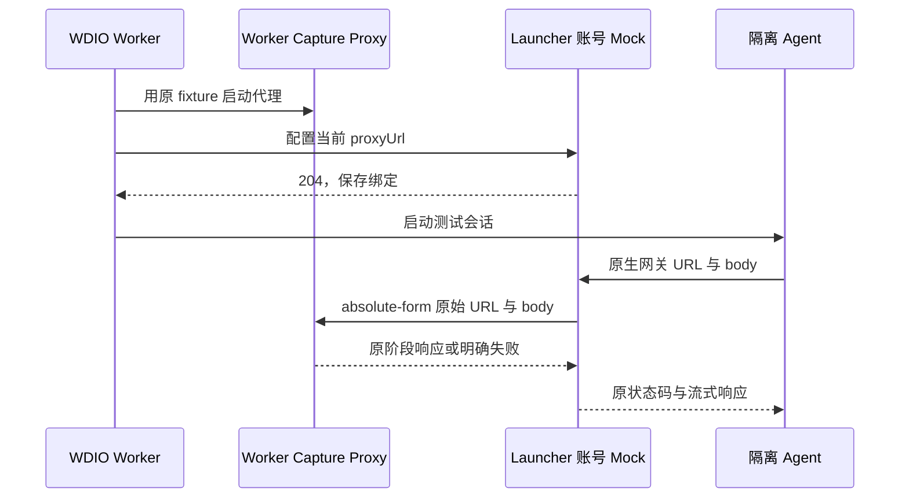
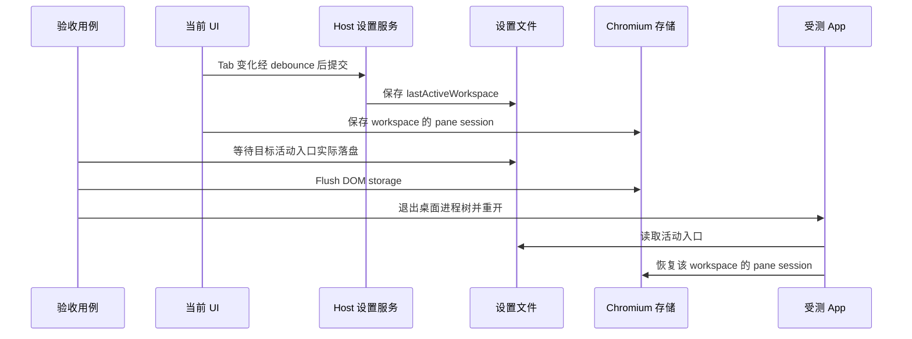

# Desktop E2E Reporting

桌面端 E2E 默认会把测试报告写到 `packages/desktop/.e2e-artifacts/<run-id>/`。这个目录只用于测试产物，已加入 `.gitignore`。

## 运行

本机运行：

```bash
ZCODE_E2E_SPEC=./test/e2e/e2ecase-regression.test.ts pnpm --filter @zcode/desktop test:e2e
```

容器运行：

```bash
pnpm run test:e2e:container
```

可用环境变量：

- `ZCODE_E2E_RUN_ID`：固定本次报告目录名
- `ZCODE_E2E_ARTIFACT_DIR`：指定报告输出目录
- `ZCODE_E2E_REPORT_VIEWER_BASE_URL`：生成 `files.viewerUrl` 时使用的 Vite viewer 地址，默认 `http://127.0.0.1:4173/`
- `ZCODE_E2E_PERF_SAMPLE_INTERVAL_MS`：Electron 进程采样间隔，默认 3000ms
- `PERF_SAMPLE_INTERVAL_SECONDS`：容器 `docker stats` 采样间隔，默认 3s
- `ZCODE_E2E_COVERAGE=1`：启用 renderer / main / host / CLI 四运行域源码覆盖率

Electron 进程采样通过 WDIO 的 Electron session 调用 `app.getAppMetrics()`，因此采样窗口从 session ready 后开始；容器采样由外层 Docker 脚本启动，能覆盖镜像运行和测试启动阶段。需要让两条曲线使用同一采样节奏时，可同时设置 `ZCODE_E2E_PERF_SAMPLE_INTERVAL_MS=1000` 和 `PERF_SAMPLE_INTERVAL_SECONDS=1`。极短 case 可能只产生开始/结束点，长时间 regression 才会形成连续趋势。

### XWork 本机隔离验收

每个 run 使用短路径私有 sandbox，`home` 与 `tmp` 放在同一父目录下。
`HOME`、`USERPROFILE`、`ZCODE_E2E_HOME_DIR` 指向 `home`，`TMPDIR`、`TMP`、`TEMP` 指向同级 `tmp`。
`beforeSession` 会重建 E2E HOME，因此不能把临时目录放在 HOME 内；短路径还可避免 macOS Unix socket 路径过长。

Desktop 与 CLI 的数据根分别设置：`ZCODE_DATA_BASE_DIR=home`、
`ZCODE_STORAGE_DIR=home/.zcode`、`ZCODE_SESSION_DB_PATH=home/.zcode/cli/db/db.sqlite`、
`ZCODE_LOG_DIR=home/.zcode/cli/log`。验收前后比对真实用户设置、凭据、数据库及配置文件；
退出本轮进程后再清理私有目录，报告与失败截图保存在独立 artifact 目录。

包含 `/event/report` 断言时，必须在构建前把 `ZCODE_TELEMETRY_REPORT_ENDPOINT` 设置为本轮
loopback 接收端。空端点会在 Main bundle 中编译为关闭；仅在运行时设置不能启用既有 bundle。
隔离接收端只需接受本轮事件并返回成功，不保存事件 payload，也不连接生产遥测服务。

Bash 输出优先写入本轮 `tmp/zcode-bash-*/<sessionId>/`，不能按旧 `storage/cli/exec` 路径推算。
后台输出测试读取产品发布的真实文件路径；需要操作文件的夹具先确认其属于本轮临时根与会话。
BGV04 子会话冷恢复需要真实等待 publisher 的 120 秒 grace 与 60 秒扫描周期，
该 spec 的 WDIO 外层预算至少为原用例的 360 秒，仍须证明释放、冷恢复及最终输出。

CLI 经 `pnpm test:e2e -- ...` 转发时，只移除脚本参数最前面的分隔符 `--`，
其后的 WDIO 选项和值必须保留。否则 `--mochaOpts.timeout`、`--logLevel` 等选项会被当作位置参数忽略。
多阶段 SSH cold reconnect 原用例预算为 35 分钟，运行时使用 `--mochaOpts.timeout 2100000`；
全量入口须让外层覆盖所纳入用例的既定预算，不能仍按默认 120 秒截断，也不放宽各阶段的产品断言。

Electron 开发入口可能注册 `zcode://`。验收前保存原应用路径，结束后注销本轮 Electron 入口并按原路径恢复，
不能只按 bundle ID 推断恢复成功。

## 产物

- `manifest.json`：运行环境、spec、采样间隔
- `test-results.ndjson`：逐 case 的标题、状态、耗时和错误摘要
- `summary.json`：机器可读报告摘要
- `summary.md`：人工可读报告摘要
- `workers.ndjson`：完成 worker 级环境登记的 cid/spec；若数量少于 `before-session`，说明前置事务在登记前失败
- `lifecycle-events.ndjson`：prepare/worker/session/hook/complete 的耗时；失败事件必须同时记录 `status=failed` 与错误摘要
- `perf/process-samples-*.ndjson`：通过 Electron `app.getAppMetrics()` 采集 main / renderer / GPU / utility 进程 CPU 和内存
- `perf/container-samples.ndjson`：容器模式下通过 `docker stats` 采集 CPU、内存、网络 IO、块 IO 和 PID 数
- `coverage/ui-renderer-istanbul-raw.json`：`ZCODE_E2E_COVERAGE=1` 时从 renderer `globalThis.__coverage__` 采集的 Istanbul 原始覆盖率数据
- `coverage/ui-renderer-summary.json` / `coverage/ui-renderer-summary.md`：renderer UI 源码级覆盖率摘要
- `coverage/ui-renderer-html/index.html`：Istanbul HTML 覆盖率报告，可查看总覆盖率、逐文件覆盖率和逐行命中状态
- `coverage/lcov.info`：LCOV 覆盖率报告，供 CI 或其它 coverage 工具消费
- `coverage/coverage-final.json` / `coverage/coverage-summary.json`：Istanbul JSON 覆盖率数据
- `coverage/summary.json`：四运行域 totals、raw 数量、源码文件数和完整性
- `coverage/{main,host,cli}/`：各 Node/Electron 运行域的 JSON、LCOV 与 HTML 报告
- `coverage/heatmap/index.html`：renderer / main / host / CLI 四层函数执行热度图
- `coverage/heatmap/data.json`：热度图使用的逐文件函数命中数据，供后续趋势或 case 维度分析复用

## HTML 报告

HTML 报告的边界是“读 `summary.json` 渲染视图”，不直接读取 WDIO runtime 或业务代码。报告 viewer 是 `packages/e2e-report` 里的 Vite 应用，图表使用 Chart.js；桌面 E2E runner 只负责传入汇总后的 summary payload。

启动 viewer：

```bash
pnpm dev:e2e-report
```

E2E 结束后，`summary.md` 和 `summary.json` 的 `files.viewerUrl` 会给出带 `summary` 参数的访问地址，例如：

```text
http://127.0.0.1:4173/?summary=%2F%40fs%2FUsers%2Fdev%2Fworkspace%2Fz-code%2Fpackages%2Fdesktop%2F.e2e-artifacts%2F...%2Fsummary.json
```

页面包含：

- run 状态、耗时、测试通过率和关键资源指标
- CPU 趋势图：容器 CPU 和 Electron 各 process type CPU 维度叠加展示
- Memory 趋势图：容器内存和 Electron 各 process type memory 维度叠加展示
- case 明细、spec、环境和 artifact 路径
- `ZCODE_E2E_COVERAGE=1` 时展示 renderer UI coverage 的总览、逐文件摘要和 Istanbul HTML / LCOV / JSON 入口

## 边界

当前已落地的是报告骨架、case 结果、容器级资源采样、Electron 进程级 CPU / 内存采样，以及可选的四运行域 coverage 采样。它们都只挂在 E2E harness 和 coverage 专用构建里，不改变正常桌面版本的业务启动链路。

`summary.json` 和全局进程/HOME 清理仍由 WDIO `onComplete` 权威收口。最后一个 worker
结束时 runner 必须持有一个有引用的短期 finalization guard，直到 `onComplete` 开始；这样
Node 不能在 promise continuation 执行前静默退出 0。正常 `onComplete` 会解除 guard 并写入
summary；guard 超时只作为基础设施失败兜底，必须先从现有 NDJSON 写出失败 summary，再以
非零退出，不能把缺 summary 的空跑当作成功。

renderer UI coverage 默认关闭，只在显式设置 `ZCODE_E2E_COVERAGE=1` 时启用：

```bash
ZCODE_E2E_COVERAGE=1 pnpm --filter @zcode/desktop test:e2e -- --spec ./test/e2e/conversation-session/manual-review/pending/conversation-session-running-actions.test.ts
```

需要把正式、`manual-review` 一次跑完并生成四域报告时，使用仓库入口：

```bash
pnpm test:e2e:all:coverage
```

入口会同时设置 `ZCODE_E2E_COVERAGE=1` 和 `ZCODE_E2E_MANUAL_REVIEW=1`。每个 worker
再按自身 spec 隔离 provider：正式 case 与已有 case-local fixture 的 pending case 使用 replay；
缺 fixture 的 pending case 和 `upstream-provider.test.ts` 使用 capture。单 worker 不允许混用两种模式。
独立真实 provider smoke 仅在同时配置了 `E2E_PROVIDER_BASE_URL` 与真实 `E2E_PROVIDER_API_KEY`（非 replay 占位值）时纳入；
否则入口会精确排除该外部 smoke 并打印原因，避免把缺 key 的 401 误报成产品回归。SSH 环境齐全时包含 SSH case；环境不齐时仅排除 SSH case，并在其余范围内继续全量执行。

XWork 同步验收沿用原 case 的业务断言和模型回放，只修正执行前提。脚本入口仅移除参数数组最前面的独立 `--`，后续 `--` 作为真实参数保留。原生 Coding Plan 网关路径由隔离账号 mock 转发给当前 worker 的既有 capture proxy，复用原 fixture 和分阶段响应；抓包保留实际网关 URL 与原始 body，未绑定或未匹配时显式失败，不补通用模型响应。

账号 mock 仅保存当前串行 worker 的代理绑定，不保存会话或队列事实：



隔离 HOME 不能替代 CLI 的独立路径：外层和嵌套 Bot worker 都必须设置 `ZCODE_STORAGE_DIR`、`ZCODE_SESSION_DB_PATH`、`ZCODE_LOG_DIR`。固定项目中的文件、模型及运行时目录夹具必须先从同一项目入口恢复空草稿，再准备 Provider；无项目场景按实际 navigation intent 与分配的 cwd 验收。终态工具检查先展开 V4 工作历史及所需工具分组；预览文件身份从同一可见 FileManager 的外层 header 按面包屑分段还原完整相对路径，正文仍验证该面板的真实 renderer 或 Diff，不能假定统一文件管理器创建 `code-viewer` 标签。Node REPL 每次调用重新初始化，跨调用只传递真实工具结果里的 tab ID，不依赖 JavaScript 全局变量。

TTFT 诊断的引导场景使用默认项目内的 Read 夹具，须通过 `startDraftFromProject` 从该项目新建，再切换交互设置。全局新建仍保留独立 cwd，不能为了设置页返回等待或文件定位而改变产品语义。

分享工具内容回归沿用当前 popover 的发布、勾选检查、再次发布顺序，保留真实复制及导入断言。剪贴板恢复所需的精确分享 URL 从本轮导入索引在 HOME 清理前记录，不能在 WDIO 收尾删除隔离目录后再扫描，也不能按 URL 外观推定当前剪贴板属于测试。

专项夹具替换模型能力后，还须为同一 Composer scope 播种声明范围内的完整 Reasoning Recent；启动默认只保存 provider/model ID，不能代替合法提交选项。只有 `disabled` 的能力没有额外档位控件。草稿晋升后重开文件树，需要重新展开收起的父目录，不能把缺少文件行误判为文件丢失。

`modelSelectionGroups` 过滤空模型目录是 XWork 的产品规则。套餐切换 E2E 通过设置页的 Provider 导航与「连接方式」选择，沿用 `selectTeamPlanInSettings` 的真实 UI 顺序；连接完成后再选择已有模型。不能为建立测试起点重新展示空目录账号分组，也不能把连接身份当成 Composer 已选模型。

Highspeed 队列回归的 Account 数据面应转发到当前 worker 已选择的原回放服务器，保留 `response.chunks` 的实际间隔、匹配次数及请求证据；不能用只支持静态 `body` 的卡片响应器替代流式队列回放。Stop 工具配对与 Team 权限历史回归不验收自动压缩，使用正常上下文窗口，避免 manual-review 的 240/80 小窗口在原工具历史之间插入无关 compact。

声明流式转发的主机若未匹配原回放路径，明确报错并禁止出网；Host 正常抽卡回放与队列回放沿用同一接线。实际 Electron SDK 的 URL 及卡片状态仍以整 spec 回归为准。

V4 重命名使用当前任务行的右键菜单与真实重命名对话框。删除先执行该任务的行内归档确认，再进入设置页「归档管理」，展开真实归档分组，按唯一 taskId 选中任务并确认永久删除；普通任务视图与未分类任务不要求行祖先带有项目 ID。归档列表中目标记录消失后返回主区，不能把归档隐藏或旧 header `deleteSession` 按钮当作现行删除合同。

动态 `this.skip()` 的执行时长可能不为零。测试事件包含显式 Mocha `pending` 时记录为 skipped；仅仅没有 error 或 status 不能据此推断跳过，未知失败仍单独保留。

需要在真实 RPC 服务调用前后制造状态变化的 E2E 探针，应在服务容器外层包装并透传原服务；`ProxyChannel.toService` 的 `get` trap 会忽略直接写入的方法属性。React 已捕获旧服务引用时，通过真实草稿或配置交互重新绑定，再明确验证探针完成。准入拒绝检查真实消息行，不能把空会话中仍保留的 Composer 草稿当成已进入 timeline 的消息。

V4 终态以当前 pane 已持有的真实 projection 为准。`PluginUiSessionProvider.projectionStore` 已公开同一 lease 的只读 `getState()`；诊断按 session、workspace identity 与已呈现的 projection seq 读取 `control.phase`、`control.sessionEnded`，不额外 acquire store，也不把旧 `runtimeStatus: null` 补成 `completed`。停止、队列与下一轮断言仍需等待真实 terminal 投影。

模型 wire 专项必须为原 fixture 明确提供其使用的档位与 Mapping；空 Map 表示不发送 reasoning 参数。只有原场景明确保存 low/high profile 的 Subagent 刷新用例才补齐相应 Option Spec，普通回放和默认模型合同不扩档。内部 `EnterPlanMode` 不渲染工具卡时，观察真实 plan 模式及后续权限、退出审批和文件结果。

原生 local-zero-copy 媒体附件可以没有 object URL、`img.alt` 或文件名正文。混合媒体前提按原顺序、类型和真实 `data-upload-status=ready` 验收，文件身份通过真实 gallery 标题确认；视频使用仓库现有有效 MP4。文件 mention 使用 provider 发布的绝对路径 ID。

完整重启前先等待 Host 设置中真正持久化的 `lastActiveWorkspace`，并 flush Chromium 的 pane-session 存储。这是两条独立写入链；只 flush DOM storage 不能证明 Host debounce 已落盘。重启按上游活动入口恢复，不补开旧兼容列表，也不为 `lastActiveTaskByWorkspace` 增加消费者。



SSH 安装、升级、reset 和故障用例各自持有可丢弃的容器与远端 HOME，同一 spec 内保留断线和重启状态。清理和 seed 使用同一个严格专属 namespace；不能放宽任意绝对路径删除。MCP 的 session/settings owner 可各自 Initialize，OAuth registration、authorize、token 事务仍分别精确一次，plain HTTP 基线和 stdio PID 不放松。

手机入口复用原 loopback relay、当前 Web 和桌面已有 Host attachment。当前 Web 使用动态端口，配对链接的 origin 必须等于本轮 `ZCODE_WEB_REMOTE_CONTROL_URL`，且路径保持 `/remote/v4`；不固定为 5173，也不接受任意 loopback 替代。TTFT 专项在 Electron 启动前启用原本机 exporter，连接独占端口的原 OTLP receiver，继续校验实际 protobuf Trace/Metric，不用业务事件 204 sink 代替。

连续至少两个同类工具才形成合成分组；可见 reasoning 拆开后按原真实 tool ID、终态和顺序验证。原响应只有单项而旧断言要求三个合成组时，保留合同冲突及未执行到的冷恢复阶段，不添加工具响应或宣称合成组恢复通过。

`conversation-session-snapshot-retention.test.ts` 是连接独立生产构建的 Node/CDP 验收，不交给 WDIO 执行。中断批次保留原始 NDJSON 与生命周期证据，续跑按未完成 spec 列表另建 run；原失败、明确跳过、hook/setup 失败和复测分别记账，不累计重复执行次数形成通过率。与现行产品合同冲突的 pending 断言保留失败及差异证据，不通过修改产品默认行为转绿。

renderer coverage 在 `ZCODE_E2E_COVERAGE=1` 时由 Vite 在构建阶段插入 Istanbul instrumentation。E2E 结束时，reporter 通过 WebdriverIO `browser.getPuppeteer()` 连接真实 renderer target，从页面里的 `globalThis.__coverage__` 读取 counter，再生成 Istanbul 标准报告。

coverage 插桩必须发生在源码级 `pre` transform 阶段，直接对原始 `.ts` / `.tsx` AST 生成 Istanbul counter。不要改回 post-transform 的通用 Vite Istanbul 插件；那类插件依赖 Vite/React/esbuild 合并 sourcemap 反推源码位置，已验证会把生成后的 JS 覆盖点映射到 `import`、`interface` 等非运行时代码行，导致逐行 HTML 和总覆盖率口径都被污染。

当前纳入 UI coverage 的源码范围是：

- `packages/ui/src`
- `packages/desktop/src/renderer`

E2E summary 和 e2e-report viewer 只展示覆盖率总览、逐文件摘要和 artifact 入口；逐行命中/未命中的专业视图以 `coverage/ui-renderer-html/index.html` 为准。这个分层可以避免 E2E 运行报告重复实现完整 coverage UI，也让 CI 后续可以直接上传 LCOV 或 Istanbul HTML。

## 跨进程源码覆盖率合同

`ZCODE_E2E_COVERAGE=1` 必须采集同一次 Desktop E2E run 中的四个运行域，且分别出具报告：

- `renderer`：`packages/ui/src` 与 `packages/desktop/src/renderer` 的 Istanbul 源码覆盖率。
- `main`：Electron main 及其打包进 main graph 的一方源码覆盖率。
- `host`：Electron utility host 及其打包进 host graph 的一方源码覆盖率。
- `cli`：桌面启动的 zcode-cli `app-server` 及其打包进 CLI graph 的一方源码覆盖率。

覆盖率数据链路如下：

```text
WDIO worker/session
  |-- renderer globalThis.__coverage__ ----------> raw/renderer/<worker>.json
  |-- Electron main NODE_V8_COVERAGE + flush ----> raw/main/<pid>.json
  |-- utility host NODE_V8_COVERAGE + flush ----> raw/host/<pid>.json
  `-- CLI app-server NODE_V8_COVERAGE ------------> raw/cli/<pid>.json
                                                      |
                                                      v
                                    source map remap + repo-relative normalize
                                                      |
                       renderer / main / host / cli 独立 Istanbul 标准报告
```

采集与汇总必须满足以下规则：

1. worker、session 和 PID 只能写独立 raw 文件；禁止覆盖同一 run 中其它 worker 的数据。
2. suite 汇总只能在所有 worker 退出后执行。renderer 使用 Istanbul coverage map union；Node/Electron 域使用 V8 raw union 后再由 c8 映射回源码。每个 worker 退出后可把 Node raw 就地裁剪为目标运行域，并按 canonical bundle URL 只保留一份 source map；同一运行域存在多个 lazy chunk 时，每个不同 bundle 仍必须各保留一份 map，不能以“该域已有 map”为由删除后续 chunk 的唯一映射。
3. coverage 专用构建必须保留 external source map 且不得压缩 main、host、preload 和 CLI bundle；这些 map 只存在于 E2E build/cache/artifact，不进入发布包。
4. Electron main 的 E2E 退出路径最终会强杀进程，因此必须在强杀前显式调用 `node:v8.takeCoverage()`；host 在资源释放完成、`process.exit` 前显式 flush。CLI coverage 模式先通过 stdin EOF 请求 app-server 正常退出，并使用比发布包更长的等待窗口；超时后的 SIGTERM / `process.exit` 路径也必须主动 flush，并在显式退出前留出 V8 后台写盘窗口。CLI coverage preload 在一方 bundle 执行前写 readiness marker：有 marker 却没有 raw 才属于采集缺失；无 marker 的早退进程尚未执行一方入口代码，按 pre-entry zero 单独计数，不把它误报为 incomplete。
5. 报告只统计 source map 可归属到仓库一方代码的条目，排除 `node_modules`、测试、fixture、声明文件和第三方/生成产物。main / host 映射到 TypeScript 源码；CLI 内部 workspace package 当前未发布二级 sourcemap，因此这些 package 以 CLI bundle map 能提供的 `dist/*.js` 作为最细粒度源码，CLI 自身及 shared package 仍映射到原始源码。后续补齐内部 package sourcemap 后应直接收敛到 TypeScript，不改变 raw 采集合同。
6. 四层百分比必须独立展示，不能把不同运行域直接相加成一个总百分比。共享源码允许分别出现在多个运行域中。
7. 任一已执行运行域没有产生 raw 数据时，本次 coverage 状态必须是 `incomplete`，不得用剩余数据冒充完整覆盖率。

每个运行域输出以下标准产物：

- `coverage/<domain>/coverage-final.json`
- `coverage/<domain>/coverage-summary.json`
- `coverage/<domain>/lcov.info`
- `coverage/<domain>/index.html`

## 函数执行热度图合同

覆盖率百分比回答“有没有执行”，函数热度图回答“执行集中在哪里”。热度图只消费四层已经生成的 `coverage-final.json`，不得重新启动应用，也不得改变 E2E case 的运行语义。

```text
renderer coverage-final.json ----\
main coverage-final.json ---------+--> 逐文件函数命中聚合 --> 全量平铺 --> coverage/heatmap/
host coverage-final.json ---------+
cli coverage-final.json ----------/
```

热度图必须满足以下口径：

1. 同一运行域的全部源码文件叶子节点必须在一个画布内一次性铺开，一个 tile 只能代表一个文件。目录只作为文件路径的一部分存在，禁止聚合成 tile，也禁止要求用户逐层点击目录才能比较热点。
2. 所有文件 tile 必须等宽等高，面积不编码任何指标；只有亮度表示文件内函数命中热度，越亮代表执行越频繁。所有文件 tile 使用运行域内同一个标尺，不能按局部目录重新归一化。
3. 默认颜色指标是文件内函数总命中次数，先使用 `log1p` 对数刻度处理数量级，再对归一化结果做对比增强，避免少数百万级热点把其余文件压缩成同一种暗色，也避免所有非零文件看起来同样亮。报告同时允许切换到“每函数平均命中”，用于削弱大文件天然累加更多次数的规模效应。
4. 未命中的文件使用独立的零命中颜色，不能和低频但已命中的代码混淆。颜色之外必须显示准确次数、函数覆盖数量和覆盖率，不能只依赖视觉亮度表达结论。
5. renderer / main / host / CLI 必须独立切换、独立归一化颜色，禁止跨运行域把调用次数合并。共享源码可以分别出现在多个运行域。
6. tile 的 hover、键盘 focus 或点击只更新选中详情，不改变画布层级。详情至少包含路径、函数总命中次数、函数覆盖数以及最热函数及其源码行。
7. 热度表示本次整套 E2E 的累计运行强度，不等价于功能覆盖广度。高热度可能只来自单个 case 的循环；低热度也可能已经验证关键状态。后续按 case 拆分时，应并列展示命中该函数的 case 数和每 case 的 P50/P95/最大调用次数。
8. 报告必须是自包含静态文件，不依赖远端 CDN 或运行中的 viewer 服务，以便直接从本机或 CI artifact 打开。

suite 级 `coverage/summary.json` 记录四层 totals、raw 文件数量、源码文件数量和采集完整性。CLI 还会用 runtime log 中已退出的 Agent PID 反查 readiness/raw PID；任一已进入一方入口的 CLI 进程缺 raw 时会记录 `missingRawProcessCount` 并把该域标记为 incomplete，入口前早退则记录 `preEntryProcessCount`。首阶段只把覆盖率作为诊断与趋势指标，不设置通过率门槛；功能状态组合是否被验证仍以 case catalog、coverage matrix 以及 case 的 setup/action/assertion 为准。
