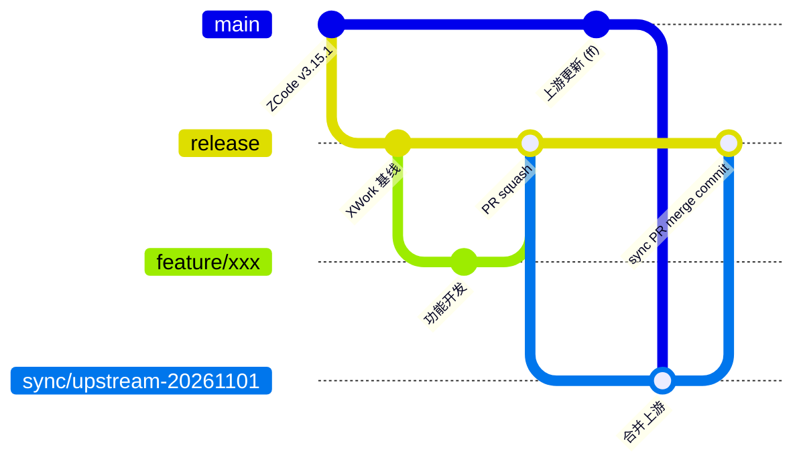

# XWork 分支与上游同步规范

XWork 是基于智谱开源项目 [zai-org/ZCode](https://github.com/zai-org/ZCode) 的下游产品。本规范所有开发者（含 AI Agent）都必须遵守。

## 1. 远端约定

| 远端       | 地址                                 | 用途             |
| ---------- | ------------------------------------ | ---------------- |
| `origin`   | `git@github.com:978655242/XCode.git` | XWork 产品仓库   |
| `upstream` | `git@github.com:zai-org/ZCode.git`   | ZCode 上游，只读 |

首次克隆后执行：

```bash
git remote add upstream git@github.com:zai-org/ZCode.git
git remote set-url --push upstream DISABLED   # 防止误推上游
git fetch upstream --tags
```

## 2. 分支模型

两条长期分支各司其职：`main` 镜像上游，`release` 是 XWork 产品主干。上游改动按 `main → sync/upstream-* → release` 单向流动，功能开发只进 `release`。



| 分支                       | 来源            | 规则                                                                                            |
| -------------------------- | --------------- | ----------------------------------------------------------------------------------------------- |
| `main`                     | `upstream/main` | 上游纯镜像。只允许 fast-forward 到 `upstream/main`，禁止提交任何 XWork 改动。                   |
| `release`                  | —               | XWork 产品主干，GitHub 默认分支。接受功能/修复 PR 与 `sync/upstream-*` 同步 PR，禁止直接 push。 |
| `feature/<简述>`           | `release`       | 新功能。                                                                                        |
| `fix/<简述>`               | `release`       | 缺陷修复。                                                                                      |
| `chore/<简述>`             | `release`       | 工程杂项。                                                                                      |
| `hotfix/<版本>-<简述>`     | 发布 tag        | 线上紧急修复，合回 `release`。                                                                  |
| `sync/upstream-<YYYYMMDD>` | `release`       | 上游同步专用，见第 4 节。                                                                       |

规则：

- 所有分支（含 `sync/upstream-*`）从最新的 `release` 切出，PR 目标必须是 `release`。禁止向 `main` 提 PR。
- 小步提交、短生命周期；功能分支落后 `release` 时用 `git rebase origin/release` 更新（仅限个人未共享分支）。同步分支不得通过 rebase 重写上游历史。
- 上游的其他分支（如 `upstream/feat/ui-plugin`）不直接合入；等其进入 `upstream/main` 后随常规同步进入。确需提前引入时走 `sync/` 流程并在同步记录中注明。
- 同步 PR 只包含上游合并、冲突解决、拒绝项 revert 和同步所需的最小适配。

## 3. 提交与 PR

- 提交信息使用 Conventional Commits：`feat:`、`fix:`、`refactor:`、`docs:`、`chore:`、`sync:`（仅同步分支）。
- `feature/`、`fix/`、`chore/` 的 PR 使用 Squash merge。
- 上游同步 PR（`sync/upstream-*` → `release`）必须使用 Create a merge commit，禁止 Squash 与 Rebase。原因：保留上游提交的原始 SHA，下次同步时 Git 才能正确计算 merge-base，否则同一批上游改动会反复冲突。
- PR 合并前必须通过 CI 检查 `policy` 与 `verify`（见第 8 节），并按 PR 模板填写检查项。

## 4. 上游同步流程

同步分两步：先把上游镜像到 `main`，再评审差异并经 `sync/upstream-*` 合入 `release`。建议每两周或上游发布新版本时执行一次。

### 4.1 更新 `main` 镜像

```bash
git fetch upstream --tags
git switch main
git merge --ff-only upstream/main   # 失败说明 main 被污染，停止并排查，禁止强推覆盖
git push origin main --follow-tags
```

也可使用 `gh repo sync 978655242/XCode -b main`。

### 4.2 评审上游差异

```bash
# 尚未进入 release 的上游提交
git log --oneline --no-merges release..main

# 上游自上次同步以来改了哪些文件（三点 diff，基于 merge-base）
git diff --stat release...main

# XWork 相对上游改了哪些文件（预估冲突面）
git diff --stat main...release

# 两边都改过的文件 = 高冲突风险
comm -12 <(git diff --name-only release...main | sort) \
         <(git diff --name-only main...release | sort)
```

逐个提交分类，结果写入 [`upstream-sync-log.md`](./upstream-sync-log.md)：

| 分类 | 判断标准                                       | 处理                          |
| ---- | ---------------------------------------------- | ----------------------------- |
| 采纳 | Bug 修复、安全修复、性能、依赖升级、通用新功能 | 随合并进入                    |
| 适配 | 有价值但与 XCode 定制冲突                      | 合并后在同步分支内改造        |
| 拒绝 | 与 XCode 产品方向冲突、或依赖 ZCode 专有服务   | 合并后 `git revert`，记录原因 |

安全修复一律采纳，不得以“暂不需要”为由拒绝。

### 4.3 合入 `release`

```bash
git switch release && git pull --ff-only
git switch -c sync/upstream-$(date +%Y%m%d)
git merge --no-ff main -m "sync: merge upstream ZCode <上游版本或短 SHA>"
# 解决冲突；对“拒绝”的上游提交执行 git revert <sha>，每个 revert 单独提交
pnpm install && pnpm typecheck && pnpm lint && pnpm verify:pre-push
git push -u origin HEAD
gh pr create --base release --title "sync: upstream ZCode <版本>"
```

要求：

- 默认整体 merge `main`，不要从上游 cherry-pick。cherry-pick 会生成新 SHA，下次 merge 时同一改动会再次冲突。只有紧急安全修复来不及完整同步时才允许 cherry-pick（`git cherry-pick -x`），并在同步记录中登记，下次完整同步时核对。
- 冲突解决必须说明取舍：保留 XCode 行为、采用上游行为或二者融合。不确定时在 PR 中 @ 相关功能负责人。
- 同步 PR 只包含上游合并、冲突解决、拒绝项 revert 和必要适配，禁止夹带新功能。
- 在同步 PR 内更新 `upstream-sync-log.md`（含“已同步到”字段）；CI 会拒绝未更新记录的同步 PR，也拒绝功能 PR 修改该文件。
- 合并时必须选择 Create a merge commit，并通过必需的 `policy`、`verify` 检查。需要较大产品改造时，同步合入后在 `release` 上另开 `fix/` PR。

## 5. 降低与上游的分叉成本

后续同步的成本取决于 XWork 改了多少上游文件。具体规则、扩展方式和 PR 合并检查以 [`UPSTREAM-EXTENSION.md`](./UPSTREAM-EXTENSION.md) 为准（通用功能迭代的最高原则），要点：

- 先复用上游能力，再通过扩展点叠加，最后才最小化修改上游文件；XWork 代码放在新文件、新模块或新包中。
- 必须修改上游文件时，改动保持最小，并在改动处加注释 `// XCODE: <原因>`，便于同步时识别；严格 JSON、生成文件等不能写注释的格式，改在 PR 描述中逐条说明（见 `UPSTREAM-EXTENSION.md` 第 5 节）。
- 禁止对上游文件做与功能无关的格式化、重命名、目录调整。
- 品牌名称、图标、域名、服务地址等差异集中到配置或资源文件，不在业务代码中散落替换。
- 修复 bug 前先确认上游是否已修复（`git log upstream/main --grep=<关键词>`）。

## 6. 版本与 Tag

- 上游 tag（如 `v3.14.3`）保持原样，不删除、不重写。
- XWork 发布 tag 沿用 `xcode-v<主>.<次>.<修订>`，只在 `release` 上打，避免破坏既有发布自动化和上游 tag。

## 7. 禁止事项

- 禁止向 `main` 提交或合并任何 XWork 代码；禁止 force push `main` 与 `release`。
- 禁止向 `upstream` 推送。
- 禁止 Squash 或 Rebase 方式合并上游同步 PR。
- 禁止在一个 PR 中同时包含上游同步与功能开发。

## 8. 强制机制

以下规则由工具强制执行，违反会被直接拦截，不依赖自觉：

| 层级          | 位置                                                       | 拦截内容                                                                                                                                                                                                              |
| ------------- | ---------------------------------------------------------- | --------------------------------------------------------------------------------------------------------------------------------------------------------------------------------------------------------------------- |
| GitHub 规则集 | `release`                                                  | 直接 push、force push、删除分支；未通过 `policy`/`verify` 的 PR 不能合并；禁用 Rebase merge。                                                                                                                         |
| GitHub 规则集 | `main`                                                     | force push、删除分支；仅仓库管理员可更新（用于快进上游）。                                                                                                                                                            |
| CI `policy`   | `.github/workflows/xcode-pr.yml`                           | PR 不指向 `release`；分支名不合规；功能分支夹带上游提交；同步分支不含当前 `origin/release`、未先快进 `main` 或未更新同步记录；功能 PR 修改同步记录。                                                                  |
| CI `verify`   | `.github/workflows/xcode-pr.yml`                           | `pnpm lint`、`pnpm typecheck`、`pnpm architecture:check` 失败；PR 改动文件未格式化（同步 PR 跳过；`release` 上本就未格式化的文件跳过并列出，避免为追加几行整份重排上游文件，见 `scripts/xcode/format-changed.mjs`）。 |
| 合并后巡检    | `.github/workflows/xcode-main-guard.yml`                   | `release` 上的同步内容被 squash 合并（事后告警）；每日检查 `main` 是否偏离上游，并在 Actions Summary 列出待同步到 `release` 的上游提交。                                                                              |
| 本地 pre-push | `.husky/pre-push` → `scripts/xcode/branch-policy.mjs push` | 推送已存在的 `release`（仅放行首次创建）、推送含非上游提交的 `main`、分支名不合规；随后执行 `pnpm verify:pre-push`。`pnpm install` 后自动生效。                                                                       |

- `policy`、`verify` 是规则集中的必需检查名，修改 workflow 的 job 名必须同步修改规则集。
- 规则集、巡检告警只能由仓库管理员处理；禁止为绕过检查而临时关闭规则集或使用 `--no-verify`。
- 巡检失败（squash 合并了同步 PR）时：revert 该提交，重新用 merge commit 合并同步分支。
