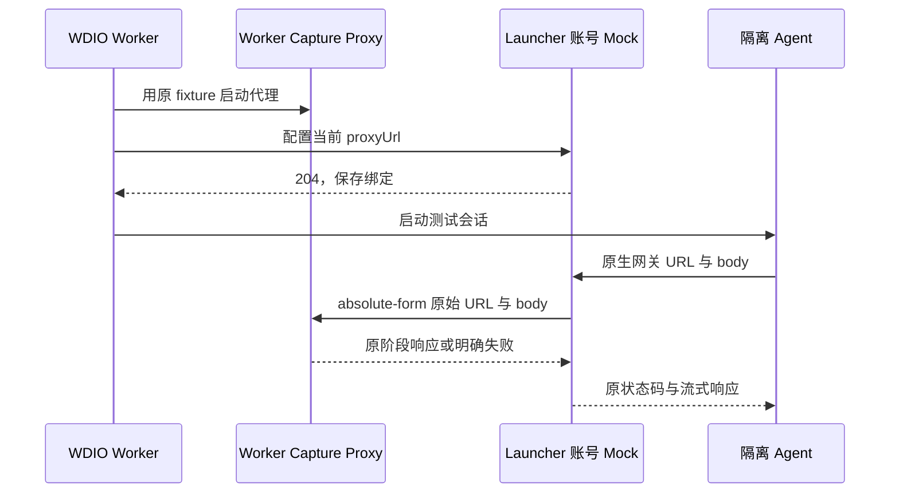
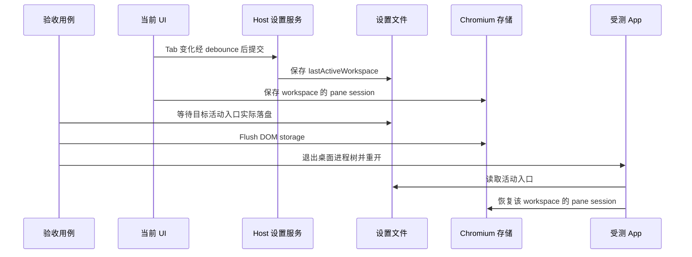

# XWork 桌面 E2E 验收补充

本文件收录 XWork 对上游 ZCode 桌面 E2E 的补充说明。按 [UPSTREAM-EXTENSION.md](UPSTREAM-EXTENSION.md) §7，不修改上游 `docs/testing/*`。

## 1. 本机隔离验收

每个 run 使用短路径私有 sandbox，`home` 与 `tmp` 放在同一父目录下。
`HOME`、`USERPROFILE`、`ZCODE_E2E_HOME_DIR` 指向 `home`，`TMPDIR`、`TMP`、`TEMP` 指向同级 `tmp`。
`beforeSession` 会重建 E2E HOME，因此不能把临时目录放在 HOME 内；短路径还可避免 macOS Unix socket 路径过长。

Desktop 与 CLI 的数据根分别设置：`ZCODE_DATA_BASE_DIR=home`、
`ZCODE_STORAGE_DIR=home/.zcode`、`ZCODE_SESSION_DB_PATH=home/.zcode/cli/db/db.sqlite`、
`ZCODE_LOG_DIR=home/.zcode/cli/log`。验收前后比对真实用户设置、凭据、数据库及配置文件；
退出本轮进程后再清理私有目录，报告与失败截图保存在独立 artifact 目录。

包含 `/event/report` 断言时，必须在构建前把 `ZCODE_TELEMETRY_REPORT_ENDPOINT` 设置为本轮
loopback 接收端。空端点会在 Main bundle 中编译为关闭；仅在运行时设置不能启用既有 bundle。
隔离接收端只需接受本轮事件并返回成功，不保存事件 payload，也不连接生产遥测服务。

Bash 输出优先写入本轮 `tmp/zcode-bash-*/<sessionId>/`，不能按旧 `storage/cli/exec` 路径推算。
后台输出测试读取产品发布的真实文件路径；需要操作文件的夹具先确认其属于本轮临时根与会话。
BGV04 子会话冷恢复需要真实等待 publisher 的 120 秒 grace 与 60 秒扫描周期，
该 spec 的 WDIO 外层预算至少为原用例的 360 秒，仍须证明释放、冷恢复及最终输出。

CLI 经 `pnpm test:e2e -- ...` 转发时，只移除脚本参数最前面的分隔符 `--`，
其后的 WDIO 选项和值必须保留。否则 `--mochaOpts.timeout`、`--logLevel` 等选项会被当作位置参数忽略。
多阶段 SSH cold reconnect 原用例预算为 35 分钟，运行时使用 `--mochaOpts.timeout 2100000`；
全量入口须让外层覆盖所纳入用例的既定预算，不能仍按默认 120 秒截断，也不放宽各阶段的产品断言。

Electron 开发入口可能注册 `zcode://`。验收前保存原应用路径，结束后注销本轮 Electron 入口并按原路径恢复，
不能只按 bundle ID 推断恢复成功。

XWork 同步验收沿用原 case 的业务断言和模型回放，只修正执行前提。脚本入口仅移除参数数组最前面的独立 `--`，后续 `--` 作为真实参数保留。原生 Coding Plan 网关路径由隔离账号 mock 转发给当前 worker 的既有 capture proxy，复用原 fixture 和分阶段响应；抓包保留实际网关 URL 与原始 body，未绑定或未匹配时显式失败，不补通用模型响应。

账号 mock 仅保存当前串行 worker 的代理绑定，不保存会话或队列事实：

隔离 HOME 不能替代 CLI 的独立路径：外层和嵌套 Bot worker 都必须设置 `ZCODE_STORAGE_DIR`、`ZCODE_SESSION_DB_PATH`、`ZCODE_LOG_DIR`。固定项目中的文件、模型及运行时目录夹具必须先从同一项目入口恢复空草稿，再准备 Provider；无项目场景按实际 navigation intent 与分配的 cwd 验收。终态工具检查先展开 V4 工作历史及所需工具分组；预览文件身份从同一可见 FileManager 的外层 header 按面包屑分段还原完整相对路径，正文仍验证该面板的真实 renderer 或 Diff，不能假定统一文件管理器创建 `code-viewer` 标签。Node REPL 每次调用重新初始化，跨调用只传递真实工具结果里的 tab ID，不依赖 JavaScript 全局变量。

TTFT 诊断的引导场景使用默认项目内的 Read 夹具，须通过 `startDraftFromProject` 从该项目新建，再切换交互设置。全局新建仍保留独立 cwd，不能为了设置页返回等待或文件定位而改变产品语义。

分享工具内容回归沿用当前 popover 的发布、勾选检查、再次发布顺序，保留真实复制及导入断言。剪贴板恢复所需的精确分享 URL 从本轮导入索引在 HOME 清理前记录，不能在 WDIO 收尾删除隔离目录后再扫描，也不能按 URL 外观推定当前剪贴板属于测试。

专项夹具替换模型能力后，还须为同一 Composer scope 播种声明范围内的完整 Reasoning Recent；启动默认只保存 provider/model ID，不能代替合法提交选项。只有 `disabled` 的能力没有额外档位控件。草稿晋升后重开文件树，需要重新展开收起的父目录，不能把缺少文件行误判为文件丢失。

`modelSelectionGroups` 过滤空模型目录是 XWork 的产品规则。套餐切换 E2E 通过设置页的 Provider 导航与「连接方式」选择，沿用 `selectTeamPlanInSettings` 的真实 UI 顺序；连接完成后再选择已有模型。不能为建立测试起点重新展示空目录账号分组，也不能把连接身份当成 Composer 已选模型。

Highspeed 队列回归的 Account 数据面在 replay 模式转发到当前 worker 已选择的原回放服务器，保留 `response.chunks` 的实际间隔、匹配次数及请求证据；capture 模式复用该 worker 的 capture proxy，不要求另起 replay server。不能用只支持静态 `body` 的卡片响应器替代流式队列回放。Stop 工具配对与 Team 权限历史回归不验收自动压缩，使用正常上下文窗口，避免 manual-review 的 240/80 小窗口在原工具历史之间插入无关 compact。

声明流式转发的主机若未匹配原回放路径，明确报错并禁止出网；Host 正常抽卡回放与队列回放沿用同一接线。实际 Electron SDK 的 URL 及卡片状态仍以整 spec 回归为准。

V4 重命名使用当前任务行的右键菜单与真实重命名对话框。删除先执行该任务的行内归档确认，再进入设置页「归档管理」，展开真实归档分组，按唯一 taskId 选中任务并确认永久删除；普通任务视图与未分类任务不要求行祖先带有项目 ID。归档列表中目标记录消失后返回主区，不能把归档隐藏或旧 header `deleteSession` 按钮当作现行删除合同。

动态 `this.skip()` 的执行时长可能不为零。测试事件包含显式 Mocha `pending` 时记录为 skipped；仅仅没有 error 或 status 不能据此推断跳过，未知失败仍单独保留。

需要在真实 RPC 服务调用前后制造状态变化的 E2E 探针，应在服务容器外层包装并透传原服务；`ProxyChannel.toService` 的 `get` trap 会忽略直接写入的方法属性。React 已捕获旧服务引用时，通过真实草稿或配置交互重新绑定，再明确验证探针完成。准入拒绝检查真实消息行，不能把空会话中仍保留的 Composer 草稿当成已进入 timeline 的消息。

V4 终态以当前 pane 已持有的真实 projection 为准。`PluginUiSessionProvider.projectionStore` 已公开同一 lease 的只读 `getState()`；诊断按 session、workspace identity 与已呈现的 projection seq 读取 `control.phase`、`control.sessionEnded`，不额外 acquire store，也不把旧 `runtimeStatus: null` 补成 `completed`。停止、队列与下一轮断言仍需等待真实 terminal 投影。

模型 wire 专项必须为原 fixture 明确提供其使用的档位与 Mapping；空 Map 表示不发送 reasoning 参数。只有原场景明确保存 low/high profile 的 Subagent 刷新用例才补齐相应 Option Spec，普通回放和默认模型合同不扩档。内部 `EnterPlanMode` 不渲染工具卡时，观察真实 plan 模式及后续权限、退出审批和文件结果。

原生 local-zero-copy 媒体附件可以没有 object URL、`img.alt` 或文件名正文。混合媒体前提按原顺序、类型和真实 `data-upload-status=ready` 验收，文件身份通过真实 gallery 标题确认；视频使用仓库现有有效 MP4。文件 mention 使用 provider 发布的绝对路径 ID。

完整重启前先等待 Host 设置中真正持久化的 `lastActiveWorkspace`，并 flush Chromium 的 pane-session 存储。这是两条独立写入链；只 flush DOM storage 不能证明 Host debounce 已落盘。重启按上游活动入口恢复，不补开旧兼容列表，也不为 `lastActiveTaskByWorkspace` 增加消费者。

SSH 安装、升级、reset 和故障用例各自持有可丢弃的容器与远端 HOME，同一 spec 内保留断线和重启状态。清理和 seed 使用同一个严格专属 namespace；不能放宽任意绝对路径删除。MCP 的 session/settings owner 可各自 Initialize，OAuth registration、authorize、token 事务仍分别精确一次，plain HTTP 基线和 stdio PID 不放松。

手机入口复用原 loopback relay、当前 Web 和桌面已有 Host attachment。当前 Web 使用动态端口，配对链接的 origin 必须等于本轮 `ZCODE_WEB_REMOTE_CONTROL_URL`，且路径保持 `/remote/v4`；不固定为 5173，也不接受任意 loopback 替代。TTFT 专项在 Electron 启动前启用原本机 exporter，连接独占端口的原 OTLP receiver，继续校验实际 protobuf Trace/Metric，不用业务事件 204 sink 代替。

连续至少两个同类工具才形成合成分组；可见 reasoning 拆开后按原真实 tool ID、终态和顺序验证。原响应只有单项而旧断言要求三个合成组时，保留合同冲突及未执行到的冷恢复阶段，不添加工具响应或宣称合成组恢复通过。

`conversation-session-snapshot-retention.test.ts` 是连接独立生产构建的 Node/CDP 验收，不交给 WDIO 执行。中断批次保留原始 NDJSON 与生命周期证据，续跑按未完成 spec 列表另建 run；原失败、明确跳过、hook/setup 失败和复测分别记账，不累计重复执行次数形成通过率。与现行产品合同冲突的 pending 断言保留失败及差异证据，不通过修改产品默认行为转绿。

## 2. Coding Plan 团队套餐（XWork 连接方式）

`modelSelectionGroups` 过滤空模型目录是 XWork 的产品规则，下列说明只适用于 XWork。

XWork 保留 `modelSelectionGroups` 的空模型目录过滤。CTP-20/22/23/24/27/30 的账号连接和目录准备通过设置页的 Provider 导航与「连接方式」完成，再在 Composer 选择原有真实模型；普通 API 切换也必须选择真实模型，不能只聚焦供应商分组。

CTP-20/22 的 DOM 采样只记录实际可见的 Composer 控件；设置页期间的卸载不等于思考档位清空。仍检查可见控件的档位、模型、持久化身份及实际出现的 loading/aria-busy，但不强制设置页动作产生旧 Composer 控件的加载次数。CTP-23 在设置页检查连接选项的中英文，CTP-24 从原过期团队切到原有效团队并核对完整 product/org/project。

Team 模型分组使用完整 family/product/org/project 身份对应的 JSON key，不使用通用 registry Provider key。CTP-24 的原第二团队与 Team A 共享 `product-team-a`，只切换 org/project。CTP-22 的普通 API 模型选择助手负责打开根菜单，调用方不得提前打开后又将它切闭。

CTP-28/29/31 是 Composer 自身的 CAS、展示 mismatch 和同 owner 无事件重试回归。先通过设置页建立原夹具中有效的 Team A 目录，再用同 Provider 的原 Team B 触发被测 Composer 命令，保留原故障端口、错误提示、解除锁及回执时序；设置页处理器不拥有这套 Composer pending 状态机，不能用页面卸载冒充原锁恢复。

CTP-05 仍保留账号全部用量来源及未选中 Team tab 断言，不通过删除断言或恢复空模型分组转绿。完整运行 `xwork-upstream-20261022185828240-smoke` 得到 39 passed、2 failed；连接迁移、两尺寸两主题、原 Composer 故障回归和重置时序均通过，剩余失败是中英文两项 CTP-05。切 Personal 后 Account owner 发布 Team `unknown / entitled:false`，当前用量来源门禁据此无法提供未选中 Team tab；最终 Renderer view 未直接采样，产品路径保持原样并单独记账。

重置机会徽标助手须等待真实 Dialog 显示后返回，再检查原 FIVE_HOUR 按钮和 use/status 时序；不以点击已返回代替 Portal 就绪。

390px 视口会按产品规则自动收起任务侧栏。统一设置助手先读取侧栏祖先的真实 `aria-hidden`，需要时通过现有「切换侧边栏 / Toggle sidebar」按钮展开，再点击设置入口；保留窄屏尺寸、原连接切换、滚动及宽度断言，不改变产品自动折叠规则。

## 3. 模型 Provider 重启（Recent v2 种子）

测试种子写入上游当前的项目作用域 Recent v2：先读取
`zcode-composer-workspace-scope:v1:` 的导航归属，再生成 `zcode-composer-recent:v2:` 键。
初始窗口尚无导航记录时使用本机任务作用域 `["desktop","local",null]`；不从目录猜测项目，
也不复制旧 workspace v1 选择。真实重启同时保留导航归属和 Recent v2，以验证同一作用域的恢复。

## 4. 暂缓维护的上游用例

以下用例来自上游接口与入口变化的静态分类，包括 `runtimeStatus` / `sessionEnded`、归档删除入口、`EnterPlanMode` 工具卡和 Recent v2。部分分类尚未逐项在纯上游运行验证，不表示每个失败都已确认是上游缺陷。XWork 暂时撤回这批适配；上游更新后需定向复测，再从跳过清单移除。

- 正式用例（11 个）：列在 `packages/desktop/scripts/xwork-upstream-broken-specs.mjs`，默认全量跳过。用 `--spec` 定向运行时仍会执行，可用来复核上游是否已修复。上游修复后从清单删除。
- manual-review 用例（77 个）：默认全量不执行，不另行排除。

加权全量分片通过 `ZCODE_E2E_SPEC` 分配用例时，由父 runner 设置 `XWORK_E2E_SPEC_ORIGIN=shard`；它是内部任务分配，仍须执行默认排除。用户直接指定 `--spec` 或 `ZCODE_E2E_SPEC` 时保留定向复核能力。

正式用例：

- `conversation-session/conversation-session-assistant-preview-cards.test.ts`
- `conversation-session/conversation-session-background-bash-output.test.ts`
- `conversation-session/conversation-session-bash-direct-output.test.ts`
- `conversation-session/conversation-session-markdown-preview-selection.test.ts`
- `conversation-session/conversation-session-pasted-image-path-projection.test.ts`
- `conversation-session/conversation-session-ssh-remote-development-p0.test.ts`
- `conversation-session/conversation-session-ssh-remote-p0.test.ts`
- `conversation-session/conversation-session-tool-cross-product.test.ts`
- `conversation-session/conversation-session-v4-video-preview.test.ts`
- `ui-shell/side-pane-tabs-responsive-interactions.test.ts`
- `workspace-file-tree/workspace-file-tree-shared-search.test.ts`

manual-review 用例：

- `conversation-session/manual-review/pending/conversation-session-agent-step-message-scope.test.ts`
- `conversation-session/manual-review/pending/conversation-session-ask-user-question-answer-visible.test.ts`
- `conversation-session/manual-review/pending/conversation-session-ask-user-question-custom-click-multi-question.test.ts`
- `conversation-session/manual-review/pending/conversation-session-ask-user-question-custom-enter-manual-multi-question.test.ts`
- `conversation-session/manual-review/pending/conversation-session-ask-user-question-custom-enter-multi-question.test.ts`
- `conversation-session/manual-review/pending/conversation-session-ask-user-question-custom-enter-single-question.test.ts`
- `conversation-session/manual-review/pending/conversation-session-ask-user-question-custom-mixed-manual-multi-question.test.ts`
- `conversation-session/manual-review/pending/conversation-session-attachment-only-wire-padding.test.ts`
- `conversation-session/manual-review/pending/conversation-session-attachment-resume.test.ts`
- `conversation-session/manual-review/pending/conversation-session-auto-drain.test.ts`
- `conversation-session/manual-review/pending/conversation-session-automation-cron-update.test.ts`
- `conversation-session/manual-review/pending/conversation-session-background-file-diff.test.ts`
- `conversation-session/manual-review/pending/conversation-session-background-guide-steer.test.ts`
- `conversation-session/manual-review/pending/conversation-session-bash-read-state.test.ts`
- `conversation-session/manual-review/pending/conversation-session-changes-group-responsive-file-summary.test.ts`
- `conversation-session/manual-review/pending/conversation-session-changes-group-unresolved-path.test.ts`
- `conversation-session/manual-review/pending/conversation-session-claude-anthropic-reasoning-budget.test.ts`
- `conversation-session/manual-review/pending/conversation-session-compact-actions.test.ts`
- `conversation-session/manual-review/pending/conversation-session-compact-auto-actions.test.ts`
- `conversation-session/manual-review/pending/conversation-session-compact-manual-queue.test.ts`
- `conversation-session/manual-review/pending/conversation-session-create-telemetry.test.ts`
- `conversation-session/manual-review/pending/conversation-session-draft-model-switch-first-send.test.ts`
- `conversation-session/manual-review/pending/conversation-session-edit.test.ts`
- `conversation-session/manual-review/pending/conversation-session-file-mention-host-search.test.ts`
- `conversation-session/manual-review/pending/conversation-session-file-tools-atomic-write.test.ts`
- `conversation-session/manual-review/pending/conversation-session-first-submit-visibility.test.ts`
- `conversation-session/manual-review/pending/conversation-session-fork-side-pane-empty-state.test.ts`
- `conversation-session/manual-review/pending/conversation-session-fork.test.ts`
- `conversation-session/manual-review/pending/conversation-session-goal-interruptions.test.ts`
- `conversation-session/manual-review/pending/conversation-session-goal-queue.test.ts`
- `conversation-session/manual-review/pending/conversation-session-goal-resume-stale-target.test.ts`
- `conversation-session/manual-review/pending/conversation-session-goal.test.ts`
- `conversation-session/manual-review/pending/conversation-session-highspeed-card-admission-retains-draft.test.ts`
- `conversation-session/manual-review/pending/conversation-session-interrupted-actions.test.ts`
- `conversation-session/manual-review/pending/conversation-session-local-conversation-identity.test.ts`
- `conversation-session/manual-review/pending/conversation-session-mcp-oauth-status-isolation.test.ts`
- `conversation-session/manual-review/pending/conversation-session-message-image-gallery.test.ts`
- `conversation-session/manual-review/pending/conversation-session-mixed-media-path-strip.test.ts`
- `conversation-session/manual-review/pending/conversation-session-model-availability-fallback.test.ts`
- `conversation-session/manual-review/pending/conversation-session-node-repl-stateless-browser-multisession.test.ts`
- `conversation-session/manual-review/pending/conversation-session-openai-compatible-thinking-toggle-request-shape.test.ts`
- `conversation-session/manual-review/pending/conversation-session-permission-full-access.test.ts`
- `conversation-session/manual-review/pending/conversation-session-plan-directory-order.test.ts`
- `conversation-session/manual-review/pending/conversation-session-plan-file-compact-continuity.test.ts`
- `conversation-session/manual-review/pending/conversation-session-plan-mode-capabilities.test.ts`
- `conversation-session/manual-review/pending/conversation-session-plan-mode-mcp-permission.test.ts`
- `conversation-session/manual-review/pending/conversation-session-plan-session-switch-restore.test.ts`
- `conversation-session/manual-review/pending/conversation-session-plugin-remote-explicit-sync-workspace.test.ts`
- `conversation-session/manual-review/pending/conversation-session-plugin-remote-identity-workspace.test.ts`
- `conversation-session/manual-review/pending/conversation-session-plugin-workspace-marketplace.test.ts`
- `conversation-session/manual-review/pending/conversation-session-project-upgrade-order.test.ts`
- `conversation-session/manual-review/pending/conversation-session-provider-registry-prewarm.test.ts`
- `conversation-session/manual-review/pending/conversation-session-purpose-section-drag.test.ts`
- `conversation-session/manual-review/pending/conversation-session-r3-ack-loss.test.ts`
- `conversation-session/manual-review/pending/conversation-session-r3-boundary-ack.test.ts`
- `conversation-session/manual-review/pending/conversation-session-r3-mobile-permission.test.ts`
- `conversation-session/manual-review/pending/conversation-session-r3-mobile.test.ts`
- `conversation-session/manual-review/pending/conversation-session-remote-accessibility.test.ts`
- `conversation-session/manual-review/pending/conversation-session-rpn-project-navigation.test.ts`
- `conversation-session/manual-review/pending/conversation-session-share-tool-presentation.test.ts`
- `conversation-session/manual-review/pending/conversation-session-sidebar-stop-status-race.test.ts`
- `conversation-session/manual-review/pending/conversation-session-ssh-remote-cold-reconnect.test.ts`
- `conversation-session/manual-review/pending/conversation-session-ssh-remote-share-authority.test.ts`
- `conversation-session/manual-review/pending/conversation-session-stop-empty.test.ts`
- `conversation-session/manual-review/pending/conversation-session-stop-held-queue.test.ts`
- `conversation-session/manual-review/pending/conversation-session-stop-tool-results.test.ts`
- `conversation-session/manual-review/pending/conversation-session-subagent-model-boundary.test.ts`
- `conversation-session/manual-review/pending/conversation-session-task-index-row-authority.test.ts`
- `conversation-session/manual-review/pending/conversation-session-thought-level-cold-resume.test.ts`
- `conversation-session/manual-review/pending/conversation-session-tool-group-reasoning-visibility-boundary.test.ts`
- `conversation-session/manual-review/pending/conversation-session-ttft-diagnostics.test.ts`
- `conversation-session/manual-review/pending/conversation-session-ttft-stages.test.ts`
- `conversation-session/manual-review/pending/conversation-session-v4-delete.test.ts`
- `conversation-session/manual-review/pending/conversation-session-virtual-project-mobile.test.ts`
- `conversation-session/manual-review/pending/conversation-session-web-remote-project-directory.test.ts`
- `conversation-session/manual-review/pending/conversation-session-web-remote-unread.test.ts`
- `plugins/manual-review/pending/plugin-subagent-override-cold.test.ts`
