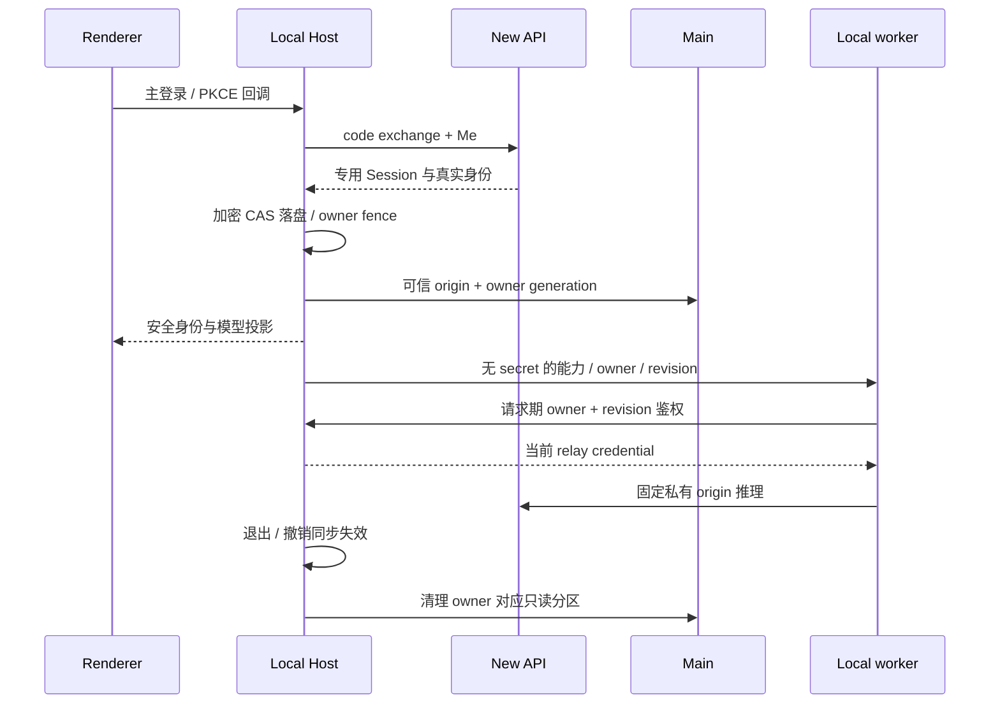

# XWork / New API 本机集成运行手册

客户端规则见 [spec](specs/new-api-integration.md)，认证、资金与管理员接口以 [New API canonical spec](../../../new-api/docs/specs/xcode-integration.md) 为唯一来源。实施与发布验收见 [执行计划](../superpowers/plans/2026-10-08-new-api-integration.md)。

## 配置与边界

- Node 版本使用 `mise.toml`，pnpm 使用根 `package.json`。本次验证使用 Node 24.14.0 / pnpm 10.33.2。
- 只有显式 `NEW_API_BASE_URL` 且本机桌面 Local Host 才启用私有组合，没有默认 3001。Main 安全库、Host 与 scheduler 使用相同 dotenv→已定义 process env 优先级；显式空 process 值遮蔽 dotenv。未配置的原非私有桌面、独立 Web/远程路径保留；已启用后任何认证、目录或资金错误都不回退到原官方身份或钱包。
- Origin 必须是精确 origin，不能含路径、query、fragment、用户名或密码；HTTP 仅允许 loopback。生产操作员明确设置后端 `XCODE_INTEGRATION_ENABLED`、与客户端完全一致的 `XCODE_PUBLIC_ORIGIN`，并验证实际二进制、挂载及数据库。
- 不复用 Z.ai/BigModel 的环境变量。它们继续属于独立官方连接；metadata、网页地址和 `server_address` 均不能改变私有 API origin。
- 现有 3001 服务不能仅凭 `/api/status` 成功判定就绪。先验证 canonical 端点、构建来源和隔离门槛；本次未重启或修改该服务及其业务库。

显式启用既有测试启动命令（后端与数据隔离需由操作员先准备）：

```sh
NEW_API_BASE_URL=http://127.0.0.1:3001 pnpm dev:desktop:test
```

桌面运行时隔离变量：`ZCODE_DESKTOP_USER_DATA_DIR`、`ZCODE_DESKTOP_SESSION_DATA_DIR`；业务数据根通过已有 `ZCODE_DATA_BASE_DIR` 处理，必须核实启动链实际采用的值，不能只设置变量就假设隔离成功。不要连接真实用户目录做注册、撤销或额度耗尽场景。

macOS 保持系统 `HOME` 不变，应用/Host/工作区使用上述隔离变量。改成合成 HOME 会让真实 OS keychain 查找失败，不能选择“还原为默认”来掩盖测试配置错误。无安全库时 fail-closed，不注入测试 AES key 就宣称真实恢复通过。

## 主账号与独立官方连接

1. 主登录打开 New API 原生认证页面，复用原生注册、密码、2FA/Passkey 流程。桌面只持有 PKCE flow，不保存密码；浏览器会话与专用客户端 Session 分开。
2. Local Host 是 Native 身份与三类凭据的唯一业务 owner。Main 的 OS keystore 仅保护安全库密钥；Renderer、配置、Web Storage、日志及普通凭据 RPC 不得到 control、refresh 或 relay secret。
3. 恢复前校验 origin、用户、SID、期限及真实 Me。明确撤销会失效模型/权限并清理只读 WebView；503、离线或安全库不可用不是成功退出、无套餐或零用量。
4. 官方 MCP、闲时任务、分享需要单独连接 BigModel/Z.ai。它们保留真实官方 origin、身份、Plan 和模型；官方登录不替换主账号/头像。连接关闭、迟到回调和 A→B→A 都受主 owner 与凭据 generation 约束。
5. 官方安全记录只恢复到相同 Native origin/user；旧全局官方 secret 不自动认领。普通官方 Plan 推理仍不从这条云连接恢复到主模型选择。



macOS/Windows 使用 Electron `safeStorage`；Linux 的 `basic_text`、无可用 OS keystore 或无法保护密钥时私有登录 fail-closed，不降级到旧机器 key。跨平台真实 keystore 验收单独记录，不能以注入测试 key 的 AES-GCM 测试代替。

## 手工套餐与模型维护

- 管理员在 New API 为用户授予 canonical 的 `xcode` 专用实例。托管 relay key 只消费指定实例；钱包/general/其他订阅不兜底。renew、replace、revoke、reset 通过当前管理员接口及 revision 执行，不在客户端造订单或修改原生账户关系。
- 客户端模板价格、指定实例、额度单位和 `quota_per_unit` 来自真实 metadata；保持原始十进制字符串。Unlimited 与未知指标明确区分，不把 unknown/null 变成零。
- 前端仅展示 `account:new-api-openai-chat-completions`，名称为 `XWork·Plan`；模型设置、聊天选择和默认候选使用同一可见性规则。Responses/Messages anchor 保留底层协议与历史身份，但不向前端开放；旧选择须手动重选，不自动转换协议。管理员需将供 XWork 使用的模型配置为真实可用的 Chat Completions transport。
- 管理员维护真实 transport、完整 model properties 与 option/CEL maps。缺失配置、非法 CEL、禁用模型或授权/catalog revision 不一致均不能获得可执行 ref；问题在目录 issue 投影中显示，不猜供应商默认能力。
- 旧个人、企业、Start Plan ref 必须手动重选，即使 `model_id` 同名也不自动映射。保留历史消息/ref 与用户自配 Provider/key/模型，不批量改写用户配置。
- 配置/能力变化需刷新目录并检查 Host→worker 同一快照；UI 标签更新不代表 worker 已执行新能力。当前私有链路仅本机 worker；远程私有 provisioning 明确 unsupported，原非私有远程功能不删除。

## 用量、额度与只读升级

- 图表是 Native **账号级**消费/退款日志，不是当前 workspace、当前套餐或单一 relay key 的汇总。历史已下架模型仍保留真实统计；跨用户数据不能混入。
- 指定套餐卡只有单周期额度/剩余和真实 reset 時刻，unlimited 为明确空限额；不模拟官方三窗口、额外 reset 机会、工具调用总数或成功动画。
- 聊天用量面板点击「周期详情 · 只读」须打开现有单周期弹窗，显示服务端周期/重置时刻与管理员说明；没有官方机会也能打开，不能调用官方 opportunity/reset 或出现五小时/周双窗口。
- 自定义日期使用合法 calendar date 与 IANA timezone，按服务端范围投影；DST 不能按固定 24 小时补造桶。Signed quota/net 值、精确计数及无数据字段保留实际语义。
- 默认 `server-local` 不是 IANA 名称：用量日桶以服务端 `YYYY-MM-DD` 标签归日，today 小时桶以服务端 `range_start_date` 归日；保留带 offset 的小时标签与 DST 重复桶，包括横轴和 tooltip。不能用电脑时区、UTC 日期或当前额度 offset 重建历史用量日历。工具详情的总计与卡片一样按 availability 显示“暂不提供”，不能将空 series 转为业务零。
- 客户端购买/升级入口打开同源只读 `/xcode/plans`。短期 handoff 一次性使用，放在 owner 专属临时 WebView partition；禁止跨源导航、购买、下载、弹窗及权限获取，退出/owner 变化清 Cookie、Storage 和 Cache。
- 2026-10-12 已实施 [U01–U04](../superpowers/plans/2026-10-08-new-api-integration.md#5-升级页评审修正u01u04) 和 [升级 UI 规格](specs/new-api-upgrade-ui.md)：原生管理员在模板表单配置可空 `xcode_display`；分类/周期/等高卡片按真实模板派生，摘要独立显示实际授权，当前标记只匹配 exact plan ID。`/plans` 仍为旧严格契约，展示 metadata 仅在 `web/view` sidecar；展示 Cookie 不含身份/权限，主题/语言/字号由 Native 首帧传递。参考价及折扣只在可比数据成立时显示，`manual_admin` CTA 仅说明实际 SKU 的 grant/renew/replace，不提交付款/申请；团队明确不支持。
- 升级页中文基准 content1568×947、UI14/zoom1 下四卡与 CTA 首屏；英文、最大字号和较矮窗口允许纵滚，不能缩小字号或截断权益。验收截图使用隔离环境的真实合成模板，不代表部署目录必有体验/Lite/Pro/Max 或正式供应商权益。
- 隔离开发后端重启仍须保留 `SESSION_SECRET`/`CRYPTO_SECRET` 与原数据库，并设置正确 `XCODE_PUBLIC_ORIGIN`（仅 loopback 允许 HTTP）；缺公开源的 handoff503 是配置故障，不是身份撤销。live smoke 的短期控制 token 快照过期须沿真实 refresh/PKCE 获取，不禁用限流/签名校验。Full Desktop 的冷恢复后一次 logout/relaunch 尚未解释，G2 不因此通过。
- Native payment 写方法在发付款 HTTP 前拒绝；六项旧付款读取明确返回不支持/手工分配，不能返回假钱包、假订单或付款成功。购买功能是否保留在原生 New API dashboard 单独验收。

## 故障区分

| 现象                            | 处理与不变量                                                                 |
| ------------------------------- | ---------------------------------------------------------------------------- |
| 旧服务 404 / 不符合 wire schema | 核对实际二进制与开关/origin；不改成官方 endpoint 或默认成功                  |
| 503 / 网络中断                  | 展示暂不可用；不声称 signed-out、no_plan、0 用量；下一次有效读取仍校验 owner |
| 明确 SID / relay 撤销           | 同步阻断旧目录/请求，关闭私有 WebView；新登录不能复用旧 owner/revision       |
| OS key / 加密记录损坏           | 提示安全凭据恢复；不反射 secret，不使用旧 key 解密私有命名空间               |
| 没有指定实例 / 额度耗尽         | 明确未授权/不可用；钱包/general 余额不能救济托管请求                         |
| 模型 metadata 错误              | 修真实 backend metadata 并刷新；不补能力、不混用 transport、不切供应商兜底   |
| 官方连接缺失或失效              | 仅官方功能要求重新连接；Native 主账号与本机推理不替换为官方身份              |

## 回归与验收

根目录现有命令：

```sh
pnpm exec tsx --experimental-test-module-mocks --tsconfig packages/services/test/tsconfig.json --test packages/services/test/newApi*.test.ts packages/services/test/officialCloudOwner.test.ts packages/services/test/offPeakExecutionLifetime.test.ts packages/services/test/conversationShareOperationFence.test.ts packages/services/test/officialInvocationDispatch.test.ts packages/services/test/providerConfigMigration.test.ts packages/desktop/test/newApiOAuthRoutes.test.ts
node packages/desktop/test/runNewApiElectronSmokes.mjs
pnpm typecheck
pnpm lint
pnpm fmt:check
pnpm architecture:check --changed
```

`newApiComposerContextElectron.mjs` 已纳入上述 Electron smoke 入口：真实 Composer/额度 hooks 验证自定义 API Key 空草稿不显示订阅、三个 Native transport 保留额度、Native 缓存切换到自定义模型后只展示上下文且 hover 不读取订阅、切回 Native/清空选择，以及触摸按下的上下文展示。全局侧栏与设置额度保持主账号来源；对话浮层跟随当前结构化模型选择。

`newApiModelSettingsElectron.mjs` 同样纳入该入口：使用真实 Native 状态卡与 owner hook，在隔离业务 fixture 下验证授权/查询失败/空模板、换号与退出首帧、旧响应及重复刷新隔离、手动刷新、英文深色与 393px 窄屏。模型设置按 [原版呈现规格](specs/new-api-model-settings-ui.md) 复用套餐卡及个人/团队入口，不再显示独立官方云横幅；连接/断开仍在使用统计 MCP 区。本机完整桌面在 Renderer 重新加载后实际读取部署数据，状态卡与个人入口均打开只读套餐 WebView，手动刷新正常，自定义供应商编辑入口保持；未改真实模板/授权，未以 fixture 声称官方权益或推理通过。

CLI/bootstrap 不包含在根 `typecheck` 入口内，需使用其当前包脚本另行校验并重建本机 Agent bundle，不能启动旧 bundle 就声称新 worker 行为通过。桌面必须实际操作登录、手动重选、真实套餐/用量页与只读升级页，并观察重启、退出、owner 变化和旧 worker 拒绝结果。

2026-10-09 可达证据见 `.superpowers/sdd/2026-10-08-new-api-integration/progress.md`：隔离后端实际完成 Native PKCE、七 DTO、refresh/恢复、admin grant/renew/revoke、handoff 与用途隔离；之后重建 backend `web/dist` 和 Go embed 二进制，SHA-256 为 `9d1cb26a27babc08f93f6a774fae978800c586c423e37888c2c714706c745a0a`，源码 `46a74273cd3b3a88d01d0a5d5512375c1c719530`、`vcs.modified=true`，不是 clean release artifact。三 installed SDK 已经穿过真实 New API relay/adapter 到受控上游，指定实例扣费与日志 wallet deduction0 有真实证据；另有真实 full Desktop 主登录、macOS keystore 冷恢复、Host→CLI→Native 推理和只读套餐页证明。受控上游的 11/7 token 是 fixture，不是真供应商计量；没有以此声称正式供应商或完整资金矩阵通过。

发布仍必须完成执行计划 T10 覆盖表：真实上游与三 transport 的资金结算、所有资金域/跨周期/并发及数据库矩阵、真实官方 Plan/MCP/闲时任务/分享、各目标 OS 安全库、对应源码的完整部署。缺凭据、测试数据或部署授权的项明确未验收；代码检查或页面打开不替代它们。

## 安全部署与回滚

- 发布前核对客户端/后端源码、构建标记、挂载、canonical origin、功能开关和实际 consumer；备份并确认审计保留，使用明确允许的测试数据验证撤销和资金域。
- 关闭开关不是旧二进制安全回滚：先撤销全部专用客户端 Session/relay key，取消所有有效 xcode 实例，保留 purpose/scope 与资金审计。确认旧代码不能把专用实例/托管 key 当 general/wallet 再部署旧二进制。
- 切客户端 URL 或去掉 `NEW_API_BASE_URL` 不迁移用户、订阅或秘密，也不允许未归属云凭据被认领。原生 browser Session 与 XCode Session 的撤销语义必须分别检查。
- 默认不自动发布、不提交/推送、不重启用户已有服务、不改业务数据库；部署必须有明确授权。PR 目标 `XCode-main`，`main` 仍只镜像上游。
- 2026-10-12 用户明确选择「桌面前端＋3001嵌入页」后，已重建桌面/本机 Agent、New API Web 与 Go embed，并启动 `NEW_API_BASE_URL=http://127.0.0.1:3001 pnpm dev:desktop:prod`。现有 `new-api` 容器保留原配置、会话密钥、数据挂载和端口，实际版本为 `xwork-upgrade-20261012`，加载 `index.3b9adbf597.js`；数据库新增可空 `xcode_display`，完整性检查通过，原 3 个账号、2 个模板、账号额度及订阅记录与升级前一致。真实 Native 页面已验证账号恢复、模板读取、个人/团队切换及主题/语言/字号继承，不替代完整 G1–G5 验收。
- 本次部署备份位于 `~/ai/new-api-backup-xcode-restart-zv7Pnl/`，包含一致数据库快照、旧二进制和私有容器配置；目录及私有文件已限制权限，禁止提交或对外分享。旧容器保留为停止状态的 `new-api-before-upgrade-zv7Pnl`，不要与新容器同时写入相同数据库。当前模板未配置 `xcode_display`，页面按规格保留原始名称与条款；未改写套餐价格、授权、权益或补造体验/Lite/Pro/Max。
