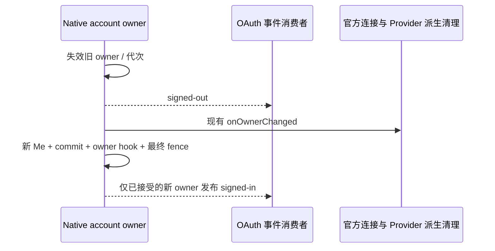
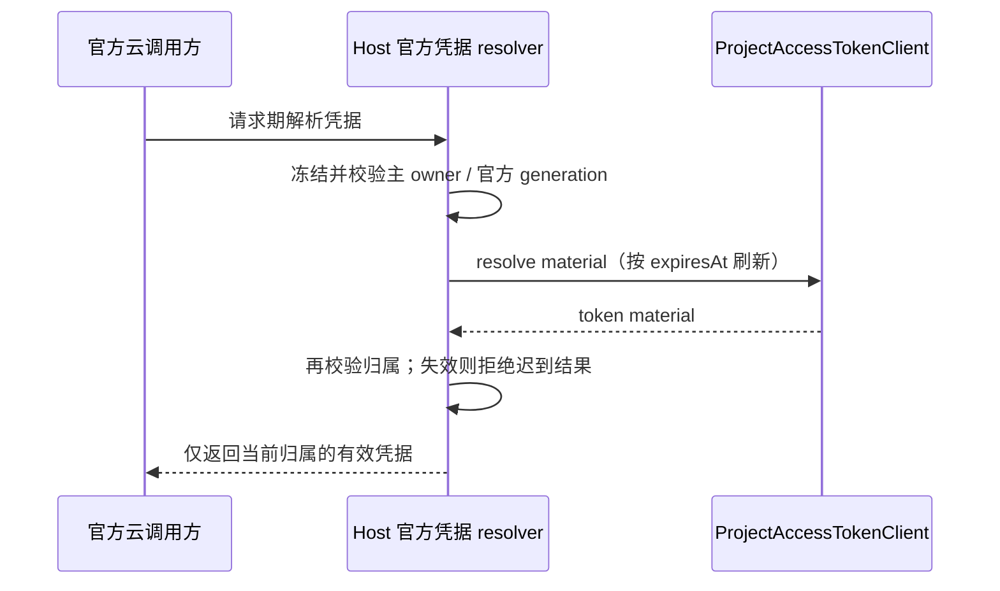

# XCode / XWork 私有网关：客户端适配实现规范

状态：2026-10-09 开始按客户端独立执行计划实施；已有 wire/主身份工作继续完成。代码实现、确定性回归与真实联调分别记录，不以测试或旧服务 status 代替桌面验收。

跨仓库 HTTP、认证、额度、模型 metadata 与错误定义以 [New API canonical spec](../../../../new-api/docs/specs/xcode-integration.md) 为准。本文件规定 XCode 的 Host/RPC/Registry/UI 映射，不维护第二套 HTTP 契约。XCode 为代码目录，该基线产品展示名是 XWork；不再重命名，也不删除 New API / QuantumNous 归属。

## 1. 基线、范围与非目标

源码基线：`7740b06bb501e1dce2ab5db867a5f0c3365e4f1a`，分支 `feature/private-server-technical-design`。New API 基线及运行二进制取证限制见 canonical spec §1；实际开发服务 `http://127.0.0.1:3001`。

用户最终将一期范围收窄为**全部本机启动、部署和访问**：

- 覆盖桌面窗口 Local Host 及本机 Agent/worker。
- 不开发私有网关的 SSH/WSL/Docker/远程接入、转发、凭据 provisioning、远程部署或独立 Web 多用户登录。
- 不删除现有远程/Web 功能；不将它们列为私有网关已支持，不把远程环境的 localhost 当成桌面地址。
- 普通 Agent 的所有官方 BigModel/Z.ai 个人、企业、Start Plan 通道切到 New API；用户自配 API Provider、key、模型及会话历史不改。
- 官方 Server MCP/闲时云任务保留原服务、官方模型、官方计费和独立官方登录。私有账号不是官方权益。
- 现有布局、导航、组件、交互保留；后端相关名称、单位、周期和无法提供数据的文案允许真实适配。不是要求所有旧 wire DTO 完全不变。
- 已保存官方 Plan 模型选择统一不可自动迁移；用户重新选择 New API 实际模型，即使 ID 相同。自配 Provider 选择不受影响。
- 不做已有 New API 用户/订阅迁移绑定、企业组织权限、Start 独立余额、线上购买、额外 reset 机会或新增遥测采集。

## 2. 源码依赖与实际切入点

| 领域            | 当前源码与约束                                                                                                                                                                                                                                                                                                     |
| --------------- | ------------------------------------------------------------------------------------------------------------------------------------------------------------------------------------------------------------------------------------------------------------------------------------------------------------------ |
| 主账号 RPC      | [IOAuthService](../../../packages/services/src/oauth/oauth.ts)、[shared OAuth DTO](../../../packages/shared/src/oauth.ts#L55)、[OAuthService](../../../packages/services/src/oauth/oauthService.ts)、[凭据 Repo](../../../packages/services/src/oauth/repo/oauthCredentialRepo.ts)                                 |
| 套餐 RPC        | [ICodingPlanSubscriptionService](../../../packages/services/src/coding-plan-subscription/codingPlanSubscription.ts#L58)，包含个人/企业/Start、Stripe/PayPal、官方 feature config 等多种职责                                                                                                                        |
| 用量 RPC        | [IUsageStatsService](../../../packages/services/src/usage-stats/usageStats.ts#L20)、[Usage DTO](../../../packages/shared/src/usage-stats.ts#L64)、[Quota DTO](../../../packages/shared/src/usage-quota.ts)                                                                                                         |
| Provider 运行时 | [Host 组装](../../../packages/services/src/node.ts#L1491)、[providerRuntime](../../../packages/services/src/model-provider/providerRuntime.ts)、[连接解析](../../../packages/services/src/model-provider/accountProviderConnectionResolver.ts)                                                                     |
| Registry 边界   | [account source](../../../packages/provider/src/sources.ts)、[AccountProviderService](../../../packages/provider/src/account-provider-service.ts)、[resolver](../../../packages/provider/src/resolver.ts)、[Registry 发布](../../../packages/provider/src/registry-service.ts)                                     |
| 能力结构        | [shared model-config](../../../packages/shared/src/model-config.ts#L21)、[provider access union](../../../packages/provider/src/config/provider-data-schema.ts#L4)、[受限 option-map](../../../packages/model-option-map/src/compiler.ts#L35)                                                                      |
| worker 同步     | [Host push](../../../packages/services/src/zcode-agent/zcodeAgentService.ts#L1382)、[worker runtime](../../../apps/zcode-cli/packages/bootstrap/src/app/process-provider-registry-runtime.ts)、[account config protocol](../../../apps/zcode-cli/packages/bootstrap/src/zcode-protocol/account-provider-config.ts) |
| 官方云身份      | [officialMcpCredentials](../../../packages/services/src/official-mcp/officialMcpCredentials.ts#L151)、[offPeakRuntimeModel](../../../packages/services/src/session/offPeakRuntimeModel.ts)、[off-peak model view](../../../packages/services/src/model-provider/offPeakModelSelectionView.ts)                      |
| 嵌入购买页      | [CodingPlanUpgradeDialog](../../../packages/ui/src/settings/CodingPlanUpgradeDialog.tsx)、[用量面板](../../../packages/ui/src/settings/usage-stats/CodingPlanUsagePanel.tsx)                                                                                                                                       |
| 远程边界        | [remoteWorkspaceServiceCollection](../../../packages/desktop/src/host/remoteWorkspaceServiceCollection.ts#L320)、[当前 provisioning schema](../../../packages/shared/src/provider-provisioning.ts#L74)；本期不扩成私有远程协议                                                                                     |

两项不能省略的改造：

1. Account overlay 目前只能覆盖已存在 Built-in provider ID，且不承载动态完整模型配置；只给它一份模型列表不能完成真实能力适配。
2. 官方 MCP/闲时任务目前从**普通模型 Registry**推断唯一官方 Plan 连接，并读全局 oauth/zcode JWT key。普通通道换成 New API 后，“这些模块不改”会导致云功能失效或跨用户串凭据。

实现必须在现有 Host 服务、shared schema、Registry 和 worker 同步层打通，不能在 UI 直接 fetch、在 Repo 做跨服务调度，或通过全局替换 ZCODE_BASE_URL 混淆官方 origin。

## 3. 状态与凭据所有权

| 状态                       | 唯一 owner                                                 | 不变量                                                                            |
| -------------------------- | ---------------------------------------------------------- | --------------------------------------------------------------------------------- |
| New API 主账号/SID/refresh | 窗口 Local Host 的 `NewApiAccountService` 与私有安全凭据库 | 仅 `.oauth` 公共投影注册 RPC；Renderer 不拿 control/refresh/sk-key                |
| 私有控制 API client        | Local Host，绑定已验证主账号                               | 请求 origin 固定为 New API；401/403 与网络失败分开处理                            |
| 私有模型授权/目录          | Host AccountProviderService                                | 以当前 user/SID/auth generation/canonical revision 构建快照；不是 Personal Config |
| 本机 worker 配置           | 现有 providerUpdateAccountConfig                           | 数据快照和请求期 secret 分离；过期/另一用户快照不执行                             |
| 官方云连接                 | 独立 Host 官方连接服务                                     | 按 New API 主用户命名空间持久化；不由当前私有模型 provider 推断                   |
| 官方云目录与权益           | 原官方 source/adapter，绑定独立官方连接                    | 只用官方真实模型/Plan/组织项目，不能读 New API model catalog 替代                 |
| UI                         | 现有 RPC/hooks                                             | 订阅状态是投影，不能自行授予、重置或重新解释金额                                  |

每轮异步请求冻结 `origin + NewApiUserId + SID + authGeneration`；官方请求还冻结 `officialConnectionKey + credentialGeneration`。返回前核对，身份变了则丢弃旧结果。不得把 A 用户的订阅、模型、图表、WebView 或云凭据写进 B 用户的状态。

主账号 logout、换号、refresh 失效、明确 SID/key 撤销立即清理可执行授权，失效 in-flight 请求/缓存及本机 worker credentials；尽力调用服务端 logout，并按真实结果处理网络失败。不宣称本机离线删除等于已经服务端撤销。

主会话事件复用 `IOAuthService.onDidChangeSession`，由 `NewApiAccountService` 的同一 owner 状态机发布，不另建 UI 认证缓存。事件只携带 `signed-in` / `signed-out`：

- 退出、换号、取消和明确撤销先同步失效 owner/代次，再发布 `signed-out`，最后执行现有 `onOwnerChanged` 派生清理与撤销；订阅者回读时不得仍得到旧有效 owner。
- 登录只有在 Me 核验、原子 commit、owner hook 及最终代次/期限 fence 均接受后发布 `signed-in`。冷恢复首次确认 owner 同样发布；迟到或取消的激活不能发布登录成功。
- 同 SID 正常 refresh 不模拟退出/登录；503 不发伪造退出事件。独立官方云连接的登录、刷新或退出仅更新自身事件，不改变 Native 主会话事实。
- 现有远控认证同步 hook 消费真实事件并使迟到初始 UI 恢复投影失效；不以头像、设置更新或成功计数重新推断会话变更。



Account refresh 的过期失败不能恢复启动请求时捕获的旧授权；失败失效基于当前快照。logout、换号、官方连接失效与新 owner 的已发布状态不被旧异常覆盖。

官方云凭据退出主账号时锁定/隐藏，按用户要求保留安全存储；再次登录**同一个原生 user_id**才允许恢复。切换其他主用户不得迁移、借用或暴露它们。旧全局、没有明确主账号 owner 的官方凭据不自动认领给第一位私有用户；保留原数据，要求该用户独立完成真实官方登录后形成新 namespace。

官方云 Project Access Token 使用上游 material 的真实 `expiresAt` 与刷新规则；请求期由既有官方凭据 resolver 解析，过期 token 不因安全库中仍有记录就继续执行。刷新前后校验主 owner 与官方 credential generation，静态 Registry 投影不发起网络刷新。

官方云项目定位复用上游 `ProjectAccessTokenClient` 的分接口鉴权契约：两个 family 的 `getCustomerInfo` 均使用裸业务 token；个人 Key 管理仅 Z.ai 添加 Bearer，团队 Key 管理使用裸业务 token 和组织/项目 header；项目短期 Token 签发使用 Bearer。目录加载器的首次身份读取与后续项目定位必须遵守同一契约，不复制长期 Key secret，也不回退私有主账号凭据。



## 4. 主账号登录适配

### 4.1 配置与 Adapter

新增明确的 `NEW_API_BASE_URL`，开发值 `http://127.0.0.1:3001`；解析并规范化精确 origin，HTTP 仅允许本机 loopback。不要复用 Z.ai/BigModel/官方 XCode 服务的 env 或从网页 metadata 接受任意 endpoint。
此显式 origin 启用桌面私有组合；未配置的原非私有宿主及独立 Web/远程路径保留。已配置后，认证、目录、套餐或用量失败不得回退到原官方身份/资金或自配 Provider；配置值不是从 status、metadata 或旧官方 origin 推导的默认值。
Main 与 Host 使用同一有效环境配置：开发 `.env`/`.env.local` 与进程环境的既有优先级一致，进程中的显式空值也必须一致关闭；安全密钥加载及闲时 scheduler 模式不能仅检查未经合并的进程环境。

主登录 Provider ID 为 `new-api`；在已有 OAuth adapter/service 框架中增加原生授权 code + PKCE adapter。所有浏览器登录/注册页转到 New API 本源，复用原生密码、注册、2FA、Passkey 等流程。不在 Electron 保存密码，也不复制 Native 登录表单/账户库。

- `startOAuth` 打开 canonical §6.2 的 authorize URL，client_id=xcode-desktop、S256、现有 zcode deep link；不走官方中转页。
- state/verifier 保留在 Host pending flow；深链只交给精确 provider/state 对应的窗口，不能拿“当前窗口”兜底跨窗口登录。
- `handleCallback` 对 code 兑换并校验 SessionBundle schema、identity、expiry/origin；不能把 private token 写进 zcodeJwtToken 字段。
- 当前 IOAuthService 的主账号恢复/刷新/退出语义保留，由 new-api adapter 实现。新增私有凭据字段/Repo 方法必须有真实领域名称，不能伪装成 zai token。
- 本期不将 `startOAuthWithPolling` 的官方 polling 协议套给 New API；保留原方法供独立官方路径，私有不支持时明确返回稳定错误而非 mock pending。

保持登录入口与个人信息菜单布局；主账号区域展示真实 New API 用户，提供原有登录/注册操作。官方云连接入口是现有云功能的连接操作，不能让官方登录覆盖主账号头像/用户名或 `getActiveProvider` 的 new-api 主身份。

浏览器授权页的账户切换遵循 [已确认页面规格](new-api-authorization-account-switch.md)：显示当前真实账户并提供“使用其他账户”，明确告知同源后台登录态会改变；仅退出确认时的浏览器 SID，重新登录后仍须主动授权，不延长原 AuthFlow。此增量于 2026-10-17 完成设计确认与实施计划编写，尚未实施或部署；不新增独立授权会话、不改变本节 PKCE 和桌面凭据边界。

### 4.2 安全持久化与恢复

安全凭据域按 `new-api:<origin-key>:<user-id>:<sid>` 命名，保存 control、refresh、relay 的类型/expiry。origin-key 是规范化 origin 的稳定非秘密标识；不能同用户名不同服务器复用 token。

复用现有 `credentials.json`、目录锁和原子替换。私有 typed bundle 与 active pointer 同次加密落盘，refresh/delete/取消补偿按精确 owner 与前继 refresh CAS；公共 `ICredentialService` 拒绝 `new-api:` / `official-cloud:` 秘密域。Desktop Main 使用平台 `safeStorage` 保护独立随机私有加密 key，仅传给 Host；拒绝 Linux `basic_text` 或无安全 keystore 的降级。旧官方密文不改 key，Headless 缺私有 cipher 时明确不可用。

原生 JWT本地 exp 解析只作刷新提示；身份、SID、授权最终由服务端确认。Opaque/不可解析不等于已经登录。刷新采用 Host 内单飞，复用原生 refresh 轮换和竞态恢复，及时原子替换安全库中的后继 refresh。

- control 过期：允许一次正常 refresh 后重试原只读请求；不要对安全拒绝无限重试。
- Native 明确 session/key 已撤销：主登录失效，清可执行私有授权，要求重新登录。
- 503/网络故障：显示暂不可用，不伪装 signed-out/no_plan，不删除可恢复凭据。
- 解密失败：沿用稳定错误及人工恢复提示，不能静默换到官方或环境变量 key。
- 取消/新登录覆盖：迟到回调不持久化；若已兑换到有效 SID，按 canonical 撤销，不发布错误主用户。

同 SID 的正常 refresh 不重建 relay key；删 key 后不通过 refresh 自动“修复”用户的明确撤销。

### 4.3 内嵌页面不是主登录凭据导出

升级入口实际 load embedded `/coding-plan` 页面。改为 Host 请求 `/web-handoffs`，仅加载返回的同源 `/xcode/plans` 短期交接 URL。保持原 dialog/sidebar/navigation，不注入官方 localStorage 脚本。

WebView 分区绑定主账号 generation，退出/切换即清理/关闭旧视图；不能复用 A 的分区给 B。页面只拿服务端只读 Cookie，不能看到 control、refresh 或 sk-key。校验精确私有 origin；拒绝跨源导航拿凭据，不放宽既有官方 origin 防护。

Main 必须先收到当前可信 Host 对**精确 handoff URL 与 generation**的一次性 admission REQUEST，校验当前 child、所属 BrowserWindow 与当前 owner，并回送匹配该 REQUEST 的 ACK；Host 等待成功 ACK 且再次核对 owner 后才返回 Renderer RPC。`createPlanWebHandoff` 缺少该 seam 时须在请求 `/web-handoffs`、铸造短码前拒绝；只读 headless 依赖可不提供 seam，但不能因此绕过交接准入。REQUEST/ACK 不承载 control、refresh、relay key 或 Cookie。跨 IPC 通道不靠超时猜测登记已完成，也不依赖离线 logout 已送达服务端。

Renderer 只能消费当前窗口最新的 admission，不能自行登记；`ownerGeneration` 数字本身不是授权。仅比对 Renderer 提交的 generation 不能阻止它给旧 A URL 改写 B generation，即使旧短码仍有效也必须拒绝。owner 变化清除待用 URL；准备分区即一次性消费，guest 只能 attach 一次，重复或重标记均拒绝。Host 退出、换号或窗口销毁须失效待决准入与迟到 ACK。初始主 frame 必须是已登记短 URL，之后只允许同源无 query/hash/userinfo 的 `/xcode/plans`；外源资源、popup、下载及权限请求拒绝。同源首屏资源按已准入 origin 校验，不依赖尚为空的 guest URL。异步清理旧 A 分区不得删除随后建立的 B policy。

同一 Electron Session 的 Native 请求守卫与网络捕获共用唯一 `onBeforeRequest` 分发器。守卫拒绝优先且异常时拒绝请求；观测者无放行权，启动、停止或重复注销网络捕获都不能覆盖或清除仍在生效的安全守卫。

升级页视觉恢复的无秘密展示上下文由 `IPlatformService.prepareNativePlanWebview` 送 Main，在已准入临时分区写 UI Cookie；不改 Host `createPlanWebHandoff`、短码认证和上述 URL 防护。完整字段、异步写入后的 owner 复核及 head Bootstrap 首帧规则见 [升级 UI 规格 §5](new-api-upgrade-ui.md#5-无秘密展示上下文与首帧)；展示 Cookie 与 HttpOnly 认证 Cookie 不可混用。

## 5. 私有 Provider Registry 与模型调用

### 5.1 显式访问类型与稳定 Provider ID

新增访问类型，而非把 Native 主账号伪装成 zai/bigmodel team：

```ts
// 目标 schema 形状；不是本次已实现代码。
type NewApiAccountAccess = {
  type: "new-api-account";
  accountType: "new-api";
  mode: "private-subscription";
  entitled: boolean;
};
```

在静态/动态 AccountAccess、运行时 Registry、RPC schema 中增加对应私有分支；动态 identity 用 Host 解析的 opaque connectionKey，不制造 organizationId/projectId。原 zhipu-account 类型保留于真实官方云路径，不作为普通私有推理认证。

Provider API transport 固定一个协议，因此声明三个稳定 Built-in 私有 anchor：

- `account:new-api-anthropic-messages`
- `account:new-api-openai-chat-completions`
- `account:new-api-openai-responses`

group 为 `new-api-family`，不要按每个套餐新建 provider ID。模型归属由 canonical api_type 决定，每个实际 model_id 只进入管理员选择的 transport。Built-in anchor 不包含 key 或猜测 GLM 模型；origin 在 Host 从显式配置形成，不从模型响应接受上游 URL。

Native Provider 归类为 ordinary model-selection 行为，但 access 仍为 managed account；不套原 `account-plan` 的“唯一 current Provider 自动 remap”，避免三种 transport 产生歧义。选择由实际 provider+model ref 决定，不自动转成另一协议或模型。

XWork 前端仅开放 `account:new-api-openai-chat-completions`，展示名称固定为 `XWork`。另两个 anchor 使用现有 `visibility: hidden`，不进入模型设置、聊天模型选择或默认候选；历史 ref 保留但不自动迁移，重新选择可见模型。底层协议契约与管理员模型归属不改，不把其他 transport 的模型移入 Chat Completions。可见入口即使目录为空也保留，按真实权限和配置显示不可用。用户自配 Provider 与独立官方云连接不受影响。

模型设置遵循 [原版呈现规格](new-api-model-settings-ui.md)：托管入口复用现有标题、编程套餐状态卡、个人/团队入口，数据只取 Native `/plans` 与 `/entitlements`。参考价只在相同币种/完整周期的启用模板中比较；团队明确不支持。独立官方连接操作保留在使用统计 MCP 区，不在套餐详情另造横幅。UI 投影按既有 connectionKey、登录 epoch、服务实例与请求序号隔离，换号/退出首帧清空旧数据，查询失败不解释为未开通。

### 5.2 动态能力的真实通道

扩展 AccountProviderConfigSnapshot，增加 `modelConfigs`：providerId → modelId →完整 ModelConfigData，并纳入 revision/解析/序列化。复用现有 source/AccountProviderService，不另建一套 Registry。

必须落到这些现有 seam：

1. 本地受维护的 Built-in rules 始终合并私有 anchors，使 account overlay 不被 `ProviderConfigResolver` 丢弃；不能依赖官方 CDN 先发布这些私有 ID，也不能让 CDN 刷新移除它们。
2. Account resolver 从真实 login + `/entitlements` + `/models` 生成 provider access/state、builtinModelIds 和完整 modelConfigs；No Plan 不假 entitled。
3. sources/config schema/resolver/Registry 在同一个 matching revision 发布模型列表、能力与权限。`basedOnZCodeBuiltinRevision` 栅栏仍有效。
4. 私有模型完整 capabilities 最终由 account snapshot 取值；Personal/Template/manual model 规则不得覆盖管理员上下文/能力/协议。用户仍可选择允许的 reasoning level、输出上限，不可放宽其范围。
5. `providerUpdateAccountConfig` 以及 worker 的 parseProcessAccountProviderConfigSnapshot 同步扩展 modelConfigs；Host 与本机 worker 同时更新，不能只改桌面 selector。
6. Native source 出错、换号/撤销时先发布 fail-closed 的可执行权限，旧 Registry 在等待 revision 时也不得继续执行旧用户模型。保留缓存资料与允许请求是两回事。

完整能力依 canonical §7：contextWindow、全部 input/output flags、tool/JSON schema/native search/mid-system、reasoning values/map、output max/map。用现有 completeModelConfigDataSchema 和受限 CEL 编译器严格校验；无 reasoning 的 neutral 配置也来自服务器，不是客户端补默认值。

编译错误或 metadata 缺失：保留现有 disabledReason 展示，禁用实际执行并说明管理员配置问题；不读内置 GLM capabilities、不猜模型前缀、不重新拼接旧官方列表。目录空或无授权是实际不可用，不在私有列表塞一个假默认模型。

canonical 返回 api_type=null/model_config=null 的未配置模型不能硬塞到任一 transport Registry 或提供可执行 ref。AccountProviderService 将它们以及 Host CEL 编译失败项投影到快照的 `catalogIssues`，每项固定 `{source:"new-api",modelId,displayName,code}`，与完整能力一起按同一 owner/revision 更新。

`ModelSelectionView`、`ProviderSettingsView` 及相应 shared RPC schema 保留只读 catalogIssues；本机 worker 同步保留该字段，但不得将 issue 创建为 Registry model。对话及复用同一分组构造器的模型选择菜单仅展示可选择的真实目录项，不显示 catalogIssues，也不生成只含问题项的空分组；没有可选模型时保留既有管理模型入口。`settings/ModelProviderSection.tsx` 继续显示问题模型的实际名称/原因，供管理员诊断，不提供选择 action/model ref。管理员修复后从 issues 移入正确 transport 的真实目录；换号先清该 owner 的 issues。隐藏仅是 Renderer 展示规则，不修改 Host 的可用性判断、授权、Registry 或历史选择。

### 5.2.1 服务端能力声明与思考控制一致性

2026-10-12 优化范围：复用上述动态通道和原版 Composer，不新增模型配置页、能力 Registry 或 HTTP 字段；执行任务见 [模型能力优化计划](../../superpowers/plans/2026-10-12-new-api-model-capability-optimization.md)。

- New API 是托管模型能力声明的唯一来源；Host 持有经校验的 owner-scoped 投影，Renderer 只展示该投影。本规则只覆盖 `new-api-account`，不覆盖用户自配 Provider 或独立官方云模型。
- 每个 exact model ID 独立声明完整能力、思考档位顺序及 CEL 映射。新增模型或修改既有 schema 能表达的能力不要求发布客户端；新协议、新交互或超出 schema 的能力仍需客户端支持，不能凭配置凭空增加。前端只开放 Chat Completions 的规则不变。
- `reasoningLevel.values` 决定允许选择的值；`map` 决定这些值如何写入真实协议请求。客户端不得硬加 `low/medium/high`，也不得因模型名称匹配就补默认能力。
- “关闭”必须语义真实：有思考能力的模型若提供 `disabled/off` 等关闭档位，映射必须使用实际上游支持的明确关闭参数。`map:"{}"` 仅表示不覆盖请求字段，不能作为关闭思考的证据；canonical 的非思考模型 neutral 配置只适用于已确认没有思考能力的模型。
- 元数据必须同时符合模型接口及部署渠道的实际能力。原生 channel 参数覆盖、默认值或模型别名不能把用户选择重新改成另一档；同名模型的候选渠道不一致时，由管理员拆分真实 alias，不在客户端增加兜底。
- 保留既有标签、选择器和无效值提示。多档模型可选；已选中的单档模型保持只读；恢复时未选或已失效的值不能在展示层伪装为首档或“关闭”。新建/主动选模保留 `completeNewModelSelection` 取服务端 `values` 最后一项的现行行为，辅助调用保留首项；不新增默认档位字段，也不把恢复失效值当作主动选模。
- 后台保存不等于客户端已刷新。明确使用模型设置已有 `refreshSources` 拉取目录；Renderer 重读 View 不代替 HTTP 刷新。不新增轮询/推送。刷新后首次 `sendText` 复用 Host 的 Account Config 串行交付，并以 Worker Registry 已应用匹配 revision 为放行条件，不能只凭 `receivedRevision` 回执。
- 用户选择属于下一次提交；同一个 model ID/档位的后续 turn 必须重新绑定已应用的能力。纯能力/映射更新不改写或取消已经开始的 turn，该 turn 的后续工具步骤及重试仍用冻结配置；排队输入在真正执行时按当时有效目录校验，已删除档位不得静默替换成另一档。
- 配置 revision 与执行授权身份分开：完整 Account snapshot revision 继续用于交付/应用；Native 执行授权使用精确 owner 与 canonical `authorizationRevision`。换号、退出、授权撤销、模型停用或移出可执行目录仍须及时取消/拒绝，不得只删除旧 revision 判断而失去安全门禁。保留当前保守的 owner 级取消范围，不新建多租约系统；自配模型与独立官方云不共享 Native 生命周期。
- 保留现有结构、受限编译、授权和 owner/revision 校验。客户端可以校验配置可执行性，但不能自动证明供应商真实支持声明；两者须分别验收。凭据、上游地址和任意 JS 不进入模型配置或 Renderer。

增量验收：

1. 两个托管模型声明不同的档位、上下文和输出上限，Host、UI 与 worker 分别采用各自配置；本地覆盖及内置规则不能改写托管能力。
2. 对实际有思考能力的部署模型，每个公开档位的 UI 选择、CLI 原始出站参数和真实 relay/上游行为对应；关闭档位显式关闭，非关闭档位不被渠道覆盖。仅有标签或空映射不算通过。
3. 服务端只改声明并刷新目录后，既有客户端可使用新增合法档位；原选择被删除时明确重选，后续请求使用新映射，已在执行的请求保持自身快照。
4. 缺失配置、非法 CEL、模型停用、换号/撤销或旧响应回写均不可执行；隐藏 transport、自配 Provider、独立官方云和原版设置布局不受影响。

### 5.3 调用凭据与协议

请求期 auth resolver 为 new-api-account 读取当前 SID 的托管 sk-key，核对主账号 generation，普通模型调用不读官方 MaaS/zcodeJWT/环境变量覆盖 key。private usage 直接通过只读 NewApiClient，不复用模型 key 查询旧官方 monitor。

每种 api_type 的路径拼接严格遵守 canonical §6.5：Anthropic origin→/v1/messages；两种 OpenAI origin+/v1→相应路径。应通过实际 SDK流验证，不能只检查字符串。

- `reason="model-request"` 使用私有 relay secret。
- 私有 account 的 `reason="off-peak"` 必须拒绝，不能送到官方任务。
- 原生模型错误、额度不足、过期/撤销、后台故障分开显示；没有 wallet/general-sub/official/custom-key fallback。
- 现有本机 Agent 推理能力：stream、tools、允许的 vision/reasoning、取消，使用实际 metadata；不裁掉请求参数，也不统一将 provider 错误改成额度错误。

secret 不进入 provider config、header rule、modelConfigs、Renderer DTO 或个人配置文件。沿用本机 Agent 已有请求期 secret 传输及安全存储边界，不设计远程 lease/provisioning。

### 5.4 原选择与各分支清理

原 `account:{bigmodel,zai}-{individual-coding-plan,team-coding-plan,start-plan}` 普通推理选择标记为旧官方选择不可用，并提示重选。持久化历史 ref 保留用于显示/回放；不能同 ID 自动映射 Native，也不能悄悄运行旧官方网关。

必须迁移所有受影响 caller，而不是兼容别名或新旧同时有效：

| 区域            | 需要的 clean cutover                                                                                                                   |
| --------------- | -------------------------------------------------------------------------------------------------------------------------------------- |
| provider config | provider-data-schema/provider-config/schema/rule-data-schema 的访问与 group union、hydration/overlay/只读约束                          |
| Registry        | resolver、sources、account-provider-resolution/state/service、config-service 的 entitled/current/fail-closed 分支                      |
| shared          | model-provider-types、zcode-protocol AccountAccess/模型 DTO、worker account-config 协议                                                |
| node            | model-selection-facade 分类、process-provider-registry-runtime 解析、Host account provider connection/auth                             |
| UI              | usePlanIdentitySnapshot、accountProviderAccess、codingPlanUsageSources、modelVisionBadge、ModelProviderSection/Detail 以及账号失效提示 |
| 身份分支        | 任何 `family === "zai" ? ... : bigmodel` 式 fallback 必须显式处理 native 与 official-cloud；不得把 new-api 当 bigmodel                 |

不删除仍由官方云使用的旧 family、off-peak ID/配置和官方 adapters；删除的是普通私有路径上的旧依赖、fallback、secret alias 和失效兼容逻辑。

## 6. 套餐、余额与支付 RPC

主套餐服务改为 Native read adapter。原个人/企业/Start 入口统一对应真实模板与唯一指定订阅；不假造企业 org/project、Start wallet、免费赠送、已有订单或支付签约。

| 现有 ICodingPlanSubscriptionService 方法                                                                                            | 一期映射                                                                                                                        |
| ----------------------------------------------------------------------------------------------------------------------------------- | ------------------------------------------------------------------------------------------------------------------------------- |
| getStaticProducts / getStaticTeamProducts / getStartPlanPreview / batchPreview / productInfo / preview                              | canonical plans + entitlements；返回带 native/private-user 语义的 shared 读 DTO，真实模板 ID/名称/价格/周期。不要强塞假企业结构 |
| getEnterprisePricing / getEnterpriseBalance                                                                                         | 主套餐页面为统一私人订阅的预算/额度展示；明确不是企业组织钱包。真实官方 team scope 读取移至独立官方连接路径                     |
| getManualClaimPlanPreviews / claimManualPlan / getBillingDiscount                                                                   | 私有模式拒绝 `XCODE_SELF_SERVICE_DISABLED`；不领取官方 Start 赠送或读取官方促销，非私有模式保留原官方行为                       |
| createSign / updateSign                                                                                                             | 拒绝 `XCODE_SELF_SERVICE_DISABLED`；不返回 agreement/payment URL                                                                |
| bindStripeCard / unbindStripeCard / payStripe                                                                                       | 同上；不调用官方/native支付写接口                                                                                               |
| createPaypalSetupToken / subscribePaypal                                                                                            | 同上；不创建假 setup token                                                                                                      |
| calculateEnterpriseOrder / createEnterpriseOrder / cancelEnterpriseOrder / continueEnterpriseOrderPayment                           | 同上；本期不存在 XCode 下单/订单修改操作                                                                                        |
| checkPayment / checkPendingOrders / queryStripeCards / checkPaypalSupport / getEnterprisePendingOrders / checkEnterpriseOrderStatus | 使用下文确定的 SelfServiceReadResult；私有模式返回 not-supported，不返回 paid 成功、空订单/false 等代替未提供的业务事实         |
| getOffPeakClientConfig / getDynamicWorkflowClientConfig                                                                             | 保持原官方配置读取，改用独立官方连接；不从 Native client-config 仿造                                                            |
| getModelContextBudgetStrategy                                                                                                       | 保留现有 preflight-v1 客户端策略；管理员 metadata 决定模型硬上限                                                                |
| getForceUpdateConfig                                                                                                                | 保留实际应用更新来源，不伪装成 New API 套餐字段                                                                                 |

上述六个自助支付读方法的返回值统一改为 `SelfServiceReadResult<T>`：`{availability:"available",data:T}` 或 `{availability:"not-supported",reason:"manual_admin",data:null}`。T 分别为原 `CodingPlanPaymentCheckResponse`、`CodingPlanPendingOrderCheckResponse`、`CodingPlanStripeCard[]`、`CodingPlanPaypalSupportResponse`、`EnterpriseCodingPlanPendingOrder[]`、`EnterpriseCodingPlanOrderStatusResponse`。当前私有模式只能返回第二分支；权限/身份/网络/后端失败仍抛真实错误，不当作 not-supported。所有 caller 必须先按 availability 分支，停止订单状态/付款轮询并显示现有手工授予入口；不新增支付读 HTTP 请求。旧非私有功能如果仍使用这些读方法，真实 T 必须显式包装 available，不能保留未判别的兼容返回。

不要新增几十个仿官方 HTTP endpoint。允许 shared DTO 增加明确 `source="new-api"`、`purchaseMode="manual_admin"`、`scope="private-user"` 分支并迁移 caller；RPC channel/服务边界和现有页面组件保留，不要求错误地冻结所有旧 DTO。

原“购买/升级/续费”等入口保留，点击进入与原版一致的真实套餐比较只读页，而不是后台授权详情、删除入口、打开官方支付或显示已下单。实际 grant/renew/replace/revoke/reset 仅在 New API 管理员界面完成；手工授予事实通过参考价提示和 CTA 说明表达。

主账号是 native 用户级订阅，套餐计费周期从原生数据显示。价格是参考展示；quota 显示依 canonical display 配置，不能把钱包余额或其他订阅总剩余作为 XCode 可用额度。

### 6.1 升级套餐页面一致性

[升级 UI 规格](new-api-upgrade-ui.md) 是本条执行规则，任务为客户端计划 U01–U04。保留原版“升级套餐”外壳、个人/团队切换、月季年选择、同排等高卡片/底部白按钮与真实主题语言首帧；品牌仍为 XWork，manual_admin 按钮为“联系管理员”，团队固定真实不支持。不伪造付款、体验结束、官方 MCP 权益或固定商品档位。

仅 canonical `/web/view` 增 `plan_presentations` 展示 sidecar，公共 `/plans` 和 `NewApiPlanSchema` 不扩展。原生模板仍是价格/币种/时长/额度的唯一事实；缺周期不替用、重复 slot 不覆盖，折扣基于可比日历月真实价格。授权摘要独立于启用模板列表，卡片状态只精确匹配 plan_id；不从续期时间差猜 SKU/周期，不新增 trial 历史。

初始分类、resolved theme、locale、现有字号经 Main 隔离 UI Cookie 送同源同步 Bootstrap，不拼 handoff query/hash、不注入官方认证脚本。唯一内容限宽/留白与 Native guest 父窗口 zoom 同步一并实施；恢复验收必须实际打开 Electron 的 Native 页，观察首帧、四卡/CTA、长文案、主题语言和换号，不用独立浏览器截图代替。此增量尚待实施，不能把旧页面成功打开等同 UI 一致性验收。

## 7. 用量与重置 RPC

### 7.1 统计口径必须拆开

| 视图            | 数据范围                                                                                 |
| --------------- | ---------------------------------------------------------------------------------------- |
| App Usage       | 当前本机 Agent 数据库，原统计不改                                                        |
| 私有额度卡      | 唯一 XCode 指定实例；只有一个真实 quota 周期                                             |
| 私有云用量/图表 | New API 账号全部已记录消费/退款，显示“New API 账号用量”；包括其他 native key、订阅和钱包 |
| 官方 MCP/云任务 | 独立官方连接的官方范围/账务；不并入 Native 套餐卡或 Native 账号图表                      |

`getCodingPlanUsageSnapshot` 调 canonical `/usage`；`getEntitlementSnapshot` 调 `/entitlements`；旧 monitor 路径不再决定主私有权益。`getAppUsageSnapshot` 保留本地实现。generic `getSnapshot` 按明确数据源调用；私有不可用时不降级为本地或官方 monitor。

### 7.2 对 shared DTO 和 UI 的必要适配

- 新增来源/范围判别，支持 private-user entitlement，不能硬塞 `scope=team` 或 fake org/project。
- 原 QuotaSnapshot 的 five-hour/week/TOKENS_LIMIT 桶识别改为原生 reset_period/nextResetTime/真实 quota 单位；保留原 panel/card 容器，但不得继续显示一个假第二周期。
- 原 percentage 表示**已用比例**，剩余显示才做 100-percentage。unlimited 单独显示“无限制”，total/remaining/percentage 为 null，不能显示为 0。
- raw ID/额度/计数在 HTTP 和 shared 边界使用十进制字符串。显示转换需有限且安全；金额/扣费不参与客户端计算。超过安全整数的精确值不能无标记截断，图表使用显示精度，不用于账务。
- AccountUsageSnapshot 的 consume_record_count 映射为“消费记录数”，不要填入标为模型调用次数的旧字段。扩展 DTO 的原 modelCallCount 为可空，并提供明确 consumptionRecordCount/source kind；官方来源仍可保留真实 modelCallCount。
- prompt/completion/total token 由日志实际字段；charged/refunded/net quota 依 canonical。真实无消费桶可补零；未知指标不能借此补零。
- `CodingPlanActivitySummary.totalUsageDurationMs`、工具统计/详情、健康 decode speed 等 Native 不可提供字段改为明确 nullable/availability；UI 保留卡片并展示“暂不提供”，包括工具详情的“总计”，不能对空 series 求和后展示 0。真实 total tokens/峰值/消费日趋势可从 Native buckets 计算，但不能冒充本机 Agent 活跃时长。
- 不从总 Tokens 推算 cache/reasoning，不从请求耗时推算 Agent 工作时长，不拼接本地工具数据装成账号全部客户端统计。
- today/7d/30d/custom 和原 date controls 保留；custom 最多 30 个自然日，IANA/DST 与服务端 canonical 一致。显示时间与服务端 quota reset 时区分开。自然日桶标签不经客户端时区改日；小时桶完整 UTC offset 保留在图表横轴和 tooltip，DST 回拨的同名小时不能合并成同一显示标签。
- metadata 和统计里的历史 model_id 可不同集合；历史模型不再授权也可以展示消费，但不能因此恢复为可选模型。

Native 主权益的 mcpQuota 必须 null，不能暗示新私有套餐附带官方 quota；官方 MCP 卡通过真实官方连接读取其真实配额。布局容器保留，未独立连接显示连接操作，已连接显示官方来源标签。

#### 对话上下文浮层的模型来源边界

- Composer 的结构化 `modelSelection.providerId` 是当前模型展示的唯一来源；不借 Session 旧值或全局登录账号补值。
- 仅当前选择属于 New API Registry 的模型时，对话浮层展示 Native 订阅额度。展示与原生 ZCode 一致：只有原生「剩余额度」标题、头部「查看」入口和一根「当前订阅周期」额度条；不加授权状态行、只读周期按钮或独立周期弹窗（授权状态与周期详情在设置页的用量统计里看）。
- Native 额度属于账号，不属于某个 transport：浮层以当前所选 Native provider 为优先来源，未投影或无 owner 时回退到其余已连接的 Native provider；任一 transport（Anthropic Messages、OpenAI Chat Completions、OpenAI Responses）单独存在都必须能显示额度。原生 `ChatCodingPlanUsageRemainingPanel` 原样复用，不改 UI。
- 自定义 API Key、本地模型及其他非 Native 模型不得展示或通过 hover 查询 Native 订阅；官方 Coding/Start 模型继续沿原有各自来源读取。
- 自定义模型复用接入 New API 前的 `ChatContextUsage` 布局：上下文总量/容量、占比进度条，以及运行时实际提供的组成和缓存命中率。没有真实用量的新对话不显示上下文触发器，不补假 0 或假 100%。
- 切换 Native → 自定义模型或清空选择时，即使账号订阅已缓存，浮层也立即移除无关订阅；切回 Native 后保留其真实订阅展示。侧栏及设置中的主账号额度不受影响。
- 验收：已连接 Native 账号且有缓存额度时选择自定义 DeepSeek，hover 只见真实上下文；覆盖空草稿、Native → DeepSeek → Native、清空选择，以及手机触摸打开。凭据、模型请求路由、计费和持久化均不改动。

### 7.3 reset 方法

原 reset RPC 保留入口，但区分 native-single-period 与 official 双窗结构，不制造 FIVE_HOUR/WEEK机会：

shared `CodingPlanResetStatusSnapshot` 改为有 mode 的联合：原官方窗口结构显式加 `mode:"official-windows"`，以及 `NativeSinglePeriodResetStatus`。Native 分支字段固定为 `{mode:"native-single-period",source:"new-api",selfServiceEnabled:false,authorizationStatus,authorizationRevision,period,lastResetTime,nextResetTime,resetTimeZone,history:{availability:"not-supported",reason:"native-history-not-provided"}}`。authorizationStatus/revision 来自 canonical；period 为 never/daily/weekly/monthly/custom，未授予时 null；其余时间/时区来自真实 quota，未提供时 null，时间为毫秒。Native 分支没有五小时/周机会数组和 hasUnreadHistory。

`hooks/useCodingPlanQuotaResetUi.ts`、`lib/codingPlanQuotaResetUi.ts` 及 reset dialog/coordinator 必须先判 mode；Native 不进入机会请求、完成轮询、已读标记或自动成功动画，保留原入口外壳，展示只读周期/管理员说明。Native `markCodingPlanResetHistoryRead` 返回 `{availability:"not-supported",reason:"native-history-not-provided"}`，相应 shared/服务返回类型与 caller 一起更新；不能继续以 Promise<void> 假装已执行。

- `getCodingPlanResetStatus`：主私有返回 auto/admin-only、真实周期和 next reset，无 self-service opportunities。未提供的 reset 历史明确 unavailable，不伪造 admin/auto 事件来源。
- `requestCodingPlanResetOpportunity` / `useCodingPlanReset`：拒绝 `XCODE_SELF_SERVICE_DISABLED`，不用 `{used:true}` 或免费机会填充旧契约。
- `markCodingPlanResetHistoryRead`：只有真实、可读历史才记录 owner-scoped read 状态；Native 不提供历史时明确 not-supported，不能伪造已读成功。
- 自动/管理员 reset 后重新读 canonical entitlement，清相关 owner 缓存。不是点击前端 reset button 自行清 used。

跨 reset 的请求按用户确认的“最终结算时周期”计费，算法以 canonical §5.3 为准；重置后在途请求可以重新增加当期真实 used。UI 不用旧预扣金额抵减新周期、不因 used 再增加误报重置失败，也不将跨周期结算伪装成 reset 机会。换套餐仍只结算原实例，不能扣新指定套餐。

后端模板/服务端到期、额度不足与网络故障分别映射 existing unavailable 提示；DB 失败不得当 no_plan。主账号保持已登录时可显示已过期授权及账号级统计。

## 8. 官方云服务独立连接

这是保持原功能的必要改造，不是新增第二套通用认证平台。

### 8.1 官方 connection owner

在现有官方服务/账号连接边界增加一个明确的 `IOfficialCloudConnectionService` 契约及 RPC：读取连接快照、发起已有官方 OAuth、注销该官方连接、刷新真实云 entitlement/catalog。复用 BigModel/Z.ai adapter 与安全 Repo，不复制 OAuth token exchange 实现。

官方登录目的必须 `official-cloud`，与主登录 pending state 分开；完成后只更新当前 Native owner 的官方连接，不调用主 `setActiveProvider` 覆盖 New API 身份。凭据 namespace 包含 Native origin/user_id、官方 family/account 和 credential generation。

官方连接快照保存真实 family、official account identity、个人/team 的实际 plan scope 及真实 org/project；不存在权益则明确不可用，不造 org/project ID，也不因 Native 有套餐认为官方 Plan 有效。当前官方 family 来自连接选择，不从私有模型 selection 推断。

### 8.2 断开对普通 Registry 的依赖

必须重接：

- `resolveOfficialMcpCredentials/resolveSelectedProvider`：输入独立官方 connection/entitlement，不扫描普通模型 Registry找唯一 zhipu-account。
- `offPeakRuntimeModel.resolveOffPeakCredentials` 与 node 的 resolveAccountProvider：从同一官方连接拿原 JWT/官方 coding-plan API key，拒绝混 generation/owner。
- `buildOffPeakModelSelectionView`：从原官方配置建立独立云模型 view，不能过滤 Native普通 view 或显示 New API 私有模型。
- `getOffPeakClientConfig/getDynamicWorkflowClientConfig`：保留原官方 origin及灰度/权限，采用独立 connection；不拿 Native client-config 打开官方 feature。
- 官方 MCP usage：保留 `/api/v1/mcp/usage` 和 buildOfficialMcpAuthHeaders 的真实 scope；Native quota/read token 不参与。
- 官方会话分享：`node.ts` 的 ConversationShareHttpClient tokenProvider 改从独立官方连接取得当前 owner 的真实官方凭据，覆盖发布/能力发现及其分享读取调用；禁止 `getActiveProvider()` 后取主账号 token 或用 Native accessToken 兜底。原 client 的 required-auth 操作无官方连接时维持 authentication_required；public preview/continuation 的 optional-auth 语义保留，可以匿名访问，但也不能附 Native token。异步能力/导入结果按主 owner 与官方 generation 栅栏校验。
  - 发布/导入入口冻结整次操作的 Native owner 与官方 generation；本地正文/附件读取期间换号，后续 preparation/upload/confirm 不得重新取得新账号凭据。所有 HTTP attempt 与最终返回沿用同一 operation fence。
  - 导入 fence 通过仅 Host 可携带的准入契约进入 MCP/worker/config 异步准备及实际 durable session-create 边界；过期操作不得写 session、index 或广播。持久化确认后先解除附件清理武装，再拒绝过期结果，不能通过事后删除会话引用的安全产物掩盖错误提交。公开 optional-auth/匿名读取仍保留，匿名导入也受当前 Native owner 约束。

现有“二次读取 credential fingerprint 防混代”保护保留，并增加 Native主用户 owner 栅栏。正式请求不得混 A 的 JWT 与 B 的 coding-plan authorization。

普通 Agent 选择私有模型不改变闲时任务模型。闲时任务执行、quota 和账单继续官方；无官方登录/Plan/云能力时保持原入口但明确要求独立连接或权限，不发送私有模型调用当作云任务。

保留真正官方 endpoints、cloud adapters、hidden off-peak配置、MCP scopes 与现有官方服务错误处理。只有普通主套餐/模型路径不再使用它们。

## 9. 本机 worker 与非本期平台

本期必须实际贯通 Host → 本机 worker 的 `providerUpdateAccountConfig` 和请求期凭据；否则 selector 的真实模型无法用于 Agent 推理。快照 schema 必须同步解析、revision和 complete modelConfig，旧 snapshot不得静默丢弃新字段后执行。

本期不升级跨 Environment `providerProvisioningEnvelope` 为私有协议，也不向它加入 Native control/refresh/model credentials。无私有远程实现时，private account不能被旧 zhipu-family fallback解释或投递到远程；有明确 unsupported 提示，不偷偷把默认 key导出。

现有 remote workspace 的 schema/type 接口如果受 shared改动影响，需要保持编译兼容和非私有原功能；不承诺 New API登录后的远程会话已可推理，不新增远程专用 child key、lease、reverse tunnel、Cloud Host或手机独立认证。

后续远程方案须另行确认 gateway可达地址、执行主体、凭据所有权与转发选择。它不是本期交付中的 stub/TODO，不能用未经验证的“继续沿用”冒充私有远程支持。

## 10. 实现顺序与变更边界

| 切片          | 交付内容                                                                                    | 依赖                                 |
| ------------- | ------------------------------------------------------------------------------------------- | ------------------------------------ |
| X1 身份与协议 | Native wire解析、主/官方连接 purpose、凭据 namespace、安全恢复、pending generation          | canonical auth 和 scoped Session后端 |
| X2 Registry   | 私有 access/anchors、完整 account modelConfigs、严格能力、worker同步、旧选择要求重选        | canonical models/entitlements        |
| X3 控制面     | Native套餐/usage/reset adapter、manual purchase guards、只读 Web handoff、实际周期/空值映射 | canonical读接口/页面                 |
| X4 官方云     | 独立连接/目录/权益，MCP与闲时任务解除普通Registry耦合                                       | X1，原官方服务                       |
| X5 联调       | 本机登录→管理员授予→真实Agent→消费→耗尽/撤销，真实 UI和官方云验收                           | 两仓全部切片                         |

在现有 feature 分支实施，遵守 docs/xcode/BRANCHING.md 与仓库架构治理。新增契约放 shared、协调放服务 owner；UI使用现有RPC/hooks。先核对 exported symbol references、复用patterns，再改 union；不加单实现抽象或全局 generic backend framework。

不修改品牌、发布渠道、项目/作者归属和无关用户配置。数据文案使用项目 i18n。Root srcnode及本机 worker同步一起切换，不建立deprecated alias或默默回官方的过渡层。

只有入口开关不能回滚资金/凭据隔离；旧后端不理解scope时不能直接恢复。按 canonical部署/回滚规定处理；本次不执行这些操作。

## 11. 验收与实施时验证

下面是未来实现的完成条件，本次文档交付不声称已通过。

| 场景                   | 可观察结果                                                                                                                                                                    |
| ---------------------- | ----------------------------------------------------------------------------------------------------------------------------------------------------------------------------- |
| 私有注册/登录/重启恢复 | 原页面入口/布局保留，浏览器打开本机 Native页，主UserInfo真实；无官方中转和 Renderer token                                                                                     |
| 无授权→管理员grant     | 登录不假报Plan；授予后从真实目录选择模型，真实本机Agent请求成功；没有钱包/其他订阅fallback                                                                                    |
| 旧官方Plan选择         | 原保存选择即使 model_id 与私有目录完全相同，也不可自动迁移、必须用户重选；不调用旧网关；会话历史和custom provider仍可用                                                       |
| 三种transport          | 实际SDK路径、stream/tool/reasoning/vision按metadata正确；失败可分辨，不只是typecheck                                                                                          |
| 目录/权限更新          | 管理员metadata、grant/replace/revoke更新到Host/worker；旧用户/旧revision不可执行                                                                                              |
| 主用户A→B              | A的用量、model、WebView与官方连接不出现在B；B无法读A任何secret；A再登录可恢复其官方连接                                                                                       |
| 官方登录               | 不替换Native主用户，不用Nativekey/JWT；MCP/闲时任务使用真实官方model和计费                                                                                                    |
| 官方会话分享           | 发布/能力使用当前 owner 的官方凭据，主 Native token 不出站到官方；无连接时受保护动作要求官方登录，公开分享导入的匿名能力仍可用                                                |
| 手工购买入口           | 原upgrade/续费入口仍在，原版套餐比较结构/真实manual CTA按§6.1及U01–U04验收；无假order/card/payment成功；Native原生面板支付不受影响                                            |
| 交接一次性准入         | Host 等待匹配 Main ACK 后返回短 URL；无 seam 不铸码；A URL 重标 B generation、重复 prepare/attach、迟到旧 ACK 均拒绝；真实首屏同源资源可加载，旧分区清理不删除新 owner policy |
| 单周期与无限额度       | 无五小时+周假双窗；原生period/单位正确；used比例与remaining不反转；unlimited明确                                                                                              |
| 跨周期额度刷新         | 旧周期预扣100、reset后actual150，真实卡片显示新周期完整150；actual=旧预扣也计入，旧占用退款不减少其他新请求额度，UI不自行抵扣                                                 |
| 账号用量               | 不同Nativekey及资金来源全计入；指定套餐额度仍仅它本身；记录数非模型调用数；欠缺指标显示不可提供                                                                               |
| 控制/relay/Web秘密     | 三类用途不可互换，refresh仅Host；页面和日志无长期token；Web Cookie不升级原生面板                                                                                              |
| 失败/竞态              | 网络503不清账号或假报零；真实撤销要求重登；迟到login/usage/catalog/cloud结果不能覆盖当前owner                                                                                 |
| 非本期远程             | 不删除原功能，不输出“私有远程可用”；旧provisioning中无新Native秘密                                                                                                            |

实施时运行仓库当前实际命令，不创建仅验证转发/mock echo的测试：

```sh
node scripts/check-workspace-freshness.mjs
pnpm typecheck
pnpm lint
pnpm fmt:check
pnpm architecture:check --changed
```

该仓库并无统一现成的 provider/official-mcp源测试套件，不能杜撰命令或声称它们已通过。对风险最高的owner fencing、数据null语义、model config propagation和模型重选保留确定性可运行回归，按实际package脚本接入；新测试应保护消费者可见的状态/边界而非代码文字。

完成必须启动真实桌面应用和New API，操作实际登录、Native管理员授予及模型选择，观察真实流、日志/扣费、用量和撤销；逐项检查保留的UI surfaces。官方云联调必须有真实可用官方账户/Plan，缺少凭据时报告具体未验收项，不能用mock宣称完整替代。

执行期间须记录每次真实验证及限制。T01–T09 的实现/确定性回归与 T10 的正式联调分开签验；缺少实际部署来源、原生账号、管理员授予或真实官方账户时，不把纯测试、旧 status、模拟上游当成发布验收。
