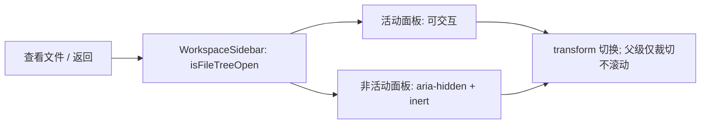

# 工作区侧栏布局与面板切换

## 规则与所有权

- `WorkspaceShellLayout` 继续拥有侧栏像素宽度、折叠状态和宽度持久化；默认/最小宽度保持 264px，不迁移设置。
- `WorkspaceSidebar` 独占列表与文件树的切换状态 `isFileTreeOpen`。两个面板保持挂载，通过现有 transform 动画切换。
- 动画视口仅负责裁切，不能成为滚动容器；浏览器焦点恢复、`scrollIntoView()` 和程序滚动不得平移整列导航、项目、任务或账号栏。
- 非活动面板同时 `aria-hidden` 和 `inert`，不得接受点击、Tab 导航或程序焦点。活动面板保持原有键盘交互。
- 项目/任务列表、文件树各自的纵向滚动仍由其内部视口负责；裁切父级不得禁止内部纵向滚动。
- Desktop 与普通 Web 复用同一组件；不改变服务、Host、会话、远程 identity、数据存储及账号协议。



## 缺陷依据

2026-10-11 真实桌面窗口中，侧栏宽度为 264px，但动画父级使用 `overflow-hidden`，右移隐藏面板使 `scrollWidth` 达到 528px；实际 `scrollLeft=54.5`，新建任务行 x=-46.5px，导航和账号一起被裁切。对隐藏面板调用 `scrollIntoView()` 可使整列移出窗口。`overflow-hidden` 不等于禁止滚动；不能用重置宽度、定时归零或额外状态掩盖该问题。

## 验收

1. 在真实桌面工作区对隐藏面板调用 `scrollIntoView()`，动画父级 `scrollLeft` 仍为 0，导航和账号行都在侧栏边界内。
2. 打开文件树时列表不能获得程序焦点；返回列表后文件树不能获得焦点。重复切换不出现横向偏移。
3. 列表和文件树内部仍可纵向滚动，账号菜单、项目入口与侧栏宽度键盘操作正常。
4. 在真实窗口检查浅色/深色、缩放与窄窗口布局；不改变原有宽度和折叠规则。

回归入口（已有桌面开发进程开启 CDP、侧栏展开且至少一个可查看文件的本地项目）：

```sh
node packages/desktop/test/workspaceSidebarLayout.cdp.mjs http://127.0.0.1:9229
```

该场景连接真实窗口，只切换面板与检查焦点/布局，不创建任务、修改文件或变更账号。

## 本次验收记录（2026-10-11）

- macOS 真实 XWork Dev 窗口：修复前回归断言得到 `scrollLeft=264`，导航和账号均越界；修复后通过两轮文件树往返、隐藏面板焦点与账号菜单检查。
- 原窗口 1512×884、原生放大一档（CSS 视口 1374×803）、原生窄窗口 900×640；浅色与深色截图均无侧栏左侧裁切。原生放大状态也执行并通过上述回归。
- 窄窗口中真实滚轮使任务列表滚动到 99px、XCode 文件树滚动到 300px；宽度键盘操作 264→280→264，折叠/展开后宽度 264px、横向偏移 0。
- 已恢复原浅色主题、实际大小和侧栏宽度设置；恢复窗口后的 CSS 视口实测为 1512×883（macOS 原生尺寸回写相差 1px）。
- `pnpm typecheck` 通过；`pnpm lint` 为 0 错误、71 条现有警告；`pnpm architecture:check --changed` 为 0 违规；本次三个文件格式检查通过。
- 未验 Windows/Linux 原生窗口或独立手机 Web；共享组件没有平台分支改动。
