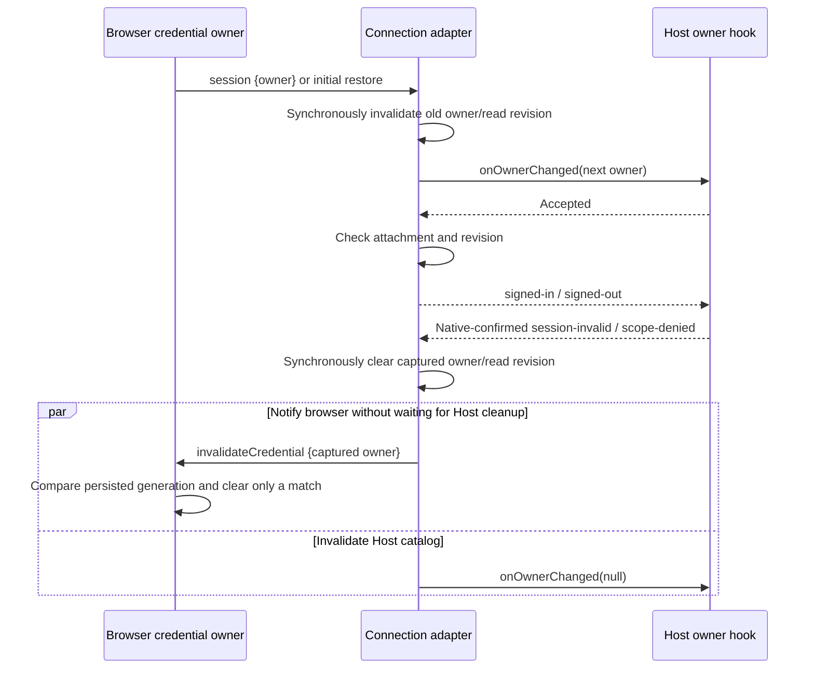

# Browser account reverse bridge

The enabled entry profile reads its backend origin only from `AISCOO_ADMIN_BASE_URL`. The retired backend variable is not an alias or fallback; origin validation and the existing loopback/Origin boundaries are unchanged.

The browser alone owns credentials, refresh rotation, and its user/SID/generation. This adapter retains one live attachment and a frozen, validated owner projection. It has no credential cache, persistence, network session, or model authorization policy. `origin` is normalized with the existing New API helper; wire owners must already use that exact canonical origin, a positive decimal user ID, a nonempty trimmed SID, and a positive safe integer generation. Additional owner fields are rejected.

The browser serves `aiscoo/browser-account` on the existing socket. `restore(undefined)` returns `{owner, session}`. `control({owner})` returns `{owner, accessToken}`. `relay({owner})` returns `{token, expiresAt}`. `oauth({method, args})` uses only the fixed `BROWSER_ACCOUNT_OAUTH_METHODS` list and positional IOAuthService arguments. `invalidateCredential({owner})` is a narrow reverse command with a void result: Native-confirmed `XCODE_SESSION_INVALID` / `XCODE_CREDENTIAL_SCOPE_DENIED` synchronously clear the captured Host owner/revision before the first await, then notify the browser to clear only that origin/user/SID/generation. Browser remains the only persistent credential owner; no refresh token crosses this command. Network failures do not invalidate. Late failures cannot clear a replacement owner or attachment. `session` emits `{owner}`. Public restore/profile/metadata/callback results are projected explicitly; void OAuth results are discarded. Refresh tokens and session bundles have no wire result or authority property.

Every read checks the captured attachment, owner, and local revision before and after asynchronous work. A control response additionally binds its returned owner. Detach clears current ownership synchronously before calling the Host hook; it does not dispose the shared socket. A second live attachment throws synchronously. Late restores, hooks, reads, and events cannot mutate a later attachment, even if its owner fields match. Duplicate session projections are idempotent. Failed validation or owner acceptance fails closed. Unrecognized remote errors become a fixed error code without remote messages, stacks, or secret-bearing data.

Only `authority.oauth`, the explicit IOAuthService projection, may be registered on the ordinary forward OAuth channel. The bridge, attachment, and credential authority must never be passed to reflective RPC registration. The parent owns loopback/Origin checks, service injection, and socket disposal. The channel is a live connection boundary, not an additional replay or task owner; Desktop continuous and mobile replayable transports retain their existing owners and delivery semantics.
