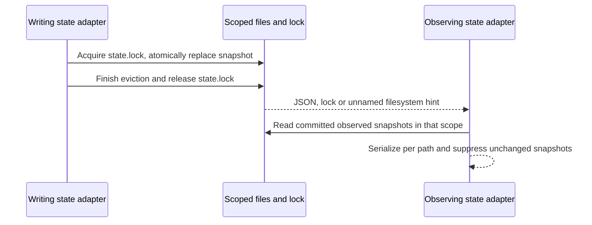

# gen-ui-service

Target Workspace Host owns bounded, nonsymlink fragment reads. Desktop Local Host owns persisted
widget state and issues sandbox registrations with explicit gen-ui provenance. Remote workspace
content uses the existing remote services route; desktop state uses base services. No new Agent,
MCP server, content publication journal or accepted command queue is introduced.

The execution Host owns an output root under its application data directory and passes that root
to the Agent at process startup. Host reads and Agent context use the same scope-to-directory
function, keyed by workspace identity (path fallback) and session ID. These subdirectories organize
generated files; reads may reference any file under the Host output root, including a parent
session's file retained by fork. Files outside the output root are rejected, with no legacy path fallback.
Creation failures surface before the runtime advertises a writable directory. HTML stays on the
execution machine; widget state stays on the desktop. The fixed application data root remains valid
when the workspace contains it, including when the user opens their home directory. Workspace
containment and the current session's output subdirectory are not read authorization boundaries.
Widget state remains scoped to the current workspace identity and session.

State storage is an injected adapter. Atomic file replacement and the existing cross-process file
lock serialize full snapshots; notifications project durable state. Only modelContent is exported
as untrusted next-turn context. Main owns native sandbox resources, not persisted state.

Filesystem notifications are hints, not an exact list of changed filenames. A missing filename or
`state.lock` hint must refresh already observed targets in that scope after the commit lock is gone.
Resolve these coarse hints only after observing that the lock is gone. Reuse per-path notification
serialization and snapshot deduplication; unrelated scopes must not be notified.

The native `fs.watch` transport remains best-effort: macOS can omit all hints for a committed write.
There is no polling fallback. Cross-instance notification delivery is therefore not guaranteed;
reloading reads the durable snapshot. This limitation is retained by explicit product decision.

Model state travels as bounded `genUiContext` input metadata, never appended to user text.
The CLI owns legacy-tail decoding and reminder projection; queued inputs retain the snapshot
captured at admission. Empty arrays identify new-format input. See `docs/specs/gen-ui-model-context.md`.
