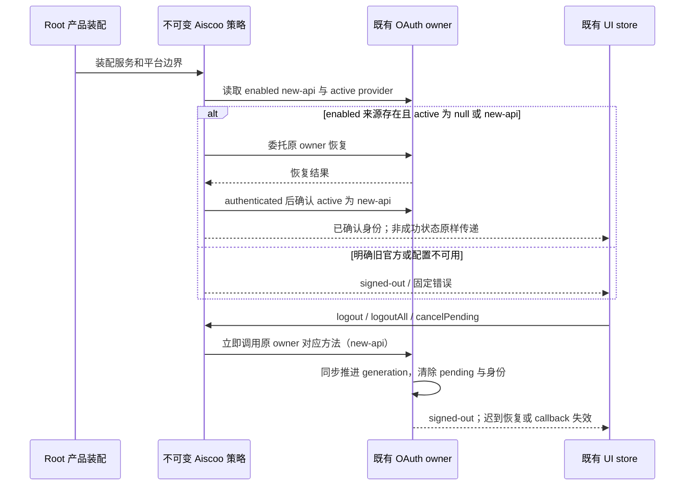

# Aiscoo 唯一账号 UI 装配

按 `docs/aiscoo/specs/aiscoo-only-login.md` 在共享 Root 必然装配。此模块是不可变产品限制；账号、凭据、pending state、generation 和事件仍由既有 OAuth owner 持有，不建立第二份状态。

`createAiscooAccountLoginServices` 仅暴露 enabled 的 new-api metadata。恢复前要求此合法来源存在并拒绝明确的官方 active provider；冷启动 active 为 null 时允许委托既有 owner 恢复，authenticated 结果必须后置确认 active 为 new-api。expired、unavailable 等非成功投影原样传递，不把临时不可用变成退出。拒绝官方 start、polling、refresh 与 callback；不读取旧官方用户缓存、不删除旧凭据。缺配置投影为空渠道，错误使用固定码，不携带 origin。第三方服务、模型自配与其他 MCP OAuth 保持原接口。

`logout` 与产品 `logoutAll` 均立即委托既有 owner 的 `logout(new-api)`，`cancelPending` 同样立即委托 `cancelPending(new-api)`，不先等待 providers 或 active 查询。原 owner 同步推进 generation、清除 pending 与身份后，再执行异步撤销；挂起恢复或迟到 callback 不能重新登录。只操作 Aiscoo 作用域，不调用通用 `logoutAll`，不清除历史官方凭据；不可用 owner 自身无状态退出或取消保持 no-op。

`createAiscooAccountLoginPlatform` 注入可选通用 `oauthAccountPolicy`，拒绝 official state 注册并过滤官方 callback。未注入的通用组件仍使用上游默认行为。登录面板按此策略过滤渠道与成功信号，不将旧 user 或官方成功序号认作 Aiscoo 登录。现有本机 Web 生命周期若已装配则继续保留。

