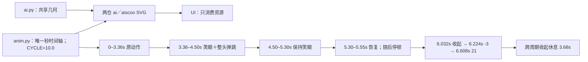
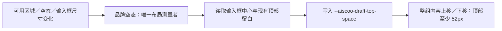

# aiscoo-brand-ui

Aiscoo 的只读界面品牌入口。品牌名称由 `@zcode/shared/aiscoo-brand` 提供，图形来自用户确认的设计源确定性生成的 `assets`。ai / aiscoo 共用中性胶囊眼（宽 7.4、高 17.2、中心距 18）、短眨眼、闭合填充厚圆拱笑眼与整头弹跳。笑眼宽约 13.4（中性眼宽的 1.81 倍），两端圆润、内侧凹；先缩短中性眼再切换，不交叉淡化重影。常态静态视觉保持不变；头部直径 61，弹跳静止后恢复圆形，其余字母、配色、比例及探出／收起轨迹保持原值，收起时刻整体后移 2 秒。运行时不访问 docs 或远程服务。

公开 `AiscooIntlProvider`、`AiscooMark`、`AiscooWordmark`、`AiscooAppLogo`、`AiscooStartupLogo`、`AiscooStartupLogoBadge`、`AiscooEmptyStateLogo`、主题静态资源 URL 和导出图片使用的自包含 mark SVG。`tone` 表示背景主题；默认随应用 dark / theme-zai-dark class 切换，品牌模块自己的主题样式明确控制图片互斥，避免将系统深色偏好误当应用当前主题。图形保持透明画布与比例，调用方提供可读的品牌文字，固定深色容器显式使用 dark。

启动动效使用用户原稿的 startup SVG；减少动态效果时只显示静态 mark。动效与静态图通过现有 motion-reduce 样式类切换，不向静默启动页面注入样式文本。初始对话空态使用完整 animated wordmark 的原稿字标几何和 10 秒自动循环。0–3.36 秒的探出、转眼／转头、眨眼与 i 圆点时刻保持不变，眼神先于轻微转头；3.36–4.50 秒切换笑眼，整头与眼睛一起蓄力纵向压缩 6%、上跳 8.2 头部单位（直径 61 的 13.4%）、落地压缩 5%、小回弹 2.1 头部单位，静止时恢复圆形。4.50–5.30 秒保持笑眼；5.30–5.55 秒恢复中性眼，随后停顿；6.032 秒开始收起，6.224 秒到预备位 x=-3，6.608 秒到收起位 x=21，沿用原轨迹和缓动，跨周期收起休息 3.68 秒。

`docs/brand/aiscoo/source/anim.py` 唯一以秒定义时间轴与 `CYCLE = 10.0`，`source/ai.py` 提供共享几何，正式与旧预览入口都复用同一时间轴，旧百分比缩放已移除。aiscoo 与 aiscoo-admin 两仓的 ai／aiscoo 浅深资源同源生成；SVG 承载动作，UI 只消费资源，不增加 React 状态、鼠标交互或业务事件，原静态／动态展示入口保持不变。`prefers-reduced-motion` 关闭全部动画（含 bounce），保持中性眼、圆形头部与收起姿态。

字标在问候语上方以不透明内容展示；减少动态效果时显示同主题完整静态 wordmark，不能回退单独 mark。静态字标画布为 581.15×200，动态原稿画布为 615.58×200，分别保留比例。旧 ZCode 组件名称与测试钩子只作为兼容入口，不作为产品展示名。

桌面草稿布局由本模块负责测量可用区域与输入 surface 的实际位置，用 ResizeObserver 观察可用高度、字标／问候语、错误横幅与输入框高度变化，统一写入一个只读布局投影 `--aiscoo-draft-top-space`。输入框中心位于会话可用区域中部，字标、问候语、输入框和推荐入口整体随窗口高度连续移动；顶部留白保留 52px 安全下限，空间不足时自然滚动。仅在既有顶部伪元素存在时启用，组件卸载时清理观察和布局值，不新增业务状态；紧凑远控、浮窗与已有消息会话不受影响。

`AiscooLoginHeader` 是登录头部的下游展示实现，包含完整动态字标和本地化说明，不渲染欢迎标题。Root 通过 `WelcomeScreen.header` 可选插槽装配；未传插槽时原登录页保留默认头部和完整 title／children 接口。品牌模块不引用或包装登录业务组件，不拥有 OAuth 状态。

Root 同时向 `WelcomeScreen` 传入可选 `hideApiKeyLogin`，隐藏“使用 API key”入口；未传时保留上游默认入口。主按钮文案由 `AiscooIntlProvider` 将 `login.oauth.button.native` 投影为“登录”（英文 “Sign in”），不改原词典。

Root 通过 `oauthWaitingDisplayNames` 装配本模块的等待提示展示名：桌面、本机 Web 及其他 Web 的 `new-api` 均显示共享品牌配置中的小写 `aiscoo`，中文为“等待 aiscoo 完成认证...”，英文为“Waiting for aiscoo authentication...”。取消和登录仍使用原 provider ID，其他 provider 保留原名称；未传映射的上游登录页保留原默认行为。

不新增状态、持久化或 IO。`AiscooIntlProvider` 通过原 Provider 可选 `catalogTransform` 在字典装配及插值前投影静态产品文案；原 Provider 默认词典不变；用户值、供应商名称、协议和路径不在此处重写。
