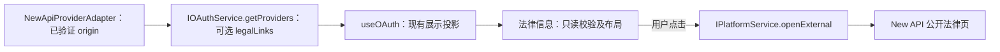

# aiscoo-legal-ui

桌面通用设置底部与登录按钮下的只读法律信息入口。链接的唯一 owner 是已配置 new-api adapter 的公开 metadata，正文由其后端 `/user-agreement`、`/privacy-policy` 维护；法定运营主体由 `@zcode/shared/aiscoo-brand` 配置提供。

`AiscooLegalLinks` 接受已有 `useOAuth` 的 providers 投影，校验启用的 new-api provider、完整同源公开路径、HTTP loopback / HTTPS origin，以及没有 query、fragment 或凭据。缺失或不合法时不渲染，无官方地址 fallback。`AiscooLegalSettings` 在已有服务 context 中复用 `useOAuth`；登录面板直接传已有 providers，不重复读取或维护身份状态。

共享 `SettingsGroupCard` / `SettingsRow` / `Button` 提供布局和操作；`usePlatform().openExternal` 是唯一副作用。中文和英文标签来自现有字典，法定中文公司名在两种语言均原样展示；不提供勾选、自动接受、启动弹窗、正文副本或凭据交接。不修改 OAuth、PKCE、会话与账务行为。

