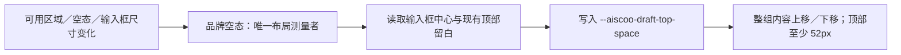

# xwork-brand-ui

Aiscoo 的只读界面品牌入口。品牌名称由 `@zcode/shared/xwork-brand` 提供，图形来自用户最终设计确定性生成的 `assets`，保留原始 ai / aiscoo 几何与眼睛，不访问 docs 或远程服务。

公开 `AiscooIntlProvider`、`AiscooMark`、`AiscooWordmark`、`AiscooAppLogo`、`AiscooStartupLogo`、`AiscooStartupLogoBadge`、`AiscooEmptyStateLogo`、主题静态资源 URL 和导出图片使用的自包含 mark SVG。`tone` 表示背景主题；默认随应用 dark / theme-zai-dark class 切换，品牌模块自己的主题样式明确控制图片互斥，避免将系统深色偏好误当应用当前主题。图形保持透明画布与比例，调用方提供可读的品牌文字，固定深色容器显式使用 dark。

启动动效使用用户原稿的 startup SVG；减少动态效果时只显示静态 mark。初始对话空态使用完整 animated wordmark 的原稿几何和 8 秒循环，字标在问候语上方以不透明内容展示；减少动态效果时显示同主题完整静态 wordmark，不能回退单独 mark。静态字标画布为 581.15×200，动态原稿画布为 615.58×200，分别保留比例。旧 ZCode 组件名称与测试钩子只作为兼容入口，不作为产品展示名。

桌面草稿布局由本模块负责测量可用区域与输入 surface 的实际位置，用 ResizeObserver 观察可用高度、字标／问候语、错误横幅与输入框高度变化，统一写入一个只读布局投影 `--aiscoo-draft-top-space`。输入框中心位于会话可用区域中部，字标、问候语、输入框和推荐入口整体随窗口高度连续移动；顶部留白保留 52px 安全下限，空间不足时自然滚动。仅在既有顶部伪元素存在时启用，组件卸载时清理观察和布局值，不新增业务状态；紧凑远控、浮窗与已有消息会话不受影响。

不新增状态、持久化或 IO。`AiscooIntlProvider` 通过原 Provider 可选 `catalogTransform` 在字典装配及插值前投影静态产品文案；原 Provider 默认词典不变；用户值、供应商名称、协议和路径不在此处重写。
