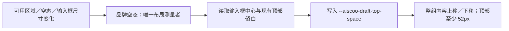

# xwork-brand-ui

Aiscoo 的只读界面品牌入口。品牌名称由 `@zcode/shared/xwork-brand` 提供，图形来自用户最终设计确定性生成的 `assets`，保留原始 ai / aiscoo 几何与眼睛，不访问 docs 或远程服务。

公开 `AiscooIntlProvider`、`AiscooMark`、`AiscooWordmark`、`AiscooAppLogo`、`AiscooStartupLogo`、`AiscooStartupLogoBadge`、`AiscooEmptyStateLogo`、主题静态资源 URL 和导出图片使用的自包含 mark SVG。`tone` 表示背景主题；默认随应用 dark / theme-zai-dark class 切换，品牌模块自己的主题样式明确控制图片互斥，避免将系统深色偏好误当应用当前主题。图形保持透明画布与比例，调用方提供可读的品牌文字，固定深色容器显式使用 dark。

启动动效使用同源 startup SVG；减少动态效果时只显示静态 mark。动效与静态图通过现有 motion-reduce 样式类切换，不向静默启动页面注入样式文本。初始对话空态使用完整 animated wordmark 的原稿几何和 10 秒自动循环，字标在问候语上方以不透明内容展示；减少动态效果时显示同主题完整静态 wordmark，不能回退单独 mark。共享几何由 `docs/brand/aiscoo/source/ai.py` 维护，中性眼为宽 7.4、高 17.2、中心距 18 的竖胶囊；`source/anim.py` 唯一维护秒时间轴。0–3.36 秒保留探出、转眼、眨眼与圆点跳动，随后切换闭合填充的厚圆拱笑眼并整头弹跳，5.55 秒恢复中性眼，6.032 秒开始收起，6.608 秒回到 x=21，跨周期休息 3.68 秒。两套眼睛以互补离散可见性切换；减少动态效果时关闭全部动画，保持中性眼、圆形头部与收起姿态。UI 只消费生成资源，不增加动画状态、计时器或鼠标响应。静态字标画布为 581.15×200，动态原稿画布为 615.58×200，分别保留比例。旧 ZCode 组件名称与测试钩子只作为兼容入口，不作为产品展示名。

桌面草稿布局由本模块负责测量可用区域与输入 surface 的实际位置，用 ResizeObserver 观察可用高度、字标／问候语、错误横幅与输入框高度变化，统一写入一个只读布局投影 `--aiscoo-draft-top-space`。输入框中心位于会话可用区域中部，字标、问候语、输入框和推荐入口整体随窗口高度连续移动；顶部留白保留 52px 安全下限，空间不足时自然滚动。仅在既有顶部伪元素存在时启用，组件卸载时清理观察和布局值，不新增业务状态；紧凑远控、浮窗与已有消息会话不受影响。

`AiscooLoginHeader` 是登录头部的下游展示实现，包含完整动态字标和本地化说明，不渲染欢迎标题。Root 通过 `WelcomeScreen.header` 可选插槽装配；未传插槽时原登录页保留默认头部和完整 title／children 接口。品牌模块不引用或包装登录业务组件，不拥有 OAuth 状态。

共享 Root 的 Aiscoo 登录页通过可选 `hideApiKeyLogin` 隐藏 API key 入口；未提供时保留上游完整入口与表单。品牌词典仅将 New API 按钮模板投影为中文“登录”或英文“Sign in”，其他 provider 名称与认证状态不变。桌面、普通 Web 和已连接远控的共享 Root 遵循此规则；远控连接前的独立 Web 登录页仍提供 Z.ai 和 BigModel 两个账号入口。

Root 通过 `oauthWaitingDisplayNames` 装配本模块的等待提示展示名：`new-api` 显示共享品牌配置中的小写 `aiscoo`，中文为“等待 aiscoo 完成认证...”，英文为“Waiting for aiscoo authentication...”。取消和登录仍使用原 provider ID，其他 provider 保留原名称；未传映射的上游登录页保留原默认行为。现有授权链接复制和桌面法律 footer 继续保留，不新增授权窗口、生命周期 hook 或账号状态。

不新增状态、持久化或 IO。`AiscooIntlProvider` 通过原 Provider 可选 `catalogTransform` 在字典装配及插值前投影静态产品文案；原 Provider 默认词典不变；用户值、供应商名称、协议和路径不在此处重写。
